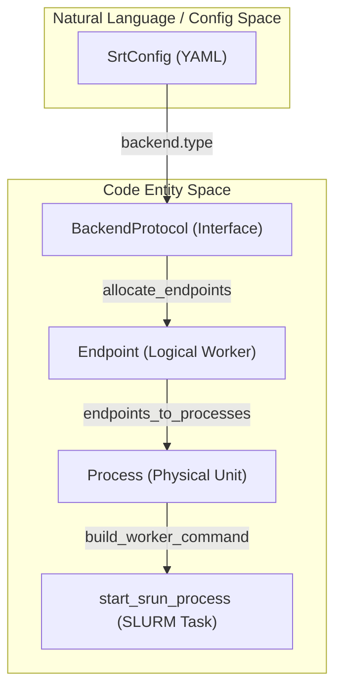
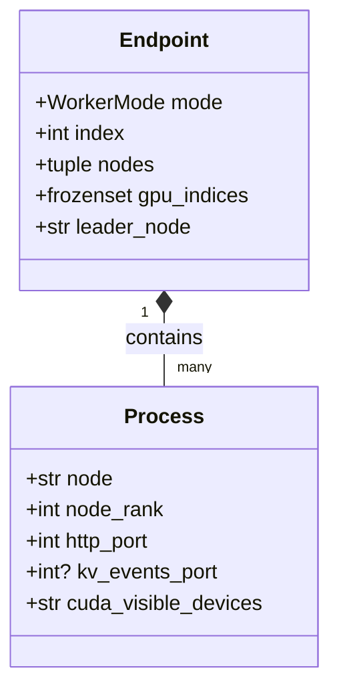

<!-- source: DeepWiki mcp.deepwiki.com · repo NVIDIA/srt-slurm · page 5 Backends · fetched 2026-10-26 -->

# Backends

Relevant source files

The following files were used as context for generating this wiki page:

- [src/srtctl/README.md](src/srtctl/README.md)
- [src/srtctl/backends/base.py](src/srtctl/backends/base.py)
- [src/srtctl/backends/sglang.py](src/srtctl/backends/sglang.py)
- [src/srtctl/backends/trtllm.py](src/srtctl/backends/trtllm.py)
- [src/srtctl/backends/vllm.py](src/srtctl/backends/vllm.py)
- [src/srtctl/benchmarks/mooncake_router.py](src/srtctl/benchmarks/mooncake_router.py)
- [src/srtctl/benchmarks/scripts/mooncake-router/bench.sh](src/srtctl/benchmarks/scripts/mooncake-router/bench.sh)
- [src/srtctl/cli/do_sweep.py](src/srtctl/cli/do_sweep.py)
- [src/srtctl/core/topology.py](src/srtctl/core/topology.py)
- [tests/fixtures/trace_replay_sample.jsonl](tests/fixtures/trace_replay_sample.jsonl)
- [tests/test_endpoint_allocation.py](tests/test_endpoint_allocation.py)
- [tests/test_frontends.py](tests/test_frontends.py)

The `srtctl` system uses a provider-based architecture to support multiple inference engines. Each backend implementation is responsible for translating high-level resource requirements into physical SLURM processes, generating engine-specific CLI commands, and managing distributed coordination (e.g., Tensor Parallelism across nodes).

## BackendProtocol Interface

All backends must implement the `BackendProtocol` defined in [src/srtctl/backends/base.py:47-112](). This protocol ensures that the `SweepOrchestrator` [src/srtctl/cli/do_sweep.py:54-60]() can interact with any inference engine (SGLang, vLLM, or TRT-LLM) using a unified set of methods.

### Key Responsibilities

| Method | Role |
| :--- | :--- |
| `allocate_endpoints` | Maps logical workers (Prefill/Decode/Aggregated) to physical GPU indices and nodes [src/srtctl/backends/base.py:77-89](). |
| `endpoints_to_processes` | Converts logical units into individual process definitions with unique system ports [src/srtctl/backends/base.py:91-97](). |
| `build_worker_command` | Generates the specific shell command (e.g., `python -m sglang.launch_server`) to start the engine [src/srtctl/backends/base.py:99-109](). |
| `get_srun_config` | Defines SLURM launch parameters, such as whether to use MPI (`pmix`) or launch per-process [src/srtctl/backends/base.py:62-67](). |

### Logical to Physical Mapping

The transition from a user's `SrtConfig` to running SLURM tasks follows a structured pipeline:

Sources: [src/srtctl/backends/base.py:47-112](), [src/srtctl/core/topology.py:98-170](), [src/srtctl/cli/do_sweep.py:73-99]()

---

## Supported Backends

### SGLang Backend
The SGLang backend implements the `SGLangProtocol` [src/srtctl/backends/sglang.py:76-80](). It specializes in Prefill/Decode disaggregation and supports advanced features like Mooncake RDMA KV-cache transfers and Multi-Token Prediction (MTP).

*   **Launching:** Uses per-process `srun` launching [src/srtctl/backends/sglang.py:121-125]().
*   **Coordination:** Handles multi-node Tensor Parallelism (TP) via `--dist-init-addr` and `--node-rank` [src/srtctl/backends/sglang.py:246-251]().
*   **KV-Events:** Configures ZMQ-based event publishing for disaggregated coordination [src/srtctl/backends/sglang.py:106-109]().

For details, see [SGLang Backend](#5.1).

### vLLM Backend
The vLLM backend implements the `VLLMProtocol` [src/srtctl/backends/vllm.py:53-57](). It is designed for high-throughput serving and integrates with `dynamo` for disaggregated KV transfers.

*   **Mode:** Supports Data Parallel + Expert Parallel (DP+EP) patterns where each GPU runs its own process [src/srtctl/backends/vllm.py:178-185]().
*   **KV-Transfer:** Translates connector settings into complex `--kv-transfer-config` JSON payloads [src/srtctl/backends/vllm.py:59-60]().
*   **Ports:** Manages unique `DYN_VLLM_KV_EVENT_PORT` and `VLLM_NIXL_SIDE_CHANNEL_PORT` per worker [src/srtctl/backends/vllm.py:132-141]().

For details, see [vLLM Backend](#5.2).

### TensorRT-LLM Backend
The TRT-LLM backend implements the `TRTLLMProtocol` [src/srtctl/backends/trtllm.py:39-43](). It focuses on maximum performance via specialized engine builds and MPI-based orchestration.

*   **Launching:** Uses MPI-style launching with `srun --mpi=pmix` and `oversubscribe=True` [src/srtctl/backends/trtllm.py:73-81]().
*   **Config:** Generates YAML configuration files on-the-fly to pass via `--extra-engine-args` [src/srtctl/backends/trtllm.py:170-175]().
*   **Load Balancing:** Injects `TRTLLM_EPLB_SHM_NAME` UUIDs to coordinate Expert Parallel Load Balancing [src/srtctl/backends/trtllm.py:96-106]().

For details, see [TensorRT-LLM Backend](#5.3).

---

## Process Topology & Port Allocation

To avoid conflicts when multiple workers share a single SLURM node, `srtctl` uses a `NodePortAllocator` [src/srtctl/core/topology.py:30-52]().

### Port Ranges
| Service | Range | Scope |
| :--- | :--- | :--- |
| **HTTP Port** | 30000+ | Per-node [src/srtctl/core/topology.py:54]() |
| **Bootstrap Port** | 31000+ | Per-node [src/srtctl/core/topology.py:55]() |
| **KV Events (ZMQ)** | 5550+ | Globally Unique [src/srtctl/core/topology.py:56]() |
| **NIXL Side Channel** | 6550+ | Globally Unique [src/srtctl/core/topology.py:57]() |

### Topology Entity Diagram

Sources: [src/srtctl/core/topology.py:98-170]()

---

