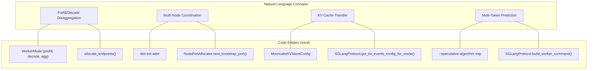
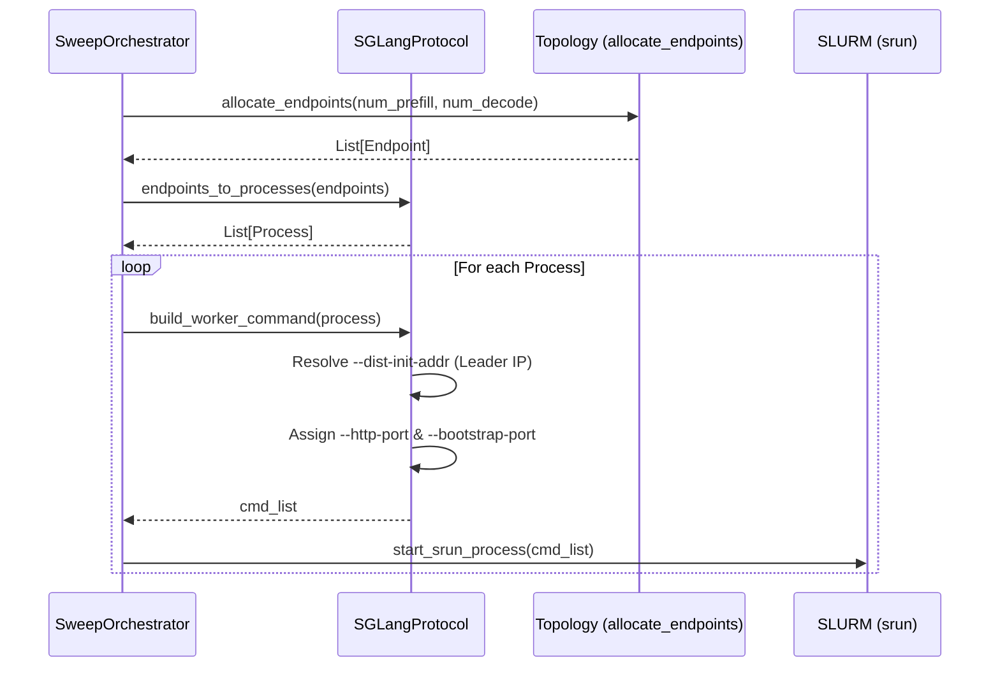

<!-- source: DeepWiki mcp.deepwiki.com · repo NVIDIA/srt-slurm · page 5.1 SGLang Backend · fetched 2026-10-26 -->

# SGLang Backend

Relevant source files

The following files were used as context for generating this wiki page:

- [src/srtctl/README.md](src/srtctl/README.md)
- [src/srtctl/backends/base.py](src/srtctl/backends/base.py)
- [src/srtctl/backends/sglang.py](src/srtctl/backends/sglang.py)
- [src/srtctl/cli/do_sweep.py](src/srtctl/cli/do_sweep.py)
- [src/srtctl/cli/mixins/benchmark_stage.py](src/srtctl/cli/mixins/benchmark_stage.py)
- [src/srtctl/cli/mixins/worker_stage.py](src/srtctl/cli/mixins/worker_stage.py)
- [src/srtctl/core/topology.py](src/srtctl/core/topology.py)
- [tests/test_endpoint_allocation.py](tests/test_endpoint_allocation.py)

The SGLang backend implementation in `srtctl` provides a robust orchestration layer for the [SGLang](https://github.com/sgl-project/sglang) inference engine. It supports both aggregated and disaggregated (Prefill/Decode) execution modes, multi-node Tensor Parallelism (TP), and advanced features like Multi-Token Prediction (MTP) and Mooncake-based disaggregated KV cache transfers.

The implementation is centered around the `SGLangProtocol` class [src/srtctl/backends/sglang.py:76-115](), which implements the `BackendProtocol` [src/srtctl/backends/base.py:47-111]() to define how SGLang processes are allocated, configured, and launched across a SLURM cluster.

## Implementation Overview

SGLang integration follows a per-process `srun` launching strategy [src/srtctl/backends/sglang.py:121-125](). Unlike MPI-based backends, each node in a multi-node SGLang endpoint is launched as an individual `srun` command by the `SweepOrchestrator` [src/srtctl/cli/mixins/worker_stage.py:123-153]().

### Data Flow and Coordination
The backend manages coordination between nodes using several key mechanisms:
1.  **Distributed Init**: Multi-node TP groups coordinate via `--dist-init-addr`, which points to the IP of the leader node (rank 0) within the endpoint [src/srtctl/backends/sglang.py:284-288]().
2.  **Bootstrap Ports**: For disaggregated prefill workers, a unique bootstrap port is allocated per process to facilitate the handshake between prefill and decode instances [src/srtctl/backends/sglang.py:290-293]().
3.  **KV Events**: SGLang can publish KV cache events via ZMQ. `srtctl` automatically allocates unique ZMQ ports and generates the `--kv-events-config` JSON payload [src/srtctl/backends/sglang.py:202-243]().

### Natural Language to Code Entity Mapping

The following diagram maps high-level SGLang concepts to their specific implementations within the `srtctl` codebase.

**Concept to Code Entity Map**

Sources: [src/srtctl/backends/sglang.py:31-31](), [src/srtctl/backends/sglang.py:37-52](), [src/srtctl/backends/sglang.py:196-199](), [src/srtctl/core/topology.py:72-78](), [src/srtctl/core/topology.py:182-195]()

## Topology and Port Allocation

The `NodePortAllocator` [src/srtctl/core/topology.py:30-52]() ensures that multiple SGLang workers co-located on the same physical node do not have port collisions.

| Port Type | Base Port | Scope | Purpose |
| :--- | :--- | :--- | :--- |
| `http_port` | 30000 | Per Node | SGLang HTTP server port [src/srtctl/core/topology.py:64-70]() |
| `bootstrap_port` | 31000 | Per Node | Disaggregated P/D handshake [src/srtctl/core/topology.py:72-78]() |
| `kv_events_port` | 5550 | Global | ZMQ publisher for KV events [src/srtctl/core/topology.py:80-86]() |

### Multi-Node Process Topology
When an endpoint spans multiple nodes (e.g., TP=16 on 8-GPU nodes), `srtctl` calculates the `node_rank` and sets the appropriate `--nnodes` and `--node-rank` flags [src/srtctl/backends/sglang.py:279-283]().

**Process Allocation Flow**

Sources: [src/srtctl/cli/do_sweep.py:79-99](), [src/srtctl/backends/sglang.py:245-305](), [src/srtctl/core/topology.py:182-195]()

## Module Selection: Dynamo vs. SGLang Native

The backend dynamically selects the entry point based on the `frontend` configuration in the `SrtConfig`.

1.  **dynamo.sglang**: Used when `config.frontend.type == "dynamo"`. This launches SGLang within the Dynamo orchestration framework [src/srtctl/backends/sglang.py:255-257]().
2.  **sglang.launch_server**: Used for native SGLang frontends or standalone benchmarking [src/srtctl/backends/sglang.py:259-260]().

The backend also handles the installation of Dynamo dependencies if `config.dynamo.install` is enabled, injecting the necessary commands into the worker preamble [src/srtctl/cli/mixins/worker_stage.py:84-87]().

## Disaggregated KV Cache Support

### Mooncake Integration
For disaggregated deployments using RDMA-based KV cache transfers, `srtctl` manages the `mooncake_master` service:
*   **Master Launch**: The orchestrator starts `mooncake_master` on the infrastructure node (port 50051) [src/srtctl/cli/do_sweep.py:164-203]().
*   **Environment Injection**: The backend injects `MOONCAKE_MASTER` (pointing to the infra node) and `MOONCAKE_LOCAL_HOSTNAME` (worker IP) into all worker processes [src/srtctl/backends/sglang.py:158-180]().

### KV Events (ZMQ)
If `kv_events_config` is enabled in the YAML, `srtctl` generates a JSON configuration for SGLang's `--kv-events-config` flag.
*   **Prefill**: Configured as a ZMQ `publisher` [src/srtctl/backends/sglang.py:218-223]().
*   **Decode**: Configured as a ZMQ `subscriber` [src/srtctl/backends/sglang.py:225-230]().
*   The system automatically bridges these using the leader node's IP and the allocated `kv_events_port`.

## Multi-Token Prediction (MTP)
SGLang MTP support is handled by detecting the `speculative-algorithm: mtp` flag within the `sglang_config` [src/srtctl/backends/sglang.py:61-73](). When MTP is active, the backend ensures that the model configuration is correctly passed to the server CLI, often involving specific `--speculative-model` and `--speculative-num-candidates` arguments defined in the recipe YAML [src/srtctl/backends/sglang.py:87-93]().

Sources:
- [src/srtctl/backends/sglang.py:1-305]()
- [src/srtctl/core/topology.py:26-195]()
- [src/srtctl/cli/do_sweep.py:73-203]()
- [src/srtctl/cli/mixins/worker_stage.py:32-153]()
- [src/srtctl/backends/base.py:47-111]()

---

