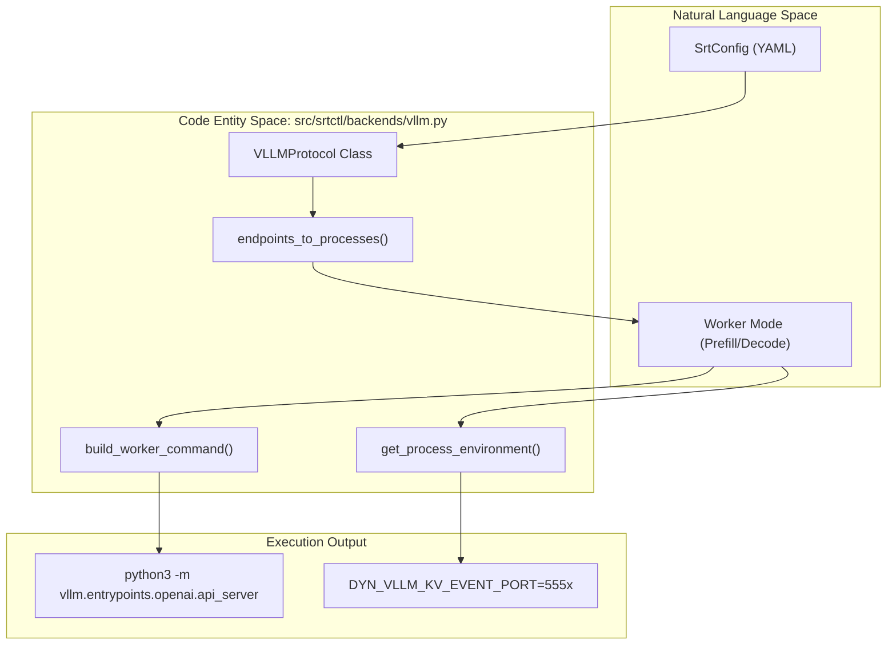
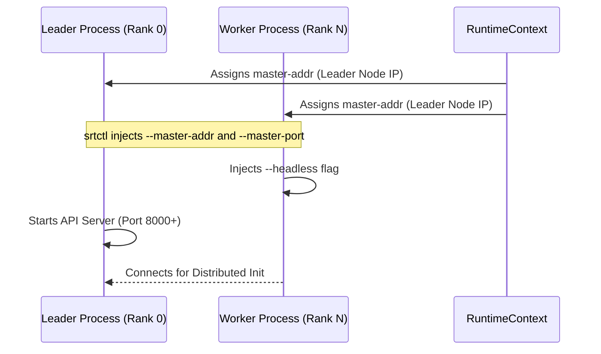

<!-- source: DeepWiki mcp.deepwiki.com · repo NVIDIA/srt-slurm · page 5.2 vLLM Backend · fetched 2026-10-26 -->

# vLLM Backend

Relevant source files

The following files were used as context for generating this wiki page:

- [configs/patches/vllm-container-deps.sh](configs/patches/vllm-container-deps.sh)
- [configs/patches/vllm_numa_bind_hash_fix.py](configs/patches/vllm_numa_bind_hash_fix.py)
- [recipes/vllm/deepseek-v4-pro/GB200/8k1k/disagg-gb200-1p1d-dep8-dep8-16-c256-c512-c1024-offload.yaml](recipes/vllm/deepseek-v4-pro/GB200/8k1k/disagg-gb200-1p1d-dep8-dep8-16-c256-c512-c1024-offload.yaml)
- [recipes/vllm/deepseek-v4-pro/GB200/8k1k/disagg-gb200-1p4d-dep8-tp8-c256-c512-offload.yaml](recipes/vllm/deepseek-v4-pro/GB200/8k1k/disagg-gb200-1p4d-dep8-tp8-c256-c512-offload.yaml)
- [recipes/vllm/deepseek-v4-pro/GB200/8k1k/disagg-gb200-1p8d-dep8-tp8-c8-c16-c32-c64-c128-c256-offload.yaml](recipes/vllm/deepseek-v4-pro/GB200/8k1k/disagg-gb200-1p8d-dep8-tp8-c8-c16-c32-c64-c128-c256-offload.yaml)
- [recipes/vllm/deepseek-v4-pro/GB200/8k1k/disagg-gb200-2p1d-dep8-dep8-c4096-offload.yaml](recipes/vllm/deepseek-v4-pro/GB200/8k1k/disagg-gb200-2p1d-dep8-dep8-c4096-offload.yaml)
- [recipes/vllm/deepseek-v4-pro/GB200/8k1k/disagg-gb200-3p1d-dep8-dep16-c4096-offload.yaml](recipes/vllm/deepseek-v4-pro/GB200/8k1k/disagg-gb200-3p1d-dep8-dep16-c4096-offload.yaml)
- [recipes/vllm/deepseek-v4-pro/GB200/8k1k/disagg-gb200-3p1d-dep8-dep8-c4096-offload.yaml](recipes/vllm/deepseek-v4-pro/GB200/8k1k/disagg-gb200-3p1d-dep8-dep8-c4096-offload.yaml)
- [src/srtctl/backends/trtllm.py](src/srtctl/backends/trtllm.py)
- [src/srtctl/backends/vllm.py](src/srtctl/backends/vllm.py)
- [src/srtctl/benchmarks/mooncake_router.py](src/srtctl/benchmarks/mooncake_router.py)
- [src/srtctl/benchmarks/scripts/mooncake-router/bench.sh](src/srtctl/benchmarks/scripts/mooncake-router/bench.sh)
- [tests/fixtures/trace_replay_sample.jsonl](tests/fixtures/trace_replay_sample.jsonl)
- [tests/test_frontends.py](tests/test_frontends.py)

The vLLM backend implements the `BackendProtocol` to support high-performance inference serving using the vLLM engine. It specifically targets advanced deployment patterns such as **Data Parallel + Expert Parallel (DP+EP)** offloading and **Prefill/Decode Disaggregation** using various KV transfer connectors (NIXL, LMCache).

## Overview

The `VLLMProtocol` class manages the lifecycle, configuration, and command-line generation for vLLM workers. It supports three primary operational modes: `prefill`, `decode`, and `aggregated` (combined prefill and decode) [src/srtctl/backends/vllm.py:33-34]().

Key features include:
*   **DP+EP Mode**: Support for running one process per GPU when `data-parallel-size` is specified, facilitating Expert Parallelism [src/srtctl/backends/vllm.py:178-185]().
*   **Disaggregated KV Transfer**: Automated generation of `--kv-transfer-config` JSON payloads for connectors like NIXL and LMCache [src/srtctl/backends/vllm.py:89-92]().
*   **Multi-node Coordination**: Orchestration of `VLLM_HOST_IP` and `master-addr` for distributed initialization across Slurm nodes [src/srtctl/backends/vllm.py:284-300]().
*   **Headless Operation**: Automatic injection of the `--headless` flag for non-leader ranks in multi-node configurations [src/srtctl/backends/vllm.py:326-328]().

**Sources:** [src/srtctl/backends/vllm.py:1-92](), [src/srtctl/backends/vllm.py:178-185]()

---

## Configuration Schema

The backend configuration is structured to allow global settings with per-mode overrides.

### VLLMProtocol Fields
| Field | Type | Description |
| :--- | :--- | :--- |
| `type` | `Literal["vllm"]` | Discriminator for the backend factory. |
| `vllm_config` | `VLLMServerConfig` | Dictionary of CLI flags for `prefill`, `decode`, and `aggregated` modes. |
| `connector` | `str` | Default KV connector (e.g., `"nixl"`, `"lmcache"`). |
| `prefill_environment` | `dict[str, str]` | Environment variables applied only to prefill workers. |
| `decode_environment` | `dict[str, str]` | Environment variables applied only to decode workers. |

### KV Transfer Configuration
For disaggregated deployments, the `connector` field is translated into a complex JSON payload passed via `--kv-transfer-config`. If the `connector` is set to `"nixl"`, the backend automatically configures:
*   `kv_connector`: `NixlConnector`
*   `kv_role`: Based on worker mode (`kv_producer` for prefill, `kv_consumer` for decode)
*   `kv_rank` and `kv_parallel_size`

**Sources:** [src/srtctl/backends/vllm.py:52-94](), [src/srtctl/backends/vllm.py:237-270]()

---

## Data Flow & Implementation

The following diagram illustrates how the `VLLMProtocol` transforms a high-level `SrtConfig` into specific Slurm execution commands and environment variables.

### Logic Flow: Config to Execution

**Sources:** [src/srtctl/backends/vllm.py:53-57](), [src/srtctl/backends/vllm.py:192-210](), [src/srtctl/backends/vllm.py:212-235]()

---

## Data Parallel + Expert Parallel (DP+EP) Mode

vLLM deployments on hardware like GB200 often utilize a DP+EP pattern where each GPU runs a separate process rather than using Tensor Parallelism (TP) across the node. 

The `VLLMProtocol` detects this mode by checking for `data-parallel-size` in the `vllm_config` [src/srtctl/backends/vllm.py:178-185](). When active:
1.  **Process per GPU**: `endpoints_to_processes` creates a unique `Process` for every allocated GPU [src/srtctl/backends/vllm.py:204-207]().
2.  **Unique Ports**: Each process is assigned unique ports (HTTP, KV events, NIXL side-channel) [src/srtctl/backends/vllm.py:129-141]().
3.  **NUMA Binding**: Recipes typically include `numa-bind: true` to ensure memory locality for these per-GPU processes [recipes/vllm/deepseek-v4-pro/GB200/8k1k/disagg-gb200-1p1d-dep8-dep8-16-c256-c512-c1024-offload.yaml:83]().

### DP Consistency Hotfix
Because vLLM ranks on different NUMA nodes might auto-detect different configurations, a patch script `vllm_numa_bind_hash_fix.py` is provided to exclude NUMA-specific fields from the DP consistency hash, preventing `RuntimeError: Configuration mismatch` during startup [configs/patches/vllm_numa_bind_hash_fix.py:8-18]().

**Sources:** [src/srtctl/backends/vllm.py:178-185](), [recipes/vllm/deepseek-v4-pro/GB200/8k1k/disagg-gb200-1p1d-dep8-dep8-16-c256-c512-c1024-offload.yaml:61-83](), [configs/patches/vllm_numa_bind_hash_fix.py:1-22]()

---

## Multi-Node Coordination

For large models requiring multi-node TP or DP, `srtctl` coordinates the bootstrap process:

The backend handles the following distributed environment variables:
*   `VLLM_HOST_IP`: Set to the local node IP for communication [src/srtctl/backends/vllm.py:284-286]().
*   `master-addr`: Points to the leader node of the specific endpoint group [src/srtctl/backends/vllm.py:293-300]().

**Sources:** [src/srtctl/backends/vllm.py:284-300](), [src/srtctl/backends/vllm.py:326-328]()

---

## Key Functions

### `build_worker_command`
Constructs the `python3 -m vllm.entrypoints.openai.api_server` command. It handles:
*   **Model Pathing**: Resolves local mounts (`/model`) vs. HuggingFace IDs [src/srtctl/backends/vllm.py:226-231]().
*   **KV Transfer**: Generates the `--kv-transfer-config` JSON [src/srtctl/backends/vllm.py:237-270]().
*   **Port Mapping**: Maps logical ports to physical host ports [src/srtctl/backends/vllm.py:302-306]().

### `get_process_environment`
Provides the critical environment variables for vLLM/Dynamo integration:
*   `DYN_VLLM_KV_EVENT_PORT`: ZMQ port for KV events [src/srtctl/backends/vllm.py:137-138]().
*   `VLLM_NIXL_SIDE_CHANNEL_PORT`: Port for NIXL transfers [src/srtctl/backends/vllm.py:139-140]().

**Sources:** [src/srtctl/backends/vllm.py:129-141](), [src/srtctl/backends/vllm.py:212-330]()

---

