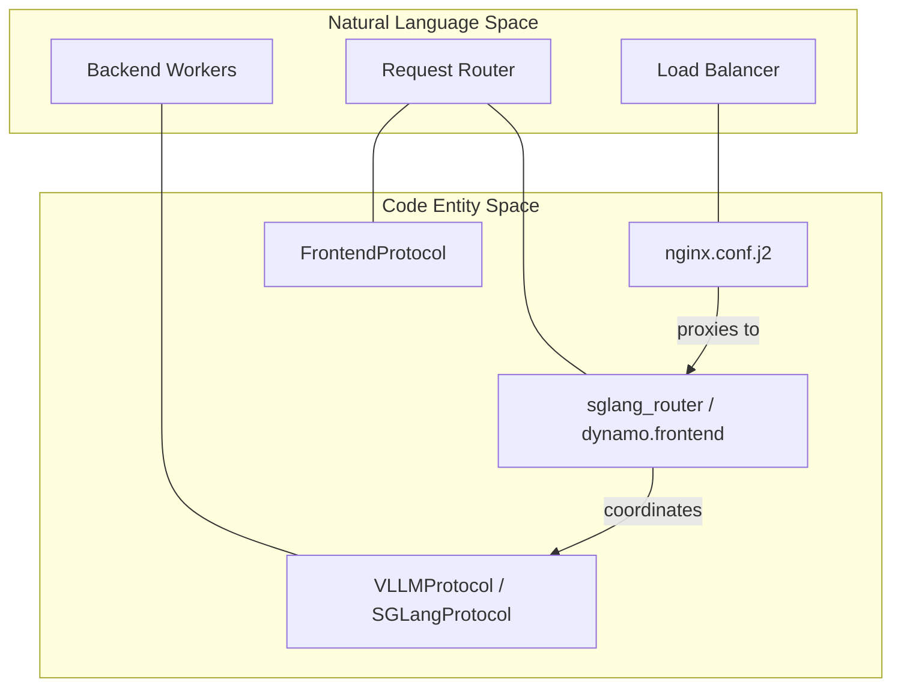
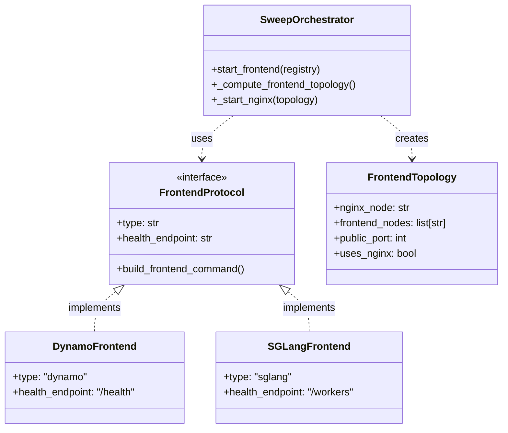

<!-- source: DeepWiki mcp.deepwiki.com · repo NVIDIA/srt-slurm · page 6 Frontends · fetched 2026-10-26 -->

# Frontends

Relevant source files

The following files were used as context for generating this wiki page:

- [docs/architecture.md](docs/architecture.md)
- [docs/sglang-router.md](docs/sglang-router.md)
- [recipes/dsv4-pro/sglang/gb300-fp4/1k1k/disagg/stp/max-tpt.yaml](recipes/dsv4-pro/sglang/gb300-fp4/1k1k/disagg/stp/max-tpt.yaml)
- [src/srtctl/backends/trtllm.py](src/srtctl/backends/trtllm.py)
- [src/srtctl/backends/vllm.py](src/srtctl/backends/vllm.py)
- [src/srtctl/benchmarks/mooncake_router.py](src/srtctl/benchmarks/mooncake_router.py)
- [src/srtctl/benchmarks/scripts/mooncake-router/bench.sh](src/srtctl/benchmarks/scripts/mooncake-router/bench.sh)
- [src/srtctl/cli/mixins/frontend_stage.py](src/srtctl/cli/mixins/frontend_stage.py)
- [src/srtctl/templates/nginx.conf.j2](src/srtctl/templates/nginx.conf.j2)
- [tests/fixtures/trace_replay_sample.jsonl](tests/fixtures/trace_replay_sample.jsonl)
- [tests/test_frontend_topology.py](tests/test_frontend_topology.py)
- [tests/test_frontends.py](tests/test_frontends.py)

The Frontend layer in `srtctl` acts as the request coordinator and load balancer for distributed inference. It implements the `FrontendProtocol` to manage how requests are routed to backend workers, particularly in disaggregated prefill/decode (PD) setups.

## FrontendProtocol Interface

All frontend implementations must adhere to the `FrontendProtocol` (conceptually defined and implemented in `src/srtctl/frontends/`). This interface ensures that the orchestration layer can launch, monitor, and configure different routing solutions interchangeably.

### Key Responsibilities
*   **Command Construction**: Generating the `srun` command to launch the router process [src/srtctl/frontends/sglang.py:118-125]().
*   **Argument Parsing**: Converting YAML configuration dictionaries into CLI flags [tests/test_frontends.py:76-84]().
*   **Health Monitoring**: Defining specific health check endpoints (e.g., `/health` for Dynamo or `/workers` for SGLang) [tests/test_frontends.py:60-69]().

### Frontend Type Mapping
| Type | Class | Primary Use Case |
| :--- | :--- | :--- |
| `dynamo` | `DynamoFrontend` | Default for NATS/etcd-based coordination and KV-aware routing. |
| `sglang` | `SGLangFrontend` | Native `sglang_router` for SGLang-specific PD disaggregation. |

Sources: [src/srtctl/frontends/sglang.py:11-30](), [tests/test_frontends.py:11-40]()

## Request Routing & Topology

Request routing is managed by the `FrontendStageMixin` within the `SweepOrchestrator`. It determines the physical placement of frontend processes and optional Nginx load balancers based on the cluster size and configuration.

### Topology Selection Logic
The system automatically selects a topology based on the number of nodes and the `enable_multiple_frontends` flag:

1.  **Single Node / Single Frontend**: The frontend runs on the head node at port `8000`. No Nginx is used [src/srtctl/cli/mixins/frontend_stage.py:86-93]().
2.  **Multi-Node / Distributed Frontends**: Nginx runs on the head node (port `8000`) and load balances across multiple router instances running on other worker nodes (port `8180`) [src/srtctl/cli/mixins/frontend_stage.py:95-118]().

### Natural Language to Code Entity Mapping: Routing

Sources: [src/srtctl/cli/mixins/frontend_stage.py:29-47](), [src/srtctl/templates/nginx.conf.j2:1-20]()

## Nginx Load Balancing

When `enable_multiple_frontends` is true, `srtctl` deploys an Nginx container to provide a single entry point for benchmarks.

*   **Configuration**: Nginx is configured via a Jinja2 template (`nginx.conf.j2`) which populates an `upstream` block with the IP addresses of all launched frontend processes [src/srtctl/templates/nginx.conf.j2:12-16]().
*   **Ulimit Management**: The `nginx_raise_ulimit` flag allows the orchestrator to attempt raising `worker_rlimit_nofile` to `1048576` for high-concurrency workloads [src/srtctl/cli/mixins/frontend_stage.py:138-143]().

Sources: [src/srtctl/cli/mixins/frontend_stage.py:120-164](), [src/srtctl/templates/nginx.conf.j2:1-31]()

## Implementation Details

The following diagram illustrates the relationship between the Orchestrator and the Frontend entities.

Sources: [src/srtctl/cli/mixins/frontend_stage.py:28-118](), [tests/test_frontends.py:47-70]()

---

## Child Pages

*   **[Dynamo Frontend](#6.1)**: Details on the `DynamoFrontend` implementation, including NATS/etcd discovery, health checks for disaggregated workers, and OpenTelemetry integration.
*   **[SGLang Router Frontend & Nginx Load Balancing](#6.2)**: Details on `SGLangFrontend`, the native `sglang_router`, and the specifics of Nginx template rendering and port management.

---

