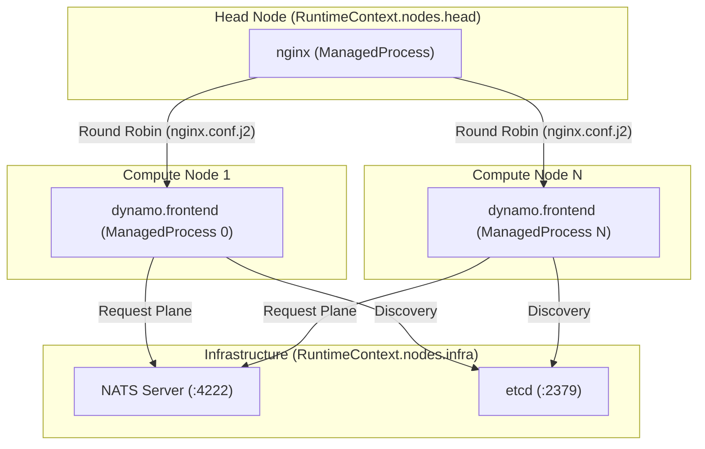
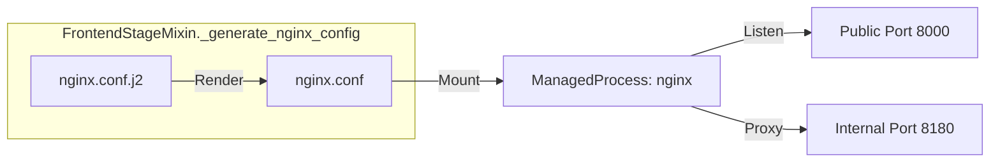

<!-- source: DeepWiki mcp.deepwiki.com · repo NVIDIA/srt-slurm · page 6.1 Dynamo Frontend · fetched 2026-10-26 -->

# Dynamo Frontend

<details>
<summary>Relevant source files</summary>

The following files were used as context for generating this wiki page:

- [.gitignore](.gitignore)
- [Makefile](Makefile)
- [README.md](README.md)
- [docs/architecture.md](docs/architecture.md)
- [docs/sglang-router.md](docs/sglang-router.md)
- [recipes/dsv4-pro/sglang/gb300-fp4/1k1k/disagg/stp/max-tpt.yaml](recipes/dsv4-pro/sglang/gb300-fp4/1k1k/disagg/stp/max-tpt.yaml)
- [src/srtctl/cli/mixins/frontend_stage.py](src/srtctl/cli/mixins/frontend_stage.py)
- [src/srtctl/frontends/dynamo.py](src/srtctl/frontends/dynamo.py)
- [src/srtctl/templates/job_script_minimal.j2](src/srtctl/templates/job_script_minimal.j2)
- [src/srtctl/templates/nginx.conf.j2](src/srtctl/templates/nginx.conf.j2)
- [tests/test_frontend_topology.py](tests/test_frontend_topology.py)

</details>


The `DynamoFrontend` is the default frontend implementation in `srtctl`, designed to coordinate requests between prefill and decode workers using a NATS-based message bus and etcd for service discovery. It leverages the `dynamo.frontend` module to provide a high-performance, KV-aware routing layer for disaggregated inference.

## Overview and Purpose

In a disaggregated architecture, the frontend serves as the entry point for HTTP requests (OpenAI-compatible). The `DynamoFrontend` implementation manages the lifecycle of `dynamo.frontend` processes, configures their connection to the infrastructure services (NATS/etcd), and integrates with the `srtctl` health check system to ensure workers are ready before benchmarking begins.

### Key Capabilities
- **Worker Discovery**: Automatically discovers prefill and decode workers via etcd [src/srtctl/frontends/dynamo.py:27-31]().
- **Health Validation**: Validates that the exact number of expected prefill and decode workers have registered with the frontend [src/srtctl/frontends/dynamo.py:41-48]().
- **Observability**: Built-in support for OpenTelemetry (OTEL) via `build_otel_env` [src/srtctl/frontends/dynamo.py:90]().
- **Scalability**: Supports multi-frontend topologies load-balanced by Nginx [src/srtctl/cli/mixins/frontend_stage.py:29-46]().

---

## Architecture and Data Flow

The `DynamoFrontend` operates within the `FrontendStageMixin` of the `SweepOrchestrator`. It interacts with the `RuntimeContext` to retrieve infrastructure IPs and the `ProcessRegistry` to manage the resulting `ManagedProcess` handles.

### Frontend Topology and Code Mapping

The following diagram illustrates how the `FrontendStageMixin` maps the logical `FrontendTopology` to physical processes on the SLURM cluster.

**Frontend Process Topology**

Sources: [src/srtctl/cli/mixins/frontend_stage.py:29-46](), [src/srtctl/frontends/dynamo.py:75-87]()

---

## Implementation Details

### Process Launching (`start_frontends`)
The `start_frontends` method in `DynamoFrontend` constructs the `srun` command and environment required to launch the `dynamo.frontend` module.

1.  **Command Construction**: Launches `python3 -m dynamo.frontend` with the specified `--http-port` [src/srtctl/frontends/dynamo.py:79]().
2.  **Environment Setup**: Configures `ETCD_ENDPOINTS` and `NATS_SERVER` using the `infra` node IP from `RuntimeContext` [src/srtctl/frontends/dynamo.py:82-87]().
3.  **OTEL Integration**: Injects OpenTelemetry environment variables using `build_otel_env` to enable tracing and metrics [src/srtctl/frontends/dynamo.py:90]().
4.  **Bash Preamble**: Executes a preamble that includes custom setup scripts and the `dynamo` installation commands if `config.dynamo.install` is enabled [src/srtctl/frontends/dynamo.py:101-154]().

### Health Check Logic
`DynamoFrontend` implements the `parse_health` method, which delegates to `check_dynamo_health`. This check is critical for ensuring the cluster is fully initialized before the benchmark starts.

| Metric | Description | Source |
| :--- | :--- | :--- |
| **Endpoint** | `/health` | [src/srtctl/frontends/dynamo.py:38-39]() |
| **Prefill Count** | Validates `response_json` contains the expected number of prefill workers. | [src/srtctl/frontends/dynamo.py:41-48]() |
| **Decode Count** | Validates `response_json` contains the expected number of decode workers. | [src/srtctl/frontends/dynamo.py:41-48]() |

### Frontend Topology Rules
The `FrontendStageMixin` determines the distribution of frontend processes based on the `FrontendConfig` [src/srtctl/cli/mixins/frontend_stage.py:72-81]():

-   **Single Node**: If only one worker node exists, a single frontend runs on the head node at port 8000, and Nginx is bypassed [src/srtctl/cli/mixins/frontend_stage.py:87-93]().
-   **Multi-Node**: If `enable_multiple_frontends` is true, Nginx is launched on the head node (port 8000) and load-balances across multiple `dynamo.frontend` instances running on worker nodes (port 8180) [src/srtctl/cli/mixins/frontend_stage.py:95-118]().

---

## Configuration and Arguments

The frontend behavior is customized via the `args` and `env` blocks in the recipe YAML.

### CLI Arguments Mapping
The `get_frontend_args_list` method converts a dictionary of arguments into CLI flags [src/srtctl/frontends/dynamo.py:50-60]().

**Example Configuration:**
```yaml
frontend:
  type: dynamo
  args:
    router-mode: "kv"
    router-reset-states: true
  env:
    DYN_LOG_LEVEL: "DEBUG"
```
Sources: [docs/sglang-router.md:61-69](), [src/srtctl/frontends/dynamo.py:97-99]()

### Nginx Load Balancing
When multiple frontends are active, `srtctl` generates an `nginx.conf` from the `nginx.conf.j2` template. This configuration sets up an `upstream` block containing the IPs of all nodes running `dynamo.frontend` [src/srtctl/cli/mixins/frontend_stage.py:166-182]().

**Nginx Configuration Logic**

Sources: [src/srtctl/cli/mixins/frontend_stage.py:120-144](), [src/srtctl/templates/nginx.conf.j2:10-31]()

---

## Key Functions and Classes

| Entity | Role | File Reference |
| :--- | :--- | :--- |
| `DynamoFrontend` | Implementation of `FrontendProtocol` for Dynamo. | [src/srtctl/frontends/dynamo.py:26]() |
| `FrontendTopology` | Dataclass describing Nginx and Frontend node assignments. | [src/srtctl/cli/mixins/frontend_stage.py:29]() |
| `start_frontends` | Orchestrates the `srun` launch of frontend processes. | [src/srtctl/frontends/dynamo.py:62]() |
| `_compute_frontend_topology` | Logic for distributing frontends across the cluster. | [src/srtctl/cli/mixins/frontend_stage.py:72]() |
| `check_dynamo_health` | Validates worker registration via the `/health` endpoint. | [src/srtctl/frontends/dynamo.py:14]() |
| `build_otel_env` | Generates environment variables for OpenTelemetry. | [src/srtctl/core/schema.py:15]() |

Sources: `src/srtctl/frontends/dynamo.py`, `src/srtctl/cli/mixins/frontend_stage.py`

---

