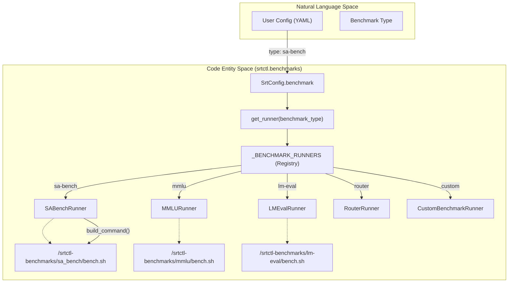
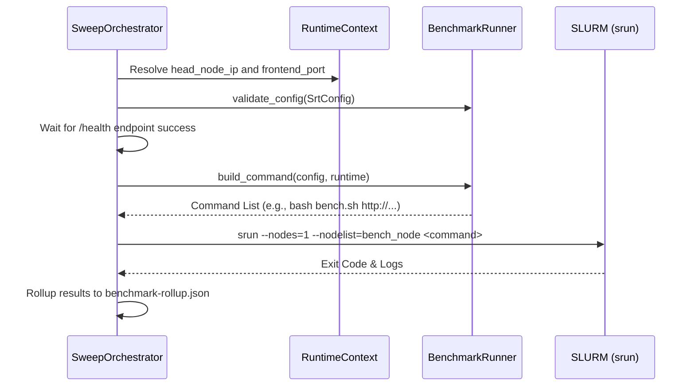

<!-- source: DeepWiki mcp.deepwiki.com · repo NVIDIA/srt-slurm · page 7 Benchmarking · fetched 2026-10-26 -->

# Benchmarking

Relevant source files

The following files were used as context for generating this wiki page:

- [configs/aime/run.sh](configs/aime/run.sh)
- [docs/accuracy.md](docs/accuracy.md)
- [examples/example.yaml](examples/example.yaml)
- [src/srtctl/benchmarks/__init__.py](src/srtctl/benchmarks/__init__.py)
- [src/srtctl/benchmarks/base.py](src/srtctl/benchmarks/base.py)
- [src/srtctl/benchmarks/gpqa.py](src/srtctl/benchmarks/gpqa.py)
- [src/srtctl/benchmarks/lm_eval.py](src/srtctl/benchmarks/lm_eval.py)
- [src/srtctl/benchmarks/longbenchv2.py](src/srtctl/benchmarks/longbenchv2.py)
- [src/srtctl/benchmarks/mmlu.py](src/srtctl/benchmarks/mmlu.py)
- [src/srtctl/benchmarks/router.py](src/srtctl/benchmarks/router.py)
- [src/srtctl/benchmarks/scripts/gpqa/bench.sh](src/srtctl/benchmarks/scripts/gpqa/bench.sh)
- [src/srtctl/benchmarks/scripts/lm-eval/bench.sh](src/srtctl/benchmarks/scripts/lm-eval/bench.sh)
- [src/srtctl/benchmarks/scripts/longbenchv2/bench.sh](src/srtctl/benchmarks/scripts/longbenchv2/bench.sh)
- [src/srtctl/benchmarks/scripts/mmlu/bench.sh](src/srtctl/benchmarks/scripts/mmlu/bench.sh)
- [src/srtctl/core/runtime.py](src/srtctl/core/runtime.py)
- [src/srtctl/core/yaml_utils.py](src/srtctl/core/yaml_utils.py)
- [tests/test_benchmarks.py](tests/test_benchmarks.py)

The `srt-slurm` benchmarking system provides a unified interface for executing performance and accuracy evaluations across different inference backends. It utilizes a registry-based architecture where specialized runners translate high-level `BenchmarkConfig` settings into containerized execution commands.

### Benchmark Architecture

The system is built around the `BenchmarkRunner` abstract base class, which defines the lifecycle for any benchmark type. Each runner is responsible for validating its specific configuration requirements and constructing the final shell command executed on the `bench` node.

#### Code Entity Mapping
The following diagram illustrates how the `BenchmarkRunner` registry connects high-level configuration to specific code implementations.

**Benchmark Registry Logic**

Sources: [src/srtctl/benchmarks/base.py:21-133](), [src/srtctl/benchmarks/__init__.py:1-44](), [tests/test_benchmarks.py:12-37]()

### Supported Benchmark Types

The framework supports a wide variety of benchmarks, ranging from raw throughput measurement to complex reasoning evaluations.

| Category | Type Name | Implementation Class | Description |
| :--- | :--- | :--- | :--- |
| **Performance** | `sa-bench` | `SABenchRunner` | SemiAnalysis benchmark for TTFT, TPOT, and ITL metrics. |
| **Performance** | `router` | `RouterRunner` | Tests `sglang-router` performance with prefix caching. |
| **Performance** | `trace-replay` | `TraceReplayRunner` | Replays real-world traffic traces. |
| **Accuracy** | `mmlu` | `MMLURunner` | Massive Multitask Language Understanding evaluation. |
| **Accuracy** | `gpqa` | `GPQARunner` | Graduate-level Google-Proof Q&A benchmark. |
| **Accuracy** | `lm-eval` | `LMEvalRunner` | Bridge to EleutherAI `lm-evaluation-harness`. |
| **Accuracy** | `longbenchv2` | `LongBenchV2Runner` | Evaluation for long-context models (128K+ tokens). |
| **Extensibility**| `custom` | `CustomBenchmarkRunner` | Allows arbitrary shell commands in custom containers. |

Sources: [src/srtctl/benchmarks/__init__.py:7-44](), [src/srtctl/benchmarks/base.py:93-109](), [docs/accuracy.md:3-19]()

### Execution Flow

Benchmarks are orchestrated by the `BenchmarkStageMixin` within the `SweepOrchestrator`. The process follows a strict sequence to ensure the inference backend is ready before traffic starts.

**Benchmark Orchestration Lifecycle**

Sources: [src/srtctl/core/runtime.py:82-129](), [src/srtctl/benchmarks/base.py:46-60](), [src/srtctl/benchmarks/sa_bench.py:45-75]()

### Detailed Evaluation Subsystems

For in-depth technical details on specific benchmarking suites, refer to the following child pages:

#### [Performance Benchmarks (SA-Bench, Trace Replay, Mooncake Router)](#7.1)
Covers the `SABenchRunner` implementation, including asyncio request loops, concurrency control via semaphores, and the calculation of metrics like TTFT (Time to First Token) and TPOT (Time per Output Token). Details on `router` benchmarks for disaggregated topologies are also found here.

#### [Accuracy Benchmarks (lm-eval, MMLU, GPQA, AIME, GSM8K)](#7.2)
Explains the accuracy evaluation framework. This includes the `LMEvalRunner` bridge to InferenceX/EleutherAI, reasoning-specific evaluations like AIME using the NeMo Skills container, and how topology metadata is passed to scripts to ensure accurate scoring.

#### [Profiling Integration](#7.3)
Details how to use `ProfilingConfig` to trigger Nsight Systems (`nsys`) and PyTorch Profiler captures during benchmark runs. This includes iteration-based triggers for TRT-LLM and time-based captures for SGLang/vLLM.

Sources: [docs/accuracy.md:26-37](), [src/srtctl/benchmarks/lm_eval.py:18-58](), [src/srtctl/benchmarks/router.py:17-74]()

---

