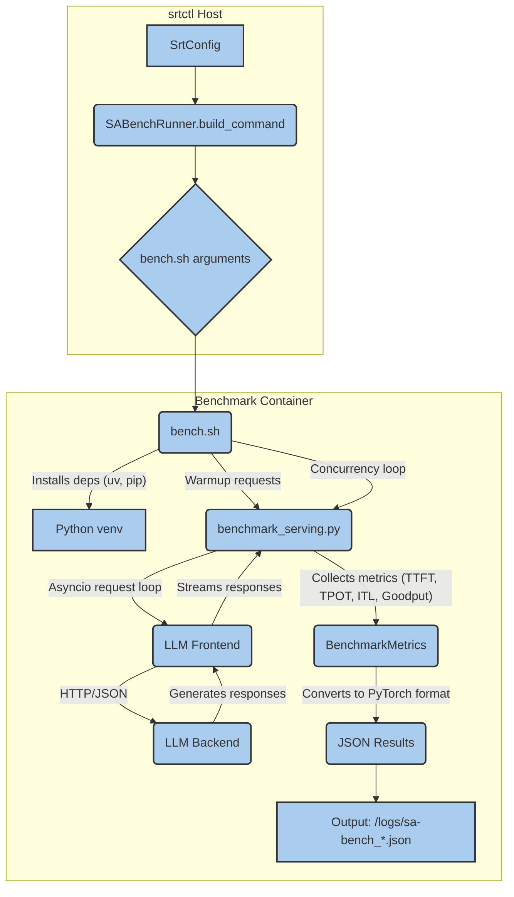
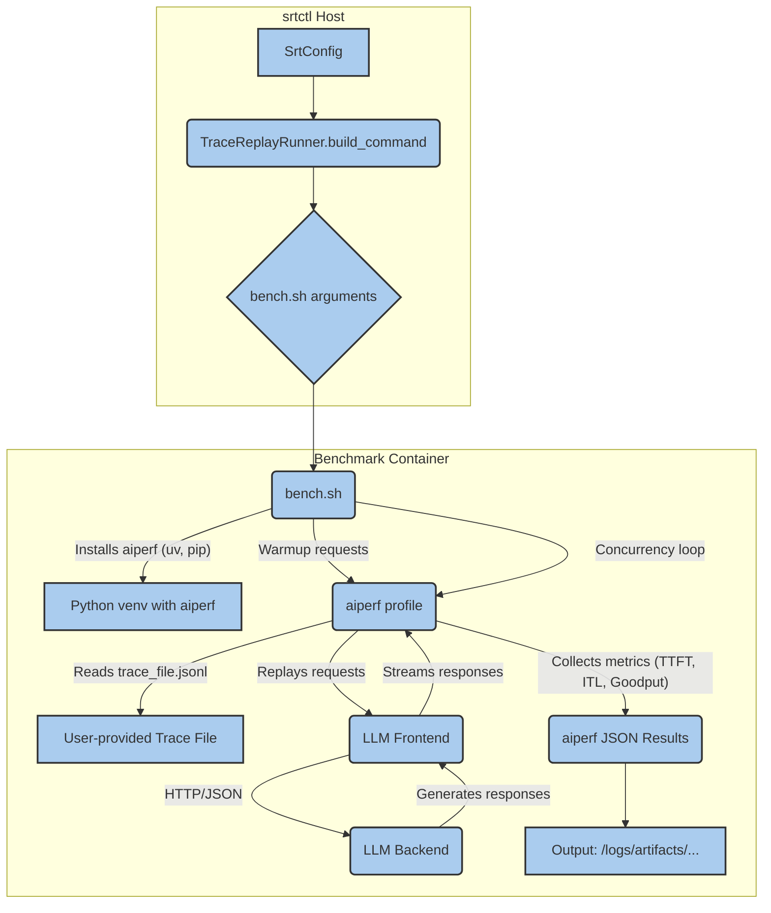

<!-- source: DeepWiki mcp.deepwiki.com · repo NVIDIA/srt-slurm · page 7.1 Performance Benchmarks (SA-Bench, Trace Replay, Mooncake Router) · fetched 2026-10-26 -->

# Performance Benchmarks (SA-Bench, Trace Replay, Mooncake Router)

<details>
<summary>Relevant source files</summary>

The following files were used as context for generating this wiki page:

- [src/srtctl/backends/trtllm.py](src/srtctl/backends/trtllm.py)
- [src/srtctl/backends/vllm.py](src/srtctl/backends/vllm.py)
- [src/srtctl/benchmarks/mooncake_router.py](src/srtctl/benchmarks/mooncake_router.py)
- [src/srtctl/benchmarks/sa_bench.py](src/srtctl/benchmarks/sa_bench.py)
- [src/srtctl/benchmarks/scripts/lib/profiling_trtllm.sh](src/srtctl/benchmarks/scripts/lib/profiling_trtllm.sh)
- [src/srtctl/benchmarks/scripts/mooncake-router/bench.sh](src/srtctl/benchmarks/scripts/mooncake-router/bench.sh)
- [src/srtctl/benchmarks/scripts/sa-bench/bench.sh](src/srtctl/benchmarks/scripts/sa-bench/bench.sh)
- [src/srtctl/benchmarks/scripts/sa-bench/benchmark_dataset.py](src/srtctl/benchmarks/scripts/sa-bench/benchmark_dataset.py)
- [src/srtctl/benchmarks/scripts/sa-bench/benchmark_serving.py](src/srtctl/benchmarks/scripts/sa-bench/benchmark_serving.py)
- [src/srtctl/benchmarks/scripts/sa-bench/sa_bench_tokenizers/__init__.py](src/srtctl/benchmarks/scripts/sa-bench/sa_bench_tokenizers/__init__.py)
- [src/srtctl/benchmarks/scripts/sa-bench/sa_bench_tokenizers/_sglang_encoding_dsv4.py](src/srtctl/benchmarks/scripts/sa-bench/sa_bench_tokenizers/_sglang_encoding_dsv4.py)
- [src/srtctl/benchmarks/scripts/sa-bench/sa_bench_tokenizers/sglang_deepseek_v4.py](src/srtctl/benchmarks/scripts/sa-bench/sa_bench_tokenizers/sglang_deepseek_v4.py)
- [src/srtctl/benchmarks/scripts/trace-replay/bench.sh](src/srtctl/benchmarks/scripts/trace-replay/bench.sh)
- [src/srtctl/benchmarks/trace_replay.py](src/srtctl/benchmarks/trace_replay.py)
- [tests/fixtures/trace_replay_sample.jsonl](tests/fixtures/trace_replay_sample.jsonl)
- [tests/test_frontends.py](tests/test_frontends.py)

</details>


This page details the performance benchmarks available in `srtctl`, focusing on `SA-Bench`, `Trace Replay`, and `Mooncake Router`. These benchmarks are designed to measure the throughput and latency characteristics of LLM serving systems under various workloads and configurations. They provide critical metrics such as Time To First Token (TTFT), Time Per Output Token (TPOT), Inter-Token Latency (ITL), and goodput, enabling comprehensive performance analysis.

## SA-Bench (SABenchRunner)

SA-Bench is a throughput and latency benchmark that tests the serving performance of LLMs at various concurrency levels. It is implemented by the `SABenchRunner` class [src/srtctl/benchmarks/sa_bench.py:18-32]() and executed via the `bench.sh` script [src/srtctl/benchmarks/scripts/sa-bench/bench.sh:1-18]() within the benchmark container.

### Implementation Details

The core of SA-Bench is an asynchronous request loop implemented in `benchmark_serving.py` [src/srtctl/benchmarks/scripts/sa-bench/benchmark_serving.py:1-73](). This script uses `asyncio` to send requests concurrently to the LLM serving endpoint.

#### Dataset Types

SA-Bench supports several dataset types for generating prompts:
*   **`random`**: Generates prompts with random input and output lengths within specified ranges (`isl` and `osl`). This is the default behavior [src/srtctl/benchmarks/sa_bench.py:91]().
    *   The `random-input-len`, `random-output-len`, and `random-range-ratio` arguments control the length distribution [src/srtctl/benchmarks/scripts/sa-bench/bench.sh:104-106]().
    *   Parallel random prompt generation is supported via `--random-num-workers` [src/srtctl/benchmarks/scripts/sa-bench/bench.sh:107-109]().
*   **`sharegpt`**: Samples real-world conversations from the ShareGPT dataset [src/srtctl/benchmarks/scripts/sa-bench/benchmark_serving.py:128-167]().
*   **`sonnet`**: Generates prompts based on sonnet texts, allowing for controlled prefix lengths [src/srtctl/benchmarks/scripts/sa-bench/benchmark_serving.py:195-212]().
*   **`custom`**: Allows users to provide their own JSONL dataset via `benchmark.dataset_path` [src/srtctl/benchmarks/sa_bench.py:29-30](). The `benchmark_dataset.py` script handles loading and processing these custom datasets.
*   **`burstgpt`**: Samples requests from the BurstGPT dataset [src/srtctl/benchmarks/scripts/sa-bench/benchmark_serving.py:169-193]().

#### Concurrency Control

The benchmark sweeps through a list of concurrency levels specified by `benchmark.concurrencies` [src/srtctl/benchmarks/sa_bench.py:23](). For each concurrency level, `benchmark_serving.py` uses `asyncio.Semaphore` to limit the number of simultaneous in-flight requests, ensuring controlled load generation.

#### Metrics

SA-Bench collects and reports various performance metrics:
*   **TTFT (Time To First Token)**: Latency until the first token is received.
*   **TPOT (Time Per Output Token)**: Average time taken to generate each output token.
*   **ITL (Inter-Token Latency)**: Latency between consecutive output tokens.
*   **E2EL (End-to-End Latency)**: Total time from sending a request to receiving the complete response [src/srtctl/benchmarks/scripts/sa-bench/benchmark_serving.py:118-120]().
*   **Request Throughput**: Requests completed per second.
*   **Output Throughput**: Output tokens generated per second.
*   **Total Token Throughput**: Total (input + output) tokens processed per second.
*   **Goodput**: A measure of "useful" throughput, often defined by requests meeting specific latency thresholds.

These metrics are reported with mean, median, standard deviation, and percentiles [src/srtctl/benchmarks/scripts/sa-bench/benchmark_serving.py:106-124]().

#### Peak Throughput Calculation

The benchmark iterates through specified concurrency levels. For each level, it performs a warmup phase followed by the actual measurement [src/srtctl/benchmarks/scripts/sa-bench/bench.sh:160-180](). The results are then used to determine the peak throughput achieved by the system.

#### PyTorch Benchmark Format Output

The results are converted into a PyTorch benchmark format for easier integration with analysis tools [src/srtctl/benchmarks/scripts/sa-bench/benchmark_serving.py:69](). This standardized format facilitates comparison across different benchmarks and systems.

#### DeepSeek-V4 Tokenizer Adapters

For models like DeepSeek-V4, which require specific chat template handling, SA-Bench includes custom tokenizer adapters. These adapters ensure that the client-side tokenization matches the server's internal processing, especially for complex prompt formats like DeepSeek-V4's DSML (DeepSeek Markup Language) [src/srtctl/benchmarks/scripts/sa-bench/bench.sh:77-92](). The `sa_bench_tokenizers` package [src/srtctl/benchmarks/scripts/sa-bench/sa_bench_tokenizers/__init__.py:1-5]() contains these specialized tokenizers, such as `SGLangDeepseekV4Tokenizer` [src/srtctl/benchmarks/scripts/sa-bench/sa_bench_tokenizers/sglang_deepseek_v4.py]() and `VLLMDeepseekV4Tokenizer`. The `load_tokenizer` function in `benchmark_serving.py` handles loading these custom adapters [src/srtctl/benchmarks/scripts/sa-bench/benchmark_serving.py:74-94]().

### SA-Bench Data Flow


**Diagram 7.1.1: SA-Bench Data Flow**
Sources: [src/srtctl/benchmarks/scripts/sa-bench/bench.sh:1-18](), [src/srtctl/benchmarks/scripts/sa-bench/bench.sh:160-180](), [src/srtctl/benchmarks/scripts/sa-bench/benchmark_serving.py:1-73](), [src/srtctl/benchmarks/scripts/sa-bench/benchmark_serving.py:69](), [src/srtctl/benchmarks/scripts/sa-bench/benchmark_serving.py:106-124](), [src/srtctl/benchmarks/scripts/sa-bench/benchmark_serving.py:74-94](), [src/srtctl/benchmarks/sa_bench.py:18-32](), [src/srtctl/benchmarks/sa_bench.py:23](), [src/srtctl/benchmarks/sa_bench.py:29-30](), [src/srtctl/benchmarks/sa_bench.py:91]()

## Trace Replay Benchmark

The Trace Replay benchmark uses `aiperf` to replay a user-provided JSONL trace dataset. This allows for benchmarking with realistic, recorded request patterns, including session IDs, input/output lengths, and inter-request delays. It is implemented by `TraceReplayRunner` [src/srtctl/benchmarks/trace_replay.py:25-39]().

### Implementation Details

The `bench.sh` script [src/srtctl/benchmarks/scripts/trace-replay/bench.sh:1-17]() for trace replay sets up an isolated `aiperf` environment using `uv` [src/srtctl/benchmarks/scripts/trace-replay/bench.sh:109-111]() and then executes `aiperf profile` commands.

#### Dataset Format

The trace file is expected to be a JSONL file in a format compatible with `aiperf`'s `mooncake_trace` custom dataset type. This format typically includes `session_id`, `input_length`, `output_length`, `hash_ids`, and `delay` for each request. An example can be found in `tests/fixtures/trace_replay_sample.jsonl`.

#### Concurrency Sweeps

Similar to SA-Bench, this benchmark can sweep through multiple concurrency levels, specified as a comma-separated string in `benchmark.concurrencies` [src/srtctl/benchmarks/trace_replay.py:76-78](). For each concurrency, `aiperf` simulates the specified number of concurrent requests.

#### Metrics and Goodput

`aiperf` collects standard latency metrics (TTFT, ITL) and can evaluate "goodput" based on user-defined thresholds for these metrics [src/srtctl/benchmarks/scripts/trace-replay/bench.sh:161-162](). This helps in understanding the percentage of requests that meet specific performance targets.

#### Profiling Integration

The trace replay script integrates with the `srtctl` profiling system, allowing `nsys` or other profilers to be triggered during the benchmark run [src/srtctl/benchmarks/scripts/trace-replay/bench.sh:24-30](). This is particularly useful for detailed performance analysis of the backend.

### Trace Replay Data Flow


**Diagram 7.1.2: Trace Replay Data Flow**
Sources: [src/srtctl/benchmarks/scripts/trace-replay/bench.sh:1-17](), [src/srtctl/benchmarks/scripts/trace-replay/bench.sh:24-30](), [src/srtctl/benchmarks/scripts/trace-replay/bench.sh:109-111](), [src/srtctl/benchmarks/scripts/trace-replay/bench.sh:161-162](), [src/srtctl/benchmarks/trace_replay.py:25-39](), [src/srtctl/benchmarks/trace_replay.py:76-78]()

## Mooncake Router Benchmark

The Mooncake Router benchmark specifically evaluates the performance of KV-aware routing mechanisms, often comparing aggregated (round-robin) versus disaggregated (KV-aware) routing. It uses `aiperf` to replay conversation traces from the Mooncake dataset, which are designed to highlight the benefits of prefix caching and KV-aware routing. This benchmark is implemented by `MooncakeRouterRunner` [src/srtctl/benchmarks/mooncake_router.py:29-49]().

### Implementation Details

The `bench.sh` script [src/srtctl/benchmarks/scripts/mooncake-router/bench.sh:1-10]() for this benchmark downloads specific Mooncake trace datasets (e.g., `conversation`, `synthetic`, `toolagent`) if not already present [src/srtctl/benchmarks/scripts/mooncake-router/bench.sh:58-71](). It then uses `aiperf profile` with `--custom-dataset-type mooncake_trace` and `--fixed-schedule` to replay requests at their original timestamps, simulating real-world traffic patterns [src/srtctl/benchmarks/scripts/mooncake-router/bench.sh:103-105]().

#### Workload Types

The benchmark supports different Mooncake workload types, such as `mooncake`, `conversation`, `synthetic`, and `toolagent`, each representing different conversation patterns and cache efficiency potentials [src/srtctl/benchmarks/mooncake_router.py:68-71](). The `conversation` trace, for example, features 12,031 requests over ~59 minutes with high prefix sharing potential [src/srtctl/benchmarks/mooncake_router.py:36-39]().

#### Goodput Thresholds

Similar to the Trace Replay benchmark, it uses `aiperf`'s goodput feature with configurable TTFT and ITL thresholds to assess the quality of service [src/srtctl/benchmarks/scripts/mooncake-router/bench.sh:111]().

### Mooncake Router Data Flow

```mermaid
graph TD
    subgraph "srtctl Host"
        A[SrtConfig] --> B(MooncakeRouterRunner.build_command)
        B --> C{bench.sh arguments}
    end

    subgraph "Benchmark Container"
        C --> D(bench.sh)
        D -- "Installs aiperf (uv, pip)" --> E[Python venv with aiperf]
        D -- "Downloads Mooncake trace" --> F[Mooncake Trace File (e.g., conversation_trace.jsonl)]
        D -- "Warmup requests" --> G(aiperf profile)
        D -- "Fixed schedule replay" --> G
        G -- "Reads trace file" --> F
        G -- "Replays requests" --> H(LLM Frontend)
        H -- "HTTP/JSON" --> I(LLM Backend)
        I -- "Generates responses" --> H
        H -- "Streams responses" --> G
        G -- "Collects metrics (TTFT, ITL, Goodput)" --> J(aiperf JSON Results)
        J --> K[Output: /logs/artifacts/...]
    end

    style A fill:#ace,stroke:#333,stroke-width:2px
    style B fill:#ace,stroke:#333,stroke-width:2px
    style C fill:#ace,stroke:#333,stroke-width:2px
    style D fill:#ace,stroke:#333,stroke-width:2px
    style E fill:#ace,stroke:#333,stroke-width:2px
    style F fill:#ace,stroke:#333,stroke-width:2px
    style G fill:#ace,stroke:#333,stroke-width:2px
    style H fill:#ace,stroke:#333,stroke-width:2px
    style I fill:#ace,stroke:#333,stroke-width:2px
    style J fill:#ace,stroke:#333,stroke-width:2px
    style K fill:#ace,stroke:#333,stroke-width:2px
```
**Diagram 7.1.3: Mooncake Router Data Flow**
Sources: [src/srtctl/benchmarks/scripts/mooncake-router/bench.sh:1-10](), [src/srtctl/benchmarks/scripts/mooncake-router/bench.sh:58-71](), [src/srtctl/benchmarks/scripts/mooncake-router/bench.sh:103-105](), [src/srtctl/benchmarks/scripts/mooncake-router/bench.sh:111](), [src/srtctl/benchmarks/mooncake_router.py:29-49](), [src/srtctl/benchmarks/mooncake_router.py:36-39](), [src/srtctl/benchmarks/mooncake_router.py:68-71]()

Sources: [src/srtctl/benchmarks/scripts/sa-bench/bench.sh:1-18](), [src/srtctl/benchmarks/scripts/sa-bench/bench.sh:77-92](), [src/srtctl/benchmarks/scripts/sa-bench/bench.sh:104-106](), [src/srtctl/benchmarks/scripts/sa-bench/bench.sh:107-109](), [src/srtctl/benchmarks/scripts/sa-bench/bench.sh:160-180](), [src/srtctl/benchmarks/scripts/sa-bench/benchmark_serving.py:1-73](), [src/srtctl/benchmarks/scripts/sa-bench/benchmark_serving.py:69](), [src/srtctl/benchmarks/scripts/sa-bench/benchmark_serving.py:74-94](), [src/srtctl/benchmarks/scripts/sa-bench/benchmark_serving.py:106-124](), [src/srtctl/benchmarks/scripts/sa-bench/benchmark_serving.py:118-120](), [src/srtctl/benchmarks/scripts/sa-bench/benchmark_serving.py:128-167](), [src/srtctl/benchmarks/scripts/sa-bench/benchmark_serving.py:169-193](), [src/srtctl/benchmarks/scripts/sa-bench/benchmark_serving.py:195-212](), [src/srtctl/benchmarks/scripts/sa-bench/sa_bench_tokenizers/__init__.py:1-5](), [src/srtctl/benchmarks/scripts/sa-bench/sa_bench_tokenizers/_sglang_encoding_dsv4.py:1-17](), [src/srtctl/benchmarks/scripts/mooncake-router/bench.sh:1-10](), [src/srtctl/benchmarks/scripts/mooncake-router/bench.sh:58-71](), [src/srtctl/benchmarks/scripts/mooncake-router/bench.sh:103-105](), [src/srtctl/benchmarks/scripts/mooncake-router/bench.sh:111](), [src/srtctl/benchmarks/scripts/trace-replay/bench.sh:1-17](), [src/srtctl/benchmarks/scripts/trace-replay/bench.sh:24-30](), [src/srtctl/benchmarks/scripts/trace-replay/bench.sh:109-111](), [src/srtctl/benchmarks/scripts/trace-replay/bench.sh:161-162](), [src/srtctl/benchmarks/sa_bench.py:18-32](), [src/srtctl/benchmarks/sa_bench.py:23](), [src/srtctl/benchmarks/sa_bench.py:29-30](), [src/srtctl/benchmarks/sa_bench.py:91](), [src/srtctl/benchmarks/mooncake_router.py:29-49](), [src/srtctl/benchmarks/mooncake_router.py:36-39](), [src/srtctl/benchmarks/mooncake_router.py:68-71](), [src/srtctl/benchmarks/trace_replay.py:25-39](), [src/srtctl/benchmarks/trace_replay.py:76-78]()

---

