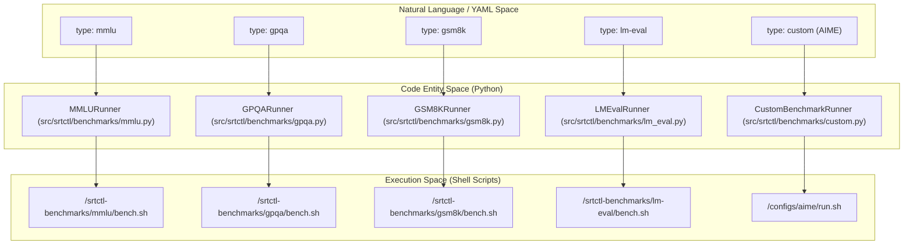
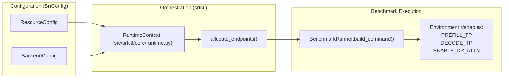

<!-- source: DeepWiki mcp.deepwiki.com · repo NVIDIA/srt-slurm · page 7.2 Accuracy Benchmarks (lm-eval, MMLU, GPQA, AIME, GSM8K) · fetched 2026-10-26 -->

# Accuracy Benchmarks (lm-eval, MMLU, GPQA, AIME, GSM8K)

<details>
<summary>Relevant source files</summary>

The following files were used as context for generating this wiki page:

- [configs/aime/run.sh](configs/aime/run.sh)
- [docs/README.md](docs/README.md)
- [docs/SUMMARY.md](docs/SUMMARY.md)
- [docs/accuracy.md](docs/accuracy.md)
- [docs/analyzing.md](docs/analyzing.md)
- [docs/installation.md](docs/installation.md)
- [docs/profiling.md](docs/profiling.md)
- [examples/example.yaml](examples/example.yaml)
- [src/srtctl/benchmarks/__init__.py](src/srtctl/benchmarks/__init__.py)
- [src/srtctl/benchmarks/base.py](src/srtctl/benchmarks/base.py)
- [src/srtctl/benchmarks/gpqa.py](src/srtctl/benchmarks/gpqa.py)
- [src/srtctl/benchmarks/gsm8k.py](src/srtctl/benchmarks/gsm8k.py)
- [src/srtctl/benchmarks/lm_eval.py](src/srtctl/benchmarks/lm_eval.py)
- [src/srtctl/benchmarks/longbenchv2.py](src/srtctl/benchmarks/longbenchv2.py)
- [src/srtctl/benchmarks/mmlu.py](src/srtctl/benchmarks/mmlu.py)
- [src/srtctl/benchmarks/router.py](src/srtctl/benchmarks/router.py)
- [src/srtctl/benchmarks/scripts/gpqa/bench.sh](src/srtctl/benchmarks/scripts/gpqa/bench.sh)
- [src/srtctl/benchmarks/scripts/gsm8k/bench.sh](src/srtctl/benchmarks/scripts/gsm8k/bench.sh)
- [src/srtctl/benchmarks/scripts/lm-eval/bench.sh](src/srtctl/benchmarks/scripts/lm-eval/bench.sh)
- [src/srtctl/benchmarks/scripts/longbenchv2/bench.sh](src/srtctl/benchmarks/scripts/longbenchv2/bench.sh)
- [src/srtctl/benchmarks/scripts/mmlu/bench.sh](src/srtctl/benchmarks/scripts/mmlu/bench.sh)
- [src/srtctl/core/runtime.py](src/srtctl/core/runtime.py)
- [src/srtctl/core/yaml_utils.py](src/srtctl/core/yaml_utils.py)
- [tests/test_benchmarks.py](tests/test_benchmarks.py)
- [tests/test_profiling.py](tests/test_profiling.py)

</details>


The `srt-slurm` framework provides a standardized suite of accuracy benchmarks to evaluate LLM performance on logic, mathematics, and general knowledge tasks. These benchmarks are integrated into the `BenchmarkRunner` registry and can be invoked via the `benchmark` section of a job configuration.

## Accuracy Evaluation Framework

The system uses a registry-based architecture where specific benchmark runners (e.g., `MMLURunner`, `GSM8KRunner`) implement a common interface to bridge high-level configurations to containerized execution scripts.

### Core Architecture and Data Flow

When a job is submitted with an accuracy benchmark type, the `SweepOrchestrator` uses the `get_runner` factory to retrieve the appropriate implementation [src/srtctl/benchmarks/__init__.py:22-24](). The runner then constructs a command that typically executes a bash script within the model's container or a dedicated evaluation container.

### Natural Language to Code Entity Space: Accuracy Flow

The following diagram illustrates how user-defined benchmark types in YAML map to specific Python classes and their corresponding shell scripts.

**Accuracy Benchmark Mapping**

Sources: [src/srtctl/benchmarks/__init__.py:7-19](), [src/srtctl/benchmarks/mmlu.py:38-39](), [src/srtctl/benchmarks/gsm8k.py:38-39](), [docs/accuracy.md:41-43]()

---

## Supported Benchmarks

### lm-eval (EleutherAI Harness)
The `LMEvalRunner` serves as a bridge to the `lm-evaluation-harness`. It allows running a wide variety of tasks by passing them through the `tasks` configuration field.
*   **Implementation**: `LMEvalRunner` in `src/srtctl/benchmarks/lm_eval.py`.
*   **Key Parameters**: `tasks` (comma-separated list), `num_fewshot`, and `batch_size`.

### MMLU & GPQA
These runners evaluate general knowledge and graduate-level reasoning.
*   **MMLU Implementation**: `MMLURunner` [src/srtctl/benchmarks/mmlu.py:17]().
*   **GPQA Implementation**: `GPQARunner` [src/srtctl/benchmarks/gpqa.py:17]().
*   **Scoring**: Computes mean scores and standard deviations across multiple repetitions if `repeat > 1` is specified [docs/accuracy.md:144-148]().

### GSM8K
Evaluates multi-step mathematical reasoning using the Grade School Math 8K dataset.
*   **Runner**: `GSM8KRunner` [src/srtctl/benchmarks/gsm8k.py:18]().
*   **Command Generation**: The `build_command` method constructs the call to `sglang.test.run_eval` with parameters for `num_examples`, `max_tokens`, and `num_shots` [src/srtctl/benchmarks/gsm8k.py:56-77]().

### AIME (American Invitational Mathematics Examination)
AIME is handled via a `custom` benchmark type rather than a dedicated runner class. It utilizes the **NeMo Skills** container.
*   **Container**: `nvcr.io/nvidia/eval-factory/nemo-skills:26.03` [docs/accuracy.md:40-41]().
*   **Logic**: Executed via `configs/aime/run.sh` [docs/accuracy.md:42-43]().
*   **Metric**: Primarily uses the **Pass@k** metric, where the model generates $k$ samples and is scored on whether at least one is correct [docs/accuracy.md:33-35]().

---

## Topology and Metadata Passing

A critical feature of the accuracy framework is how it communicates the underlying cluster topology to the evaluation scripts. This is essential for benchmarks that need to correlate accuracy with specific serving configurations (e.g., Disaggregated vs. Aggregated).

### Metadata Injection
The `RuntimeContext` captures the node topology [src/srtctl/core/runtime.py:93-96](). When benchmarks are executed, metadata such as `PREFILL_TP`, `DECODE_DP_ATTN`, and worker counts are passed as environment variables or command-line arguments to the evaluation scripts.

**Topology Metadata Flow**

Sources: [src/srtctl/core/runtime.py:82-122](), [docs/accuracy.md:77-91]()

### EVAL_ONLY Mode
For scenarios where the model server is already running, the framework supports an `EVAL_ONLY` (or `manual`) mode. In this mode, the orchestrator skips the backend launch sequence and proceeds directly to the `BenchmarkStageMixin` to execute accuracy scripts against an existing endpoint [docs/README.md:33-37]().

---

## Configuration Reference

The following table details the common fields used across accuracy benchmarks in the `benchmark` section of the YAML:

| Field | Type | Description |
| :--- | :--- | :--- |
| `type` | `str` | The benchmark identifier (e.g., `mmlu`, `gsm8k`, `custom`). |
| `num_examples` | `int` | Number of samples to evaluate from the dataset. |
| `max_tokens` | `int` | Maximum output tokens allowed per response. |
| `repeat` | `int` | Number of times to repeat the evaluation for variance analysis. |
| `num_threads` | `int` | Client-side concurrency for sending requests. |
| `temperature` | `float` | Sampling temperature for the model. |

Sources: [src/srtctl/benchmarks/gsm8k.py:23-31](), [docs/accuracy.md:128-134]()

### Example: MMLU Configuration
```yaml
benchmark:
  type: "mmlu"
  num_examples: 200
  max_tokens: 2048
  repeat: 8
  num_threads: 512
```
Sources: [docs/accuracy.md:126-134]()

---

