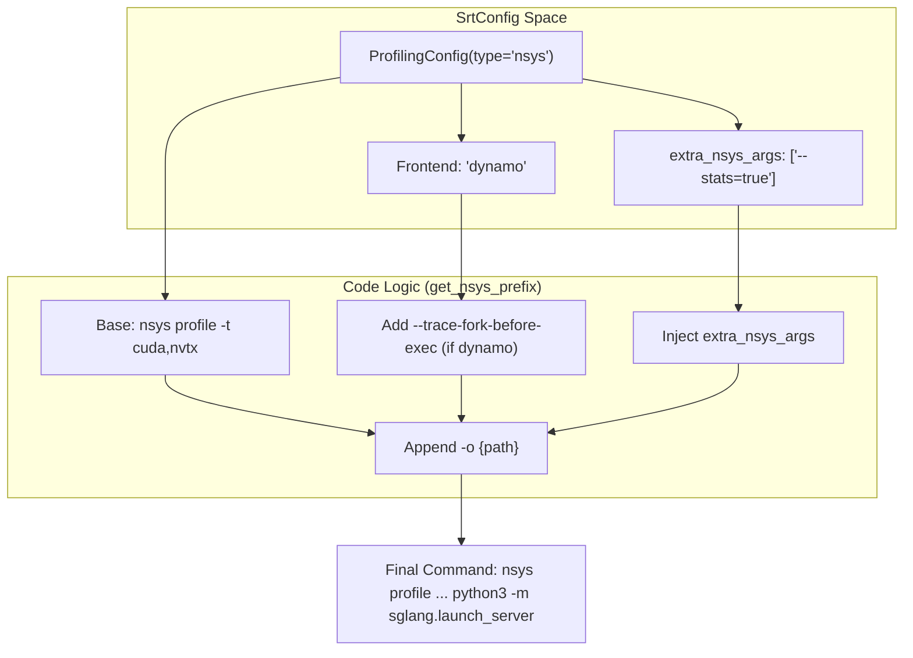
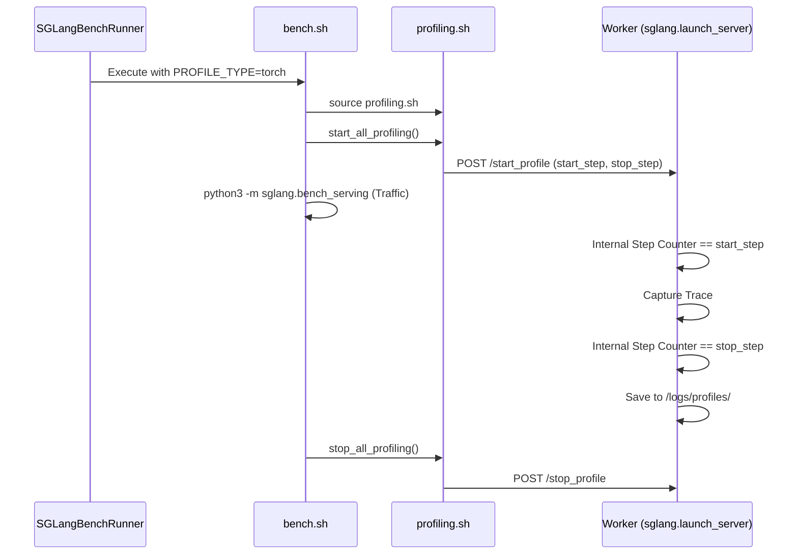

<!-- source: DeepWiki mcp.deepwiki.com · repo NVIDIA/srt-slurm · page 7.3 Profiling Integration · fetched 2026-10-26 -->

# Profiling Integration

Relevant source files

The following files were used as context for generating this wiki page:

- [docs/README.md](docs/README.md)
- [docs/SUMMARY.md](docs/SUMMARY.md)
- [docs/analyzing.md](docs/analyzing.md)
- [docs/installation.md](docs/installation.md)
- [docs/profiling.md](docs/profiling.md)
- [examples/enable-profiling.yaml](examples/enable-profiling.yaml)
- [examples/example-sweep.yaml](examples/example-sweep.yaml)
- [src/srtctl/benchmarks/scripts/lib/profiling.sh](src/srtctl/benchmarks/scripts/lib/profiling.sh)
- [src/srtctl/benchmarks/scripts/profiling/profile.sh](src/srtctl/benchmarks/scripts/profiling/profile.sh)
- [src/srtctl/benchmarks/scripts/sglang-bench/bench.sh](src/srtctl/benchmarks/scripts/sglang-bench/bench.sh)
- [src/srtctl/benchmarks/sglang_bench.py](src/srtctl/benchmarks/sglang_bench.py)
- [tests/README.md](tests/README.md)
- [tests/test_profiling.py](tests/test_profiling.py)

`srtctl` provides built-in integration for performance analysis using **NVIDIA Nsight Systems (nsys)** and the **PyTorch Profiler (torch)**. It orchestrates the lifecycle of profiling sessions across distributed nodes, ensuring that capture windows are synchronized with benchmark traffic.

## Profiling Configuration

The `ProfilingConfig` dataclass defines how profiling is executed. It supports different configurations for disaggregated (prefill/decode) and aggregated serving modes.

### Profiling Modes
| Mode | `type` | Description | Implementation Detail |
| :--- | :--- | :--- | :--- |
| **None** | `none` | Default serving mode. | Uses `dynamo.sglang` module [docs/profiling.md:100](). |
| **Torch** | `torch` | PyTorch Profiler for Python and CUDA kernels. | Uses `sglang.launch_server` [docs/profiling.md:105](). |
| **Nsys** | `nsys` | Nsight Systems for low-overhead GPU analysis. | Wraps worker process with `nsys profile` [docs/profiling.md:112-119](). |

### Configuration Schema and Validation
The configuration requires specific fields based on the resource topology:
*   **Disaggregated Mode**: Requires both `prefill` and `decode` sections in `ProfilingPhaseConfig` [tests/test_profiling.py:127-156]().
*   **Aggregated Mode**: Requires the `aggregated` section to be set [tests/test_profiling.py:158-179]().

Sources: `[docs/profiling.md:43-88]()`, `[tests/test_profiling.py:12-123]()`

---

## Nsight Systems (nsys) Integration

When `type: "nsys"` is selected, `srtctl` uses `get_nsys_prefix()` to wrap the backend execution command.

### Command Wrapping
The `get_nsys_prefix()` function generates the CLI string for `nsys`. Key features include:
*   **Frontend Specifics**: If the frontend is `dynamo`, the flag `--trace-fork-before-exec=true` is added to ensure child processes are captured [tests/test_profiling.py:44-46]().
*   **TRT-LLM Support**: For the `trtllm` backend, the prefix honors `extra_nsys_args` and places them before the output `-o` flag [tests/test_profiling.py:70-81]().
*   **Custom Arguments**: Users can pass arbitrary flags (e.g., `["--stats=true", "--trace=osrt"]`) via `extra_nsys_args` [tests/test_profiling.py:50-69]().

### Data Flow: Configuration to CLI
The following diagram illustrates how the YAML configuration transforms into a wrapped shell command.

**Profiling Command Generation**

Sources: `[tests/test_profiling.py:38-81]()`, `[docs/profiling.md:112-119]()`

---

## PyTorch Profiler (torch) Integration

The PyTorch profiler integration relies on environment variables and step-based triggers.

### Step-Based Capture
Unlike time-based capture, `srtctl` uses iteration/step counts to trigger the profiler. This is controlled by `ProfilingPhaseConfig` which specifies `start_step` and `stop_step` [tests/test_profiling.py:84-90]().

### Environment Variables
The `get_env_vars()` method translates the config into variables recognized by the worker processes:
*   `PROFILE_TYPE`: Set to `torch`.
*   `PROFILE_PREFILL_START_STEP` / `PROFILE_PREFILL_STOP_STEP`: Defines the window for prefill workers [tests/test_profiling.py:96-101]().
*   `PROFILE_DECODE_START_STEP` / `PROFILE_DECODE_STOP_STEP`: Defines the window for decode workers [tests/test_profiling.py:104-107]().
*   `SGLANG_TORCH_PROFILER_DIR`: The destination for Chrome trace JSON files [tests/test_profiling.py:102]().

Sources: `[tests/test_profiling.py:82-123]()`, `[src/srtctl/benchmarks/scripts/lib/profiling.sh:137-142]()`

---

## The `profiling.sh` Library

The core logic for interacting with worker REST APIs during a benchmark is contained in `src/srtctl/benchmarks/scripts/lib/profiling.sh`.

### Key Functions
*   **`profiling_init_from_env`**: Initializes local shell variables from the environment passed by the orchestrator [src/srtctl/benchmarks/scripts/lib/profiling.sh:124-145]().
*   **`start_all_profiling`**: Iterates through `PROFILE_PREFILL_ENDPOINTS`, `PROFILE_DECODE_ENDPOINTS`, and `PROFILE_AGG_ENDPOINTS` to send POST requests to the workers' `/start_profile` endpoint [src/srtctl/benchmarks/scripts/lib/profiling.sh:147-203]().
*   **`profiling__start_profile_on_worker`**: Constructs the JSON payload (including `activities` like `["CPU", "GPU"]`) and performs the `curl` call [src/srtctl/benchmarks/scripts/lib/profiling.sh:45-92]().

### API Path Resolution
The library detects the `SRTCTL_FRONTEND_TYPE` to determine the correct API endpoint:
*   **Dynamo**: `/engine/start_profile` [src/srtctl/benchmarks/scripts/lib/profiling.sh:79]()
*   **SGLang**: `/start_profile` [src/srtctl/benchmarks/scripts/lib/profiling.sh:80]()

Sources: `[src/srtctl/benchmarks/scripts/lib/profiling.sh:1-122]()`

---

## Runtime Execution Flow

When a profiling job is submitted, the `SGLangBenchRunner` (or other runners) coordinates the startup of workers and the execution of the benchmark script.

**Profiling Orchestration Lifecycle**

### TRT-LLM Profiling
For TensorRT-LLM backends, `srtctl` utilizes the `TLLM_PROFILE_START_STOP` environment variable logic to signal the iteration-based capture mechanism within the TRT-LLM runtime.

Sources: `[src/srtctl/benchmarks/scripts/sglang-bench/bench.sh:31-48]()`, `[src/srtctl/benchmarks/scripts/profiling/profile.sh:118-127]()`, `[docs/profiling.md:180-202]()`

---

