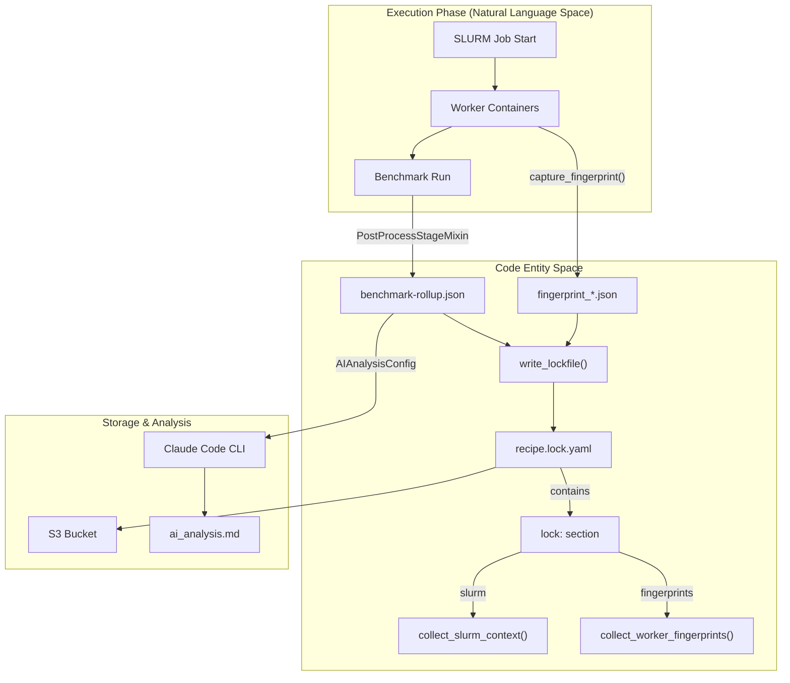
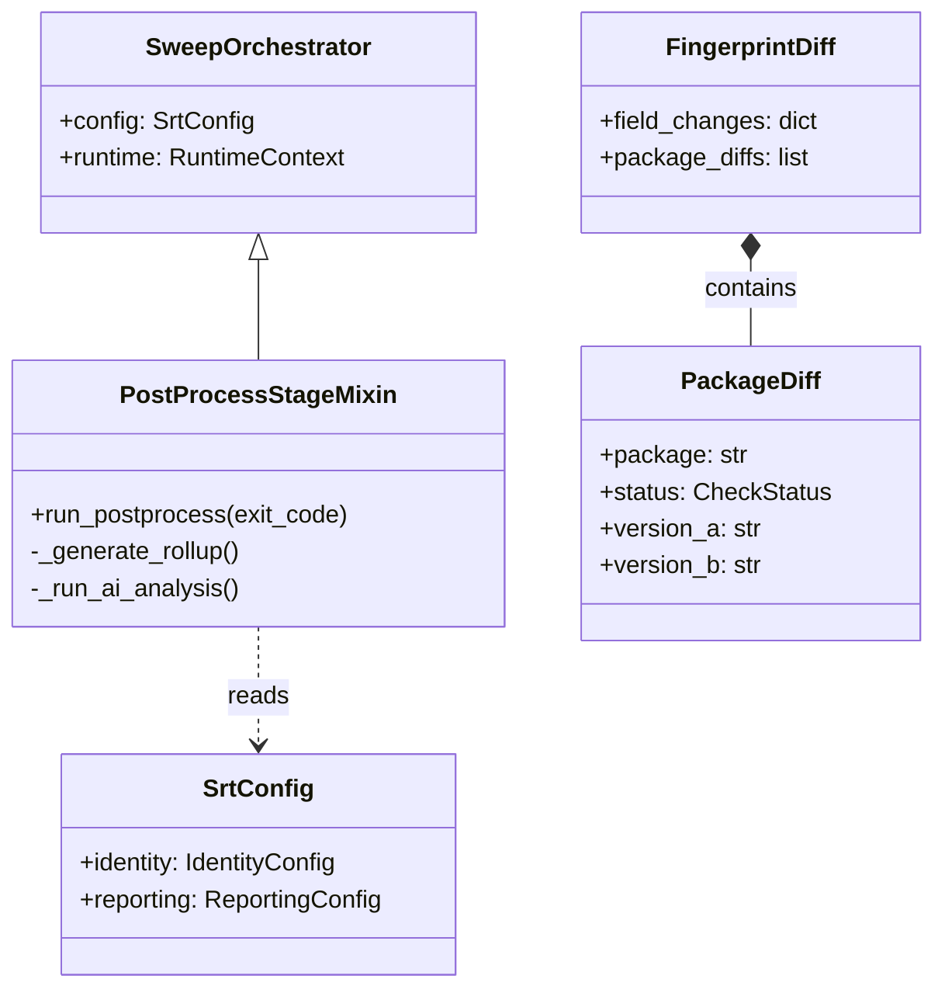

<!-- source: DeepWiki mcp.deepwiki.com · repo NVIDIA/srt-slurm · page 8 Reproducibility & Post-Processing · fetched 2026-10-26 -->

# Reproducibility & Post-Processing

Relevant source files

The following files were used as context for generating this wiki page:

- [recipes/mocker/kimi-trace-agg.yaml](recipes/mocker/kimi-trace-agg.yaml)
- [src/srtctl/cli/mixins/postprocess_stage.py](src/srtctl/cli/mixins/postprocess_stage.py)
- [src/srtctl/core/fingerprint.py](src/srtctl/core/fingerprint.py)
- [src/srtctl/core/lockfile.py](src/srtctl/core/lockfile.py)
- [tests/test_fingerprint.py](tests/test_fingerprint.py)
- [tests/test_lockfile.py](tests/test_lockfile.py)
- [tests/test_postprocess.py](tests/test_postprocess.py)

The `srt-slurm` system includes a comprehensive reproducibility and post-processing framework designed to ensure that benchmark results are verifiable, comparable across different cluster environments, and enriched with automated analysis. This system bridges the gap between raw SLURM execution and actionable engineering insights.

## High-Level Architecture

The reproducibility pipeline operates in two main phases: environment capture during execution and artifact generation after completion.

### 1. Environment Fingerprinting
Fingerprinting is the process of probing the actual state of a container environment to record exactly what software and hardware were used for a run. This prevents "silent" environment drifts (e.g., a container image being updated under the same tag) from corrupting benchmark comparisons.

*   **Probing**: The `capture_fingerprint()` function executes a series of fault-tolerant probes for GPU drivers, CUDA versions, NCCL versions, and pip packages [src/srtctl/core/fingerprint.py:226-250]().
*   **Remote Injection**: For multi-node jobs, `generate_capture_script()` creates a standalone bash script that can be injected into remote containers to capture their state without requiring the full `srtctl` package to be installed [src/srtctl/core/fingerprint.py:31-34]().
*   **Comparison**: The `diff_fingerprints()` utility allows developers to compare a current run against a reference, highlighting mismatches in package versions or hardware capabilities [src/srtctl/core/fingerprint.py:27-30]().

For details, see [Environment Fingerprinting](#8.1).

### 2. Lockfiles & Reproduction Reports
A lockfile is a "frozen" version of a job recipe that contains both the original configuration and the captured runtime metadata.

*   **Two-Phase Write**: Lockfiles are written at submission (to capture SLURM context) and again at completion (to capture fingerprints and metrics) [src/srtctl/core/lockfile.py:202-213]().
*   **Integrity**: The system uses SHA256 hashes to verify that the recipe has not been tampered with since the lock was generated [src/srtctl/core/lockfile.py:27-30]().
*   **Format**: The `recipe.lock.yaml` is a valid recipe that can be re-submitted using `srtctl apply`. When re-run, `srtctl` automatically verifies the new environment against the locked fingerprints [src/srtctl/core/lockfile.py:12-21]().

For details, see [Lockfiles & Reproduction Reports](#8.2).

### 3. Post-Processing Pipeline
The `PostProcessStageMixin` defines the lifecycle of a job after the benchmark binary finishes. This pipeline is designed to be fault-tolerant; optional stages like AI analysis or S3 syncing can fail without marking the entire job as a failure.

*   **Rollup**: Normalizes raw benchmark outputs into a standard `benchmark-rollup.json` format [src/srtctl/cli/mixins/postprocess_stage.py:172-174]().
*   **S3 Sync**: Uploads logs, configs, and results to a central bucket for long-term storage and dashboarding [src/srtctl/cli/mixins/postprocess_stage.py:86-109]().
*   **AI Analysis**: If a job fails, the system can automatically trigger an AI-powered root cause analysis using Claude Code via OpenRouter, searching relevant GitHub repositories for similar issues [src/srtctl/cli/mixins/postprocess_stage.py:46-55]().

For details, see [Post-Processing Pipeline (Rollup, S3 Sync, AI Analysis)](#8.3).

## System Data Flow

The following diagram illustrates how runtime data is transformed into reproducibility artifacts.

### Data Flow: Runtime to Artifacts

**Sources:** [src/srtctl/core/lockfile.py:5-21](), [src/srtctl/cli/mixins/postprocess_stage.py:145-168](), [src/srtctl/core/fingerprint.py:7-15]()

## Class Relationships

The post-processing logic is integrated into the `SweepOrchestrator` via mixins, allowing it to access both the configuration and the runtime context.

### Reproducibility Class Diagram

**Sources:** [src/srtctl/cli/mixins/postprocess_stage.py:46-60](), [src/srtctl/core/fingerprint.py:86-110](), [recipes/mocker/kimi-trace-agg.yaml:51-60]()

## Key Files & Entities

| Entity | File Path | Role |
| :--- | :--- | :--- |
| `capture_fingerprint` | [src/srtctl/core/fingerprint.py:251-270]() | Entry point for environment probing. |
| `write_lockfile` | [src/srtctl/core/lockfile.py:202-230]() | Orchestrates the two-phase lockfile writing. |
| `PostProcessStageMixin` | [src/srtctl/cli/mixins/postprocess_stage.py:46-60]() | Mixin providing post-run pipeline logic. |
| `AIAnalysisConfig` | [src/srtctl/core/schema.py:31-31]() | Schema for configuring automated failure analysis. |
| `UNAVAILABLE` | [src/srtctl/core/fingerprint.py:41-41]() | Sentinel used when a probe fails to return data. |

**Sources:** [src/srtctl/core/fingerprint.py:1-21](), [src/srtctl/core/lockfile.py:1-21](), [src/srtctl/cli/mixins/postprocess_stage.py:1-15]()

---

