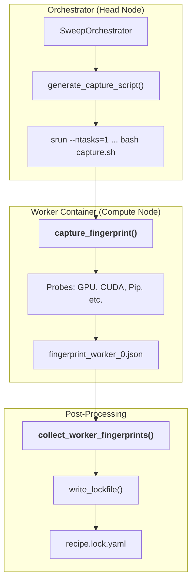
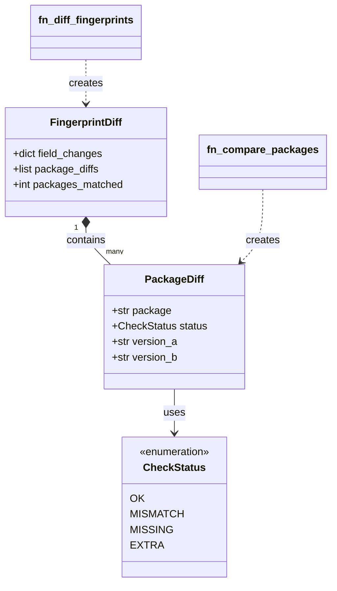

<!-- source: DeepWiki mcp.deepwiki.com · repo NVIDIA/srt-slurm · page 8.1 Environment Fingerprinting · fetched 2026-10-26 -->

# Environment Fingerprinting

<details>
<summary>Relevant source files</summary>

The following files were used as context for generating this wiki page:

- [recipes/mocker/kimi-trace-agg.yaml](recipes/mocker/kimi-trace-agg.yaml)
- [src/srtctl/cli/mixins/benchmark_stage.py](src/srtctl/cli/mixins/benchmark_stage.py)
- [src/srtctl/cli/mixins/postprocess_stage.py](src/srtctl/cli/mixins/postprocess_stage.py)
- [src/srtctl/cli/mixins/worker_stage.py](src/srtctl/cli/mixins/worker_stage.py)
- [src/srtctl/core/fingerprint.py](src/srtctl/core/fingerprint.py)
- [src/srtctl/core/lockfile.py](src/srtctl/core/lockfile.py)
- [tests/test_fingerprint.py](tests/test_fingerprint.py)
- [tests/test_lockfile.py](tests/test_lockfile.py)
- [tests/test_postprocess.py](tests/test_postprocess.py)

</details>


Environment Fingerprinting is the mechanism used by `srtctl` to capture, verify, and compare the software and hardware state of containers across distributed SLURM nodes. It ensures reproducibility by recording exactly which versions of CUDA, NCCL, and Python packages were active during a benchmark run, storing this metadata in the job's lockfile.

## Overview and Purpose

The fingerprinting system serves three primary functions:
1.  **Capture**: Probing a running container to generate a deterministic JSON representation of its environment [src/srtctl/core/fingerprint.py:11-13]().
2.  **Verification**: Comparing the captured environment against the `identity` block defined in a recipe to ensure the runtime matches the user's expectations [src/srtctl/core/fingerprint.py:14-14]().
3.  **Auditability**: Providing a structured diff between two environments (e.g., comparing a successful run to a failed one) [src/srtctl/core/fingerprint.py:13-13]().

### Key Design Principles
*   **Fault Tolerance**: Every probe (e.g., `nvidia-smi`, `pip list`) is isolated. If one fails, it returns a sentinel value (`UNAVAILABLE`) rather than crashing the orchestrator [src/srtctl/core/fingerprint.py:17-17]().
*   **Determinism**: Fields and package lists are sorted canonically to ensure that identical environments produce identical fingerprints, enabling clean text diffs [src/srtctl/core/fingerprint.py:18-18]().
*   **Performance**: A full capture typically completes in under 2 seconds [src/srtctl/core/fingerprint.py:19-19]().

---

## Technical Implementation

### Fingerprint Structure
A fingerprint is an ordered dictionary containing hardware specifications, OS details, and the full Python environment.

| Field | Description | Source |
| :--- | :--- | :--- |
| `hostname` | The network name of the node | `socket.gethostname()` |
| `gpu` | Name, driver version, and total memory | `nvidia-smi` |
| `cuda_version` | Active CUDA runtime version | `nvcc` or `nvidia-smi` |
| `nccl_version` | NCCL library version | `/usr/include/nccl.h` or `find` |
| `frameworks` | Versions of `vllm`, `sglang`, `torch`, etc. | `pip` package mapping |
| `pip_packages` | Complete list of installed packages | `pip list` |

**Sources:** [src/srtctl/core/fingerprint.py:118-136](), [src/srtctl/core/fingerprint.py:45-50]()

### Logic Flow: From Container to Lockfile

The diagram below illustrates how `srtctl` injects fingerprinting logic into remote SLURM tasks and aggregates the results.

**Fingerprint Data Flow**

**Sources:** [src/srtctl/cli/mixins/worker_stage.py:123-143](), [src/srtctl/core/lockfile.py:112-130](), [src/srtctl/core/fingerprint.py:311-320]()

---

## Core Components

### 1. The Probing Engine
The engine uses a registry of probe functions. Each function returns a `ProbeResult` object, which encapsulates the value and any error messages [src/srtctl/core/fingerprint.py:69-74]().

*   **`capture_fingerprint()`**: Iterates through `_PROBES`, executing each within a try-except block to ensure total system stability [src/srtctl/core/fingerprint.py:157-174]().
*   **`UNAVAILABLE` Sentinel**: If a command like `nvidia-smi` times out or is missing, the field is populated with the string `"unavailable"` instead of being omitted [src/srtctl/core/fingerprint.py:41-41]().

### 2. Remote Injection
Since fingerprints must be captured *inside* the specific container environment used for the job, `srtctl` generates a standalone bash/python script via `generate_capture_script()` [src/srtctl/core/fingerprint.py:311-315]().

This script is executed via `srun` during the `WorkerStage` before the benchmark begins. The output is written to the job's log directory as `fingerprint_{worker_name}.json` [src/srtctl/cli/mixins/worker_stage.py:131-132]().

### 3. Identity Verification
Recipes can include an `identity` block specifying required versions.
```yaml
identity:
  frameworks:
    sglang: "0.4.6"
    torch: "2.6.0"
```
The `verify_identity()` function compares these requirements against the actual `ProbeResult` values [src/srtctl/core/fingerprint.py:440-455](). Results are logged to the console and saved in the `lock:verification` section of the lockfile [src/srtctl/core/lockfile.py:151-176]().

---

## Comparison and Diffing

`srtctl` provides a structured way to compare two fingerprints via `diff_fingerprints()`. This is used when a user runs a lockfile to ensure the new environment matches the original recorded one.

### Diff Logic Entity Mapping
The following diagram maps the logical comparison process to the code entities responsible for the diff.

**Diffing Entity Map**

**Sources:** [src/srtctl/core/fingerprint.py:58-110](), [src/srtctl/core/fingerprint.py:350-370]()

### Canonical Ordering
To prevent false positives in diffs, the `_ordered_fingerprint()` function enforces a strict key sequence:
1.  Identity (Hostname, Timestamp)
2.  Hardware (Arch, GPU)
3.  Core Versions (Python, CUDA, NCCL)
4.  Frameworks
5.  Pip Packages (always last, sorted alphabetically)

**Sources:** [src/srtctl/core/fingerprint.py:118-149]()

---

## Usage in Post-Processing

After a benchmark completes, the `PostProcessStageMixin` triggers the collection of these fingerprints.

1.  **Collection**: `collect_worker_fingerprints()` scans the log directory for all `fingerprint_*.json` files [src/srtctl/core/lockfile.py:112-115]().
2.  **Aggregation**: These are merged into a single dictionary keyed by worker ID (e.g., `prefill_w0`, `decode_w1`) [src/srtctl/core/lockfile.py:127-128]().
3.  **Persistence**: The aggregated data is written into the `recipe.lock.yaml` under the `lock.fingerprints` key [src/srtctl/core/lockfile.py:194-195]().

**Sources:** [src/srtctl/cli/mixins/postprocess_stage.py:184-190](), [src/srtctl/core/lockfile.py:202-208]()

---

