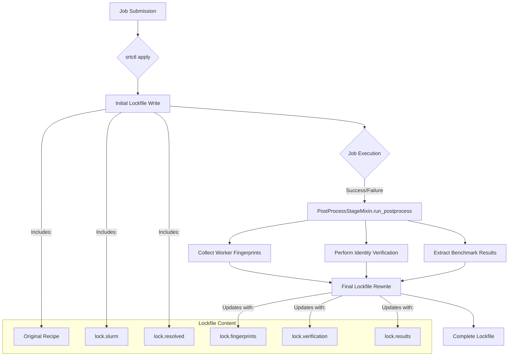
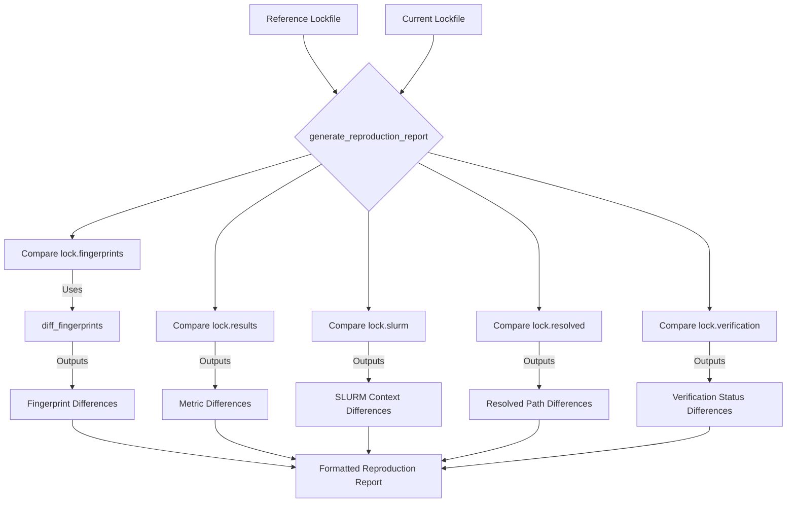

<!-- source: DeepWiki mcp.deepwiki.com · repo NVIDIA/srt-slurm · page 8.2 Lockfiles & Reproduction Reports · fetched 2026-10-26 -->

# Lockfiles & Reproduction Reports

<details>
<summary>Relevant source files</summary>

The following files were used as context for generating this wiki page:

- [recipes/mocker/kimi-trace-agg.yaml](recipes/mocker/kimi-trace-agg.yaml)
- [src/srtctl/cli/mixins/postprocess_stage.py](src/srtctl/cli/mixins/postprocess_stage.py)
- [src/srtctl/core/fingerprint.py](src/srtctl/core/fingerprint.py)
- [src/srtctl/core/lockfile.py](src/srtctl/core/lockfile.py)
- [tests/test_fingerprint.py](tests/test_fingerprint.py)
- [tests/test_lockfile.py](tests/test_lockfile.py)
- [tests/test_postprocess.py](tests/test_postprocess.py)

</details>


This page details the `recipe.lock.yaml` format, its two-phase writing process, the SHA256 integrity hash, the `verify_lock_integrity()` function, and how reproduction reports are generated by comparing fingerprints and metrics across runs. It also explains how to re-run a job from a lockfile.

The lockfile serves as a comprehensive record of a benchmark run, capturing not only the original recipe but also the exact environment and results. This ensures that future runs can be compared against a known baseline for reproducibility and debugging.

## The `recipe.lock.yaml` Format

The `recipe.lock.yaml` file is essentially the original recipe YAML with an additional `lock:` section appended. This `lock:` section contains all the metadata necessary to understand and reproduce a specific benchmark run.

The structure of a lockfile includes:
- **Original Recipe**: The unmodified YAML content of the recipe used for the run.
- **`lock.version`**: An integer indicating the lockfile format version [src/srtctl/core/lockfile.py:44-44](). This is incremented if the structure of the `lock:` section changes.
- **`lock.generated_at`**: A UTC timestamp indicating when the lockfile was generated [src/srtctl/core/lockfile.py:187-187]().
- **`lock.slurm`**: Details about the SLURM job context, such as `job_id`, `account`, `partition`, `nodelist`, `user`, `cwd`, and the `srtctl` commit hash [src/srtctl/core/lockfile.py:76-109]().
- **`lock.resolved`**: The actual paths and values that aliases in the recipe resolved to, such as `model_path` and `container_path` [src/srtctl/core/lockfile.py:178-184](). It also includes the `log_dir` where artifacts are stored.
- **`lock.verification`**: A summary of identity checks performed during the run, indicating whether declared identities (e.g., model repo, container image, framework versions) matched the runtime environment [src/srtctl/core/lockfile.py:150-176]().
- **`lock.fingerprints`**: Per-worker runtime environment fingerprints, including GPU information, Python version, CUDA/NCCL versions, framework versions, and installed pip packages [src/srtctl/core/lockfile.py:135-136]().
- **`lock.results`**: Benchmark metrics (e.g., throughput, latency) extracted from the run [src/srtctl/core/lockfile.py:198-198]().

An example of a lockfile's `lock:` section might look like this (simplified):

```yaml
# ============================================================================
# Lock section — generated by srtctl after a run. DO NOT edit manually.
# ...
# ============================================================================
lock:
  version: 2
  generated_at: "2026-04-09T14:30:00Z"
  slurm:
    job_id: "12345"
    user: "testuser"
    cwd: "/home/testuser/srt-slurm"
    srtctl_commit: "abcdef12345"
  resolved:
    model_path: "/lustre/models/kimi-k25-nvfp4"
    container_path: "/lustre/containers/trtllm-runtime.sqsh"
    log_dir: "/home/testuser/srt-slurm/outputs/kimi-k25-mocker-trace-agg-12345"
  verification:
    result: "1 verified, 1 declared, 0 FAILED"
    verified: 1
    declared: 1
    failed: 0
    checks:
      - field: "frameworks.dynamo"
        status: "OK"
        message: "Dynamo version 1.0.0 matches"
  fingerprints:
    prefill_w0:
      hostname: "node-001"
      arch: "aarch64"
      gpu:
        available: true
        driver: "570.86.15"
        gpus:
          - name: "GB200"
            driver: "570.86.15"
            memory: "192 GiB"
      python_version: "3.11.9"
      pip_packages:
        - "ai-dynamo==1.0.0"
        - "numpy==1.26.4"
        - "sglang==0.4.6.post1"
  results:
    throughput_tok_s: 12345.67
    latency_p99_ms: 123.45
```
Sources: [src/srtctl/core/lockfile.py:44-44](), [src/srtctl/core/lockfile.py:76-109](), [src/srtctl/core/lockfile.py:135-136](), [src/srtctl/core/lockfile.py:150-176](), [src/srtctl/core/lockfile.py:178-184](), [src/srtctl/core/lockfile.py:187-187](), [src/srtctl/core/lockfile.py:198-198]()

## Two-Phase Write (Submission + Completion)

The lockfile is written in two distinct phases during a job's lifecycle to ensure that critical information is captured even if a job fails prematurely.

### Phase 1: Submission
When a job is submitted, `srtctl` first writes a preliminary version of the `recipe.lock.yaml` file. This initial write includes:
- The original recipe content.
- The `lock.slurm` section, capturing SLURM job context (e.g., `SLURM_JOB_ID`, `SLURM_JOB_ACCOUNT`) [src/srtctl/core/lockfile.py:188-189]().
- The `lock.resolved` section, containing the resolved paths for models and containers [src/srtctl/core/lockfile.py:188-189]().

This ensures that even if the job fails immediately after submission (e.g., due to a misconfiguration that prevents workers from starting), there's a record of what was attempted and under what SLURM context.

### Phase 2: Completion
After the benchmark run completes (successfully or with failure), the `PostProcessStageMixin`'s `run_postprocess` method is called [src/srtctl/cli/mixins/postprocess_stage.py:145-145](). During this phase, the lockfile is updated with additional, more detailed information:
- **Worker Fingerprints**: The `collect_worker_fingerprints` function gathers environment fingerprints from each worker process's log directory [src/srtctl/core/lockfile.py:112-131](). These fingerprints include detailed information about the container environment, GPU, CUDA, NCCL, Python, and installed packages [src/srtctl/core/fingerprint.py:1-21]().
- **Identity Verification**: If identity checks were performed (e.g., comparing declared framework versions in the recipe's `identity:` block against the actual runtime environment), the `lock.verification` section is populated with the results [src/srtctl/core/lockfile.py:150-176]().
- **Benchmark Results**: The `lock.results` section is populated with key benchmark metrics extracted from the run [src/srtctl/core/lockfile.py:198-198]().

The `write_lockfile` function [src/srtctl/core/lockfile.py:202-214]() handles this two-phase update, rewriting the file with the enriched data.


**Diagram: Two-Phase Lockfile Write Process**
Sources: [src/srtctl/cli/mixins/postprocess_stage.py:145-145](), [src/srtctl/core/lockfile.py:112-131](), [src/srtctl/core/lockfile.py:150-176](), [src/srtctl/core/lockfile.py:188-189](), [src/srtctl/core/lockfile.py:198-198](), [src/srtctl/core/lockfile.py:202-214]()

## SHA256 Integrity Hash

To ensure the integrity of the lockfile and detect any accidental or malicious modifications, a SHA256 hash of the original recipe content (excluding the `lock:` section) is stored within the `lock:` section itself.

The `_strip_lock_section` function [src/srtctl/core/lockfile.py:240-250]() is responsible for parsing the YAML, removing the `lock:` block, and returning the remaining content as a string. This stripped content is then hashed using SHA256.

The `write_lockfile` function calculates this hash and stores it as `lock.recipe_sha256` [src/srtctl/core/lockfile.py:260-261]().

### `verify_lock_integrity()`

The `verify_lock_integrity()` function [src/srtctl/core/lockfile.py:300-320]() is used to check if the recipe portion of a lockfile has been altered since it was generated.
1. It reads the lockfile.
2. It extracts the `lock.recipe_sha256` value.
3. It then re-calculates the SHA256 hash of the recipe content (after stripping the `lock:` section).
4. If the re-calculated hash matches the stored `lock.recipe_sha256`, the integrity check passes. Otherwise, it indicates that the recipe has been modified.

This mechanism is crucial for ensuring that when a lockfile is used for reproduction or comparison, the underlying recipe configuration remains consistent with the original run.
Sources: [src/srtctl/core/lockfile.py:240-250](), [src/srtctl/core/lockfile.py:260-261](), [src/srtctl/core/lockfile.py:300-320]()

## Reproduction Report Generation

The lockfile's primary purpose is to enable reproducibility and provide a detailed record for debugging. The `generate_reproduction_report` function [src/srtctl/core/lockfile.py:323-390]() leverages the information within lockfiles to compare two runs.

This function takes two lockfiles (a "reference" and a "current" run) and generates a human-readable report highlighting differences in:
- **Fingerprints**: It compares the `lock.fingerprints` section of both lockfiles. This involves using `diff_fingerprints` [src/srtctl/core/fingerprint.py:309-349]() to identify changes in hardware, OS, Python, CUDA, NCCL, framework versions, and individual pip packages between the two environments.
- **Metrics**: It compares key benchmark results from the `lock.results` section.
- **SLURM Context**: Differences in SLURM job parameters (e.g., `job_id`, `partition`, `nodelist`) are reported.
- **Resolved Paths**: Any discrepancies in how model or container aliases resolved to actual paths are noted.
- **Verification Status**: Changes in the `lock.verification` status are highlighted.

The report is formatted to clearly show what changed, making it easy to pinpoint potential causes for performance regressions or unexpected behavior.


**Diagram: Reproduction Report Generation**
Sources: [src/srtctl/core/fingerprint.py:309-349](), [src/srtctl/core/lockfile.py:323-390]()

## How to Re-run from a Lockfile

A key design principle of the lockfile is that it remains a valid `srtctl` recipe. This means you can directly use a lockfile to re-run a job.

To re-run a job from a lockfile:
```bash
srtctl apply -f path/to/recipe.lock.yaml
```

When `srtctl` processes a lockfile for submission:
1. It will parse the entire file, including the `lock:` section.
2. It will extract the original recipe configuration from the top-level keys.
3. During the preflight and submission stages, `srtctl` will compare the current environment and configuration against the `lock.fingerprints` and `lock.resolved` sections within the lockfile.
4. Any significant discrepancies (e.g., different GPU driver versions, missing pip packages, different resolved model paths) will be flagged as warnings or errors, depending on the severity and configuration. This proactive check helps prevent running a "reproduction" in an environment that is fundamentally different from the original.
5. The new run will generate its own `recipe.lock.yaml` (or update the existing one if run in the same output directory), allowing for a direct comparison between the original and the "reproduced" run using `generate_reproduction_report`.

This capability allows users to easily verify the impact of environment changes, test new `srtctl` versions, or debug performance issues by comparing a current run against a known good baseline.
Sources: [src/srtctl/core/lockfile.py:19-20]()

---

