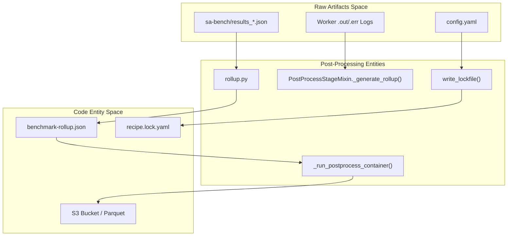
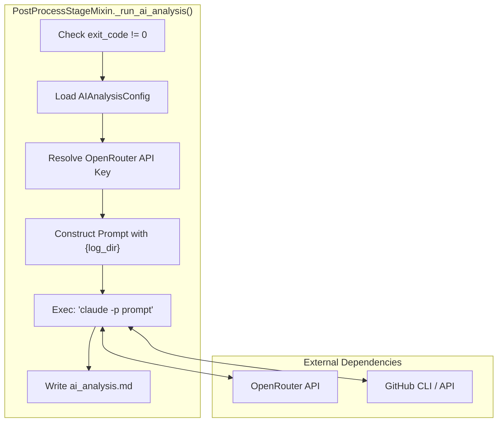

<!-- source: DeepWiki mcp.deepwiki.com · repo NVIDIA/srt-slurm · page 8.3 Post-Processing Pipeline (Rollup, S3 Sync, AI Analysis) · fetched 2026-10-26 -->

# Post-Processing Pipeline (Rollup, S3 Sync, AI Analysis)

Relevant source files

The following files were used as context for generating this wiki page:

- [recipes/mocker/kimi-trace-agg.yaml](recipes/mocker/kimi-trace-agg.yaml)
- [recipes/qwen3-32b/basic-b300/disagg-kv-dynamo.yaml](recipes/qwen3-32b/basic-b300/disagg-kv-dynamo.yaml)
- [src/srtctl/benchmarks/scripts/mooncake-router/rollup.py](src/srtctl/benchmarks/scripts/mooncake-router/rollup.py)
- [src/srtctl/benchmarks/scripts/sa-bench/rollup.py](src/srtctl/benchmarks/scripts/sa-bench/rollup.py)
- [src/srtctl/cli/mixins/__init__.py](src/srtctl/cli/mixins/__init__.py)
- [src/srtctl/cli/mixins/postprocess_stage.py](src/srtctl/cli/mixins/postprocess_stage.py)
- [src/srtctl/core/fingerprint.py](src/srtctl/core/fingerprint.py)
- [src/srtctl/core/lockfile.py](src/srtctl/core/lockfile.py)
- [tests/test_fingerprint.py](tests/test_fingerprint.py)
- [tests/test_lockfile.py](tests/test_lockfile.py)
- [tests/test_postprocess.py](tests/test_postprocess.py)
- [tests/test_sa_bench_rollup.py](tests/test_sa_bench_rollup.py)

The post-processing pipeline is the final stage of the `SweepOrchestrator` lifecycle, managed by the `PostProcessStageMixin` [src/srtctl/cli/mixins/postprocess_stage.py:46-55](). It transforms raw benchmark artifacts into structured data, ensures long-term storage via S3, and provides automated failure diagnostics using AI.

A critical design principle of this pipeline is **fault tolerance**: failures in optional stages (like S3 sync or AI analysis) do not cause the overall SLURM job to fail [src/srtctl/cli/mixins/postprocess_stage.py:145-168]().

## Overview of Post-Processing Lifecycle

The pipeline executes immediately after the benchmark process exits. It follows a sequence of normalization, persistence, and analysis.

### Data Flow Diagram: Raw Logs to Structured Results

This diagram maps the transition from raw output files produced by benchmarks and workers into the final structured formats.

**Sources:** [src/srtctl/cli/mixins/postprocess_stage.py:145-168](), [src/srtctl/benchmarks/scripts/sa-bench/rollup.py:199-210](), [src/srtctl/core/lockfile.py:202-214]()

---

## 1. Benchmark Rollup & Normalization

Because different benchmarks (e.g., `sa-bench`, `mooncake-router`, `trace-replay`) produce varying output formats, the pipeline uses a `rollup.py` script specific to each benchmark type to normalize results into a standard `benchmark-rollup.json` [src/srtctl/benchmarks/scripts/sa-bench/rollup.py:5-7]().

### SA-Bench Rollup Logic
For `sa-bench`, the rollup script:
1.  **Aggregates Results**: Scans `results_*.json` for multiple concurrency runs [src/srtctl/benchmarks/scripts/sa-bench/rollup.py:201-205]().
2.  **Calculates Derived Metrics**: Computes "Output Token Throughput per User" and "Total Token Throughput per GPU" [src/srtctl/benchmarks/scripts/sa-bench/rollup.py:180-195]().
3.  **Log Mining**: For SGLang disaggregated runs, it parses worker logs to compute the **P90 Decode Running Requests** [src/srtctl/benchmarks/scripts/sa-bench/rollup.py:112-151]().
4.  **Metadata Injection**: Merges SLURM resource metadata (e.g., total GPU counts) into the final report [src/srtctl/benchmarks/scripts/sa-bench/rollup.py:77-110]().

**Sources:** [src/srtctl/benchmarks/scripts/sa-bench/rollup.py:1-210](), [src/srtctl/benchmarks/scripts/mooncake-router/rollup.py:1-43]()

---

## 2. Lockfile Generation & Fingerprinting

The pipeline finalizes the `recipe.lock.yaml` file, which serves as the ultimate record of reproducibility.

*   **Fingerprint Collection**: The `collect_worker_fingerprints` function gathers `fingerprint_*.json` files generated by each worker container during the `BenchmarkStage` [src/srtctl/core/lockfile.py:112-130](). These contain the exact `pip` package versions, CUDA versions, and GPU hardware IDs used [src/srtctl/core/fingerprint.py:118-136]().
*   **Identity Verification**: If an `identity:` block was provided in the recipe, the pipeline records whether the runtime environment actually matched the declarations [src/srtctl/core/lockfile.py:151-175]().
*   **Integrity**: The lockfile includes the original recipe and a `lock:` section containing SLURM job metadata, resolved paths, and the normalized benchmark results [src/srtctl/core/lockfile.py:185-199]().

**Sources:** [src/srtctl/core/lockfile.py:1-214](), [src/srtctl/core/fingerprint.py:4-21]()

---

## 3. S3 Synchronization & Parquet Generation

If `reporting.s3` is configured in `srtslurm.yaml`, the pipeline launches an ephemeral container to sync artifacts to object storage [src/srtctl/cli/mixins/postprocess_stage.py:86-110]().

### The Post-Process Container
The `_run_postprocess_container` method uses `srun` to launch a container (typically `amazon/aws-cli`) to perform the following:
1.  **S3 Sync**: Uploads the entire `logs/` directory (containing worker logs, `benchmark-rollup.json`, and `recipe.lock.yaml`) to the configured S3 bucket [src/srtctl/cli/mixins/postprocess_stage.py:125-144]().
2.  **srtlog Generation**: Converts raw logs into Parquet format for efficient analysis in the Streamlit dashboard [src/srtctl/cli/mixins/postprocess_stage.py:9-10]().

**Sources:** [src/srtctl/cli/mixins/postprocess_stage.py:86-110](), [src/srtctl/cli/mixins/postprocess_stage.py:145-168]()

---

## 4. AI-Powered Failure Analysis

When a job fails (`exit_code != 0`), the pipeline can trigger an automated diagnostic analysis using **Claude Code** [src/srtctl/cli/mixins/postprocess_stage.py:158-168]().

### Implementation via Claude Code CLI
The `_run_ai_analysis` function executes the `claude` CLI in headless mode (`-p`) [src/srtctl/cli/mixins/postprocess_stage.py:13](). 

*   **Authentication**: Uses OpenRouter for API access [src/srtctl/cli/mixins/postprocess_stage.py:14]().
*   **Context Injection**: The AI is given the path to the local log directory and instructed to search relevant GitHub repositories (e.g., `sgl-project/sglang`, `ai-dynamo/dynamo`) for recent PRs or issues that match the observed error patterns [tests/test_postprocess.py:27-28]().
*   **Output**: The analysis is saved as `ai_analysis.md` within the job's output directory [tests/test_postprocess.py:97-98]().

### Logic Flow: AI Analysis Stage

**Sources:** [src/srtctl/cli/mixins/postprocess_stage.py:61-85](), [tests/test_postprocess.py:49-80]()

---

## Configuration Reference

Post-processing settings are defined in the cluster-level `srtslurm.yaml` under the `reporting` section.

| Field | Description | Source |
| :--- | :--- | :--- |
| `reporting.s3.bucket` | Destination S3 bucket for logs and Parquet files. | [src/srtctl/cli/mixins/postprocess_stage.py:86-110]() |
| `reporting.ai_analysis.enabled` | Whether to trigger Claude Code on failure. | [tests/test_postprocess.py:24]() |
| `reporting.ai_analysis.repos_to_search` | List of GitHub repos for the AI to cross-reference. | [tests/test_postprocess.py:27]() |
| `reporting.ai_analysis.prompt` | Custom Jinja2-style template for the AI instructions. | [tests/test_postprocess.py:58-62]() |

**Sources:** [src/srtctl/cli/mixins/postprocess_stage.py:61-110](), [tests/test_postprocess.py:17-46]()

---

