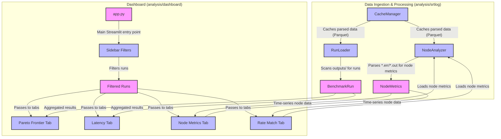

<!-- source: DeepWiki mcp.deepwiki.com · repo NVIDIA/srt-slurm · page 9 Results Analysis · fetched 2026-10-26 -->

# Results Analysis

<details>
<summary>Relevant source files</summary>

The following files were used as context for generating this wiki page:

- [analysis/dashboard/app.py](analysis/dashboard/app.py)
- [analysis/dashboard/components.py](analysis/dashboard/components.py)
- [analysis/dashboard/node_metrics_tab.py](analysis/dashboard/node_metrics_tab.py)
- [analysis/dashboard/rate_match_tab.py](analysis/dashboard/rate_match_tab.py)
- [analysis/requirements-dashboard.txt](analysis/requirements-dashboard.txt)
- [analysis/requirements.txt](analysis/requirements.txt)
- [analysis/srtlog/cluster_config.py](analysis/srtlog/cluster_config.py)
- [analysis/srtlog/config_reader.py](analysis/srtlog/config_reader.py)
- [analysis/srtlog/export_node_metrics.py](analysis/srtlog/export_node_metrics.py)
- [analysis/srtlog/log_parser.py](analysis/srtlog/log_parser.py)
- [analysis/srtlog/models.py](analysis/srtlog/models.py)
- [analysis/srtlog/run_loader.py](analysis/srtlog/run_loader.py)
- [docs/sweeps.md](docs/sweeps.md)
- [src/srtctl/benchmarks/scripts/sa-bench/backend_request_func.py](src/srtctl/benchmarks/scripts/sa-bench/backend_request_func.py)

</details>


Analyzing benchmark results is crucial for understanding performance characteristics, identifying bottlenecks, and comparing different configurations. The `srt-slurm` codebase provides a robust set of tools for parsing raw benchmark outputs and visualizing them effectively. This page offers a high-level overview of these analysis capabilities, with links to dedicated child pages for in-depth details.

The analysis pipeline generally involves two main stages:
1.  **Log Parsing and Data Transformation**: Raw log files and benchmark outputs generated by `srtctl` jobs are parsed and transformed into structured data, primarily using the `srtlog` Python library. This process extracts key performance metrics, node-level statistics, and configuration details.
2.  **Interactive Visualization**: The structured data is then fed into a Streamlit-based dashboard, providing an interactive interface for filtering, comparing, and visualizing benchmark results.

## Analysis Tooling Overview

The `srt-slurm` analysis tooling is designed to handle the diverse outputs of benchmark runs, from high-level performance metrics to granular, time-series node statistics.

### Log Parsing & `srtlog` Library

The `srtlog` Python library is the backbone of the data processing pipeline. It provides utilities to:
*   Scan `outputs/` directories for completed benchmark runs.
*   Parse various log files (`.err`, `.out`, `.json`) to extract structured data.
*   Flatten complex benchmark results into easily consumable Pandas DataFrames.
*   Cache parsed data to speed up subsequent analysis.

For a detailed explanation of the `srtlog` library, its components like `RunLoader` and `NodeAnalyzer`, and how it processes benchmark outputs, see [Log Parsing & srtlog Library](#9.1).

Sources:
- [analysis/srtlog/log_parser.py:1-199]()
- [analysis/srtlog/run_loader.py]()
- [analysis/srtlog/models.py:1-186]()
- [analysis/srtlog/export_node_metrics.py:1-199]()
- [analysis/srtlog/config_reader.py:1-199]()

### Streamlit Analysis Dashboard

The Streamlit dashboard provides an interactive web interface for visualizing and comparing the processed benchmark results. It allows users to:
*   Filter runs based on various criteria (GPU type, topology, ISL/OSL, tags).
*   Visualize key performance indicators like Output TPS, latency (TTFT, TPOT, ITL).
*   Inspect node-level metrics such as KV cache utilization, request queue depth, and transfer queue activity.
*   Analyze rate matching between prefill and decode stages in disaggregated deployments.

For a comprehensive guide on using the Streamlit dashboard, its features, and how to interpret the visualizations, see [Streamlit Analysis Dashboard](#9.2).

Sources:
- [analysis/dashboard/app.py:1-217]()
- [analysis/dashboard/components.py:1-230]()
- [analysis/dashboard/node_metrics_tab.py:1-160]()
- [analysis/dashboard/rate_match_tab.py:1-190]()

## Analysis Workflow

The typical workflow for analyzing results involves:

1.  **Running Benchmarks**: Execute `srtctl` jobs, potentially with parameter sweeps, to generate `outputs/` directories containing benchmark results and logs.
    Sources:
    - [docs/sweeps.md:1-125]()
2.  **Loading Data**: The Streamlit dashboard, via `RunLoader` [analysis/dashboard/components.py:78-80](), automatically scans the `outputs/` directory (defaulting to `project_root/outputs` [analysis/dashboard/components.py:162-166]()) and loads available benchmark runs.
3.  **Parsing Node Metrics**: For detailed node-level analysis, the `NodeAnalyzer` [analysis/srtlog/log_parser.py:21-26]() class parses `.err` and `.out` files from individual worker nodes to extract time-series metrics. This process is cached using `CacheManager` [analysis/srtlog/log_parser.py:68-70]() to optimize performance.
4.  **Filtering and Visualization**: Users interact with the Streamlit dashboard to filter runs and explore various performance and node-level graphs.

### Analysis Data Flow
```mermaid
graph TD
    A[srtctl apply] --> B(Benchmark Runs)
    B --> C{outputs/ directory}
    C -- "benchmark-rollup.json" --> D[RunLoader.load_all_with_skipped()]
    C -- "*.err, *.out" --> E[NodeAnalyzer.parse_run_logs()]
    D -- "BenchmarkRun objects" --> F[Streamlit Dashboard]
    E -- "NodeMetrics objects" --> F
    F -- "User Interaction" --> G[Visualizations & Comparisons]

    subgraph "analysis/srtlog"
        D
        E
    end

    subgraph "analysis/dashboard"
        F
        G
    end

    style A fill:#f9f,stroke:#333,stroke-width:2px
    style B fill:#bbf,stroke:#333,stroke-width:2px
    style C fill:#f9f,stroke:#333,stroke-width:2px
    style D fill:#bbf,stroke:#333,stroke-width:2px
    style E fill:#bbf,stroke:#333,stroke-width:2px
    style F fill:#f9f,stroke:#333,stroke-width:2px
    style G fill:#bbf,stroke:#333,stroke-width:2px
```
Title: Analysis Data Flow
Sources:
- [analysis/srtlog/log_parser.py:53-85]()
- [analysis/srtlog/run_loader.py]()
- [analysis/dashboard/components.py:78-80]()
- [analysis/dashboard/components.py:83-97]()
- [analysis/dashboard/app.py:209-210]()

### Key Components and Their Roles


Title: Key Analysis Components
Sources:
- [analysis/srtlog/run_loader.py]()
- [analysis/srtlog/log_parser.py:21-26]()
- [analysis/srtlog/cache_manager.py]()
- [analysis/srtlog/models.py:10-186]()
- [analysis/dashboard/app.py:20-26]()
- [analysis/dashboard/app.py:40-210]()
- [analysis/dashboard/pareto_tab.py]()
- [analysis/dashboard/latency_tab.py]()
- [analysis/dashboard/node_metrics_tab.py:11-22]()
- [analysis/dashboard/rate_match_tab.py:11-13]()

---

