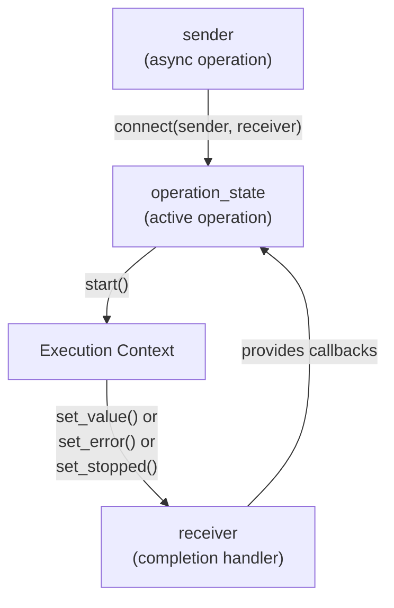
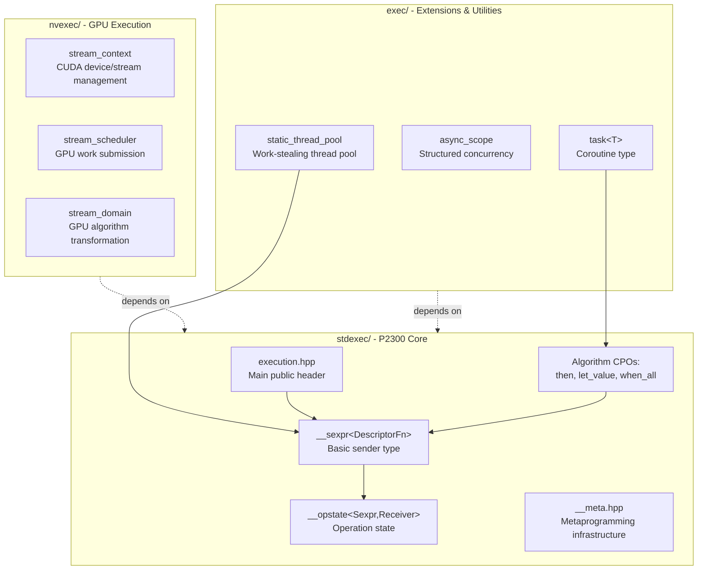
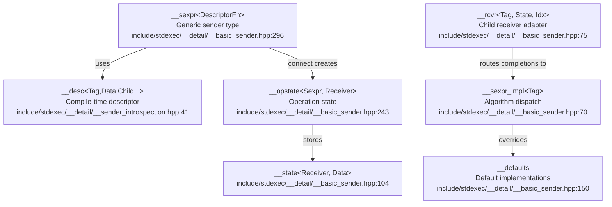

<!-- source: DeepWiki mcp.deepwiki.com · repo NVIDIA/stdexec · page 1 Overview · fetched 2026-10-26 -->

# Overview

Relevant source files

The following files were used as context for generating this wiki page:

- [.github/workflows/ci.cpu.yml](.github/workflows/ci.cpu.yml)
- [.github/workflows/ci.gpu.yml](.github/workflows/ci.gpu.yml)
- [.github/workflows/test-windows.ps1](.github/workflows/test-windows.ps1)
- [CMakeLists.txt](CMakeLists.txt)
- [README.md](README.md)
- [examples/CMakeLists.txt](examples/CMakeLists.txt)
- [examples/benchmark/fibonacci.cpp](examples/benchmark/fibonacci.cpp)
- [examples/io_uring.cpp](examples/io_uring.cpp)
- [examples/nvexec/CMakeLists.txt](examples/nvexec/CMakeLists.txt)
- [include/nvexec/stream/continues_on.cuh](include/nvexec/stream/continues_on.cuh)
- [include/stdexec/__detail/__basic_sender.hpp](include/stdexec/__detail/__basic_sender.hpp)
- [include/stdexec/__detail/__execution_fwd.hpp](include/stdexec/__detail/__execution_fwd.hpp)
- [include/stdexec/__detail/__meta.hpp](include/stdexec/__detail/__meta.hpp)
- [include/stdexec/__detail/__sender_introspection.hpp](include/stdexec/__detail/__sender_introspection.hpp)
- [include/stdexec/execution.hpp](include/stdexec/execution.hpp)
- [test/CMakeLists.txt](test/CMakeLists.txt)
- [test/nvexec/CMakeLists.txt](test/nvexec/CMakeLists.txt)
- [test/nvexec/continues_on.cpp](test/nvexec/continues_on.cpp)
- [test/nvexec/when_all_fail.cpp](test/nvexec/when_all_fail.cpp)

This document provides an overview of the NVIDIA stdexec repository, a C++20 reference implementation of the P2300 standard proposal for asynchronous execution. The material covered includes the repository's purpose, architectural structure, core abstractions, execution backends, and advanced features.

For detailed information about building and configuring the library, see [Building and Integration](#8). For hands-on examples demonstrating usage patterns, see [Examples and Tutorials](#9).

## Purpose and Scope

The stdexec library implements the sender/receiver execution model specified in [P2300](https://wg21.link/exec), providing a unified framework for expressing asynchronous operations across CPU and GPU execution contexts. The library serves as both a reference implementation for standardization efforts and a production-ready framework for asynchronous programming in modern C++.

The repository provides:
1.  **Reference Implementation**: A complete implementation of the C++26 `std::execution` additions [README.md:3-3]().
2.  **Generic Extensions**: Non-standard generic utilities under the `::exec` namespace [README.md:68-68]().
3.  **GPU Support**: NVIDIA-specific extensions for running code on GPUs using standard C++ under the `::nvexec` namespace [README.md:66-66]().
4.  **Modern C++ Requirements**: Requires C++20 and a conforming preprocessor [README.md:80-80]().

Sources: [README.md:1-70](), [include/stdexec/__detail/__execution_fwd.hpp:1-28]()

## P2300 Sender/Receiver Model

P2300 defines an execution model based on three core concepts: **senders**, **receivers**, and **operation states**. A sender represents an asynchronous operation that will eventually complete with a value, error, or cancellation signal. A receiver is a callback interface that handles these completion signals. Connecting a sender to a receiver produces an operation state that can be started.

The execution flow follows this pattern:

Vertical Data Flow:

**Core Customization Point Objects (CPOs):**
- `connect`: Combines a sender with a receiver to create an `operation_state` [include/stdexec/__detail/__execution_fwd.hpp:221-221]().
- `start`: Initiates execution of an `operation_state` [include/stdexec/__detail/__execution_fwd.hpp:222-222]().
- `set_value`, `set_error`, `set_stopped`: Completion signals sent to receivers [include/stdexec/__detail/__execution_fwd.hpp:71-77]().

Sources: [include/stdexec/__detail/__execution_fwd.hpp:64-225](), [include/stdexec/execution.hpp:42-59]()

## Repository Structure

The repository implements a three-layer architecture: **stdexec** (P2300 core), **exec** (extensions and utilities), and **nvexec** (GPU acceleration).

### Three-Layer Architecture

**Key Components by Layer:**

| Layer | Directory | Namespace | Purpose |
|-------|-----------|-----------|---------|
| **stdexec** | `include/stdexec/` | `::stdexec` | C++26 standard approved components [README.md:61-61](). |
| **exec** | `include/exec/` | `::exec` | Generic additions and extensions [README.md:68-68](). |
| **nvexec** | `include/nvexec/` | `::nvexec` | NVIDIA-specific GPU customizations [README.md:66-66](). |

Sources: [README.md:59-69](), [include/stdexec/execution.hpp:21-79]()

## Core Sender Implementation

The heart of stdexec is the `__sexpr` (sender expression) type defined in `__basic_sender.hpp`. All sender algorithms produce instances of `__sexpr` specialized with different tag types, data, and child senders.

### Key Implementation Types

**Sender Expression Framework (`__basic_sender.hpp`)**

**Key classes and their roles:**

| Class Template | Line Range | Purpose |
|---------------|------------|---------|
| `__sexpr<DescriptorFn>` | [include/stdexec/__detail/__basic_sender.hpp:296-374]() | Generic sender, holds tag/data/children in tuple-like structure. |
| `__sexpr_impl<Tag>` | [include/stdexec/__detail/__basic_sender.hpp:70-70]() | Customization point for tag-specific behavior (get_state, start, complete). |
| `__opstate<Sender, Receiver>` | [include/stdexec/__detail/__basic_sender.hpp:243-271]() | Operation state holding receiver state and child operation states. |
| `__rcvr<Tag, State, Idx>` | [include/stdexec/__detail/__basic_sender.hpp:75-76]() | Child receiver that routes completions via `__sexpr_impl<Tag>::complete`. |
| `__state<Receiver, Data>` | [include/stdexec/__detail/__basic_sender.hpp:104-121]() | Stores user receiver and algorithm-specific data. |
| `__defaults` | [include/stdexec/__detail/__basic_sender.hpp:150-199]() | Default implementations for `__get_state`, `__connect`, `__start`. |

Sources: [include/stdexec/__detail/__basic_sender.hpp:1-400](), [include/stdexec/__detail/__sender_introspection.hpp:39-55]()

## Metaprogramming Infrastructure

The metaprogramming layer (`include/stdexec/__detail/__meta.hpp`) provides the foundation for type manipulation and compile-time introspection used throughout the library.

**Core Meta-Utilities:**

| Utility | Definition | Purpose |
|---------|------------|---------|
| `__t<Tp>` | [include/stdexec/__detail/__meta.hpp:36-36]() | Convenience for `typename Tp::__t`. |
| `__mconstant<Np>` | [include/stdexec/__detail/__meta.hpp:65-80]() | Compile-time integral constant wrapper. |
| `_ERROR_<What...>` | [include/stdexec/__detail/__meta.hpp:179-207]() | Type-based error propagation mechanism. |
| `__mcall<Fn, Args...>` | [include/stdexec/__detail/__meta.hpp:234-234]() | Invokes a metafunction with arguments. |
| `__ok<Arg>` | [include/stdexec/__detail/__meta.hpp:228-228]() | Concept to check if a type is not a metaprogramming error. |

Sources: [include/stdexec/__detail/__meta.hpp:1-251]()

## Execution Backends

### CPU Execution
The library provides several CPU-based execution contexts:
- **`static_thread_pool`**: A pool of worker threads for concurrent execution [examples/benchmark/static_thread_pool.cpp:59-59]().
- **`inline_scheduler`**: Executes work immediately on the current thread [include/stdexec/execution.hpp:34-34]().
- **`run_loop`**: A manual event loop for thread coordination [include/stdexec/execution.hpp:47-47]().

### GPU Execution (nvexec)
`nvexec` enables execution on NVIDIA GPUs via:
- **`stream_scheduler`**: Executes on a single GPU using CUDA streams [README.md:154-154]().
- **`multi_gpu_stream_scheduler`**: Distributes work across all visible GPUs [README.md:155-155]().

Sources: [README.md:148-158](), [include/stdexec/execution.hpp:32-61]()

## Platform Support

The library supports a wide range of compilers and platforms:
- **Compilers**: GCC 12+, Clang 16+, MSVC 14.43+, and NVC++ 25.9+ [README.md:72-78]().
- **Architecture**: Supports x86_64 and ARM64 (AMD64 and L4 GPUs used in CI) [.github/workflows/ci.gpu.yml:22-27]().
- **CI Environment**: Extensive testing on both CPU and GPU via GitHub Actions [.github/workflows/ci.cpu.yml:1-43](), [.github/workflows/ci.gpu.yml:1-28]().

Sources: [README.md:70-84](), [.github/workflows/ci.cpu.yml:22-43](), [.github/workflows/ci.gpu.yml:22-28]()

---

