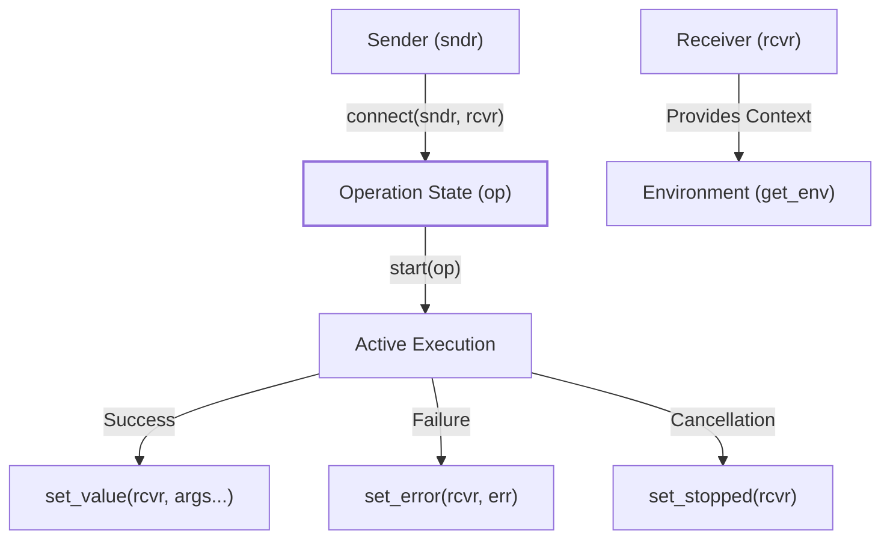
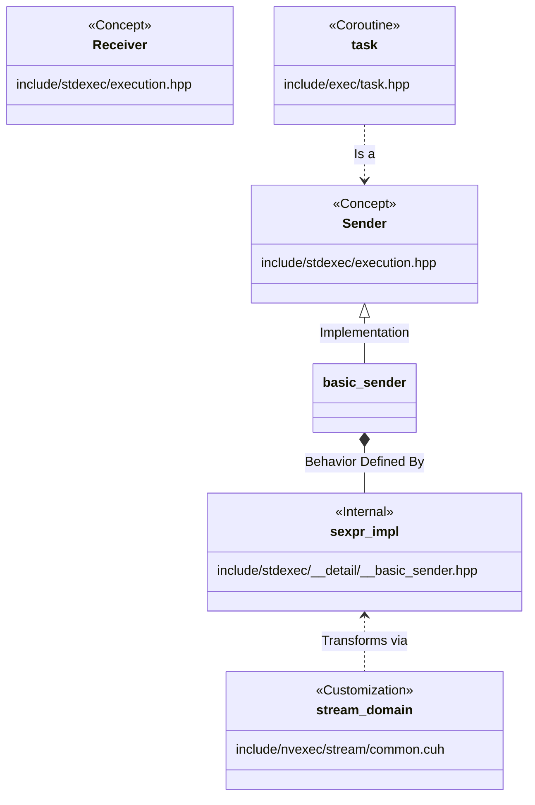

<!-- source: DeepWiki mcp.deepwiki.com · repo NVIDIA/stdexec · page 10 Glossary · fetched 2026-10-26 -->

# Glossary

Relevant source files

The following files were used as context for generating this wiki page:

- [CMakeLists.txt](CMakeLists.txt)
- [examples/CMakeLists.txt](examples/CMakeLists.txt)
- [examples/benchmark/fibonacci.cpp](examples/benchmark/fibonacci.cpp)
- [examples/io_uring.cpp](examples/io_uring.cpp)
- [examples/nvexec/CMakeLists.txt](examples/nvexec/CMakeLists.txt)
- [examples/nvexec/maxwell/snr.cuh](examples/nvexec/maxwell/snr.cuh)
- [include/exec/at_coroutine_exit.hpp](include/exec/at_coroutine_exit.hpp)
- [include/exec/on.hpp](include/exec/on.hpp)
- [include/exec/on_coro_disposition.hpp](include/exec/on_coro_disposition.hpp)
- [include/exec/task.hpp](include/exec/task.hpp)
- [include/nvexec/stream/common.cuh](include/nvexec/stream/common.cuh)
- [include/nvexec/stream/continues_on.cuh](include/nvexec/stream/continues_on.cuh)
- [include/nvexec/stream/ensure_started.cuh](include/nvexec/stream/ensure_started.cuh)
- [include/nvexec/stream/split.cuh](include/nvexec/stream/split.cuh)
- [include/nvexec/stream/when_all.cuh](include/nvexec/stream/when_all.cuh)
- [include/stdexec/__detail/__basic_sender.hpp](include/stdexec/__detail/__basic_sender.hpp)
- [include/stdexec/__detail/__config.hpp](include/stdexec/__detail/__config.hpp)
- [include/stdexec/__detail/__execution_fwd.hpp](include/stdexec/__detail/__execution_fwd.hpp)
- [include/stdexec/__detail/__meta.hpp](include/stdexec/__detail/__meta.hpp)
- [include/stdexec/__detail/__preprocessor.hpp](include/stdexec/__detail/__preprocessor.hpp)
- [include/stdexec/__detail/__sender_introspection.hpp](include/stdexec/__detail/__sender_introspection.hpp)
- [include/stdexec/concepts.hpp](include/stdexec/concepts.hpp)
- [include/stdexec/execution.hpp](include/stdexec/execution.hpp)
- [include/stdexec/functional.hpp](include/stdexec/functional.hpp)
- [test/CMakeLists.txt](test/CMakeLists.txt)
- [test/exec/test_at_coroutine_exit.cpp](test/exec/test_at_coroutine_exit.cpp)
- [test/exec/test_task.cpp](test/exec/test_task.cpp)
- [test/nvexec/CMakeLists.txt](test/nvexec/CMakeLists.txt)
- [test/nvexec/continues_on.cpp](test/nvexec/continues_on.cpp)
- [test/nvexec/when_all_fail.cpp](test/nvexec/when_all_fail.cpp)

This glossary defines codebase-specific terms, abbreviations, and domain concepts used throughout the `stdexec` and `nvexec` libraries. It covers the fundamental abstractions of the P2300 (Sender/Receiver) execution model, internal implementation patterns like the S-expression sender model, and GPU-specific terminology.

## Core P2300 Concepts

The fundamental building blocks of the execution model as defined in [include/stdexec/execution.hpp:18-78]().

| Term | Definition | Code Entity |
|:---|:---|:---|
| **Sender** | An abstraction representing a unit of work that will eventually complete with one of three signals: value, error, or stopped. | `STDEXEC::sender` |
| **Receiver** | A callback object that handles the completion signals of a sender. | `STDEXEC::receiver` |
| **Operation State** | An object that holds the state of an asynchronous operation while it is executing. Created by `connect`. | `STDEXEC::operation_state` |
| **Scheduler** | A handle to an execution context that can produce a "schedule-sender" to start a task. | `STDEXEC::scheduler` |
| **Environment** | A key-value mapping (queries to results) propagated through the sender graph to provide context (e.g., stop tokens, schedulers). | `STDEXEC::env` |
| **Domain** | A customization point that allows specific execution contexts (like CUDA streams) to transform or override sender algorithms. | `STDEXEC::default_domain` |

### The Operation Lifecycle

The interaction between these entities follows a strict lifecycle: `connect` -> `start` -> `completion`.

Title: Sender-Receiver Execution Lifecycle

**Sources:** [include/stdexec/execution.hpp:42-59](), [include/stdexec/__detail/__basic_sender.hpp:145-187]()

---

## Internal Implementation Patterns

### __sexpr (S-Expression) Model
The library uses a uniform representation for senders called `__sexpr` (Sender Expression). This allows algorithms to be defined as data structures that are later interpreted or transformed by a `domain`.

*   **Tag**: The algorithm identifier (e.g., `then_t`, `bulk_t`).
*   **Data**: The data associated with the algorithm (e.g., the function object for `then`).
*   **Children**: The predecessor senders in the graph.

**Key Entities:**
*   `__sexpr_impl`: A template used to define the behavior (state, environment, start) of a specific tag [include/stdexec/__detail/__basic_sender.hpp:69-70]().
*   `basic_sender`: The standard wrapper that holds the S-expression data [include/stdexec/__detail/__basic_sender.hpp:24-24]().

### Metaprogramming Utilities
The library relies on a custom metaprogramming library located in `__meta.hpp`.

*   **`__t`**: A metafunction to extract the nested `::type` or `::__t` from a class [include/stdexec/__detail/__meta.hpp:35-36]().
*   **`__mcall`**: Invokes a template alias or a meta-function object [include/stdexec/__detail/__meta.hpp:233-234]().
*   **`__ok`**: A concept to check if a type represents a successful meta-computation (not an `_ERROR_`) [include/stdexec/__detail/__meta.hpp:227-228]().

---

## GPU & nvexec Terminology

The `nvexec` extension provides GPU-accelerated implementations of P2300 algorithms using CUDA.

### stream_context & stream_scheduler
The `stream_context` manages a pool of CUDA streams. Its scheduler produces senders that ensure work is enqueued on a specific `cudaStream_t`.

**Sources:** [include/nvexec/stream/common.cuh:78-78](), [include/nvexec/stream/common.cuh:201-215]()

### stream_domain
A specialization of `domain` used by `nvexec`. When a sender is connected within a `stream_domain`, standard algorithms like `then` or `bulk` are transformed into GPU-side kernel launches or stream-ordered operations via `transform_sender` [include/nvexec/stream/common.cuh:145-164]().

### Completion Signatures
A type-level list of all possible ways a sender can complete.
*   `set_value_t(Args...)`: Completes with values of types `Args`.
*   `set_error_t(Error)`: Completes with an error of type `Error`.
*   `set_stopped_t()`: Completes via cancellation.

**Sources:** [include/stdexec/__detail/__execution_fwd.hpp:71-77](), [include/stdexec/__detail/__execution_fwd.hpp:185-187]()

---

## Advanced Abstractions

### Coroutine Integration
The library integrates with C++20 coroutines through `exec::task` and `as_awaitable`.
*   **`exec::task`**: A coroutine type that behaves as a sender and can `co_await` other senders [include/exec/task.hpp:41-43]().
*   **`__scheduler_affinity`**: A property in `exec::task` that determines if a coroutine should remain on its current scheduler (`__sticky`) [include/exec/task.hpp:116-120]().

### structured_binding_size
The library supports structured bindings for certain sender types (like those in `repeat_n`) by specializing `__structured_binding_size_v` [examples/nvexec/maxwell/snr.cuh:240-242]().

---

## Code Entity Mapping

The following diagram maps high-level concepts to their specific implementation classes and file locations.

Title: Mapping Concepts to Code Entities

**Sources:** [include/stdexec/__detail/__basic_sender.hpp:69-120](), [include/nvexec/stream/common.cuh:145-164](), [include/exec/task.hpp:41-84]()

## Abbreviations Table

| Abbreviation | Full Term | Context |
|:---|:---|:---|
| **CPO** | Customization Point Object | Used for functions like `connect`, `start`, `set_value` [include/stdexec/__detail/__execution_fwd.hpp:126-130](). |
| **Sexpr** | S-Expression | The internal tree-like representation of sender chains [include/stdexec/__detail/__basic_sender.hpp:44-52](). |
| **Env** | Environment | The execution context propagated via `get_env` [include/stdexec/__detail/__execution_fwd.hpp:104-111](). |
| **OpState** | Operation State | The object returned by `connect` [include/stdexec/__detail/__execution_fwd.hpp:167-167](). |
| **Sig** | Signature | Short for `completion_signatures` [include/stdexec/__detail/__execution_fwd.hpp:185-187](). |

**Sources:** [include/stdexec/__detail/__execution_fwd.hpp:104-130](), [include/stdexec/__detail/__basic_sender.hpp:44-52](), [include/stdexec/__detail/__meta.hpp:173-202]()