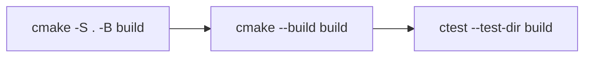
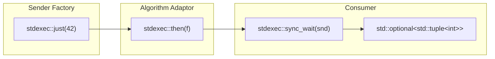
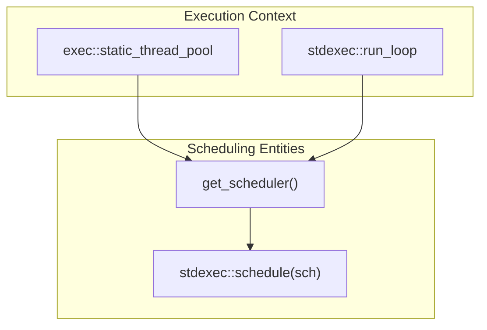
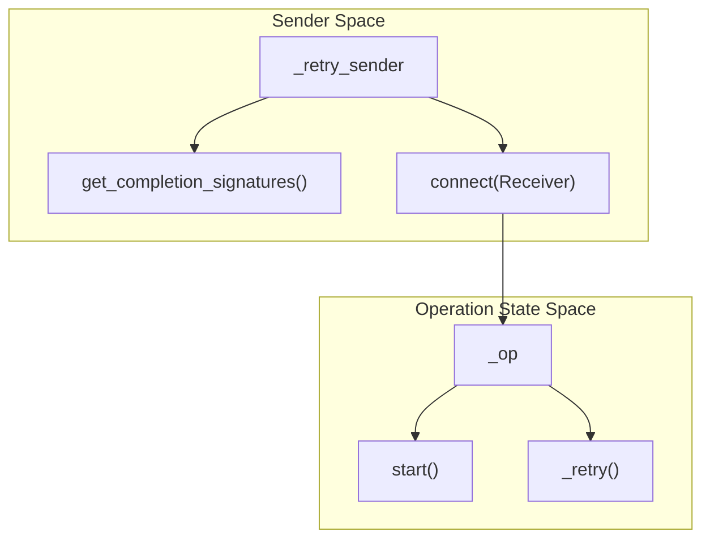

<!-- source: DeepWiki mcp.deepwiki.com · repo NVIDIA/stdexec · page 2 Getting Started · fetched 2026-10-26 -->

# Getting Started

<details>
<summary>Relevant source files</summary>

The following files were used as context for generating this wiki page:

- [.clang-format](.clang-format)
- [.gitignore](.gitignore)
- [conanfile.py](conanfile.py)
- [examples/algorithms/retry.hpp](examples/algorithms/retry.hpp)
- [examples/algorithms/then.hpp](examples/algorithms/then.hpp)
- [examples/hello_coro.cpp](examples/hello_coro.cpp)
- [examples/hello_world.cpp](examples/hello_world.cpp)
- [include/stdexec/__detail/__env.hpp](include/stdexec/__detail/__env.hpp)
- [include/stdexec/__detail/__just.hpp](include/stdexec/__detail/__just.hpp)
- [include/stdexec/__detail/__read_env.hpp](include/stdexec/__detail/__read_env.hpp)
- [include/stdexec/__detail/__schedulers.hpp](include/stdexec/__detail/__schedulers.hpp)
- [include/stdexec/__detail/__sync_wait.hpp](include/stdexec/__detail/__sync_wait.hpp)
- [include/stdexec/__detail/__write_env.hpp](include/stdexec/__detail/__write_env.hpp)
- [sanitizer-ignorelist.txt](sanitizer-ignorelist.txt)
- [test/test_main.cpp](test/test_main.cpp)
- [test_package/CMakeLists.txt](test_package/CMakeLists.txt)
- [test_package/conanfile.py](test_package/conanfile.py)
- [test_package/test.cpp](test_package/test.cpp)

</details>


This page provides a practical quick-start guide to building `stdexec`, writing your first sender/receiver code, and running examples. For a conceptual introduction to the execution model, see [Core Execution Model](#3).

## Prerequisites and Dependencies

`stdexec` requires C++20 support. The project supports multiple compilers across CPU and GPU execution contexts.

### Required Tooling

| Component | Minimum Version | Notes |
|-----------|----------------|-------|
| CMake | 3.25.0 | Required by [test_package/CMakeLists.txt:1]() |
| C++ Compiler | C++20 compliant | Validated by Conan in [conanfile.py:45]() |

### Supported Compilers

| Compiler | Versions | Platform | GPU Support |
|----------|----------|----------|-------------|
| GCC | 11+ | Linux | No |
| Clang | 16+ | Linux, macOS | Via CUDA toolkit |
| MSVC | 2022+ | Windows | No |
| NVHPC | 24.5+ | Linux | Yes (built-in) |

**Sources:** [conanfile.py:44-45](), [test_package/CMakeLists.txt:1-2]()

## Building stdexec

### Basic Build Process

`stdexec` can be built using standard CMake or via Conan. The core library is header-only unless the `parallel_scheduler` is enabled.



**Diagram: Standard CMake build workflow**

**Sources:** [conanfile.py:55-66](), [test_package/CMakeLists.txt:1-12]()

### Primary Targets

| Target | Type | Description | Source |
|--------|------|-------------|--------|
| `STDEXEC::stdexec` | Interface library | Core sender/receiver framework | [conanfile.py:80]() |
| `STDEXEC::parallel_scheduler` | Static library | Compiled parallel scheduler backend | [conanfile.py:81-85]() |

**Sources:** [conanfile.py:36-42](), [conanfile.py:77-86]()

## Your First Sender Chain

### Including the Library

The primary header provides the complete P2300 implementation:

```cpp
#include <stdexec/execution.hpp>
```

**Sources:** [examples/hello_world.cpp:19](), [examples/hello_coro.cpp:19]()

### Basic Sender Creation and Execution



**Diagram: Data flow through a simple sender chain**

Minimal working example:

```cpp
#include <stdexec/execution.hpp>
#include <iostream>

int main() {
  using namespace stdexec;
  
  // Create a sender that completes with value 42
  auto snd = just(42)
           | then([](int x) { return x * 2; });
  
  // Block and wait for result
  auto [result] = sync_wait(snd).value();
  
  std::cout << "Result: " << result << std::endl; // Prints: Result: 84
  return 0;
}
```

**Key Components:**

| Symbol | Role | Implementation |
|--------|------|----------------|
| `stdexec::just` | Factory | Creates a sender that immediately completes with values. [include/stdexec/__detail/__just.hpp:1]() |
| `stdexec::then` | Adaptor | Transforms values using a function. [examples/algorithms/then.hpp:1]() |
| `stdexec::sync_wait` | Consumer | Blocks the current thread until the sender completes. [include/stdexec/__detail/__sync_wait.hpp:197-213]() |

**Sources:** [include/stdexec/__detail/__sync_wait.hpp:44-213](), [examples/hello_world.cpp:23-41]()

## Using Schedulers

Schedulers are handles to execution contexts. You obtain a sender from a scheduler using the `schedule` customization point.



**Diagram: Obtaining and using schedulers**

Example with `static_thread_pool`:

```cpp
#include <stdexec/execution.hpp>
#include <exec/static_thread_pool.hpp>

int main() {
  exec::static_thread_pool ctx{8};
  scheduler auto sch = ctx.get_scheduler(); // [examples/hello_world.cpp:29]()
  
  sender auto snd = stdexec::schedule(sch) // [examples/hello_world.cpp:31]()
           | stdexec::then([] { return 42; });
           
  auto [res] = stdexec::sync_wait(snd).value();
}
```

**Key Scheduling Concepts:**

| Entity | Purpose | Definition |
|--------|---------|------------|
| `scheduler` | Concept for a handle to an execution context. | [include/stdexec/__detail/__schedulers.hpp:67-69]() |
| `schedule` | CPO that produces a sender from a scheduler. | [include/stdexec/__detail/__schedulers.hpp:119-164]() |
| `get_scheduler` | Query to find the current scheduler in an environment. | [include/stdexec/__detail/__sync_wait.hpp:51-56]() |

**Sources:** [include/stdexec/__detail/__schedulers.hpp:34-173](), [examples/hello_world.cpp:26-31]()

## Running Examples

The repository includes several examples demonstrating core patterns.

### Example: Hello World

The `hello_world.cpp` example shows how to bridge thread pools with `sync_wait` and how `sync_wait` itself provides a `run_loop` scheduler to its child senders.

```cpp
// examples/hello_world.cpp
exec::static_thread_pool ctx{8};
scheduler auto sch = ctx.get_scheduler();

sender auto begin = schedule(sch);
sender auto hi_again = then(begin, [] {
  std::cout << "Hello world! Have an int.\n";
  return 13;
});

auto [i] = sync_wait(std::move(hi_again)).value();
```

**Sources:** [examples/hello_world.cpp:26-41]()

### Example: Coroutines

`stdexec` integrates with C++20 coroutines. Senders are implicitly awaitable within a `stdexec::task`.

```cpp
// examples/hello_coro.cpp
template <sender S1, sender S2>
auto async_answer(S1 s1, S2 s2) -> stdexec::task<int> {
  // Senders are implicitly awaitable:
  co_await static_cast<S2&&>(s2); 
  co_return co_await static_cast<S1&&>(s1);
}
```

**Sources:** [examples/hello_coro.cpp:25-31]()

## Advanced Usage: Custom Senders

For more complex logic, you can implement the `sender` concept directly. This involves defining `completion_signatures` and a `connect` function that returns an operation state.



**Diagram: Custom sender implementation structure (Retry Algorithm)**

**Example from `retry` algorithm:**
- **Sender**: Defines `sender_concept` and computes signatures via `__transform_completion_signatures_t`. [examples/algorithms/retry.hpp:122-144]()
- **Connect**: Returns an `_op` (Operation State) object. [examples/algorithms/retry.hpp:146-150]()
- **Operation State**: Implements `start()` to initiate the child sender's operation state, and `_retry()` to re-connect and re-start upon error. [examples/algorithms/retry.hpp:83-119]()

**Sources:** [examples/algorithms/retry.hpp:50-162]()

---

