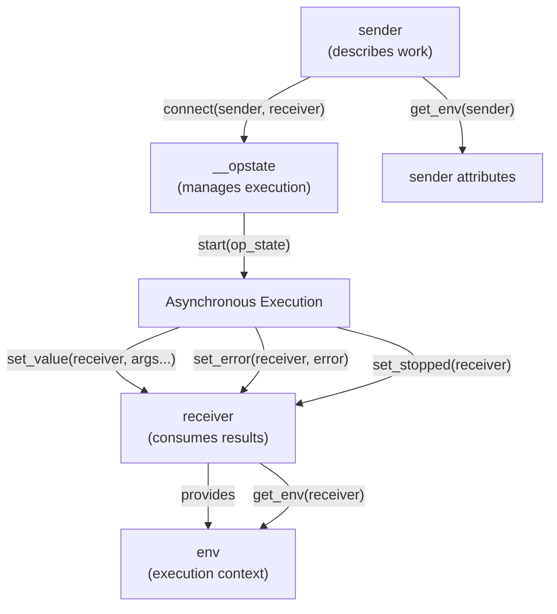
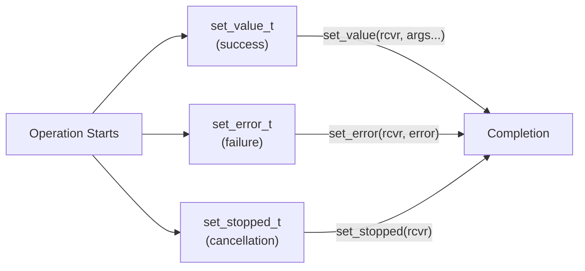
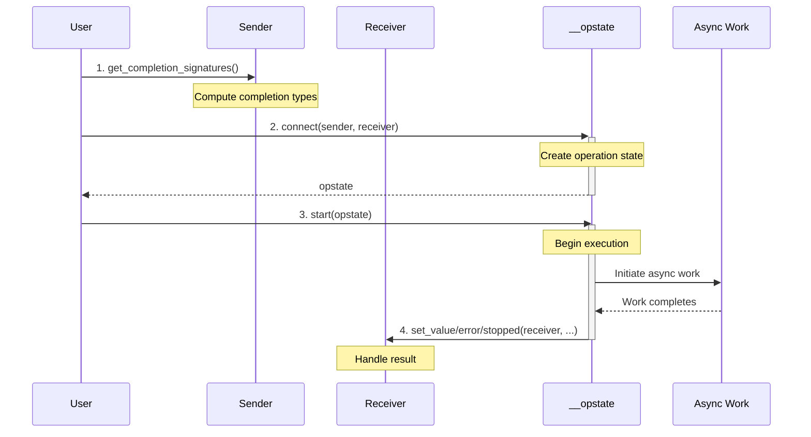
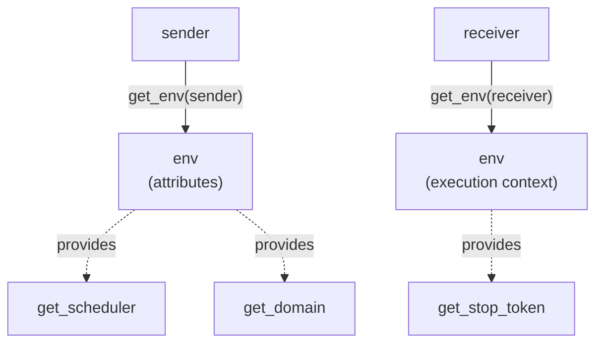

<!-- source: DeepWiki mcp.deepwiki.com · repo NVIDIA/stdexec · page 3 Core Execution Model · fetched 2026-10-26 -->

# Core Execution Model

Relevant source files

The following files were used as context for generating this wiki page:

- [include/exec/on.hpp](include/exec/on.hpp)
- [include/stdexec/__detail/__basic_sender.hpp](include/stdexec/__detail/__basic_sender.hpp)
- [include/stdexec/__detail/__config.hpp](include/stdexec/__detail/__config.hpp)
- [include/stdexec/__detail/__execution_fwd.hpp](include/stdexec/__detail/__execution_fwd.hpp)
- [include/stdexec/__detail/__meta.hpp](include/stdexec/__detail/__meta.hpp)
- [include/stdexec/__detail/__preprocessor.hpp](include/stdexec/__detail/__preprocessor.hpp)
- [include/stdexec/__detail/__sender_introspection.hpp](include/stdexec/__detail/__sender_introspection.hpp)
- [include/stdexec/concepts.hpp](include/stdexec/concepts.hpp)
- [include/stdexec/execution.hpp](include/stdexec/execution.hpp)
- [include/stdexec/functional.hpp](include/stdexec/functional.hpp)

## Purpose and Scope

This document explains the fundamental P2300 sender/receiver execution model implemented in `stdexec`. It covers the core abstractions—senders, receivers, operation states—and their interactions through customization points like `connect` and `start`. This page provides the technical foundation for understanding how asynchronous work is represented and executed in the library.

For specific details on:
- Sender and receiver concept definitions: see [Sender and Receiver Concepts](#3.1)
- How completion signatures are computed: see [Completion Signatures](#3.2)
- Environment queries and property propagation: see [Execution Environment and Queries](#3.3)
- Algorithm customization via domains: see [Domains and Customization](#3.4)
- Metaprogramming utilities: see [Metaprogramming Infrastructure](#3.5)
- The `__sexpr` sender implementation: see [The __sexpr Sender Model](#3.6)

## The P2300 Sender/Receiver Model

The `stdexec` library implements the C++ P2300 proposal for asynchronous execution, which defines a type-safe, composable framework for representing and executing asynchronous operations. The model is built around three core abstractions that form an inseparable triple:

| Concept | Role | Key Operations |
|---------|------|----------------|
| **Sender** | Represents asynchronous work that will produce values | Queried for completion signatures, connected to receivers |
| **Receiver** | Consumes the results of async work | Receives completions via `set_value`, `set_error`, `set_stopped` |
| **Operation State** | Manages the lifetime of executing work | Started with `start()`, owns resources until completion |

The model separates **description** (senders) from **execution** (operation states) from **consumption** (receivers), enabling powerful composition patterns.

**Sources:** [include/stdexec/__detail/__execution_fwd.hpp:64-170](), [include/stdexec/__detail/__basic_sender.hpp:42-121]()

## Core Type Relationships

**Diagram: Core Execution Model Type Relationships**

This diagram shows how the fundamental types interact through customization points `connect`, `start`, and the completion functions `set_value`, `set_error`, and `set_stopped`.

**Sources:** [include/stdexec/__detail/__execution_fwd.hpp:104-109](), [include/stdexec/__detail/__basic_sender.hpp:132-144](), [include/stdexec/__detail/__basic_sender.hpp:179-187]()

## Completion Signals

Every asynchronous operation in `stdexec` completes through one of three mutually-exclusive channels, represented by the completion signal types:

**Diagram: Three Completion Channels**

Each completion signal is a customization point object (CPO):

- **`set_value_t`**: Signals successful completion with zero or more result values. [include/stdexec/__detail/__execution_fwd.hpp:71]()
- **`set_error_t`**: Signals failure with a single error value. [include/stdexec/__detail/__execution_fwd.hpp:72]()
- **`set_stopped_t`**: Signals cancellation (no values). [include/stdexec/__detail/__execution_fwd.hpp:73]()

All completion functions are typically expected to be `noexcept` at the call site to ensure deterministic resource cleanup and consistent error handling boundaries.

**Sources:** [include/stdexec/__detail/__execution_fwd.hpp:69-77]()

## The Execution Lifecycle

**Diagram: Execution Lifecycle Sequence**

The execution lifecycle consists of four phases:

1. **Query Phase**: Determine what completion signatures the sender will produce using `get_completion_signatures_t`. [include/stdexec/__detail/__execution_fwd.hpp:194-199]()
2. **Connection Phase**: Call `connect(sender, receiver)` to create an operation state. [include/stdexec/__detail/__execution_fwd.hpp:221]()
3. **Start Phase**: Call `start(opstate)` to begin execution. [include/stdexec/__detail/__basic_sender.hpp:195-198]()
4. **Completion Phase**: The operation eventually calls one completion function on the receiver. [include/stdexec/__detail/__execution_fwd.hpp:71-77]()

**Sources:** [include/stdexec/__detail/__basic_sender.hpp:179-198](), [include/stdexec/__detail/__execution_fwd.hpp:194-221]()

## Concepts and Type Requirements

### sender

A type models `sender` if it has a `sender_tag` (or enables via `enable_sender`) and can be connected to appropriate receivers. [include/stdexec/__detail/__execution_fwd.hpp:166-172]()

### receiver

A type models `receiver` if it is move constructible, provides an environment via `get_env`, and supports completion signals. [include/stdexec/__detail/__execution_fwd.hpp:107-111](), [include/stdexec/__detail/__execution_fwd.hpp:169]()

## Environment and Query System

Every sender and receiver has an associated **environment** that provides access to execution context information through queries. The environment is obtained via `get_env()`.

**Diagram: Environment Query System**

Key environment queries include:

- **`get_scheduler`**: Returns a scheduler for executing subsequent work. [include/stdexec/__detail/__execution_fwd.hpp:123]()
- **`get_domain`**: Returns the domain for algorithm customization. [include/stdexec/__detail/__execution_fwd.hpp:132]()
- **`get_completion_scheduler<Tag>`**: Returns the scheduler where `Tag` completion will occur. [include/stdexec/__detail/__execution_fwd.hpp:126-127]()

**Sources:** [include/stdexec/__detail/__execution_fwd.hpp:107-147]()

## Domain Customization

Domains enable **algorithm customization** by transforming senders before they are connected to receivers. This allows platform-specific implementations to replace default algorithms with optimized versions.

The `default_domain` provides standard behavior, but custom domains can intercept and transform senders. [include/stdexec/__detail/__execution_fwd.hpp:65-68]()

**Sources:** [include/stdexec/__detail/__execution_fwd.hpp:65-68](), [include/stdexec/__detail/__execution_fwd.hpp:149-153]()

## The __sexpr Sender Model

Internally, most senders in `stdexec` are represented using the `__sexpr` template. This is a generic sender representation that stores a **tag**, **data**, and **children**. [include/stdexec/__detail/__sender_introspection.hpp:34-55]()

Each sender tag type provides a `__sexpr_impl<Tag>` specialization that customizes behavior for state management, environment propagation, and completion signature computation. [include/stdexec/__detail/__basic_sender.hpp:69-70]()

**Sources:** [include/stdexec/__detail/__basic_sender.hpp:42-70](), [include/stdexec/__detail/__sender_introspection.hpp:39-55]()

## Key Files

The core execution model is implemented across several internal header files:

| File | Purpose |
|------|---------|
| `__execution_fwd.hpp` | Forward declarations and core concept tags. [include/stdexec/__detail/__execution_fwd.hpp:1-221]() |
| `__basic_sender.hpp` | Generic `__sexpr` sender and `__opstate` implementation. [include/stdexec/__detail/__basic_sender.hpp:1-198]() |
| `__meta.hpp` | Extensive metaprogramming infrastructure. [include/stdexec/__detail/__meta.hpp:1-253]() |
| `__sender_introspection.hpp` | Utilities for decomposing senders into tags and data. [include/stdexec/__detail/__sender_introspection.hpp:1-183]() |

**Sources:** [include/stdexec/execution.hpp:1-78]()

---

