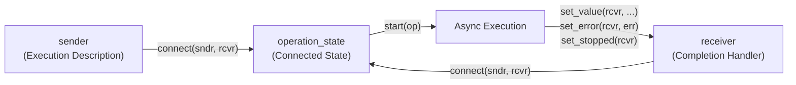
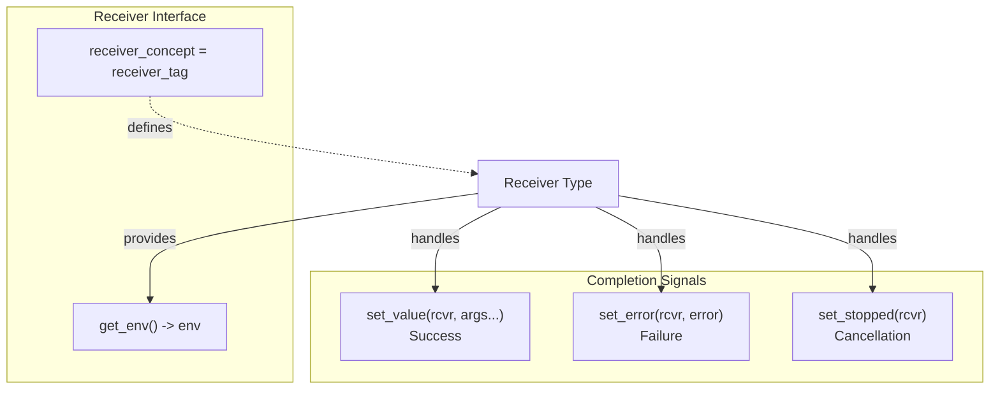
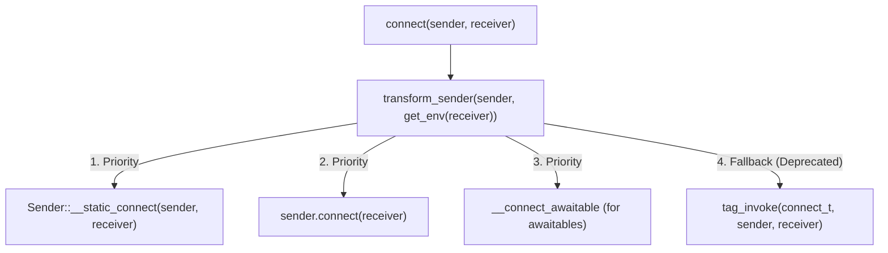
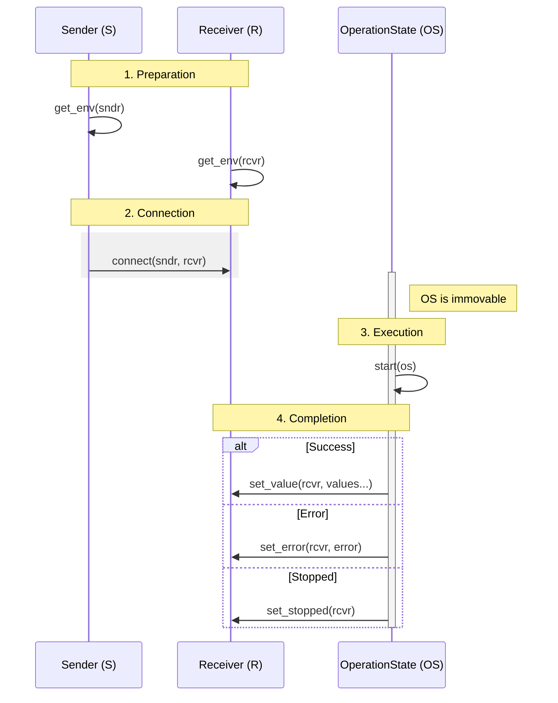

<!-- source: DeepWiki mcp.deepwiki.com · repo NVIDIA/stdexec · page 3.1 Sender and Receiver Concepts · fetched 2026-10-26 -->

# Sender and Receiver Concepts

Relevant source files

The following files were used as context for generating this wiki page:

- [include/stdexec/__detail/__concepts.hpp](include/stdexec/__detail/__concepts.hpp)
- [include/stdexec/__detail/__connect.hpp](include/stdexec/__detail/__connect.hpp)
- [include/stdexec/__detail/__diagnostics.hpp](include/stdexec/__detail/__diagnostics.hpp)
- [include/stdexec/__detail/__get_completion_signatures.hpp](include/stdexec/__detail/__get_completion_signatures.hpp)
- [include/stdexec/__detail/__operation_states.hpp](include/stdexec/__detail/__operation_states.hpp)
- [include/stdexec/__detail/__optional.hpp](include/stdexec/__detail/__optional.hpp)
- [include/stdexec/__detail/__receivers.hpp](include/stdexec/__detail/__receivers.hpp)
- [include/stdexec/__detail/__sender_concepts.hpp](include/stdexec/__detail/__sender_concepts.hpp)
- [include/stdexec/__detail/__tuple.hpp](include/stdexec/__detail/__tuple.hpp)
- [include/stdexec/__detail/__variant.hpp](include/stdexec/__detail/__variant.hpp)

## Purpose and Scope

This page defines the core sender/receiver execution model as implemented in `stdexec`. These concepts form the foundation of the library's asynchronous execution framework, establishing the vocabulary types and operations that enable composable asynchronous operations based on the P2300 proposal.

This page covers:
- The `sender`, `receiver`, and `operation_state` concepts.
- The completion signal protocol (`set_value`, `set_error`, `set_stopped`).
- The lifecycle operations (`connect` and `start`).
- Customization mechanisms for these operations.

## The Three-Concept Model

The execution model is built on three interdependent concepts that work together to represent asynchronous operations:

**Diagram: Core P2300 Concepts and Their Relationships**

Sources: [include/stdexec/__detail/__sender_concepts.hpp:90-117](), [include/stdexec/__detail/__receivers.hpp:89-91](), [include/stdexec/__detail/__operation_states.hpp:158-167]()

| Concept | Purpose | Key Operations |
|---------|---------|----------------|
| `sender` | Describes an asynchronous operation; lazy and by-value. | `connect()`, `get_env()` |
| `receiver` | Handles completion signals from an operation state. | `set_value()`, `set_error()`, `set_stopped()` |
| `operation_state` | An immovable object representing a connected sender-receiver pair. | `start()` |

Sources: [include/stdexec/__detail/__sender_concepts.hpp:123-127](), [include/stdexec/__detail/__receivers.hpp:195-204](), [include/stdexec/__detail/__operation_states.hpp:185-191]()

## The Receiver Concept

A `receiver` is a completion handler that receives notification when an asynchronous operation completes. Receivers must handle three completion signals representing different completion dispositions.

**Diagram: Receiver Concept Requirements**

Sources: [include/stdexec/__detail/__receivers.hpp:195-204](), [include/stdexec/__detail/__receivers.hpp:54-62]()

### Receiver Requirements

A type `R` models `receiver` if:
1. It is opted into the concept via a `receiver_concept` alias deriving from `receiver_tag` [include/stdexec/__detail/__receivers.hpp:196]().
2. It satisfies `__environment_provider` (provides `get_env`) [include/stdexec/__detail/__receivers.hpp:197]().
3. It is move-constructible [include/stdexec/__detail/__receivers.hpp:198]().

Sources: [include/stdexec/__detail/__receivers.hpp:195-204]()

### Completion Signal Functions

Completion signals are triggered via Customization Point Objects (CPOs):

| Function | Signature | Purpose |
|----------|-----------|---------|
| `set_value` | `void set_value(R&&, Args&&...)` | Signals successful completion with result values [include/stdexec/__detail/__receivers.hpp:91-132](). |
| `set_error` | `void set_error(R&&, E&&)` | Signals completion with an error [include/stdexec/__detail/__receivers.hpp:173-214](). |
| `set_stopped` | `void set_stopped(R&&)` | Signals cancellation [include/stdexec/__detail/__receivers.hpp:221-255](). |

**Constraints:**
- Signals must be `noexcept` [include/stdexec/__detail/__receivers.hpp:112-114]().
- Signals must return `void` [include/stdexec/__detail/__receivers.hpp:115-118]().
- A receiver must be completed with exactly one signal, exactly once [include/stdexec/__detail/__receivers.hpp:164-166]().

## The Sender Concept

A `sender` is a value type that describes an asynchronous operation. Senders are lazy—they do not start execution until `connect`-ed and `start`-ed.

### Sender Requirements

A type `S` models `sender` if:
1. It is opted into the concept via `sender_concept` alias or `enable_sender` specialization [include/stdexec/__detail/__sender_concepts.hpp:124]().
2. It provides an environment via `get_env` [include/stdexec/__detail/__sender_concepts.hpp:125]().
3. Its decayed type is move-constructible and constructible from `S` [include/stdexec/__detail/__sender_concepts.hpp:126-127]().

Sources: [include/stdexec/__detail/__sender_concepts.hpp:123-128]()

### sender_in and sender_to

- **`sender_in<S, Env>`**: A sender whose completion signatures can be computed within a specific environment `Env` [include/stdexec/__detail/__sender_concepts.hpp:169-175]().
- **`sender_to<S, R>`**: A sender that can be connected to a specific receiver `R`. This requires that the sender's completion signatures are compatible with the receiver's supported `set_*` overloads [include/stdexec/__detail/__sender_concepts.hpp:203-210]().

## The Operation State Concept

An `operation_state` is the result of `connect(sender, receiver)`. It holds the state of an in-progress operation.

### Lifecycle and Constraints

1. **Immovability**: Once constructed, an operation state must not be moved or copied [include/stdexec/__detail/__operation_states.hpp:181-183]().
2. **Start**: The `start` CPO begins execution. It must be called exactly once [include/stdexec/__detail/__operation_states.hpp:60-64]().
3. **Lifetime**: The operation state must remain alive until the receiver is notified of completion [include/stdexec/__detail/__operation_states.hpp:76-79]().

Sources: [include/stdexec/__detail/__operation_states.hpp:68-84](), [include/stdexec/__detail/__operation_states.hpp:169-177]()

## The Connect Operation

The `connect` CPO bridges a sender and a receiver. It prioritizes customization mechanisms in the following order:

**Diagram: Connect Customization Lookup**

Sources: [include/stdexec/__detail/__connect.hpp:35-57](), [include/stdexec/__detail/__connect.hpp:147-168]()

| Mechanism | Implementation | Priority |
|-----------|----------------|----------|
| Static Member | `S::__static_connect(sndr, rcvr)` | 1 |
| Member Function | `sndr.connect(rcvr)` | 2 |
| Awaitable | Coroutine-based connection | 3 |
| `tag_invoke` | Legacy P2300 mechanism | 4 (Deprecated) |

Sources: [include/stdexec/__detail/__connect.hpp:35-57]()

## Summary of Data Flow

The following diagram bridges the natural language concepts to the specific code entities in `stdexec`:

**Diagram: Sender/Receiver Interaction Lifecycle**

Sources: [include/stdexec/__detail/__operation_states.hpp:116-153](), [include/stdexec/__detail/__connect.hpp:33-58](), [include/stdexec/__detail/__receivers.hpp:91-255]()

---

