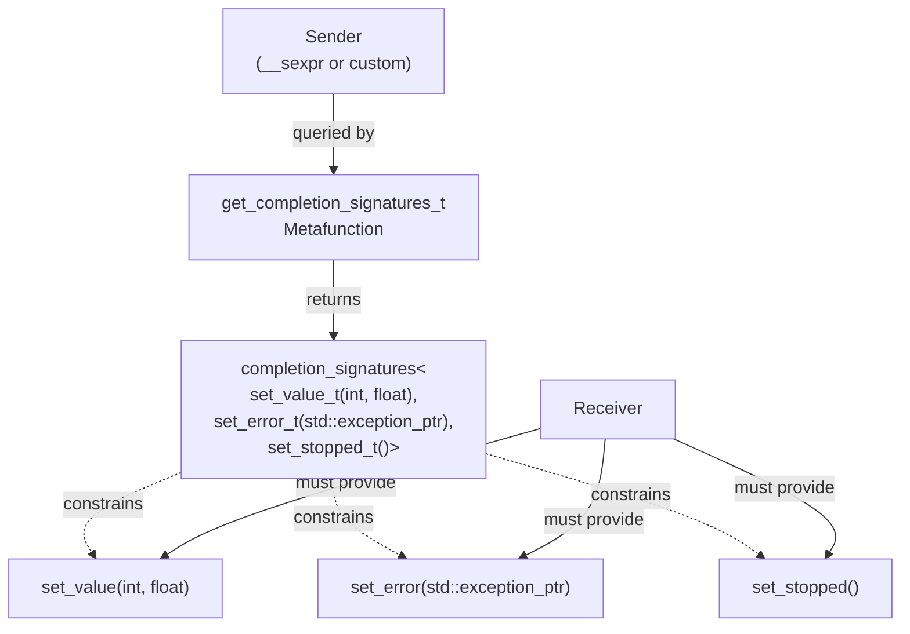
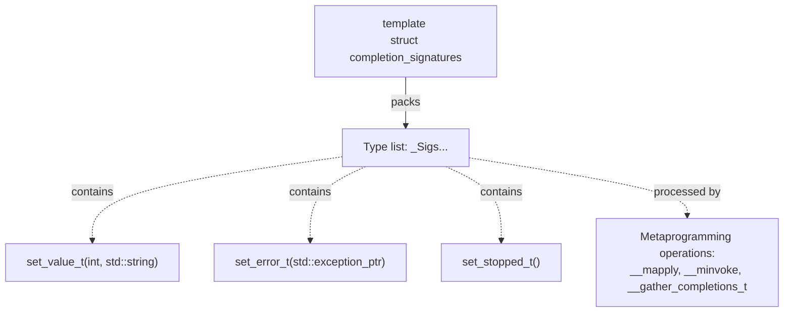
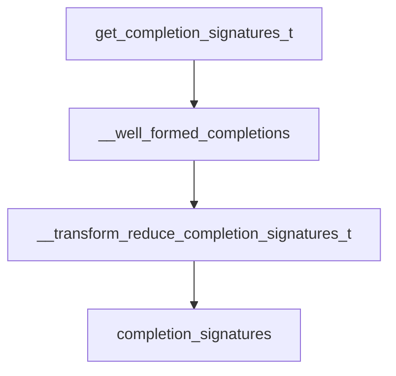
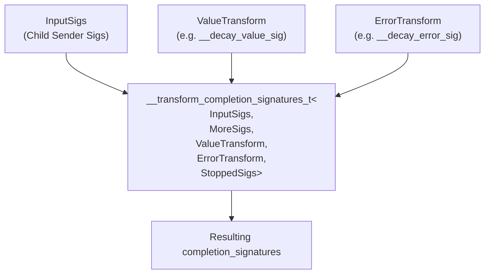

<!-- source: DeepWiki mcp.deepwiki.com · repo NVIDIA/stdexec · page 3.2 Completion Signatures · fetched 2026-10-26 -->

# Completion Signatures

<details>
<summary>Relevant source files</summary>

The following files were used as context for generating this wiki page:

- [cmake/RAPIDS.cmake](cmake/RAPIDS.cmake)
- [include/exec/completion_signatures.hpp](include/exec/completion_signatures.hpp)
- [include/stdexec/__detail/__affine.hpp](include/stdexec/__detail/__affine.hpp)
- [include/stdexec/__detail/__completion_behavior.hpp](include/stdexec/__detail/__completion_behavior.hpp)
- [include/stdexec/__detail/__completion_signatures.hpp](include/stdexec/__detail/__completion_signatures.hpp)
- [include/stdexec/__detail/__continues_on.hpp](include/stdexec/__detail/__continues_on.hpp)
- [include/stdexec/__detail/__deprecations.hpp](include/stdexec/__detail/__deprecations.hpp)
- [include/stdexec/__detail/__inline_scheduler.hpp](include/stdexec/__detail/__inline_scheduler.hpp)
- [include/stdexec/__detail/__queries.hpp](include/stdexec/__detail/__queries.hpp)
- [include/stdexec/__detail/__query.hpp](include/stdexec/__detail/__query.hpp)
- [include/stdexec/__detail/__senders.hpp](include/stdexec/__detail/__senders.hpp)
- [include/stdexec/__detail/__transform_completion_signatures.hpp](include/stdexec/__detail/__transform_completion_signatures.hpp)
- [test/stdexec/detail/test_completion_signatures.cpp](test/stdexec/detail/test_completion_signatures.cpp)
- [test/stdexec/detail/test_utility.cpp](test/stdexec/detail/test_utility.cpp)

</details>


## Purpose and Scope

This document explains **completion signatures** in stdexec, which describe the ways a sender can complete its asynchronous operation. Completion signatures are fundamental to type safety in the sender/receiver model, allowing the library to verify at compile time that senders and receivers are compatible.

For information about sender and receiver concepts themselves, see [Sender and Receiver Concepts (3.1)](). For information about how environments affect sender behavior, see [Execution Environment and Queries (3.3)]().

## Overview

Completion signatures are compile-time type lists that enumerate all possible completion channels a sender can invoke on its connected receiver. The `completion_signatures<Sigs...>` template class aggregates these signature types, enabling compile-time verification of sender-receiver compatibility.

A sender invokes exactly one of three completion customization point objects (CPOs) on its receiver:
- `set_value(args...)` - successful completion with result values (type signature: `set_value_t(Args...)`) [[include/stdexec/__detail/__completion_signatures.hpp:40-41]()]
- `set_error(error)` - completion with an error (type signature: `set_error_t(Error)`) [[include/stdexec/__detail/__completion_signatures.hpp:42-43]()]
- `set_stopped()` - completion due to cancellation (type signature: `set_stopped_t()`) [[include/stdexec/__detail/__completion_signatures.hpp:44-45]()]

The completion signatures are type metadata only; they describe which overloads of these CPOs the sender may invoke, but do not directly participate in the runtime completion process.

**Diagram: Completion Signatures as Type Metadata**


**Sources:** [[include/stdexec/__detail/__completion_signatures.hpp:32-49]()], [[include/stdexec/__detail/__transform_completion_signatures.hpp:52-57]()]

## Completion Signature Types

### The `completion_signatures` Template

The `completion_signatures<Sigs...>` class template is a tag type that aggregates completion signature types. It serves as the return type for sender signature queries.

**Diagram: completion_signatures Template Structure**


The class itself has no member functions or data; it exists purely as a compile-time container of types. Metafunctions from `__meta.hpp` operate on these type lists. The library uses a partitioning system (`__partitions`) to cache and quickly access value, error, and stopped types from these signatures [[include/stdexec/__detail/__completion_signatures.hpp:84-144]()].

**Sources:** [[include/stdexec/__detail/__completion_signatures.hpp:32-49]()], [[include/stdexec/__detail/__completion_signatures.hpp:84-144]()]

### The Three Completion Channels

Each completion signature corresponds to one of three completion channels:

| Channel | Signature Form | Purpose | Implementation Tag |
|---------|---------------|---------|--------------------|
| **Value** | `set_value_t(Args...)` | Successful completion with result values | `set_value_t` [[include/stdexec/__detail/__completion_signatures.hpp:41]()] |
| **Error** | `set_error_t(Error)` | Completion with an error | `set_error_t` [[include/stdexec/__detail/__completion_signatures.hpp:43]()] |
| **Stopped** | `set_stopped_t()` | Completion due to cancellation | `set_stopped_t` [[include/stdexec/__detail/__completion_signatures.hpp:45]()] |

A sender can have:
- Zero or more value completion signatures (different success paths).
- Zero or more error completion signatures (different error types).
- Zero or one stopped completion signature.

**Sources:** [[include/stdexec/__detail/__completion_signatures.hpp:35-49]()], [[test/stdexec/detail/test_completion_signatures.cpp:33-52]()]

## Computing Completion Signatures

### The Query Process

The library queries completion signatures through `get_completion_signatures_t`. This orchestrates the query by examining the sender's capabilities.

**Diagram: Completion Signature Query Process (Code-Level)**


The system supports multiple discovery and transformation mechanisms, including the ability to return error types when constexpr exceptions are not available [[include/stdexec/__detail/__transform_completion_signatures.hpp:35-49]()].

**Sources:** [[include/stdexec/__detail/__transform_completion_signatures.hpp:31-58]()], [[include/stdexec/__detail/__transform_completion_signatures.hpp:146-169]()]

### Environment-Dependent Signatures

Environment-dependent senders require the execution environment to compute their completion signatures. The library uses concepts like `sender_in` to verify that a sender can produce valid signatures within a specific environment [[include/stdexec/__detail/__senders.hpp:51-57]()].

**Sources:** [[include/stdexec/__detail/__senders.hpp:47-60]()]

## Transforming Completion Signatures

### The `__transform_completion_signatures_t` Metafunction

Stdexec provides powerful utilities to transform signatures, often used by adaptors like `continues_on` to modify the output of a child sender.

**Diagram: transform_completion_signatures Template Parameters**


The implementation in `__transform_completion_signatures.hpp` allows:
- `_ValueTransform`: A template that takes value types and returns a new set of signatures (defaults to `__default_set_value`).
- `_ErrorTransform`: A template that takes error types and returns a new set of signatures (defaults to `__default_set_error`).
- `_StoppedSigs`: A replacement for the stopped channel (defaults to `completion_signatures<set_stopped_t()>`).

**Sources:** [[include/stdexec/__detail/__transform_completion_signatures.hpp:156-169]()], [[include/stdexec/__detail/__continues_on.hpp:41-63]()]

### Normalization

The library performs "normalization" on signatures, which involves stripping rvalue-references from types to simplify signature matching (e.g., `set_value_t(int &&)` becomes `set_value_t(int)`).

**Sources:** [[include/stdexec/__detail/__completion_signatures.hpp:50-78]()]

## Completion Behavior

Senders can also describe their completion behavior (whether they complete synchronously or asynchronously) using `__get_completion_behavior_t`. This is a query that returns a value from the `__completion_behavior::__behavior` enum:
- `__asynchronous`: Completes on a potentially different context.
- `__asynchronous_affine`: Completes on the same context that started it, but asynchronously.
- `__inline_completion`: Completes synchronously before `start()` returns.

**Sources:** [[include/stdexec/__detail/__completion_behavior.hpp:35-82]()], [[include/stdexec/__detail/__inline_scheduler.hpp:28-36]()]

## Type Checking with `sender_of`

The `sender_of` concept verifies that a sender completes with a specific signature in a given environment.

```cpp
template <class _Sender, class _SetSig, class... _Env>
concept sender_of =
  sender_in<_Sender, _Env...>
  && __same_as<__mlist<_SetSig>,
               __gather_completions_t<__signature_tag_t<_SetSig>,
                                      __completion_signatures_of_t<_Sender, _Env...>,
                                      __mcompose<__qq<__mlist>, __qf<__signature_tag_t<_SetSig>>>,
                                      __mconcat<__qq<__mlist>>>>;
```

This ensures that the sender provides exactly the expected overload for a specific tag (like `set_value_t`).

**Sources:** [[include/stdexec/__detail/__senders.hpp:50-57]()]

## Diagnostic Utilities

The library includes `make_completion_signatures` in the `experimental::execution` namespace, which provides a `consteval` helper for users to construct signature types manually while ensuring they are unique and normalized [[include/exec/completion_signatures.hpp:26-77]()].

**Sources:** [[include/exec/completion_signatures.hpp:27-44]()], [[include/exec/completion_signatures.hpp:71-77]()]

---

