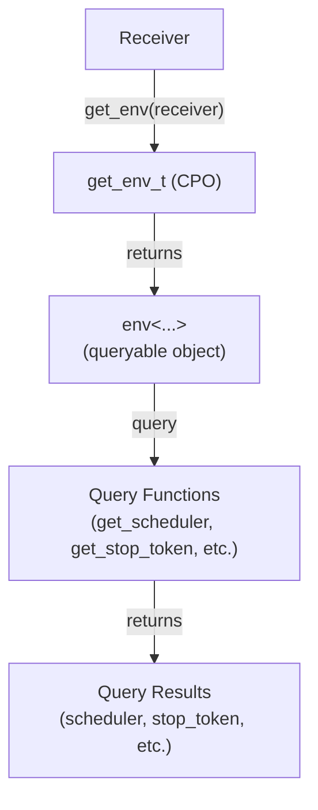
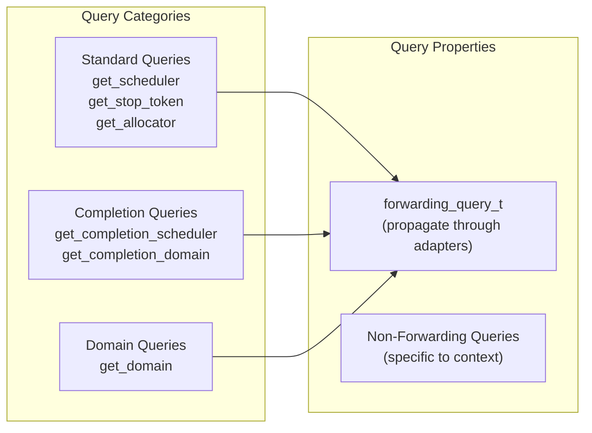
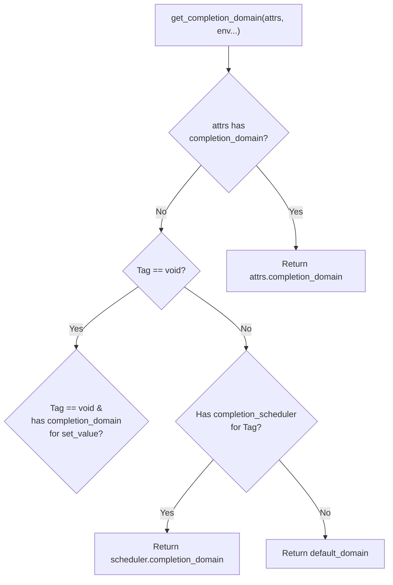
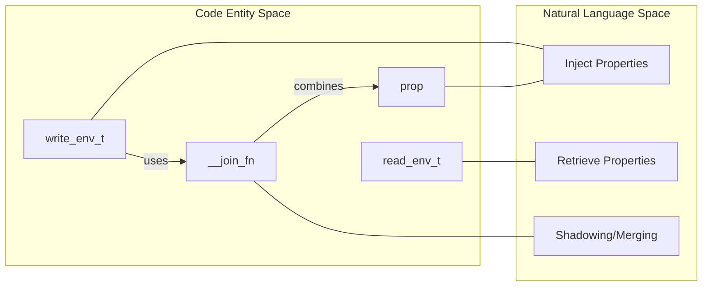

<!-- source: DeepWiki mcp.deepwiki.com · repo NVIDIA/stdexec · page 3.3 Execution Environment and Queries · fetched 2026-10-26 -->

# Execution Environment and Queries

Relevant source files

The following files were used as context for generating this wiki page:

- [include/stdexec/__detail/__any.hpp](include/stdexec/__detail/__any.hpp)
- [include/stdexec/__detail/__env.hpp](include/stdexec/__detail/__env.hpp)
- [include/stdexec/__detail/__just.hpp](include/stdexec/__detail/__just.hpp)
- [include/stdexec/__detail/__read_env.hpp](include/stdexec/__detail/__read_env.hpp)
- [include/stdexec/__detail/__schedulers.hpp](include/stdexec/__detail/__schedulers.hpp)
- [include/stdexec/__detail/__sync_wait.hpp](include/stdexec/__detail/__sync_wait.hpp)
- [include/stdexec/__detail/__utility.hpp](include/stdexec/__detail/__utility.hpp)
- [include/stdexec/__detail/__write_env.hpp](include/stdexec/__detail/__write_env.hpp)
- [include/stdexec/stop_token.hpp](include/stdexec/stop_token.hpp)
- [test/stdexec/detail/test_any.cpp](test/stdexec/detail/test_any.cpp)

## Purpose and Scope

This document describes the execution environment system and query mechanism in `stdexec`. Environments are queryable objects that provide contextual information to senders and receivers, enabling them to adapt their behavior based on execution context. The query system is the primary mechanism for accessing schedulers, stop tokens, allocators, and other execution properties.

For information about how environments interact with domain-based algorithm customization, see [Domains and Customization](3.4). For details on how queries relate to completion signatures, see [Completion Signatures](3.2).

## Environment Fundamentals

### The Environment Concept

An **environment** is a queryable object that provides answers to queries about the execution context. Environments flow from receivers through operation states to child senders, allowing execution properties to propagate through sender graphs.

The `queryable` concept is defined as any destructible type:

[include/stdexec/__detail/__query.hpp:30-31]()

### The `env` Type

The `env<>` type (also available as `env<Props...>`) is the fundamental environment type. It can be empty or composed of multiple property objects:

[include/stdexec/__detail/__execution_fwd.hpp:101-102]()

### The `get_env` Query

`get_env` is the fundamental query that retrieves an environment from an environment provider (typically a receiver or sender):

[include/stdexec/__detail/__execution_fwd.hpp:105-106]()

The alias `env_of_t` is used to retrieve the type of environment returned by `get_env`:

[include/stdexec/__detail/__execution_fwd.hpp:108-109]()

**Sources:** [include/stdexec/__detail/__execution_fwd.hpp:101-111](), [include/stdexec/__detail/__query.hpp:30-31]()

## Query Mechanism

### Query Customization

Queries are customized via member functions on the environment type. The modern customization point is the `.query()` member function:

[include/stdexec/__detail/__query.hpp:76-86]()

The internal `__query` template implements the dispatch logic, checking for the `.query()` member before falling back to `tag_invoke`:

[include/stdexec/__detail/__query.hpp:56-101]()

### Query Types and Their Properties

**Sources:** [include/stdexec/__detail/__execution_fwd.hpp:119-145](), [include/stdexec/__detail/__query.hpp:127-145]()

### Forwarding Queries

A **forwarding query** is one that should be propagated through sender adaptors. The `forwarding_query_t` query determines if a given query should forward. Queries that derive from `forwarding_query_t` or implement a `query(forwarding_query_t)` member returning `true` are considered forwarding:

[include/stdexec/__detail/__query.hpp:127-137]()

**Sources:** [include/stdexec/__detail/__query.hpp:127-145]()

## Standard Queries

### Scheduler Queries

| Query | Purpose | File Pointer |
|-------|---------|--------------|
| `get_scheduler` | Retrieves the scheduler associated with the environment | [include/stdexec/__detail/__execution_fwd.hpp:137]() |
| `get_start_scheduler` | Retrieves the scheduler used to start the sender | [include/stdexec/__detail/__execution_fwd.hpp:138]() |
| `get_delegation_scheduler` | Retrieves a scheduler for delegating work | [include/stdexec/__detail/__execution_fwd.hpp:139]() |

### Stop Token Query

`get_stop_token` retrieves the stop token for cancellation:

[include/stdexec/__detail/__execution_fwd.hpp:105-106]() (defined via `__stok::__get_stop_token_t` in [include/stdexec/stop_token.hpp:105-106]())

Common stop token types include:
- `never_stop_token`: A token that never requests stop. [include/stdexec/__detail/__stop_token.hpp:33-34]()
- `inplace_stop_token`: An efficient in-place stop token. [include/stdexec/stop_token.hpp:154-155]()

### Other Standard Queries

| Query | Purpose | File Pointer |
|-------|---------|--------------|
| `get_forward_progress_guarantee` | Indicates progress guarantee (concurrent/parallel/weakly_parallel) | [include/stdexec/__detail/__execution_fwd.hpp:136]() |
| `__execute_may_block_caller` | Indicates if execution may block the caller | [include/stdexec/__detail/__execution_fwd.hpp:135]() |

**Sources:** [include/stdexec/__detail/__execution_fwd.hpp:112-145](), [include/stdexec/stop_token.hpp:105-208]()

## Completion Queries

Completion queries determine properties about where and how a sender will complete.

### `get_completion_scheduler`

Retrieves the scheduler on which a sender will complete for a given completion channel (e.g., `set_value_t`, `set_error_t`):

[include/stdexec/__detail/__execution_fwd.hpp:125, 141]()

### `get_completion_domain`

Determines the domain on which a sender will complete:

[include/stdexec/__detail/__execution_fwd.hpp:127, 143]()

The resolution of completion domains often involves checking the scheduler's domain or the attributes of the sender:

[include/stdexec/__detail/__execution_fwd.hpp:147-151]()

**Sources:** [include/stdexec/__detail/__execution_fwd.hpp:124-151](), [include/stdexec/__detail/__domain.hpp:63-91]()

## Domain Queries

### `get_domain`

The `get_domain` query determines the domain for sender transformation. It is often resolved from the environment:

[include/stdexec/__detail/__execution_fwd.hpp:130, 144]()

The alias `__domain_of_t` extracts the domain from an environment:

[include/stdexec/__detail/__execution_fwd.hpp:179-180]()

**Sources:** [include/stdexec/__detail/__execution_fwd.hpp:130-180](), [include/stdexec/__detail/__domain.hpp:63-91]()

## Environment Propagation and Manipulation

### `prop` and `cprop`

Properties are the building blocks of environments. `prop` stores a query/value pair:

[include/stdexec/__detail/__env.hpp:177-188]()

`cprop` is a constant property that returns a static value:

[include/stdexec/__detail/__env.hpp:43-51]()

### Joining Environments

Multiple environments can be joined using `__join`. If the first environment is empty (`env<>`), the second is forwarded. Otherwise, they are wrapped in a new `env` structure:

[include/stdexec/__detail/__env.hpp:104-122]()

### Forwarding Environments

The `__fwd` wrapper is used to create an environment that only responds to forwarding queries:

[include/stdexec/__detail/__env.hpp:53-70]()

### Root Environments

A "root environment" is one that can answer the `__root_t` query. This is used to identify the base of an environment chain:

[include/stdexec/__detail/__env.hpp:129-145]()

**Sources:** [include/stdexec/__detail/__env.hpp:41-205](), [include/stdexec/__detail/__execution_fwd.hpp:88-102]()

## Read and Write Operations

### `read_env`

`read_env(query)` is a sender factory that retrieves a value from the receiver's environment at execution time. It is the primitive behind `get_scheduler()`, `get_stop_token()`, etc.

[include/stdexec/__detail/__read_env.hpp:152-173]()

The implementation uses an operation state that calls the query on the receiver's environment during `start()`:

[include/stdexec/__detail/__read_env.hpp:48-63]()

### `write_env`

`write_env(sender, env)` (or `sender | write_env(env)`) is a sender adaptor that augments or overrides the environment seen by a child sender.

[include/stdexec/__detail/__write_env.hpp:76-90]()

It works by joining the user-provided properties with the environment of the receiver connected to the `write_env` sender:

[include/stdexec/__detail/__write_env.hpp:42-46]()

**Sources:** [include/stdexec/__detail/__read_env.hpp:152-173](), [include/stdexec/__detail/__write_env.hpp:32-150]()

## Practical Usage

### Environment in `sync_wait`

`sync_wait` provides a specific environment to the sender it executes, which includes a `run_loop` scheduler for delegation:

[include/stdexec/__detail/__sync_wait.hpp:49-65]()

### Implementation Example

The `__read_env_impl` demonstrates how a sender interacts with completion signatures based on the environment:

[include/stdexec/__detail/__read_env.hpp:105-130]()

**Sources:** [include/stdexec/__detail/__sync_wait.hpp:49-65](), [include/stdexec/__detail/__read_env.hpp:98-149]()

## Summary

The execution environment and query system provides:

- **Environments**: Queryable objects (`env<...>`) carrying execution context.
- **Standard queries**: Mechanisms to retrieve schedulers, stop tokens, and progress guarantees.
- **Completion queries**: Information about where and how a sender will finish its work.
- **Propagation**: Rules for how queries flow through sender adaptors (forwarding vs. non-forwarding).
- **Manipulation**: Utilities like `prop`, `write_env`, and `read_env` to build and modify context.

**Sources:** [include/stdexec/__detail/__execution_fwd.hpp:88-187](), [include/stdexec/__detail/__query.hpp:28-145](), [include/stdexec/__detail/__env.hpp:39-205](), [include/stdexec/stop_token.hpp:105-208](), [include/stdexec/__detail/__read_env.hpp:152-173](), [include/stdexec/__detail/__write_env.hpp:76-145]()

---

