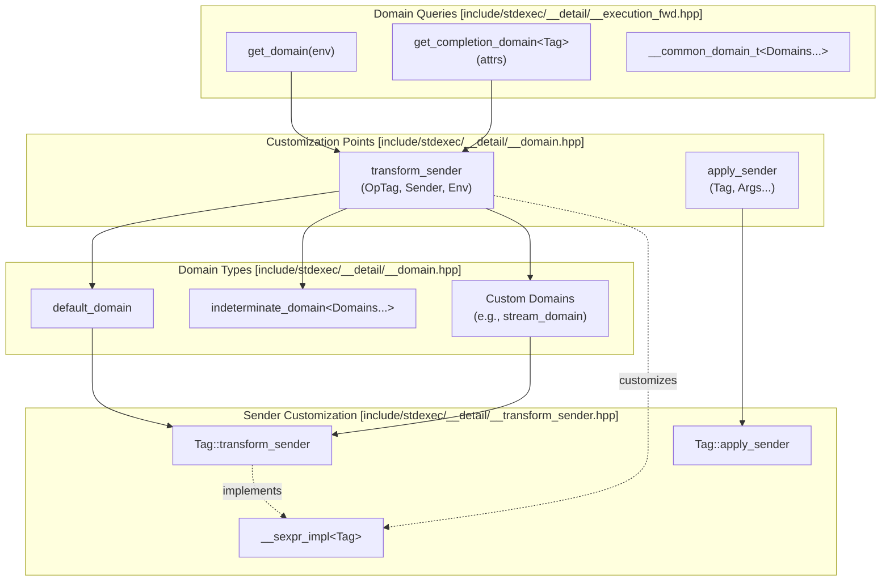
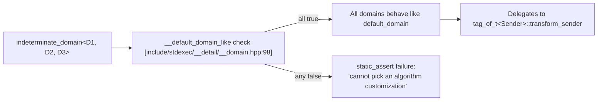
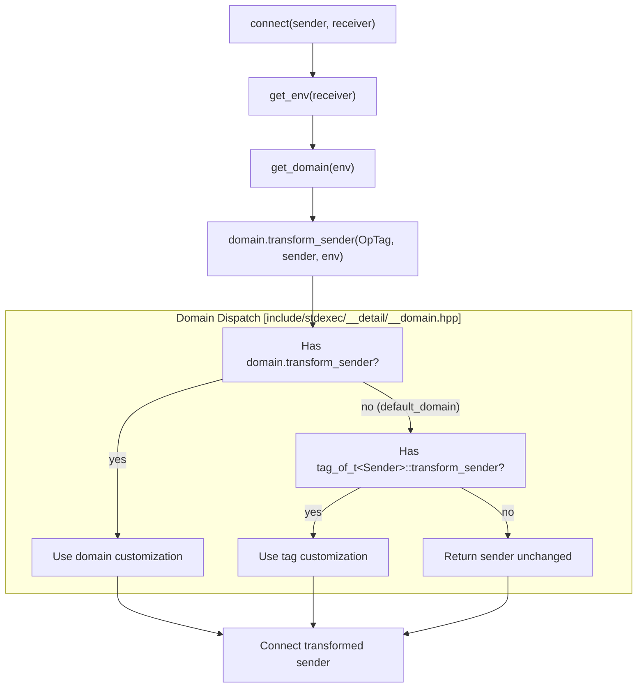
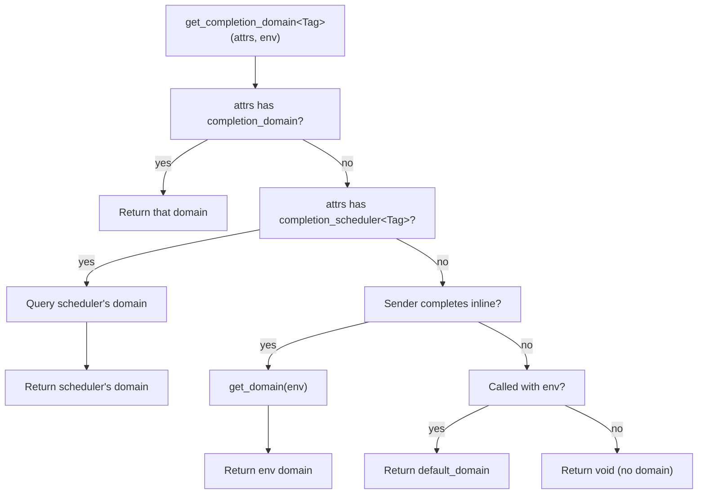
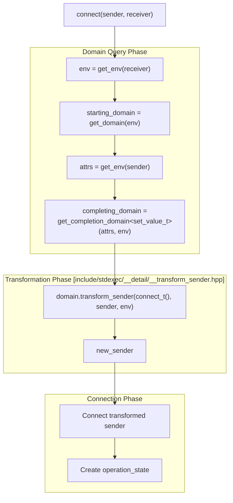

<!-- source: DeepWiki mcp.deepwiki.com · repo NVIDIA/stdexec · page 3.4 Domains and Customization · fetched 2026-10-26 -->

# Domains and Customization

<details>
<summary>Relevant source files</summary>

The following files were used as context for generating this wiki page:

- [include/exec/completion_signatures.hpp](include/exec/completion_signatures.hpp)
- [include/stdexec/__detail/__completion_signatures.hpp](include/stdexec/__detail/__completion_signatures.hpp)
- [include/stdexec/__detail/__continues_on.hpp](include/stdexec/__detail/__continues_on.hpp)
- [include/stdexec/__detail/__domain.hpp](include/stdexec/__detail/__domain.hpp)
- [include/stdexec/__detail/__senders.hpp](include/stdexec/__detail/__senders.hpp)
- [include/stdexec/__detail/__stop_token.hpp](include/stdexec/__detail/__stop_token.hpp)
- [include/stdexec/__detail/__transform_completion_signatures.hpp](include/stdexec/__detail/__transform_completion_signatures.hpp)
- [include/stdexec/__detail/__transform_sender.hpp](include/stdexec/__detail/__transform_sender.hpp)
- [include/stdexec/__detail/__type_traits.hpp](include/stdexec/__detail/__type_traits.hpp)
- [test/stdexec/concepts/test_concepts_stop_tokens.cpp](test/stdexec/concepts/test_concepts_stop_tokens.cpp)

</details>


## Purpose and Scope

This document describes the domain customization system in stdexec, which enables platform-specific and context-specific optimization of sender algorithms. Domains provide a type-safe mechanism for algorithm libraries to customize how senders are transformed and executed in different contexts (e.g., CPU thread pools vs GPU streams).

For information about the basic sender/receiver concepts, see [3.1](). For details on how completion signatures interact with domains, see [3.2](). For environment queries that domains use, see [3.3](). For the `__sexpr` sender model that domains customize, see [3.6]().

## Domain System Architecture

The domain system consists of three main components: domain types, customization points, and query mechanisms that coordinate sender transformation based on execution context.

**Domain System Components**



Sources: [include/stdexec/__detail/__domain.hpp:63-91](), [include/stdexec/__detail/__domain.hpp:103-131](), [include/stdexec/__detail/__execution_fwd.hpp:142-145](), [include/stdexec/__detail/__transform_sender.hpp:163-167]()

## Core Domain Types

### default_domain

The `default_domain` is the standard domain used when no specific domain customization is required [include/stdexec/__detail/__execution_fwd.hpp:63](). It delegates transformation to the sender's tag type, enabling per-algorithm customization [include/stdexec/__detail/__domain.hpp:63-91]().

| Member Function | Purpose | Delegation |
|----------------|---------|------------|
| `transform_sender(_OpTag, _Sender, _Env)` | Transform sender for operation | Calls `tag_of_t<_Sender>::transform_sender` if available, otherwise returns sender unchanged [include/stdexec/__detail/__domain.hpp:65-81]() |
| `apply_sender(_Tag, _Args...)` | Apply sender factory | Calls `_Tag::apply_sender` if available [include/stdexec/__detail/__domain.hpp:83-90]() |

**Key Characteristics:**
- Acts as a transparent wrapper around tag-based customization [include/stdexec/__detail/__domain.hpp:63-91]().
- Returns sender unchanged when no tag customization exists [include/stdexec/__detail/__domain.hpp:75-81]().
- Used as the default when no domain is specified in environment.

Sources: [include/stdexec/__detail/__domain.hpp:63-91]()

### indeterminate_domain

The `indeterminate_domain<_Domains...>` represents a set of domains that must all behave identically for a given transformation [include/stdexec/__detail/__domain.hpp:103-131](). It ensures type safety when multiple execution contexts are involved.

**Behavior:**
- When `sizeof...(_Domains) == 1`: collapses to that single domain [include/stdexec/__detail/__domain.hpp:135-138]().
- When `sizeof...(_Domains) > 1`: verifies all domains are `__default_domain_like` for the operation [include/stdexec/__detail/__domain.hpp:121-130]().
- Static assertion failure if domains have conflicting customizations [include/stdexec/__detail/__domain.hpp:127-128]().



Sources: [include/stdexec/__detail/__domain.hpp:103-131](), [include/stdexec/__detail/__domain.hpp:133-148]()

### Custom Domains

Custom domains (such as `stream_domain` in nvexec) override `transform_sender` to provide platform-specific implementations of algorithms [include/stdexec/__detail/__domain.hpp:33-45]().

**Example Domain Pattern:**
```cpp
struct my_domain {
  template <class _OpTag, class _Sender, class _Env>
  auto transform_sender(_OpTag, _Sender&& __sndr, const _Env& __env) const {
    // Return custom sender implementation
  }
};
```

Sources: [include/stdexec/__detail/__domain.hpp:33-45]()

## Customization Mechanisms

### transform_sender

The `transform_sender` customization point is invoked at key moments in the sender lifecycle to enable domain-specific transformations [include/stdexec/__detail/__transform_sender.hpp:114-160]().

**Invocation Points:**
- **During `connect`**: `connect(__sndr, __rcvr)` transforms sender based on receiver's environment domain [include/stdexec/__detail/__transform_sender.hpp:133-137]().
- **Explicit transformation**: Via the `transform_sender` CPO [include/stdexec/__detail/__transform_sender.hpp:160]().

**Transformation Flow**



**Type Signature:**
```cpp
template <class _Domain, class _OpTag, class _Sender, class _Env>
concept __has_transform_sender = requires(_Domain __tag, _Sender&& __sndr, const _Env& __env) {
  __tag.transform_sender(_OpTag(), static_cast<_Sender&&>(__sender), __env...);
};
```

Sources: [include/stdexec/__detail/__domain.hpp:33-38](), [include/stdexec/__detail/__transform_sender.hpp:114-160]()

### apply_sender

The `apply_sender` customization point enables domain-specific sender factories [include/stdexec/__detail/__transform_sender.hpp:170-188]().

**Purpose:**
- Customize creation of senders (factories like `just`, `schedule`, etc.).
- Allow domains to intercept sender construction via `_Tag::apply_sender` [include/stdexec/__detail/__domain.hpp:83-90]().

Sources: [include/stdexec/__detail/__domain.hpp:53-59](), [include/stdexec/__detail/__domain.hpp:83-90](), [include/stdexec/__detail/__transform_sender.hpp:170-188]()

## Domain Queries

### get_domain

The `get_domain` query retrieves the domain from an environment [include/stdexec/__detail/__execution_fwd.hpp:144](). It is the primary query for determining transformation context.

**Query Resolution Order:**
1. Query environment's `.query(get_domain_t)` member [include/stdexec/__detail/__execution_fwd.hpp:179-180]().
2. Return `default_domain{}` if no domain is specified.

Sources: [include/stdexec/__detail/__execution_fwd.hpp:142-145](), [include/stdexec/__detail/__execution_fwd.hpp:179-180]()

### get_completion_domain

The `get_completion_domain<_Tag>` query retrieves the domain on which a sender will complete [include/stdexec/__detail/__execution_fwd.hpp:143]().

**Resolution Algorithm**



Sources: [include/stdexec/__detail/__execution_fwd.hpp:127](), [include/stdexec/__detail/__execution_fwd.hpp:143](), [include/stdexec/__detail/__execution_fwd.hpp:147-151]()

### __common_domain_t

The `__common_domain_t<_Domains...>` metafunction computes the common domain among multiple domains [include/stdexec/__detail/__domain.hpp:151-172]().

**Algorithm:**
1. If domains are common-type compatible, return `std::common_type_t<_Domains...>` [include/stdexec/__detail/__domain.hpp:154-157]().
2. If all domains are convertible to `default_domain`, return `default_domain` [include/stdexec/__detail/__domain.hpp:160-163]().
3. Otherwise, return `__make_domain_t<_Domains...>` which might result in `indeterminate_domain<_Domains...>` [include/stdexec/__detail/__domain.hpp:149-150](), [include/stdexec/__detail/__domain.hpp:166-167]().

Sources: [include/stdexec/__detail/__domain.hpp:151-172]()

## Domain Selection During Connection

When `connect(__sndr, __rcvr)` is called, the domain selection process determines which domain's customizations apply. This involves identifying the "completing domain" of the sender and the "starting domain" of the environment [include/stdexec/__detail/__transform_sender.hpp:130-137]().

**Connection Domain Resolution**



Sources: [include/stdexec/__detail/__transform_sender.hpp:130-137](), [include/stdexec/__detail/__execution_fwd.hpp:147-151]()

## Completion Behavior Customization

Domains and algorithms can query the completion behavior of a sender using `__get_completion_behavior` [include/stdexec/__detail/__completion_behavior.hpp:33-133]().

| Behavior Constant | Value | Description |
|-------------------|-------|-------------|
| `__asynchronous` | `__async_ \| __not_affine_` | Completes asynchronously on potentially different context [include/stdexec/__detail/__completion_behavior.hpp:50](). |
| `__asynchronous_affine` | `__async_` | Completes asynchronously on the same context [include/stdexec/__detail/__completion_behavior.hpp:54](). |
| `__inline_completion` | `__inline_` | Completes synchronously before `start()` returns [include/stdexec/__detail/__completion_behavior.hpp:58](). |
| `__unknown` | `__not_affine_ \| __async_ \| __inline_` | Completion behavior is unknown [include/stdexec/__detail/__completion_behavior.hpp:61](). |

Sources: [include/stdexec/__detail/__completion_behavior.hpp:33-133]()

## Summary

The domain customization system provides:

1. **Type-safe algorithm customization** via `transform_sender` [include/stdexec/__detail/__domain.hpp:33-38]().
2. **Per-context optimization** through domain queries and scheduler integration [include/stdexec/__detail/__execution_fwd.hpp:142-145]().
3. **Conflict detection** via `indeterminate_domain` and compile-time checks [include/stdexec/__detail/__domain.hpp:127-128]().
4. **Flexible extension** through domain specialization and tag-based dispatch [include/stdexec/__detail/__domain.hpp:65-73]().

**Key Entities:**
- `default_domain`: Standard delegation to tag customization [include/stdexec/__detail/__domain.hpp:63]().
- `indeterminate_domain<>`: Multi-domain consistency checker [include/stdexec/__detail/__domain.hpp:103]().
- `transform_sender`: Main customization entry point [include/stdexec/__detail/__transform_sender.hpp:160]().
- `get_domain`: Environment domain query [include/stdexec/__detail/__execution_fwd.hpp:144]().
- `get_completion_domain`: Sender completion domain query [include/stdexec/__detail/__execution_fwd.hpp:143]().

Sources: [include/stdexec/__detail/__domain.hpp:1-172](), [include/stdexec/__detail/__transform_sender.hpp:1-160](), [include/stdexec/__detail/__completion_behavior.hpp:1-133]()

---

