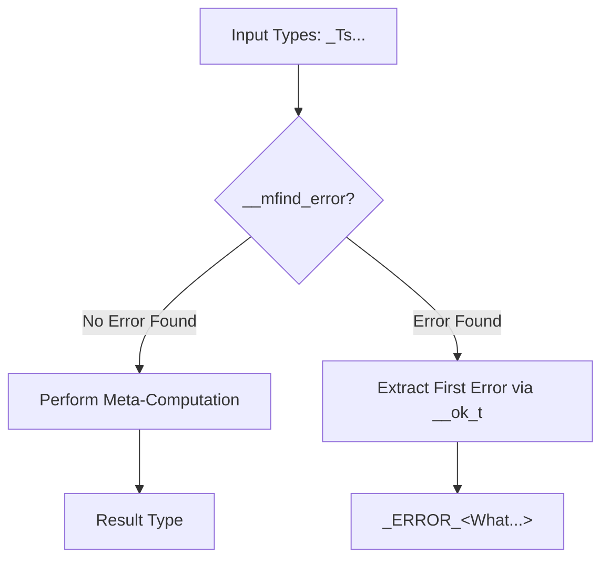
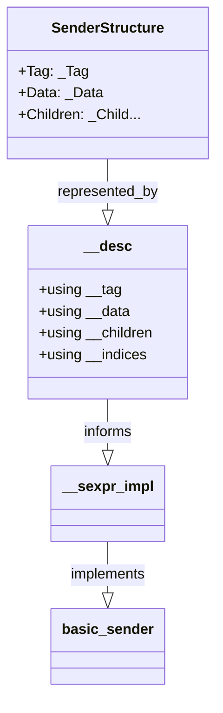

<!-- source: DeepWiki mcp.deepwiki.com · repo NVIDIA/stdexec · page 3.5 Metaprogramming Infrastructure · fetched 2026-10-26 -->

# Metaprogramming Infrastructure

<details>
<summary>Relevant source files</summary>

The following files were used as context for generating this wiki page:

- [include/exec/on.hpp](include/exec/on.hpp)
- [include/stdexec/__detail/__basic_sender.hpp](include/stdexec/__detail/__basic_sender.hpp)
- [include/stdexec/__detail/__config.hpp](include/stdexec/__detail/__config.hpp)
- [include/stdexec/__detail/__execution_fwd.hpp](include/stdexec/__detail/__execution_fwd.hpp)
- [include/stdexec/__detail/__meta.hpp](include/stdexec/__detail/__meta.hpp)
- [include/stdexec/__detail/__preprocessor.hpp](include/stdexec/__detail/__preprocessor.hpp)
- [include/stdexec/__detail/__sender_introspection.hpp](include/stdexec/__detail/__sender_introspection.hpp)
- [include/stdexec/concepts.hpp](include/stdexec/concepts.hpp)
- [include/stdexec/execution.hpp](include/stdexec/execution.hpp)
- [include/stdexec/functional.hpp](include/stdexec/functional.hpp)

</details>


This page documents the compile-time metaprogramming utilities that power stdexec's type manipulation, error handling, and introspection capabilities. These utilities are fundamental building blocks used throughout the codebase for computing completion signatures, transforming sender graphs, and implementing the domain customization system.

---

## Purpose and Design Philosophy

The metaprogramming infrastructure provides a functional-style metaprogramming framework with the following goals:

- **Error Propagation**: Meta-errors (type computation failures) propagate automatically like exceptions, avoiding deep diagnostic spew. [include/stdexec/__detail/__meta.hpp:174-207]()
- **Composability**: Metafunctions compose predictably using standard patterns like `__mcall` and `__minvoke`. [include/stdexec/__detail/__meta.hpp:233-240]()
- **Performance**: Minimize template instantiation depth and compilation time using compiler builtins where available (e.g., `__make_integer_seq`, `__type_pack_element`). [include/stdexec/__detail/__meta.hpp:118-135]()
- **Portability**: Work around compiler-specific limitations for MSVC, EDG (NVHPC), GCC, and Clang. [include/stdexec/__detail/__meta.hpp:47-53]()
- **Diagnostics**: Support pretty-printing of types and compile-time error throwing for user-friendly messages. [include/stdexec/__detail/__meta.hpp:174-180](), [include/stdexec/__detail/__execution_fwd.hpp:201-218]()

The design follows a consistent pattern where metafunctions are types with a nested `__f` template alias that performs the computation. [include/stdexec/__detail/__meta.hpp:233-234]()

**Sources:** [include/stdexec/__detail/__meta.hpp:1-50](), [include/stdexec/__detail/__config.hpp:49-82]()

---

## Core Type Manipulation Pattern

### The `__t` Extraction Convention

The `__t` type alias serves as a standard "result type" extraction mechanism:

```cpp
template <class _Tp>
using __t = _Tp::__t;
```
[include/stdexec/__detail/__meta.hpp:35-36]()

Types that participate in metaprogramming computations expose their result via a nested `__t` typedef. This pattern appears throughout stdexec's type computations, including in `_ERROR_` types and various metafunction results. [include/stdexec/__detail/__meta.hpp:181-181]()

### Metafunction Representation

Metafunctions are represented as types with a nested `__f` template alias. This allows metafunctions to be passed as template parameters and invoked uniformly using `__mcall` or `__minvoke`.

```cpp
template <class _Fn, class... _Args>
using __mcall = _Fn::template __f<_Args...>;
```
[include/stdexec/__detail/__meta.hpp:233-234]()

**Sources:** [include/stdexec/__detail/__meta.hpp:33-43](), [include/stdexec/__detail/__meta.hpp:233-250]()

---

## Error Propagation System

### The `_ERROR_` Type

The `_ERROR_` template is the foundation of meta-error propagation. When a type computation fails, an `_ERROR_` specialization is returned instead of a hard compiler error. It provides "poison" aliases to stop further computation.

```cpp
template <class... _What>
struct _ERROR_ {
  using __t           = _ERROR_;
  using __partitioned = _ERROR_;
  template <class, class>
  using __value_types = _ERROR_;
  // ... other completion signature aliases ...
};
```
[include/stdexec/__detail/__meta.hpp:179-198]()

### Error Detection Concepts

The system uses `__ok_t` and the `__ok` concept to distinguish between successful type computations and exceptions.

```cpp
template <class _Arg>
concept __ok = STDEXEC_IS_SAME(__ok_t<_Arg>, __msuccess);

template <class _Arg>
concept __merror = !STDEXEC_IS_SAME(__ok_t<_Arg>, __msuccess);
```
[include/stdexec/__detail/__meta.hpp:227-231]()

### Error Short-Circuiting

The infrastructure implements error short-circuiting. If any input type to a meta-operation is an `_ERROR_` type (detected via `__mfind_error`), the operation returns that error immediately. [include/stdexec/__detail/__meta.hpp:224-225]()

**Meta-Error Propagation Flow**



**Sources:** [include/stdexec/__detail/__meta.hpp:172-231]()

---

## Meta-Invocation Mechanism

### `__minvoke` and `__mcall`

These are the primary metafunction invocation utilities. `__mcall` is a direct invocation, while `__minvoke` typically handles error checking and short-circuiting.

| Utility | Definition | Purpose |
|---------|------------|---------|
| `__mcall` | `_Fn::template __f<_Args...>` | Direct invocation of a metafunction object. [include/stdexec/__detail/__meta.hpp:233-234]() |
| `__mcall_q` | `_Fn<_Args...>` | Direct invocation of a template alias ("quoted"). [include/stdexec/__detail/__meta.hpp:242-243]() |
| `__mcall1` | `_Fn::template __f<_Arg>` | Optimized unary invocation. [include/stdexec/__detail/__meta.hpp:236-237]() |

### Quoting: `__q` and `__qq`

To pass a template alias as a metafunction object, it must be "quoted":

```cpp
template <template <class...> class _Fn>
struct __q {
  template <class... _Args>
  using __f = __mcall_q<_Fn, _Args...>;
};
```
[include/stdexec/__detail/__meta.hpp:322-325]()

The `__qq` variant is used for internal list manipulation where the arguments are known to be safe or when using `__minvoke`. [include/stdexec/__detail/__meta.hpp:327-330]()

**Sources:** [include/stdexec/__detail/__meta.hpp:233-250](), [include/stdexec/__detail/__meta.hpp:322-335]()

---

## Pack and Index Utilities

### Index Sequence Generation: `__make_indices`

Platform-specific index sequence generation optimized for compilation speed. It uses `__integer_pack` on Clang/GCC and `__make_integer_seq` on MSVC. [include/stdexec/__detail/__meta.hpp:115-135]()

```cpp
template <class... _Ts>
using __indices_for = __make_indices<sizeof...(_Ts)>;
```
[include/stdexec/__detail/__meta.hpp:159-160]()

### Pack Indexing: `__m_at`

Extracts the Nth type from a pack. It uses C++26 pack indexing when available, or `__type_pack_element` builtins. [include/stdexec/__detail/__meta.hpp:878-900]()

```cpp
template <std::size_t _Np, class... _Ts>
using __m_at_c = /* compiler-specific-access */;
```
[include/stdexec/__detail/__meta.hpp:899-900]()

**Sources:** [include/stdexec/__detail/__meta.hpp:96-160](), [include/stdexec/__detail/__meta.hpp:878-900]()

---

## Special Containers: Tuple and Variant

### `__tuple`

A highly optimized, empty-base-optimized (EBO) tuple implementation used internally to store sender data and operation state children. [include/stdexec/__detail/__tuple.hpp:46-61]()

- Supports manual CV-ref propagation via `__apply`. [include/stdexec/__detail/__tuple.hpp:68-75]()
- Uses specialized templates for small sizes to improve compile times. [include/stdexec/__detail/__tuple.hpp:81-220]()

### `__std_variant` and `__nullable_std_variant`

The library provides aliases for standard variants that interact with the metaprogramming error system. [include/stdexec/__detail/__execution_fwd.hpp:51-59]()

```cpp
template <class... _Ts>
using __std_variant = __minvoke_if_c<sizeof...(_Ts) == 0,
                                     __mconst<__detail::__not_a_variant>,
                                     __mtransform<__q1<__decay_t>, __munique<__qq<std::variant>>>,
                                     _Ts...>;
```
[include/stdexec/__detail/__execution_fwd.hpp:51-55]()

**Sources:** [include/stdexec/__detail/__tuple.hpp:42-220](), [include/stdexec/__detail/__execution_fwd.hpp:43-63]()

---

## Sender Introspection and Descriptors

The metaprogramming infrastructure provides the mechanism for "S-expressions" (sender expressions). A sender is described by a `__desc` type which captures its structure. [include/stdexec/__detail/__sender_introspection.hpp:40-41]()

**Natural Language to Code Entity Mapping**



```cpp
template <class _Tag, class _Data, class... _Child>
struct __desc {
  using __tag      = _Tag;
  using __data     = _Data;
  using __indices  = __make_indices<sizeof...(_Child)>;
  using __children = __mlist<_Child...>;
};
```
[include/stdexec/__detail/__sender_introspection.hpp:40-55]()

This descriptor is used by `basic_sender` (aliased as `__sexpr`) to provide uniform introspection. [include/stdexec/__detail/__basic_sender.hpp:41-65]()

**Sources:** [include/stdexec/__detail/__sender_introspection.hpp:31-55](), [include/stdexec/__detail/__basic_sender.hpp:41-70]()

---

