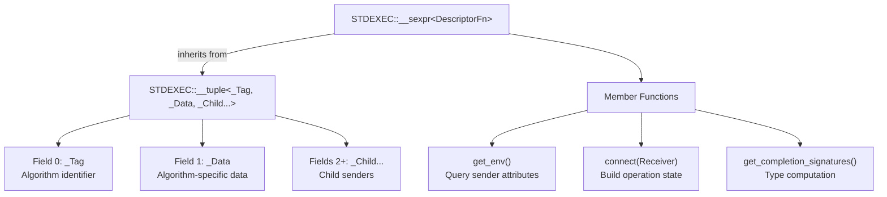
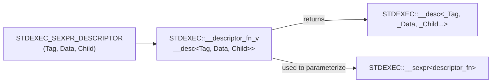
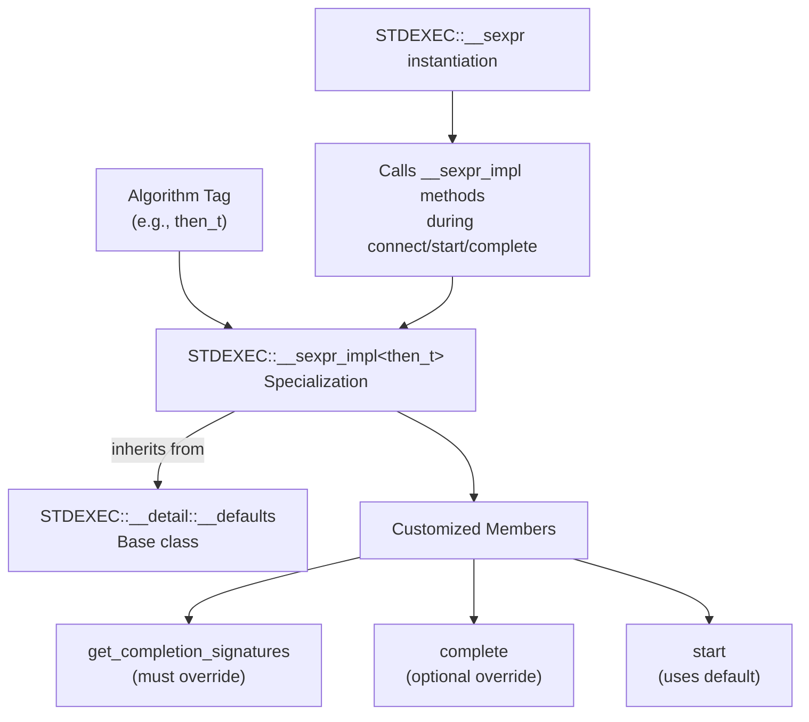
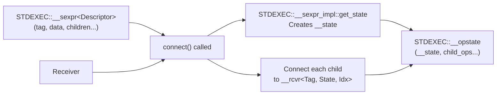
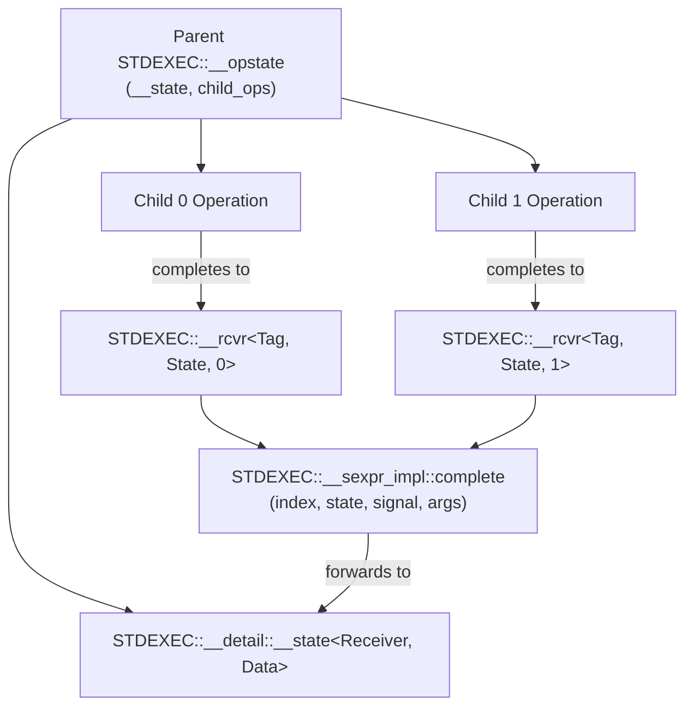

<!-- source: DeepWiki mcp.deepwiki.com · repo NVIDIA/stdexec · page 3.6 The __sexpr Sender Model · fetched 2026-10-26 -->

# The __sexpr Sender Model

<details>
<summary>Relevant source files</summary>

The following files were used as context for generating this wiki page:

- [include/stdexec/__detail/__basic_sender.hpp](include/stdexec/__detail/__basic_sender.hpp)
- [include/stdexec/__detail/__execution_fwd.hpp](include/stdexec/__detail/__execution_fwd.hpp)
- [include/stdexec/__detail/__meta.hpp](include/stdexec/__detail/__meta.hpp)
- [include/stdexec/__detail/__receiver_ref.hpp](include/stdexec/__detail/__receiver_ref.hpp)
- [include/stdexec/__detail/__sender_adaptor_closure.hpp](include/stdexec/__detail/__sender_adaptor_closure.hpp)
- [include/stdexec/__detail/__sender_introspection.hpp](include/stdexec/__detail/__sender_introspection.hpp)
- [include/stdexec/__detail/__submit.hpp](include/stdexec/__detail/__submit.hpp)
- [include/stdexec/execution.hpp](include/stdexec/execution.hpp)

</details>


## Purpose and Scope

This page documents the `__sexpr` implementation, which is stdexec's internal representation of senders. The `__sexpr` template and its associated machinery provide the foundation for P2300's _`basic-sender`_ concept, enabling efficient sender composition and customization through the `__sexpr_impl` pattern.

For information about:
- Sender and receiver concepts and their requirements, see [Sender and Receiver Concepts (3.1)]()
- How domains customize sender behavior at a high level, see [Domains and Customization (3.4)]()
- The metaprogramming utilities used by `__sexpr`, see [Metaprogramming Infrastructure (3.5)]()

---

## Overview of the __sexpr Architecture

The `__sexpr` template is the core internal sender representation in stdexec. Every sender algorithm constructs an `__sexpr` specialization that encodes:

1. **Tag**: Identifies the algorithm type (e.g., `then_t`, `let_value_t`). [include/stdexec/__detail/__sender_introspection.hpp:43-43]()
2. **Data**: Algorithm-specific state (e.g., callable objects, values). [include/stdexec/__detail/__sender_introspection.hpp:44-44]()
3. **Children**: Zero or more child senders. [include/stdexec/__detail/__sender_introspection.hpp:46-46]()

This structure enables compile-time introspection of sender graphs, algorithm-specific customization via `__sexpr_impl`, and efficient operation state construction.

**Key Types and Their Roles**

| Type | Purpose |
|------|---------|
| `__sexpr<_Descriptor>` | Main sender template, stores tag + data + children. [include/stdexec/__detail/__basic_sender.hpp:292-293]() |
| `__sexpr_impl<_Tag>` | Customization point for algorithm-specific behavior. [include/stdexec/__detail/__basic_sender.hpp:70-70]() |
| `__opstate<_Sexpr, _Receiver>` | Operation state holding receiver, data, and child operations. [include/stdexec/__detail/__basic_sender.hpp:241-241]() |
| `__rcvr<_Tag, _State, _Idx>` | Receiver wrapper for forwarding completion signals to parent. [include/stdexec/__detail/__basic_sender.hpp:203-204]() |
| `__defaults` | Default implementations for `__sexpr_impl` members. [include/stdexec/__detail/__basic_sender.hpp:150-150]() |
| `__make_sexpr<_Tag>` | Factory function for constructing senders. [include/stdexec/__detail/__basic_sender.hpp:385-385]() |

Sources: [include/stdexec/__detail/__basic_sender.hpp:37-398](), [include/stdexec/__detail/__sender_introspection.hpp:39-55]()

---

## The __sexpr Template Structure

### Type Definition and Storage Layout

The `__sexpr` template is defined as a specialization on a descriptor function. It inherits from a tuple containing the tag, data, and children.

**__sexpr Structure Diagram**



Sources: [include/stdexec/__detail/__basic_sender.hpp:292-366](), [include/stdexec/__detail/__sender_introspection.hpp:34-36]()

### Member Functions

The `__sexpr` template provides three primary member functions:

1. **`get_env()`**: Returns sender attributes by delegating to `__sexpr_impl<_Tag>::get_attrs`. [include/stdexec/__detail/__basic_sender.hpp:298-301]()
2. **`connect(_Receiver)`**: Creates an `__opstate` by calling `__sexpr_impl<_Tag>::connect`. [include/stdexec/__detail/__basic_sender.hpp:304-311]()
3. **`get_completion_signatures<_Self, _Env...>()`**: Static function computing completion signatures via `__sexpr_impl<_Tag>::get_completion_signatures`. [include/stdexec/__detail/__basic_sender.hpp:313-347]()

Sources: [include/stdexec/__detail/__basic_sender.hpp:298-347]()

---

## Descriptor System

### Descriptor Encoding

The descriptor system encodes a sender's structure in its type. Each `__sexpr` specialization is parameterized by a descriptor function that returns a `__desc` type.

**Descriptor Creation Flow**



Sources: [include/stdexec/__detail/__basic_sender.hpp:44-66](), [include/stdexec/__detail/__sender_introspection.hpp:39-55]()

### __basic_sender vs __sexpr

The `__basic_sender` template is a wrapper used for diagnostics and to provide a stable name in compiler errors. It remangles its children to keep names manageable. [include/stdexec/__detail/__basic_sender.hpp:390-396]()

Sources: [include/stdexec/__detail/__basic_sender.hpp:277-282](), [include/stdexec/__detail/__basic_sender.hpp:390-396]()

---

## __sexpr_impl Customization Pattern

### Customization Point Structure

Each algorithm tag specializes `__sexpr_impl<_Tag>` to customize sender behavior. If a member is not provided, it defaults to the behavior in `__defaults`. [include/stdexec/__detail/__basic_sender.hpp:150-201]()

**__sexpr_impl Customization Points**

| Member | Purpose | Default Behavior |
|--------|---------|------------------|
| `get_attrs` | Compute sender attributes | Forward child's environment if single child. [include/stdexec/__detail/__basic_sender.hpp:152-163]() |
| `get_state` | Construct operation state data | Store data and receiver in `__state`. [include/stdexec/__detail/__basic_sender.hpp:165-172]() |
| `get_env` | Provide environment to child receivers | Forward parent receiver's environment. [include/stdexec/__detail/__basic_sender.hpp:174-179]() |
| `connect` | Build operation state | Construct `__opstate`. [include/stdexec/__detail/__basic_sender.hpp:181-189]() |
| `start` | Begin execution | Start all child operations. [include/stdexec/__detail/__basic_sender.hpp:195-200]() |

Sources: [include/stdexec/__detail/__basic_sender.hpp:134-200]()

### Customization Example Flow



Sources: [include/stdexec/__detail/__basic_sender.hpp:271-272]()

---

## Operation State and Receiver Lifecycle

### __opstate Structure

When `connect()` is called on a sender, an `__opstate` is constructed. It holds the algorithm state (created via `get_state`) and the child operation states. [include/stdexec/__detail/__basic_sender.hpp:241-269]()

**Operation State Construction**



Sources: [include/stdexec/__detail/__basic_sender.hpp:241-269]()

### __rcvr: Child Receiver Wrapper

Each child sender is connected to an `__rcvr` receiver that forwards completions back to the parent operation by calling `__sexpr_impl<_Tag>::complete`. [include/stdexec/__detail/__basic_sender.hpp:203-239]()

**Receiver Connection Pattern**



Sources: [include/stdexec/__detail/__basic_sender.hpp:203-239](), [include/stdexec/__detail/__basic_sender.hpp:104-121]()

---

## Complete Lifecycle Example

**From Sender Creation to Completion**

```mermaid
sequenceDiagram
    participant User
    participant make_sexpr as "STDEXEC::__make_sexpr&lt;Tag&gt;"
    participant sexpr as "STDEXEC::__sexpr"
    participant sexpr_impl as "STDEXEC::__sexpr_impl&lt;Tag&gt;"
    participant opstate as "STDEXEC::__opstate"
    participant rcvr as "STDEXEC::__rcvr"
    
    User->>make_sexpr: Create sender<br/>(data, children)
    make_sexpr->>sexpr: Construct __sexpr<br/>(Tag, Data, Children)
    
    User->>sexpr: connect(Receiver)
    sexpr->>sexpr_impl: get_state(sender, receiver)
    sexpr_impl-->>sexpr: __state(receiver, data)
    sexpr->>rcvr: Create __rcvr for each child
    sexpr->>opstate: Construct __opstate<br/>(state, child_ops)
    
    User->>opstate: start()
    opstate->>sexpr_impl: start(child_ops, state)
    sexpr_impl->>opstate: Start each child_op
    
    Note over rcvr: Child completes
    rcvr->>sexpr_impl: complete(index, state, signal, args)
    sexpr_impl->>opstate: Process completion
    opstate->>User: Forward to parent receiver
```

Sources: [include/stdexec/__detail/__basic_sender.hpp:165-172](), [include/stdexec/__detail/__basic_sender.hpp:181-189](), [include/stdexec/__detail/__basic_sender.hpp:195-200]()

---

## Summary

The `__sexpr` sender model provides stdexec's internal representation mechanism:

1. **Uniform Structure**: All senders are `__sexpr` specializations storing (tag, data, children). [include/stdexec/__detail/__basic_sender.hpp:292-293]()
2. **Algorithm Customization**: `__sexpr_impl<_Tag>` allows per-algorithm behavior customization. [include/stdexec/__detail/__basic_sender.hpp:70-70]()
3. **Type-Safe Composition**: Descriptor system encodes structure in type system. [include/stdexec/__detail/__sender_introspection.hpp:39-55]()
4. **Efficient Execution**: Operation states are constructed on-demand with minimal overhead. [include/stdexec/__detail/__basic_sender.hpp:241-269]()
5. **Receiver Propagation**: `__rcvr` wrappers route child completions through parent operations. [include/stdexec/__detail/__basic_sender.hpp:203-239]()

Sources: [include/stdexec/__detail/__basic_sender.hpp:1-401](), [include/stdexec/__detail/__sender_introspection.hpp:1-155]()

---

