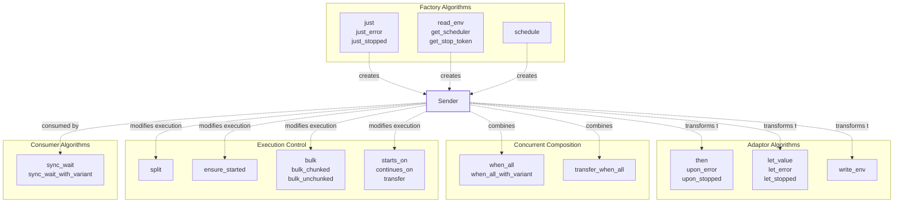
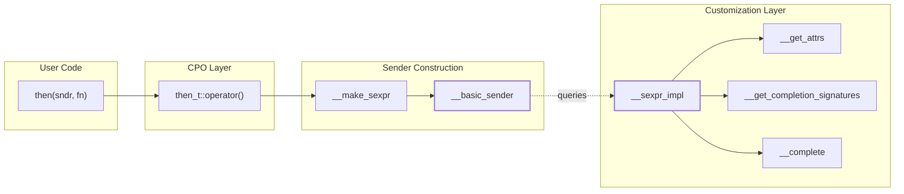
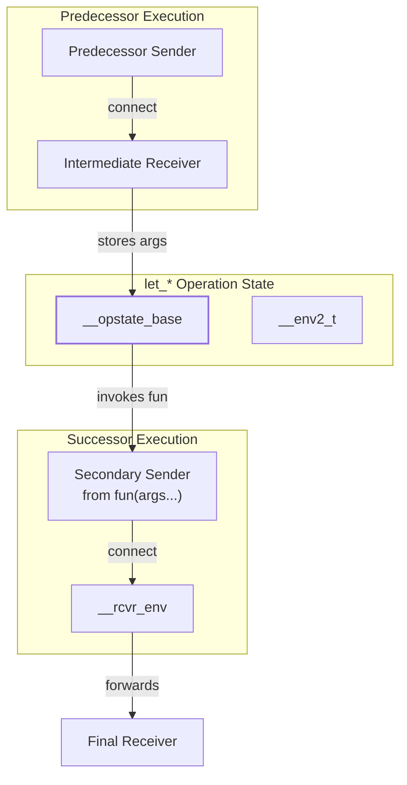

<!-- source: DeepWiki mcp.deepwiki.com · repo NVIDIA/stdexec · page 4 Standard Algorithms · fetched 2026-10-26 -->

# Standard Algorithms

Relevant source files

The following files were used as context for generating this wiki page:

- [include/stdexec/__detail/__bulk.hpp](include/stdexec/__detail/__bulk.hpp)
- [include/stdexec/__detail/__let.hpp](include/stdexec/__detail/__let.hpp)
- [include/stdexec/__detail/__schedule_from.hpp](include/stdexec/__detail/__schedule_from.hpp)
- [include/stdexec/__detail/__then.hpp](include/stdexec/__detail/__then.hpp)
- [include/stdexec/__detail/__transfer_just.hpp](include/stdexec/__detail/__transfer_just.hpp)
- [include/stdexec/__detail/__upon_error.hpp](include/stdexec/__detail/__upon_error.hpp)
- [include/stdexec/__detail/__upon_stopped.hpp](include/stdexec/__detail/__upon_stopped.hpp)
- [include/stdexec/__detail/__when_all.hpp](include/stdexec/__detail/__when_all.hpp)

## Purpose and Scope

This page provides an overview of the standard algorithms available in `stdexec`. Standard algorithms are the core vocabulary for composing asynchronous operations. They are functions and Customization Point Objects (CPOs) that create, transform, and consume senders to build execution graphs.

For detailed information about specific algorithm families, see:
- Factories and basic transformations: [Factories and Basic Adaptors](#4.1)
- Continuation-based composition: [let_value, let_error, and let_stopped](#4.2)
- Parallel composition: [when_all and Concurrent Operations](#4.3)
- Eager execution and sharing: [split, ensure_started, and Sharing](#4.4)
- Parallel iteration: [bulk Operations](#4.5)
- Blocking execution: [sync_wait and Blocking Consumers](#4.6)
- Scheduler integration: [Scheduler Operations](#4.7)

For information about the underlying execution model that these algorithms operate on, see [Core Execution Model](#3).

## Algorithm Classification

Standard algorithms in `stdexec` are organized into functional categories based on their role in composing asynchronous operations.

### Algorithm Taxonomy by Category

**Sources:** [include/stdexec/__detail/__when_all.hpp:48-71](), [include/stdexec/__detail/__let.hpp:43-47](), [include/stdexec/__detail/__then.hpp:101-118](), [include/stdexec/__detail/__bulk.hpp:37-39](), [include/stdexec/__detail/__upon_error.hpp:99-118](), [include/stdexec/__detail/__upon_stopped.hpp:71-89]()

## Core Algorithm Implementations

The following table maps algorithm names to their implementation characteristics:

| Algorithm | CPO Type | Implementation File | Completion Behavior | Domain Customizable |
|-----------|----------|---------------------|---------------------|---------------------|
| `just` | `just_t` | `__just.hpp` | Inline | Yes |
| `then` | `then_t` | `__then.hpp` | Passthrough/Throw | Yes |
| `let_value` | `let_value_t` | `__let.hpp` | Computed | Yes |
| `when_all` | `when_all_t` | `__when_all.hpp` | Coordination | Yes |
| `bulk` | `bulk_t` | `__bulk.hpp` | Iterative | Yes |
| `upon_error`| `upon_error_t`| `__upon_error.hpp` | Recovery | Yes |
| `upon_stopped`| `upon_stopped_t`| `__upon_stopped.hpp` | Recovery | Yes |
| `schedule_from`| `schedule_from_t`| `__schedule_from.hpp`| Transfer | Yes |

**Sources:** [include/stdexec/__detail/__then.hpp:180-186](), [include/stdexec/__detail/__when_all.hpp:157-170](), [include/stdexec/__detail/__bulk.hpp:179-192](), [include/stdexec/__detail/__upon_error.hpp:180-182](), [include/stdexec/__detail/__upon_stopped.hpp:150-167](), [include/stdexec/__detail/__schedule_from.hpp:32-41]()

## Sender Expression Model

All standard algorithms (except consumers) are implemented using the `__sexpr` (sender expression) framework. This provides a uniform structure for algorithm implementation and domain customization.

### Algorithm Implementation Pattern

**Sources:** [include/stdexec/__detail/__then.hpp:37-97](), [include/stdexec/__detail/__upon_error.hpp:37-95](), [include/stdexec/__detail/__upon_stopped.hpp:35-67]()

## Algorithm Composition Flow

Standard algorithms compose by wrapping child senders in new sender expressions. For complex continuations like `let_value`, this involves managing multiple operation states.

### Composition Example: `let_*`

The `let_value`, `let_error`, and `let_stopped` family of algorithms use an operation state base that coordinates between a primary sender and a secondary sender produced by a user-provided function.

**Sources:** [include/stdexec/__detail/__let.hpp:157-174](), [include/stdexec/__detail/__let.hpp:55-86]()

## Completion Signature Computation

Standard algorithms compute their completion signatures based on their child senders and transformation functions. This enables compile-time verification of sender graphs.

### Signature Computation for `then`

The `then` algorithm computes its completion signatures by:
1. **Transforming child signatures**: It takes the child sender's signatures [include/stdexec/__detail/__then.hpp:72-74]().
2. **Value Transformation**: For `set_value_t(Args...)`, it calculates the return type of the function `Fun(Args...)` [include/stdexec/__detail/__then.hpp:52]().
3. **Error Handling**: If the function `Fun` can throw, it adds `set_error_t(std::exception_ptr)` to the signatures [include/stdexec/__detail/__then.hpp:56-57]().

**Sources:** [include/stdexec/__detail/__then.hpp:45-65](), [include/stdexec/__detail/__then.hpp:67-76]()

## Operation State Management

Standard algorithms create operation states that manage the lifecycle of asynchronous operations. These states coordinate between child senders, intermediate storage, and final receivers.

### Operation State Components

| Component | Purpose | Implementation Example |
|-----------|---------|------------------------|
| **Receiver** | Holds the downstream receiver | `__rcvr_` in `__opstate_base` [include/stdexec/__detail/__let.hpp:169]() |
| **Function** | Stores the transformation logic | `__fn_` in `__opstate_base` [include/stdexec/__detail/__let.hpp:170]() |
| **Environment** | Secondary environment for result | `__env2_` in `__opstate_base` [include/stdexec/__detail/__let.hpp:172]() |

**Sources:** [include/stdexec/__detail/__let.hpp:157-174]()

## Concurrent Coordination

The `when_all` algorithm serves as the primary parallel composition primitive.

### `when_all` Characteristics
- **Single value-completion requirement**: Each input must have exactly one `set_value_t` signature [include/stdexec/__detail/__when_all.hpp:78-83]().
- **Concurrency**: Inputs are started concurrently in a fold expression [include/stdexec/__detail/__when_all.hpp:110-118]().
- **Error/Stop Semantics**: The first child to produce an error or stop wins; it triggers a stop request for remaining children via an internal `inplace_stop_source` [include/stdexec/__detail/__when_all.hpp:120-130]().

**Sources:** [include/stdexec/__detail/__when_all.hpp:48-63](), [include/stdexec/__detail/__when_all.hpp:157-181]()

## Sender Adaptor Closure

Algorithms support the pipe operator (`|`) via `__closure`.

**Pattern:**
- Calling an adaptor with only the transformation arguments (e.g., `then(fn)`) returns a closure object [include/stdexec/__detail/__then.hpp:198-202]().
- The pipe operator `sndr | closure` is equivalent to `closure(sndr)`.

**Sources:** [include/stdexec/__detail/__then.hpp:196-203](), [include/stdexec/__detail/__bulk.hpp:198-204](), [include/stdexec/__detail/__upon_error.hpp:198-204]()

---

