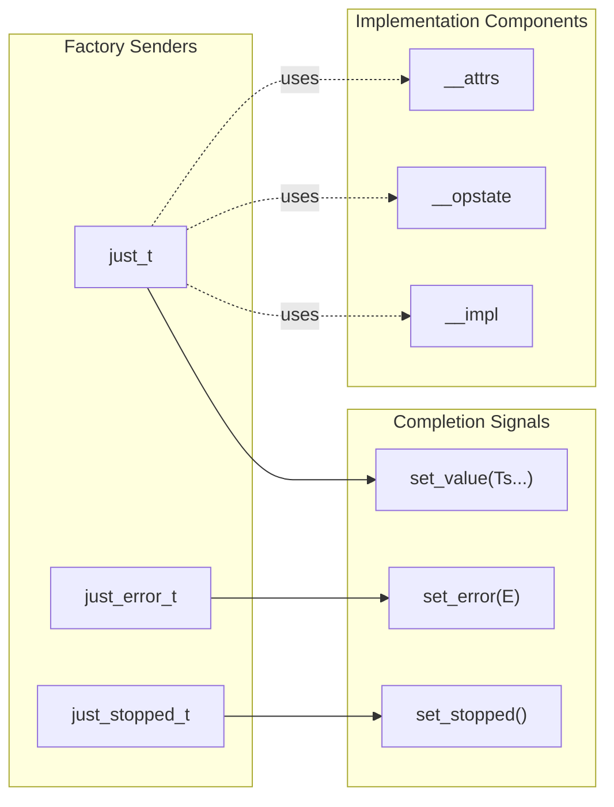
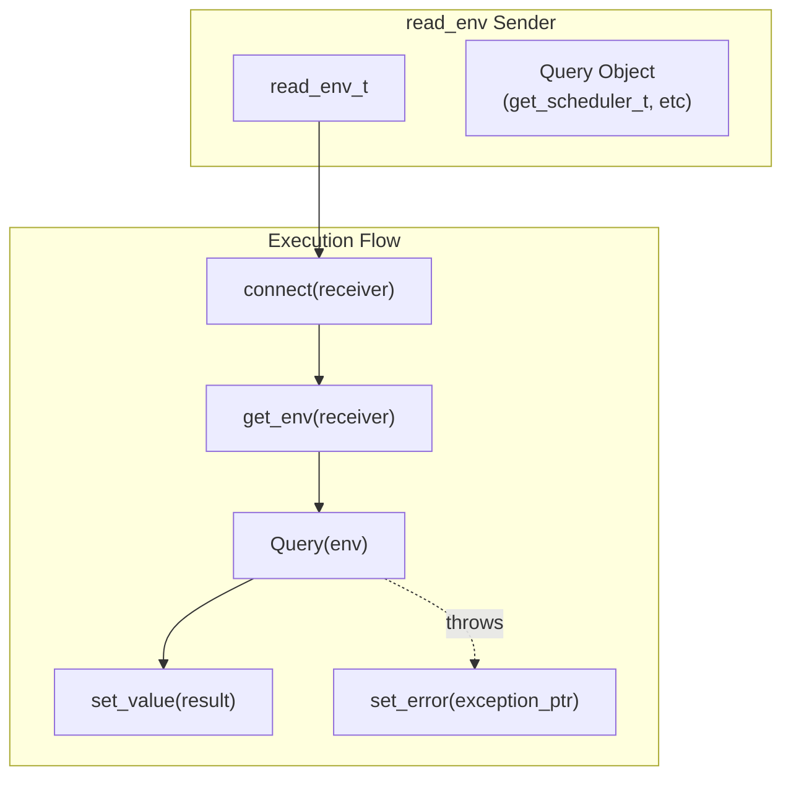
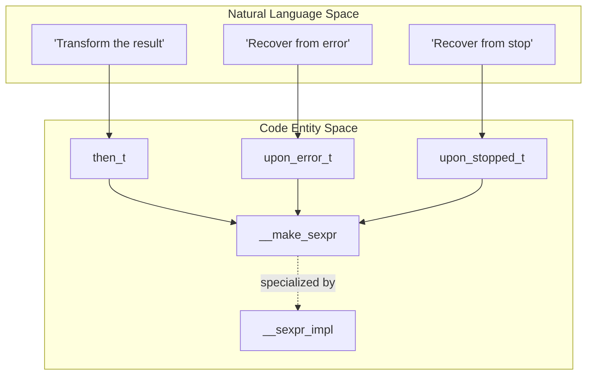

<!-- source: DeepWiki mcp.deepwiki.com · repo NVIDIA/stdexec · page 4.1 Factories and Basic Adaptors · fetched 2026-10-26 -->

# Factories and Basic Adaptors

Relevant source files

The following files were used as context for generating this wiki page:

- [include/stdexec/__detail/__bulk.hpp](include/stdexec/__detail/__bulk.hpp)
- [include/stdexec/__detail/__env.hpp](include/stdexec/__detail/__env.hpp)
- [include/stdexec/__detail/__into_variant.hpp](include/stdexec/__detail/__into_variant.hpp)
- [include/stdexec/__detail/__just.hpp](include/stdexec/__detail/__just.hpp)
- [include/stdexec/__detail/__read_env.hpp](include/stdexec/__detail/__read_env.hpp)
- [include/stdexec/__detail/__schedulers.hpp](include/stdexec/__detail/__schedulers.hpp)
- [include/stdexec/__detail/__stopped_as_error.hpp](include/stdexec/__detail/__stopped_as_error.hpp)
- [include/stdexec/__detail/__stopped_as_optional.hpp](include/stdexec/__detail/__stopped_as_optional.hpp)
- [include/stdexec/__detail/__sync_wait.hpp](include/stdexec/__detail/__sync_wait.hpp)
- [include/stdexec/__detail/__then.hpp](include/stdexec/__detail/__then.hpp)
- [include/stdexec/__detail/__upon_error.hpp](include/stdexec/__detail/__upon_error.hpp)
- [include/stdexec/__detail/__upon_stopped.hpp](include/stdexec/__detail/__upon_stopped.hpp)
- [include/stdexec/__detail/__write_env.hpp](include/stdexec/__detail/__write_env.hpp)
- [test/stdexec/algos/adaptors/test_upon_error.cpp](test/stdexec/algos/adaptors/test_upon_error.cpp)

## Overview

This page documents the fundamental sender factories and basic transformation adaptors in `stdexec`. These are the simplest building blocks for creating and transforming senders:

- **Factory senders** create senders from values or queries: `just`, `just_error`, `just_stopped`, `read_env`, and `schedule`.
- **Basic adaptors** perform simple transformations: `then`, `upon_error`, `upon_stopped`, `write_env`, `bulk`, and `into_variant`.

For more complex composition patterns like `let_value`, see [Section 4.2](). For concurrent operations like `when_all`, see [Section 4.3](). For blocking operations like `sync_wait`, see [Section 4.6]().

---

## Factory Senders

Factory senders are the starting point for sender chains. They create senders that immediately complete with a specific value, error, or stopped signal, or that query the execution environment.

### just, just_error, just_stopped

#### Purpose

These factories create senders that complete immediately with a known result:

- **`just(values...)`** - Creates a sender that completes successfully with `set_value(values...)` [include/stdexec/__detail/__just.hpp:148-168]().
- **`just_error(error)`** - Creates a sender that completes with an error via `set_error(error)` [include/stdexec/__detail/__just.hpp:170-205]().
- **`just_stopped()`** - Creates a sender that completes with cancellation via `set_stopped()` [include/stdexec/__detail/__just.hpp:207-226]().

Sources: [include/stdexec/__detail/__just.hpp:36-168]()

#### Structure and Implementation

**Type Hierarchy:**

| Component | Purpose | Location |
|-----------|---------|----------|
| `just_t`, `just_error_t`, `just_stopped_t` | User-facing factory types | [include/stdexec/__detail/__just.hpp:148-226]() |
| `__attrs<_SetTag>` | Attribute holder, provides completion behavior | [include/stdexec/__detail/__just.hpp:39-45]() |
| `__opstate<_SetTag, _Tuple, _Receiver>` | Operation state implementation | [include/stdexec/__detail/__just.hpp:47-57]() |
| `__impl<_JustTag>` | Sender expression implementation | [include/stdexec/__detail/__just.hpp:59-85]() |

**Key Implementation Details:**
The factories store their values in a `__tuple` and apply them directly to the completion function when started via `__apply` [include/stdexec/__detail/__just.hpp:50-53]().

**Completion Behavior:**
All three factories declare `__inline_completion` behavior, meaning they complete synchronously before `start()` returns [include/stdexec/__detail/__just.hpp:41-44]().

---

### read_env

#### Purpose

`read_env(query)` creates a sender that queries the receiver's execution environment and sends the result as a value [include/stdexec/__detail/__read_env.hpp:161-182]().

Sources: [include/stdexec/__detail/__read_env.hpp:41-159]()

#### Implementation Components
- **`__opstate`**: Evaluates the query against the receiver's environment during `start()` and delivers the result via `set_value` [include/stdexec/__detail/__read_env.hpp:45-78]().
- **`__read_env_impl`**: Defines the `__sexpr` logic, including `__get_completion_signatures` which computes the result type from the actual environment at connect time [include/stdexec/__detail/__read_env.hpp:98-149]().

---

### schedule

#### Purpose
`schedule(scheduler)` is the canonical way to begin a sender pipeline on a specific execution context [include/stdexec/__detail/__schedulers.hpp:46-59]().

**Implementation:**
The `schedule` CPO is an instance of `schedule_t` [include/stdexec/__detail/__schedulers.hpp:173](). It primarily looks for a `.schedule()` member function on the scheduler object [include/stdexec/__detail/__schedulers.hpp:134-144]().

Sources: [include/stdexec/__detail/__schedulers.hpp:36-173]()

---

## Basic Transformation Adaptors

### then, upon_error, upon_stopped

#### Purpose
These adaptors map completion signals through a function:
- **`then`**: Maps the value channel [include/stdexec/__detail/__then.hpp:101-118]().
- **`upon_error`**: Maps the error channel into the value channel (error recovery) [include/stdexec/__detail/__upon_error.hpp:99-118]().
- **`upon_stopped`**: Maps the stopped channel into the value channel (cancellation recovery) [include/stdexec/__detail/__upon_stopped.hpp:71-89]().

Sources: [include/stdexec/__detail/__then.hpp:180-186](), [include/stdexec/__detail/__upon_error.hpp:180-182](), [include/stdexec/__detail/__upon_stopped.hpp:150-151]()

**Implementation Details:**
- **`__complete`**: Each adaptor defines a `__complete` function that intercepts specific completion tags. For example, `__then_impl::__complete` intercepts `set_value_t` and applies the transformation function [include/stdexec/__detail/__then.hpp:77-96]().
- **Signature Transformation**: They use `__transform_completion_signatures` to compute the new signatures, adding `set_error_t(std::exception_ptr)` if the transformation function is not `noexcept` [include/stdexec/__detail/__then.hpp:46-75](), [include/stdexec/__detail/__upon_error.hpp:45-76]().

---

### bulk

#### Purpose
`bulk(sender, shape, function)` executes a function for every index in the range `[0, shape)` [include/stdexec/__detail/__bulk.hpp:178-193]().

**Implementation Traits:**
The `__bulk_traits` specialization determines how the function is "curried" with indices depending on the algorithm variant (`bulk`, `bulk_chunked`, `bulk_unchunked`) [include/stdexec/__detail/__bulk.hpp:124-159]().

Sources: [include/stdexec/__detail/__bulk.hpp:38-203]()

---

### into_variant

#### Purpose
`into_variant(sender)` collapses multiple value-completion signatures into a single `std::variant<std::tuple<Vs...>>` value completion [include/stdexec/__detail/__into_variant.hpp:112-125]().

**Implementation Details:**
- **`__variant_t`**: Metaprogramming utility to compute the `std::variant` type from completion signatures [include/stdexec/__detail/__into_variant.hpp:45-48]().
- **`__complete`**: Wraps arguments into the computed variant and delivers them via `set_value` [include/stdexec/__detail/__into_variant.hpp:76-101]().

Sources: [include/stdexec/__detail/__into_variant.hpp:39-109]()

---

## Environment Adaptors

### write_env

#### Purpose
`write_env(sender, env)` augments the environment seen by a predecessor sender [include/stdexec/__detail/__write_env.hpp:76-90]().

**Key logic:**
- **`__get_env`**: Joins the local environment data with the receiver's environment using `__env::__join` [include/stdexec/__detail/__write_env.hpp:42-46]().
- **`__get_completion_signatures`**: Computes signatures by invoking the child's signature computation with the joined environment [include/stdexec/__detail/__write_env.hpp:48-55]().

Sources: [include/stdexec/__detail/__write_env.hpp:32-74](), [include/stdexec/__detail/__env.hpp:96-125]()

---

