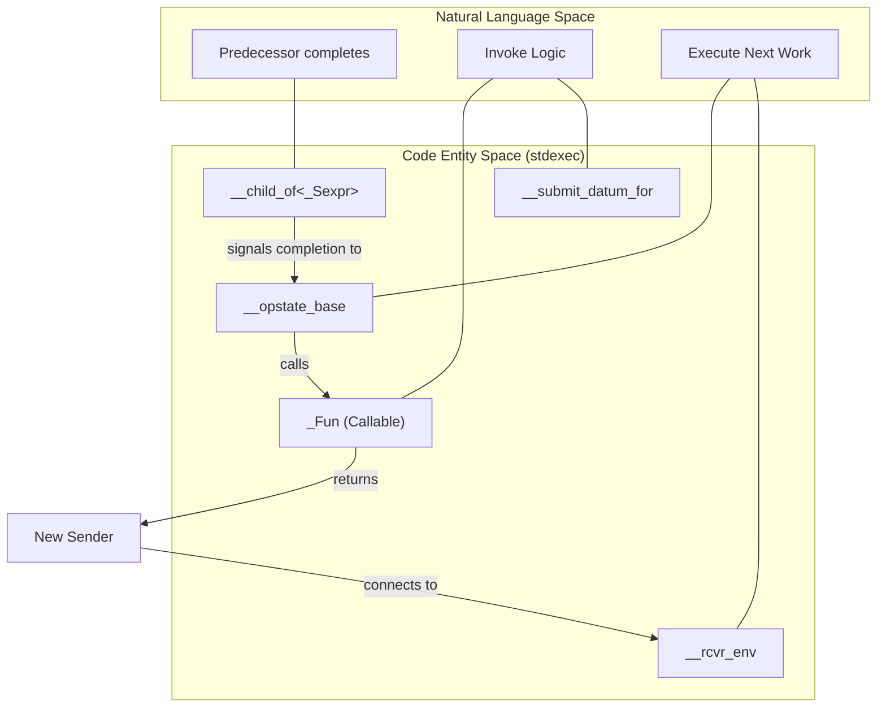
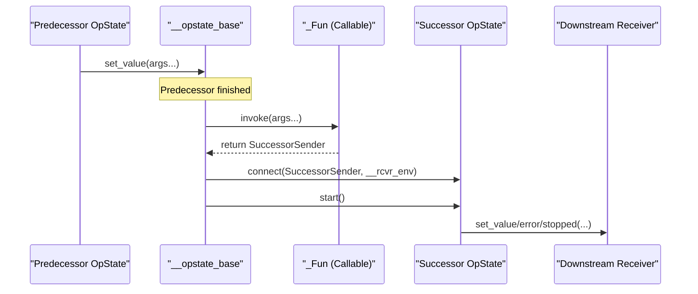

<!-- source: DeepWiki mcp.deepwiki.com · repo NVIDIA/stdexec · page 4.2 let_value, let_error, and let_stopped · fetched 2026-10-26 -->

# let_value, let_error, and let_stopped

<details>
<summary>Relevant source files</summary>

The following files were used as context for generating this wiki page:

- [include/stdexec/__detail/__let.hpp](include/stdexec/__detail/__let.hpp)
- [include/stdexec/__detail/__schedule_from.hpp](include/stdexec/__detail/__schedule_from.hpp)
- [include/stdexec/__detail/__transfer_just.hpp](include/stdexec/__detail/__transfer_just.hpp)
- [include/stdexec/__detail/__when_all.hpp](include/stdexec/__detail/__when_all.hpp)
- [test/exec/sequence/test_ignore_all_values.cpp](test/exec/sequence/test_ignore_all_values.cpp)
- [test/exec/test_type_async_scope.cpp](test/exec/test_type_async_scope.cpp)
- [test/exec/test_when_any.cpp](test/exec/test_when_any.cpp)
- [test/stdexec/algos/adaptors/test_let_stopped.cpp](test/stdexec/algos/adaptors/test_let_stopped.cpp)
- [test/stdexec/algos/adaptors/test_let_value.cpp](test/stdexec/algos/adaptors/test_let_value.cpp)
- [test/stdexec/algos/adaptors/test_stopped_as_error.cpp](test/stdexec/algos/adaptors/test_stopped_as_error.cpp)
- [test/stdexec/algos/factories/test_just.cpp](test/stdexec/algos/factories/test_just.cpp)
- [test/stdexec/algos/factories/test_transfer_just.cpp](test/stdexec/algos/factories/test_transfer_just.cpp)
- [test/stdexec/concepts/test_concepts_receiver.cpp](test/stdexec/concepts/test_concepts_receiver.cpp)
- [test/stdexec/cpos/test_cpo_receiver.cpp](test/stdexec/cpos/test_cpo_receiver.cpp)

</details>


## Purpose and Scope

This page documents the `let_value`, `let_error`, and `let_stopped` sender adaptors. These algorithms enable **dynamic sender creation based on the results of a predecessor sender**. Unlike basic adaptors like `then` (see section 4.1) which transform values within a single completion channel, the `let_*` family allows a callable to return a new sender that is subsequently connected and started. This enables complex asynchronous workflows, conditional branching, and continuation-based composition where the next step of work depends on runtime values.

For concurrent operations with multiple senders, see `when_all` (section 4.3). For sender sharing, see `split` (section 4.4).

## Overview

The `let_*` family provides three channel-specific variants defined in the `STDEXEC` namespace:

| Adaptor | Completion Channel | Purpose |
|---------|-------------------|---------|
| `let_value` | `set_value` | Create a new sender based on values from successful completion. |
| `let_error` | `set_error` | Create a new sender based on error values for recovery or transformation. |
| `let_stopped` | `set_stopped` | Create a new sender when the predecessor is stopped (cancelled). |

### Key Characteristics

*   **Dynamic Sender Construction**: The function argument to `let_*` is invoked with the predecessor's results and **must return a sender** [[include/stdexec/__detail/__let.hpp:88-89]]().
*   **Continuation-Based Composition**: The returned sender is connected to the downstream receiver and started automatically, effectively "splicing" a new asynchronous operation into the chain [[include/stdexec/__detail/__let.hpp:124-131]]().
*   **Lifetime Management**: The `let_*` operation state manages the lifetime of both the predecessor operation state and the dynamically created child sender's operation state [[include/stdexec/__detail/__let.hpp:157-173]]().

Sources: [[include/stdexec/__detail/__let.hpp:42-47]](), [[include/stdexec/__detail/__let.hpp:157-173]]()

## Conceptual Mapping: Natural Language to Code Entities

The following diagram bridges the conceptual execution flow to the internal C++ entities used in the implementation.



Sources: [[include/stdexec/__detail/__let.hpp:56-86]](), [[include/stdexec/__detail/__let.hpp:124-131]](), [[include/stdexec/__detail/__let.hpp:157-173]]()

## let_value

### Semantics
`let_value(sender, fn)` creates a sender that:
1.  Starts the predecessor `sender`.
2.  When the predecessor completes with `set_value(args...)`, it invokes `fn(args...)` [[include/stdexec/__detail/__let.hpp:182-184]]().
3.  The result of `fn` (a new sender) is connected to the downstream receiver and started [[include/stdexec/__detail/__let.hpp:129-130]]().
4.  If the predecessor completes with `set_error` or `set_stopped`, these are forwarded directly to the downstream receiver.

### Example: Transforming Values into New Async Work
```cpp
auto snd = ex::just(13) 
         | ex::let_value([](int& x) { 
             return ex::just(x + 4); // Returns a new sender
           });
```
Sources: [[test/stdexec/algos/adaptors/test_let_value.cpp:88-91]](), [[include/stdexec/__detail/__let.hpp:182-184]]()

## let_error

### Semantics
`let_error(sender, fn)` is used for asynchronous error recovery. It invokes `fn(error)` only if the predecessor completes via `set_error`.
1.  If the predecessor succeeds (`set_value`), the results are forwarded downstream.
2.  If the predecessor fails, `fn` returns a recovery sender that can either produce a value (annihilating the error) or produce a different error.

### Example: Error to Value Conversion
```cpp
auto snd = ex::just_error(std::exception_ptr{})
         | ex::let_error([](std::exception_ptr) { 
             return ex::just(); // Recover with a void value
           });
```
Sources: [[include/stdexec/__detail/__let.hpp:182-184]](), [[test/stdexec/algos/adaptors/test_let_value.cpp:175-181]]()

## let_stopped

### Semantics
`let_stopped(sender, fn)` handles cancellation. It invokes `fn()` (taking no arguments) only if the predecessor completes via `set_stopped`.
1.  This allows "annihilating" a stop signal by returning a sender that completes with a value.
2.  If the predecessor completes with `set_value` or `set_error`, those are forwarded.

Sources: [[include/stdexec/__detail/__let.hpp:182-184]](), [[test/stdexec/algos/adaptors/test_let_value.cpp:183-188]]()

## Implementation Detail: The Operation State

The `let_*` algorithms are implemented using a common base class `__opstate_base` that manages the transition between the predecessor and the successor sender.

### Data Flow Diagram

The diagram below shows how the operation state (`__op_state`) coordinates the transition from the predecessor sender to the dynamically created successor.



### Key Implementation Entities
*   **`__rcvr_env`**: A wrapper receiver that merges the environment of the downstream receiver with the environment required by the `let` algorithm [[include/stdexec/__detail/__let.hpp:56-86]]().
*   **`__opstate_base`**: An immovable class that stores the callable `_Fun` and the secondary environment `_Env2`. It provides the `__start_next` virtual function to transition execution [[include/stdexec/__detail/__let.hpp:157-177]]().
*   **`__has_nothrow_completions_t`**: A metaprogramming utility to determine if the transition to the successor sender can throw, influencing whether `set_error(std::exception_ptr)` must be added to completion signatures [[include/stdexec/__detail/__let.hpp:148-154]]().

Sources: [[include/stdexec/__detail/__let.hpp:56-86]](), [[include/stdexec/__detail/__let.hpp:157-177]](), [[include/stdexec/__detail/__let.hpp:148-154]]()

## Completion Signatures and Environments

The `let_*` adaptors must calculate their completion signatures by inspecting the signatures of the predecessor and the potential senders returned by the callable.

*   **Environment Joining**: The downstream receiver's environment is joined with a secondary environment (`__env2_t`) using `__env::__join` [[include/stdexec/__detail/__let.hpp:50-53]]().
*   **Signature Transformation**: The algorithm uses `__try_completion_signatures_of_t` to speculatively compute the signatures of the sender returned by the callable [[include/stdexec/__detail/__let.hpp:96-101]]().
*   **Error Handling**: If the callable or the connection process can throw, the implementation checks for `__nothrow_decay_copyable` and `__nothrow_connectable` to determine the error channel signatures [[include/stdexec/__detail/__let.hpp:143-145]]().

Sources: [[include/stdexec/__detail/__let.hpp:50-53]](), [[include/stdexec/__detail/__let.hpp:96-101]](), [[include/stdexec/__detail/__let.hpp:143-145]]()

---

