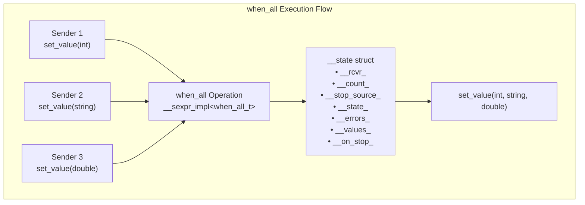
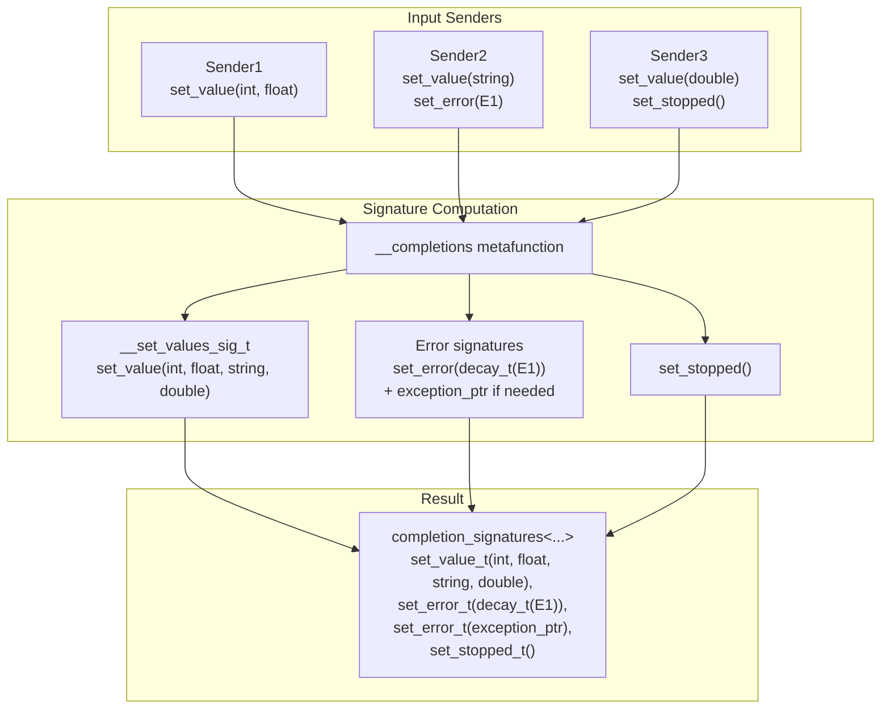
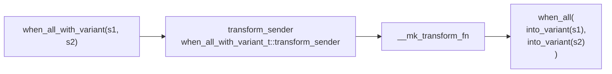
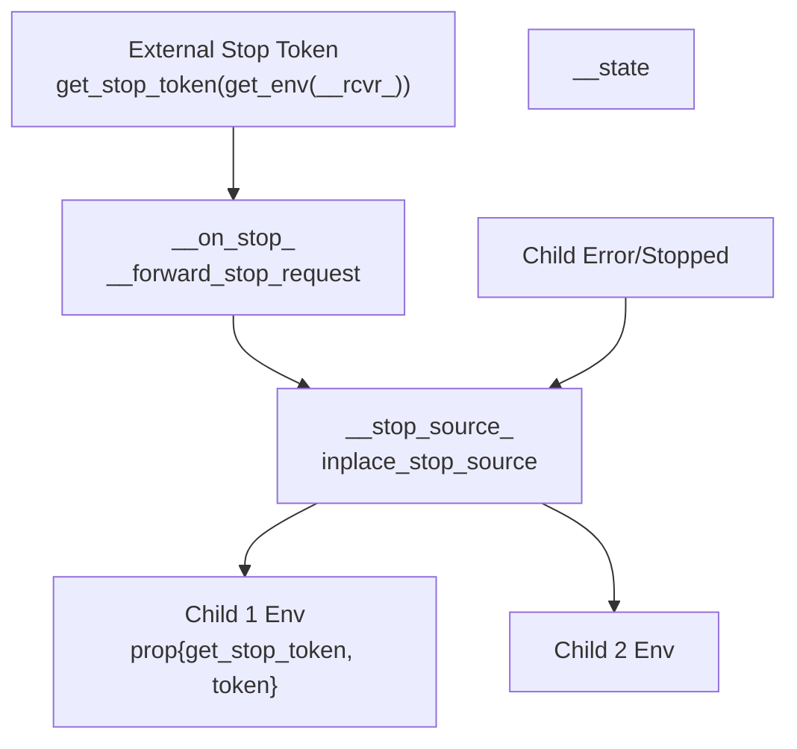

<!-- source: DeepWiki mcp.deepwiki.com · repo NVIDIA/stdexec · page 4.3 when_all and Concurrent Operations · fetched 2026-10-26 -->

# when_all and Concurrent Operations

<details>
<summary>Relevant source files</summary>

The following files were used as context for generating this wiki page:

- [include/stdexec/__detail/__let.hpp](include/stdexec/__detail/__let.hpp)
- [include/stdexec/__detail/__schedule_from.hpp](include/stdexec/__detail/__schedule_from.hpp)
- [include/stdexec/__detail/__transfer_just.hpp](include/stdexec/__detail/__transfer_just.hpp)
- [include/stdexec/__detail/__when_all.hpp](include/stdexec/__detail/__when_all.hpp)
- [test/stdexec/algos/adaptors/test_transfer_when_all.cpp](test/stdexec/algos/adaptors/test_transfer_when_all.cpp)
- [test/stdexec/algos/adaptors/test_when_all.cpp](test/stdexec/algos/adaptors/test_when_all.cpp)
- [test/stdexec/algos/consumers/test_sync_wait.cpp](test/stdexec/algos/consumers/test_sync_wait.cpp)
- [test/stdexec/concepts/test_awaitables.cpp](test/stdexec/concepts/test_awaitables.cpp)
- [test/stdexec/concepts/test_concepts_sender.cpp](test/stdexec/concepts/test_concepts_sender.cpp)

</details>


## Purpose and Scope

This page documents the `when_all` family of algorithms in `stdexec` for concurrent composition of senders. These algorithms enable multiple asynchronous operations to execute simultaneously and coordinate their completion:

- **`when_all`**: Waits for all input senders to complete successfully, returning their results as a concatenated set of values. [include/stdexec/__detail/__when_all.hpp:48-75]()
- **`when_all_with_variant`**: Variant version that wraps each sender's results in a `std::variant`, enabling support for senders with multiple completion signatures. [include/stdexec/__detail/__when_all.hpp:154-154]()
- **`transfer_when_all`**: Combines `when_all` with a scheduler transfer (CPO `continues_on`). [include/stdexec/__detail/__when_all.hpp:155-155]()
- **`transfer_when_all_with_variant`**: Combines variant wrapping with scheduler transfer. [include/stdexec/__detail/__when_all.hpp:528-528]()

For algorithms that enable sharing sender execution across multiple consumers, see [split, ensure_started, and Sharing](4.4).

---

## Conceptual Overview

The `when_all` family coordinates multiple senders executing concurrently, waiting for all to complete before forwarding results.

Title: when_all Concurrent Coordination


The operation state coordinates all child senders using atomic state tracking and a shared stop source. Results are collected in a tuple of optionals, and the final receiver is invoked only when all children complete.

Sources: [include/stdexec/__detail/__when_all.hpp:202-253](), [include/stdexec/__detail/__when_all.hpp:333-335]()

---

## when_all: Wait for All Operations

### Overview

The `when_all` algorithm (defined by `when_all_t` at [include/stdexec/__detail/__when_all.hpp:157-185]()) combines multiple senders into a single sender. If any sender completes with an error or stopped signal, the operation requests cancellation of all other children and forwards that completion to the output receiver.

**Key Characteristics:**
- **Concurrency**: Inputs are not sequenced relative to each other; all are started in a fold expression before `start` returns. [include/stdexec/__detail/__when_all.hpp:110-118]()
- **Aggregation**: Aggregates all value results by concatenating them: `set_value(V1..., V2..., ..., Vn...)`. [include/stdexec/__detail/__when_all.hpp:98-99]()
- **Cancellation**: Uses an internal `inplace_stop_source` to coordinate cancellation across all children. [include/stdexec/__detail/__when_all.hpp:60-62]()

Sources: [include/stdexec/__detail/__when_all.hpp:48-158](), [include/stdexec/__detail/__when_all.hpp:333-453]()

### Completion Signatures

The completion signatures transform according to `__when_all::__completions`:

Title: when_all Completion Signature Transformation via __completions


1. **Value Signatures**: Each sender must complete with exactly one `set_value` signature (enforced by `__max1_sender` [include/stdexec/__detail/__when_all.hpp:159-161]()).
2. **Error Signatures**: Collects all `set_error_t` signatures, plus `set_error_t(std::exception_ptr)` if any decay-copy of value results may throw. [include/stdexec/__detail/__when_all.hpp:100-101](), [include/stdexec/__detail/__when_all.hpp:123-132]()

Sources: [include/stdexec/__detail/__when_all.hpp:92-136](), [include/stdexec/__detail/__when_all.hpp:159-161]()

### Implementation Architecture

The core operation state is the `__state` struct [include/stdexec/__detail/__when_all.hpp:202-253]():

| Member | Type | Purpose |
|--------|------|---------|
| `__rcvr_` | `_Receiver` | Output receiver to complete when all children finish |
| `__count_` | `atomic<size_t>` | Completion counter initialized to child count |
| `__stop_source_` | `inplace_stop_source` | Issues stop requests to all children |
| `__state_` | `atomic<__state_t>` | Tracks state: `__started`, `__error`, or `__stopped` |
| `__errors_` | `_ErrorsVariant` | Stores the first error received |
| `__values_` | `_ValuesTuple` | Tuple of `optional<tuple<Vs...>>` for child results |

**Coordination Protocol:**

1. **Start**: Calls `start()` on all child operations. Registers a stop callback `__on_stop_` to propagate external stop requests from the receiver's stop token to the internal `__stop_source_`. [include/stdexec/__detail/__when_all.hpp:372-383]()
2. **Child Completion**: 
   - **set_value**: Stores results in `__values_`. [include/stdexec/__detail/__when_all.hpp:433-447]()
   - **set_error**: Transitions `__state_` to `__error`, stores the error if it's the first failure, and calls `__stop_source_.request_stop()`. [include/stdexec/__detail/__when_all.hpp:385-411]()
3. **Arrival**: The last child to complete (decrementing `__count_` to 0) calls `__complete()` to deliver the final result to the downstream receiver. [include/stdexec/__detail/__when_all.hpp:208-212]()

Sources: [include/stdexec/__detail/__when_all.hpp:202-253](), [include/stdexec/__detail/__when_all.hpp:372-452]()

---

## when_all_with_variant: Variant Result Wrapping

`when_all_with_variant` (defined by `when_all_with_variant_t` at [include/stdexec/__detail/__when_all.hpp:455-488]()) wraps each child sender's results in an `into_variant` adaptor before combining them. This lifts the "single value-completion" restriction of standard `when_all`. [include/stdexec/__detail/__when_all.hpp:81-83]()

**Transformation:**
`when_all_with_variant(s1, s2)` $\rightarrow$ `when_all(into_variant(s1), into_variant(s2))`

Title: when_all_with_variant Transformation


Sources: [include/stdexec/__detail/__when_all.hpp:455-488](), [include/stdexec/__detail/__when_all.hpp:81-83]()

---

## transfer_when_all: Combined Transfer and Coordination

`transfer_when_all` (defined by `transfer_when_all_t` at [include/stdexec/__detail/__when_all.hpp:490-526]()) coordinates multiple senders and then transfers the concatenated results to a specified scheduler.

**Transformation:**
`transfer_when_all(sch, s1, s2)` $\rightarrow$ `continues_on(when_all(s1, s2), sch)`

The transformation is handled by `transform_sender` [include/stdexec/__detail/__when_all.hpp:498-510]():
```cpp
// include/stdexec/__detail/__when_all.hpp:503-508
return __apply(
  [&]<class _Data, class... _Child>(__ignore, _Data&& __data, _Child&&... __child) {
    return continues_on(when_all(static_cast<_Child&&>(__child)...),
                        static_cast<_Data&&>(__data));
  },
  static_cast<_Sender&&>(__sndr));
```

Sources: [include/stdexec/__detail/__when_all.hpp:490-526](), [include/stdexec/__detail/__when_all.hpp:83-106]()

---

## transfer_when_all_with_variant

`transfer_when_all_with_variant` (defined at [include/stdexec/__detail/__when_all.hpp:528-567]()) combines variant wrapping with scheduler transfer.

**Transformation Chain:**
1. `transfer_when_all_with_variant(sch, s1, s2)`
2. `transfer_when_all(sch, into_variant(s1), into_variant(s2))` [include/stdexec/__detail/__when_all.hpp:543-550]()
3. `continues_on(when_all(into_variant(s1), into_variant(s2)), sch)`

Sources: [include/stdexec/__detail/__when_all.hpp:528-567](), [include/stdexec/__detail/__when_all.hpp:108-131]()

---

## Stop Token Coordination

The `when_all` operation provides a coordinated stop token to all children via `__mk_env` [include/stdexec/__detail/__when_all.hpp:148-152]().

Title: when_all Stop Token Coordination


Each child receives a stop token from the internal `inplace_stop_source`. This source is triggered if:
1. The external stop token is signaled. [include/stdexec/__detail/__when_all.hpp:180-200]()
2. Any child completes with an error. [include/stdexec/__detail/__when_all.hpp:392-392]()
3. Any child completes with a stopped signal. [include/stdexec/__detail/__when_all.hpp:426-427]()

Sources: [include/stdexec/__detail/__when_all.hpp:148-152](), [include/stdexec/__detail/__when_all.hpp:180-200](), [include/stdexec/__detail/__when_all.hpp:392-392]()

---

## Performance and Exception Safety

### Exception Safety
When storing value completions, `when_all` catches exceptions during the `decay-copy` of arguments and transitions the operation to the error path with `std::exception_ptr`. [include/stdexec/__detail/__when_all.hpp:107-108](), [include/stdexec/__detail/__when_all.hpp:440-445]()

### Attribute Queries
`when_all` aggregates the `completion_behavior` of its children using `completion_behavior::weakest` [include/stdexec/__detail/__when_all.hpp:283-288](). If any child is asynchronous, the combined `when_all` operation reflects that behavior.

Sources: [include/stdexec/__detail/__when_all.hpp:440-445](), [include/stdexec/__detail/__when_all.hpp:283-288]()

---

