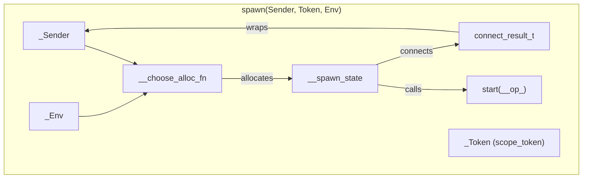
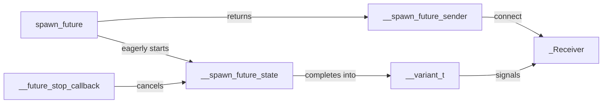
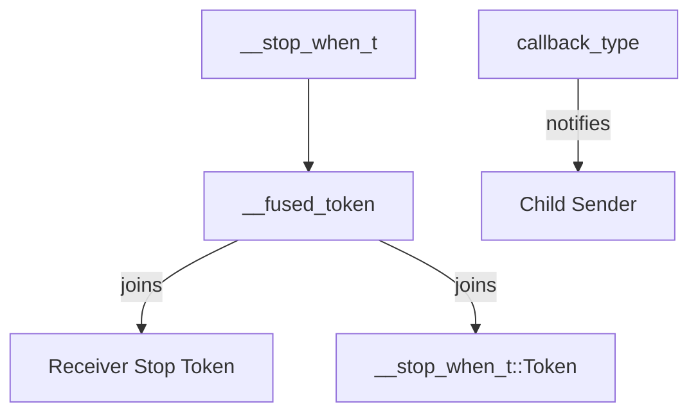

<!-- source: DeepWiki mcp.deepwiki.com · repo NVIDIA/stdexec · page 4.4 split, ensure_started, and Sharing · fetched 2026-10-26 -->

# split, ensure_started, and Sharing

Relevant source files

The following files were used as context for generating this wiki page:

- [docs/eelis_link_filter.pl](docs/eelis_link_filter.pl)
- [include/stdexec/__detail/__associate.hpp](include/stdexec/__detail/__associate.hpp)
- [include/stdexec/__detail/__counting_scopes.hpp](include/stdexec/__detail/__counting_scopes.hpp)
- [include/stdexec/__detail/__spawn.hpp](include/stdexec/__detail/__spawn.hpp)
- [include/stdexec/__detail/__spawn_common.hpp](include/stdexec/__detail/__spawn_common.hpp)
- [include/stdexec/__detail/__spawn_future.hpp](include/stdexec/__detail/__spawn_future.hpp)
- [include/stdexec/__detail/__stop_when.hpp](include/stdexec/__detail/__stop_when.hpp)
- [test/stdexec/algos/adaptors/test_spawn_future.cpp](test/stdexec/algos/adaptors/test_spawn_future.cpp)
- [test/stdexec/algos/adaptors/test_stop_when.cpp](test/stdexec/algos/adaptors/test_stop_when.cpp)
- [test/stdexec/algos/consumers/test_spawn.cpp](test/stdexec/algos/consumers/test_spawn.cpp)
- [test/test_common/scope_helpers.hpp](test/test_common/scope_helpers.hpp)

## Purpose and Scope

This page documents the `split` and `ensure_started` algorithms, alongside the related concepts of `spawn`, `spawn_future`, and `associate`. These utilities enable sharing the results of a sender among multiple receivers or managing the execution lifecycle of senders independently of the current call stack. These algorithms solve the problem of broadcasting a single asynchronous operation's result to multiple consumers or detaching work into a managed scope.

## Overview

Sharing and detaching execution in `stdexec` involves different strategies for timing and resource management:

- **`split`**: Creates a multicast sender that can be connected to multiple receivers. Execution is lazy; it starts when `start()` is called on the first connected operation state.
- **`ensure_started`**: Eagerly starts execution immediately and returns a sender that can be connected to multiple receivers to observe the result.
- **`spawn` / `spawn_future`**: Detaches a sender's execution into a "scope". `spawn` is a fire-and-forget consumer, while `spawn_future` returns a sender (the "future") to eventually retrieve the result.
- **`associate`**: Binds a sender to a `scope_token`, ensuring that the sender's lifetime and execution are tied to a specific resource scope.

| Feature | `split` | `ensure_started` | `spawn` | `spawn_future` |
|---------|---------|------------------|---------|----------------|
| Execution timing | Lazy (on first `start()`) | Eager (immediately) | Eager | Eager |
| Result retrieval | Multiple receivers | Multiple receivers | None (Fire-and-forget) | Single "future" sender |
| Requires scheduler | No | Yes | Optional (via Env) | Optional (via Env) |
| Allocation | Internal shared state | Internal shared state | Dynamic (per-spawn) | Dynamic (per-spawn) |

Sources: [include/stdexec/__detail/__spawn.hpp:127-148](), [include/stdexec/__detail/__spawn_future.hpp:244-266]()

## Detached Execution: spawn and spawn_future

The `spawn` family of functions allows work to be kicked off eagerly. These functions are particularly sensitive to the execution environment, specifically the allocator.

### Allocator and Environment Selection
Both `spawn` and `spawn_future` use a common mechanism to determine which allocator and environment to use for the internal state via `__spawn_common`:
1. **Allocator Selection**: If `get_allocator(env)` is well-formed, it is used. Otherwise, it checks the sender's attributes. If both fail, it defaults to `std::allocator<void>{}`. [include/stdexec/__detail/__spawn_common.hpp:36-61]()
2. **Environment Selection**: `__choose_senv` selects the environment to inject into the spawned work. If an allocator was pulled from the sender's attributes, it joins that allocator into the environment using `prop(get_allocator, alloc)`. [include/stdexec/__detail/__spawn_common.hpp:65-92]()

### spawn Implementation
`spawn` connects the sender to an internal `__spawn_receiver` and immediately calls `start()` on the operation state. The `__spawn_state` is dynamically allocated and destroys itself upon completion via `__do_complete`. [include/stdexec/__detail/__spawn.hpp:80-124]()

Sources: [include/stdexec/__detail/__spawn.hpp:42-124](), [include/stdexec/__detail/__spawn_common.hpp:36-95]()

### spawn_future Implementation
`spawn_future` returns a sender that, when connected, registers a callback to receive the result of the eagerly started work. It stores results in a `__results_storage` (a variant of decayed tuples). [include/stdexec/__detail/__spawn_future.hpp:125-153]()

Sources: [include/stdexec/__detail/__spawn_future.hpp:51-84](), [include/stdexec/__detail/__spawn_future.hpp:157-200](), [include/stdexec/__detail/__spawn_future.hpp:268-300]()

## Scopes and Association

The `associate` adaptor and `counting_scopes` provide structured concurrency primitives. They ensure that work does not outlive its intended context.

### associate
`associate` binds a sender to a `scope_token`. The `__associate_data` structure wraps the sender using `token.wrap(sndr)` and manages the association lifecycle. If `try_associate()` fails, the sender is not started. [include/stdexec/__detail/__associate.hpp:47-96]()

### stop_when
The `__stop_when` adaptor fuses a specific stop token into a sender's environment. This ensures the sender responds to both the receiver's stop token and the one provided to the algorithm. [include/stdexec/__detail/__stop_when.hpp:197-201]()

Sources: [include/stdexec/__detail/__stop_when.hpp:85-155](), [include/stdexec/__detail/__stop_when.hpp:184-192]()

## Implementation Architecture

### Future Completion Signatures
`spawn_future` computes its completion signatures using `__future_completions_t`. It determines if the stop callback construction is `nothrow` and if all possible completions are decay-copyable without throwing. [include/stdexec/__detail/__spawn_future.hpp:86-119]()

| Completion Type | Logic |
|-----------------|-------|
| `set_value_t` | Results are decay-copied into a tuple via `__decayed_signature_t`. |
| `set_error_t` | `std::exception_ptr` is added if result storage might throw. |
| `set_stopped_t` | Always present in `spawn_future` results. |

Sources: [include/stdexec/__detail/__spawn_future.hpp:42-48](), [include/stdexec/__detail/__spawn_future.hpp:181-200]()

### Joining Scopes
`__scope_join_t` (used in counting scopes) requires a scheduler in the environment to complete. It connects to a `schedule` sender to transition execution before delivering the final completion signal. [include/stdexec/__detail/__counting_scopes.hpp:85-114]()

## Comparison and Selection Guide

### When to Use split
Use `split` when you have a lazy sender and want to share its result among multiple consumers that will call `start()` themselves.

### When to Use ensure_started
Use `ensure_started` when you want to begin work immediately but still want to use the sender/receiver pattern to distribute the result to multiple parties later.

### When to Use spawn / spawn_future
- Use `spawn` for "fire-and-forget" tasks that must run to completion independently. [include/stdexec/__detail/__spawn.hpp:130-145]()
- Use `spawn_future` when you need to start work eagerly but eventually need to observe the result via a returned sender. [include/stdexec/__detail/__spawn_future.hpp:244-250]()

### When to Use associate
Use `associate` when you need to ensure a sender's lifetime is strictly managed by a `scope_token`. [include/stdexec/__detail/__associate.hpp:44-46]()

## Summary of Entities

| Entity | Role | File |
|--------|------|------|
| `spawn_t` | Fire-and-forget consumer | [include/stdexec/__detail/__spawn.hpp:192]() |
| `__spawn_future_state_base` | Shared state for futures | [include/stdexec/__detail/__spawn_future.hpp:126]() |
| `__stop_when_t` | Stop token fuser | [include/stdexec/__detail/__stop_when.hpp:52]() |
| `associate_t` | Scope binder | [include/stdexec/__detail/__associate.hpp:150]() |
| `__choose_alloc_fn` | Logic for spawn allocators | [include/stdexec/__detail/__spawn_common.hpp:36]() |
| `__join_state_base` | Intrusive list node for scope joins | [include/stdexec/__detail/__counting_scopes.hpp:52]() |

Sources: [include/stdexec/__detail/__spawn.hpp:40-125](), [include/stdexec/__detail/__spawn_future.hpp:51-211](), [include/stdexec/__detail/__stop_when.hpp:38-192](), [include/stdexec/__detail/__associate.hpp:45-168](), [include/stdexec/__detail/__spawn_common.hpp:34-95]()

---

