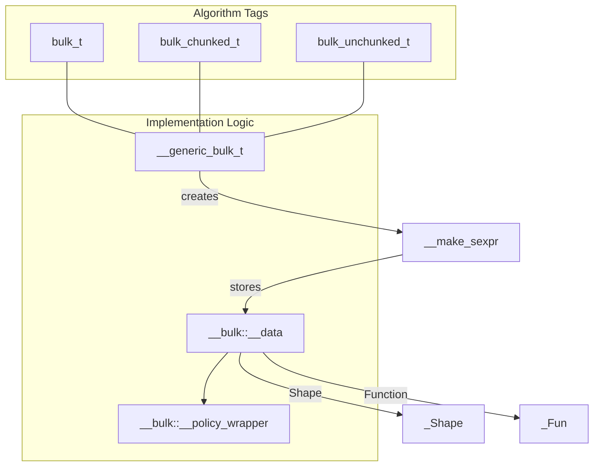
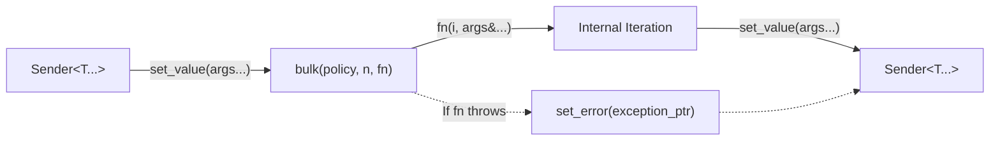

<!-- source: DeepWiki mcp.deepwiki.com · repo NVIDIA/stdexec · page 4.5 bulk Operations · fetched 2026-10-26 -->

# bulk Operations

<details>
<summary>Relevant source files</summary>

The following files were used as context for generating this wiki page:

- [include/stdexec/__detail/__bulk.hpp](include/stdexec/__detail/__bulk.hpp)
- [include/stdexec/__detail/__then.hpp](include/stdexec/__detail/__then.hpp)
- [include/stdexec/__detail/__upon_error.hpp](include/stdexec/__detail/__upon_error.hpp)
- [include/stdexec/__detail/__upon_stopped.hpp](include/stdexec/__detail/__upon_stopped.hpp)
- [test/stdexec/algos/adaptors/test_then.cpp](test/stdexec/algos/adaptors/test_then.cpp)
- [test/stdexec/algos/factories/test_read.cpp](test/stdexec/algos/factories/test_read.cpp)
- [test/test_common/receivers.hpp](test/test_common/receivers.hpp)
- [test/test_common/schedulers.hpp](test/test_common/schedulers.hpp)
- [test/test_common/senders.hpp](test/test_common/senders.hpp)
- [test/test_common/type_helpers.hpp](test/test_common/type_helpers.hpp)

</details>


This page documents the `bulk`, `bulk_chunked`, and `bulk_unchunked` sender algorithms that enable data-parallel execution of a function across multiple iterations. These algorithms apply a user-provided function to a range of indices while forwarding values from a predecessor sender.

For information about CPU thread pool execution that can parallelize bulk operations, see [Static Thread Pool](#5.1). For GPU execution of bulk operations, see [Stream Domain and Sender Adaptors](#6.2).

## Overview

The bulk family of algorithms transforms a sender by invoking a user-provided function multiple times across a shape (typically an integer count). Unlike traditional loops, bulk operations express parallelizable work that execution contexts can optimize, such as distributing iterations across threads or GPU blocks.

**Key Concepts:**
- **Shape**: An integral value specifying the number of iterations (0 to shape-1) [[include/stdexec/__detail/__bulk.hpp:183-184]]().
- **Execution Policy**: Objects like `std::execution::par` that hint at parallelization strategy [[include/stdexec/__detail/__bulk.hpp:44-106]]().
- **Bulk Function**: User code executed for each iteration, receiving indices and predecessor values [[include/stdexec/__detail/__bulk.hpp:108-116]]().
- **Value Forwarding**: Values from the predecessor sender are passed to each invocation by reference [[include/stdexec/__detail/__bulk.hpp:160-161]]().

Sources: [[include/stdexec/__detail/__bulk.hpp:37-116]]()

## Three Variants

The library provides three distinct tags for bulk iteration patterns, each with specific function signature requirements defined in `__bulk_traits`.

| Algorithm | Tag Type | Function Signature | Use Case |
|-----------|----------|-------------------|----------|
| `bulk` | `bulk_t` | `fn(Shape index, T&... values)` | Default parallel iteration [[include/stdexec/__detail/__bulk.hpp:126-134]]() |
| `bulk_chunked` | `bulk_chunked_t` | `fn(Shape begin, Shape end, T&... values)` | Processing contiguous ranges of indices [[include/stdexec/__detail/__bulk.hpp:137-147]]() |
| `bulk_unchunked` | `bulk_unchunked_t` | `fn(Shape index, T&... values)` | Iteration without chunking optimizations [[include/stdexec/__detail/__bulk.hpp:150-158]]() |

### Code Entity Relationship Diagram


Sources: [[include/stdexec/__detail/__bulk.hpp:37-203]]()

## Function Signatures

### bulk_t

```cpp
template<sender _Sender, typename _Policy, __std::integral _Shape, __std::copy_constructible _Fun>
  requires is_execution_policy_v<std::remove_cvref_t<_Policy>>
constexpr auto operator()(_Sender&& __sndr, _Policy&& __pol, _Shape __shape, _Fun __fun) const;
```

**Parameters:**
- `sndr`: Input sender providing values.
- `policy`: Execution policy (e.g., `std::execution::par`).
- `shape`: Number of iterations to execute.
- `fun`: Callable with signature `void(Shape index, T&... values)` where `T...` are the value types from `sndr`.

**Behavior:** Invokes `fun(i, values...)` for each `i` in `[0, shape)`, where `values...` are forwarded from the predecessor sender.

Sources: [[include/stdexec/__detail/__bulk.hpp:178-192]]()

### bulk_chunked_t

The `bulk_chunked` variant is designed for execution contexts that can group iterations. Its trait curries the function with two shape parameters representing the `[begin, end)` range [[include/stdexec/__detail/__bulk.hpp:137-147]]().

### bulk_unchunked_t

The `bulk_unchunked` variant signals to the execution context that the user function should be called for individual indices without grouping into chunks [[include/stdexec/__detail/__bulk.hpp:150-158]]().

## Execution Policies

The bulk algorithms accept policy objects to hint at parallelization intent. The `__policy_wrapper` provides a uniform interface for both standard and non-standard policies.

| Policy Type | Internal Wrapper | Semantics |
|-------------|------------------|-----------|
| `sequenced_policy` | `__policy_wrapper<sequenced_policy>` | Execute iterations sequentially [[include/stdexec/__detail/__bulk.hpp:61-70]]() |
| `parallel_policy` | `__policy_wrapper<parallel_policy>` | Allow parallel execution across threads [[include/stdexec/__detail/__bulk.hpp:73-82]]() |
| `parallel_unsequenced_policy` | `__policy_wrapper<parallel_unsequenced_policy>` | Allow parallel and vectorized execution [[include/stdexec/__detail/__bulk.hpp:85-94]]() |
| `unsequenced_policy` | `__policy_wrapper<unsequenced_policy>` | Allow vectorized execution [[include/stdexec/__detail/__bulk.hpp:97-106]]() |

Sources: [[include/stdexec/__detail/__bulk.hpp:44-106]]()

## Value Forwarding and Completion Signatures

Bulk operations propagate values from the input sender to the output receiver while allowing the user function to interact with them.



**Completion Signature Rules:**
1. **Value Channel**: The output sender has the same value completion signatures as the input sender [[include/stdexec/__detail/__bulk.hpp:173-176]]().
2. **Error Channel**: Includes all error signatures from the input sender. If the bulk function `_Fun` is not `noexcept`, `std::exception_ptr` is added to the signatures via `__with_error_invoke_t` [[include/stdexec/__detail/__bulk.hpp:164-171]]().
3. **Stopped Channel**: Preserved from input sender.

The bulk function receives values **by reference** (`__decay_ref`), allowing in-place modification of forwarded values [[include/stdexec/__detail/__bulk.hpp:160-161]]().

Sources: [[include/stdexec/__detail/__bulk.hpp:160-176]]()

## Comparison with then Adaptor

While `then` adapts a single completion, `bulk` iterates over a shape. Both are implemented using the `__sexpr` model.

| Feature | `then` | `bulk` |
|---------|--------|--------|
| **File** | `__then.hpp` | `__bulk.hpp` |
| **Logic** | Invokes function once per `set_value` [[include/stdexec/__detail/__then.hpp:83-88]]() | Invokes function `shape` times [[include/stdexec/__detail/__bulk.hpp:188-192]]() |
| **Value Passing** | By value/rvalue [[include/stdexec/__detail/__then.hpp:85-87]]() | By reference [[include/stdexec/__detail/__bulk.hpp:160-161]]() |
| **Implementation** | `__then_impl` [[include/stdexec/__detail/__then.hpp:37]]() | `__generic_bulk_t` [[include/stdexec/__detail/__bulk.hpp:180]]() |

Sources: [[include/stdexec/__detail/__then.hpp:37-97]](), [[include/stdexec/__detail/__bulk.hpp:160-192]]()

## Exception Handling

The library provides static introspection to determine if the bulk function can throw. If it is not `noexcept`, the operation state must handle potential exceptions.

- **Signature Computation**: `__with_error_invoke_t` uses `__bulk_traits` to check if the curried function is nothrow invocable [[include/stdexec/__detail/__bulk.hpp:123-171]]().
- **Error Propagation**: If an exception occurs during the bulk iteration, it is typically captured and passed to the receiver via `set_error(std::exception_ptr)` [[include/stdexec/__detail/__bulk.hpp:170-171]]().

Sources: [[include/stdexec/__detail/__bulk.hpp:123-171]]()

---

