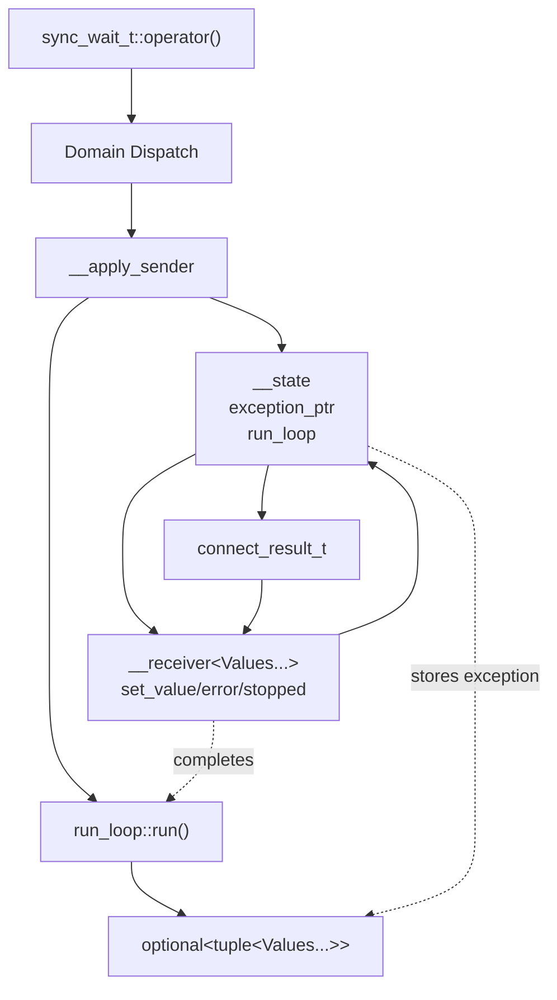
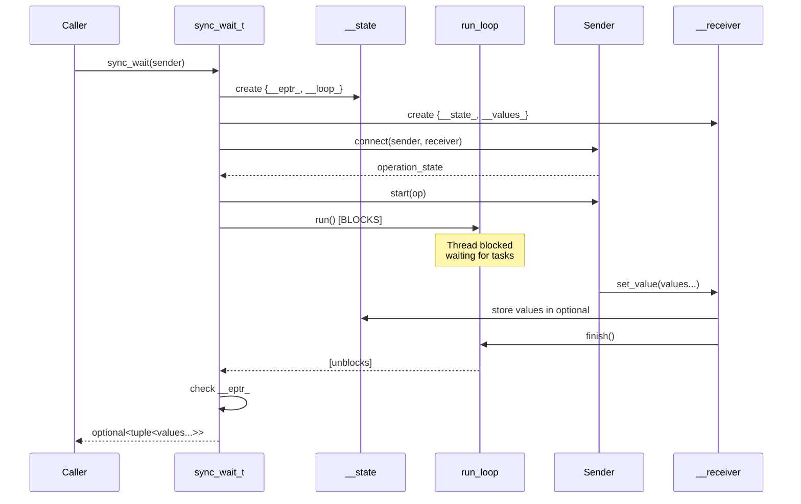

<!-- source: DeepWiki mcp.deepwiki.com · repo NVIDIA/stdexec · page 4.6 sync_wait and Blocking Consumers · fetched 2026-10-26 -->

# sync_wait and Blocking Consumers

<details>
<summary>Relevant source files</summary>

The following files were used as context for generating this wiki page:

- [include/stdexec/__detail/__env.hpp](include/stdexec/__detail/__env.hpp)
- [include/stdexec/__detail/__just.hpp](include/stdexec/__detail/__just.hpp)
- [include/stdexec/__detail/__read_env.hpp](include/stdexec/__detail/__read_env.hpp)
- [include/stdexec/__detail/__run_loop.hpp](include/stdexec/__detail/__run_loop.hpp)
- [include/stdexec/__detail/__schedulers.hpp](include/stdexec/__detail/__schedulers.hpp)
- [include/stdexec/__detail/__sync_wait.hpp](include/stdexec/__detail/__sync_wait.hpp)
- [include/stdexec/__detail/__write_env.hpp](include/stdexec/__detail/__write_env.hpp)
- [test/stdexec/algos/adaptors/test_transfer_when_all.cpp](test/stdexec/algos/adaptors/test_transfer_when_all.cpp)
- [test/stdexec/algos/adaptors/test_when_all.cpp](test/stdexec/algos/adaptors/test_when_all.cpp)
- [test/stdexec/algos/consumers/test_sync_wait.cpp](test/stdexec/algos/consumers/test_sync_wait.cpp)
- [test/stdexec/concepts/test_awaitables.cpp](test/stdexec/concepts/test_awaitables.cpp)
- [test/stdexec/concepts/test_concepts_sender.cpp](test/stdexec/concepts/test_concepts_sender.cpp)

</details>


## Purpose and Scope

This page documents `sync_wait` and related blocking consumer utilities that convert asynchronous senders into synchronous results by blocking the calling thread until completion. These utilities serve as the primary bridge between asynchronous execution contexts and synchronous code, enabling integration with traditional function call chains and main program logic.

For information about the non-blocking `run_loop` scheduler that powers `sync_wait` internally, see [Inline and Run Loop Schedulers](#5.3). For coroutine integration as an alternative to blocking, see [Coroutine Integration](#7.2).

## Overview

`sync_wait` is a blocking consumer that connects a sender, starts its operation, and blocks the current thread until the operation completes. It is defined in [include/stdexec/__detail/__sync_wait.hpp:197-218]() as the `sync_wait_t` customization point object.

The fundamental operation:
- Takes a sender as input.
- Blocks the calling thread using an internal `run_loop` [include/stdexec/__detail/__sync_wait.hpp:201-203]().
- Returns `std::optional<std::tuple<Values...>>` on successful completion [include/stdexec/__detail/__sync_wait.hpp:204-205]().
- Returns empty `std::optional` on cancellation [include/stdexec/__detail/__sync_wait.hpp:126-129]().
- Throws exceptions on error completion [include/stdexec/__detail/__sync_wait.hpp:107-124]().

**Key characteristics:**
- **Blocking**: The calling thread is blocked until completion using an internal `run_loop` [include/stdexec/__detail/__sync_wait.hpp:84]().
- **Bridge**: Converts async senders to sync results [include/stdexec/__detail/__sync_wait.hpp:200-201]().
- **Run loop**: Internally drives a `run_loop` to execute the sender and any work delegated to it [include/stdexec/__detail/__run_loop.hpp:52-64]().
- **Delegation**: Supports forward progress delegation via `get_delegation_scheduler()` [include/stdexec/__detail/__sync_wait.hpp:51-56]().

Sources: [include/stdexec/__detail/__sync_wait.hpp:44-218](), [include/stdexec/__detail/__run_loop.hpp:38-64]()

## Architecture

### Core Components



**sync_wait Architecture**

The `sync_wait` implementation consists of several coordinated components. The `__state` object [include/stdexec/__detail/__sync_wait.hpp:81-85]() acts as the anchor for the lifetime of the operation, containing the exception pointer and the `run_loop`.

Sources: [include/stdexec/__detail/__sync_wait.hpp:44-138](), [include/stdexec/__detail/__run_loop.hpp:40-64]()

### Execution Flow



**sync_wait Execution Sequence**

The sequence shows how `sync_wait` blocks the calling thread while the sender executes, and how completion signals unblock the thread via `run_loop::finish()` [include/stdexec/__detail/__run_loop.hpp:67-87]().

Sources: [include/stdexec/__detail/__sync_wait.hpp:81-138](), [include/stdexec/__detail/__run_loop.hpp:52-87]()

## Implementation Details

### The __state Structure

The `__state` struct [include/stdexec/__detail/__sync_wait.hpp:81-85]() maintains:

```cpp
struct __state {
  std::exception_ptr __eptr_;   // Captures errors
  run_loop           __loop_;   // Drives execution
};
```

This state is created locally within the internal implementation and outlives the entire async operation.

### The __receiver Template

The `__receiver` template [include/stdexec/__detail/__sync_wait.hpp:87-138]() implements:

| Function | Behavior |
|----------|----------|
| `set_value(args...)` | Stores args in `optional<tuple<Values...>>`, calls `__state_->__loop_.finish()` [include/stdexec/__detail/__sync_wait.hpp:93-105]() |
| `set_error(err)` | Converts error to `exception_ptr`, stores it in `__state_->__eptr_`, calls `__loop_.finish()` [include/stdexec/__detail/__sync_wait.hpp:107-124]() |
| `set_stopped()` | Leaves optional empty, calls `__state_->__loop_.finish()` [include/stdexec/__detail/__sync_wait.hpp:126-129]() |
| `get_env()` | Returns `__env{&__state_->__loop_}` [include/stdexec/__detail/__sync_wait.hpp:131-135]() |

The receiver's `set_error` implementation [include/stdexec/__detail/__sync_wait.hpp:107-124]() handles:
- `std::exception_ptr`: stored directly.
- `std::error_code`: wrapped in `std::system_error`.
- Other types: wrapped with `std::make_exception_ptr`.

Sources: [include/stdexec/__detail/__sync_wait.hpp:87-138](), [include/stdexec/__detail/__sync_wait.hpp:81-85]()

### The sync_wait Environment

The `__env` struct [include/stdexec/__detail/__sync_wait.hpp:49-65]() provides queries to the sender:

```cpp
struct __env {
  run_loop* __loop_ = nullptr;
  
  // Returns a scheduler for the internal run_loop
  constexpr auto query(get_scheduler_t) const noexcept -> run_loop::scheduler;
  constexpr auto query(get_start_scheduler_t) const noexcept -> run_loop::scheduler;
  constexpr auto query(get_delegation_scheduler_t) const noexcept -> run_loop::scheduler;
  constexpr auto query(__root_t) const noexcept -> bool; // Returns true
};
```

This environment enables senders to query for a scheduler to schedule additional work back onto the thread that is currently blocked in `sync_wait` [include/stdexec/__detail/__sync_wait.hpp:51-56]().

Sources: [include/stdexec/__detail/__sync_wait.hpp:49-65]()

## Return Types and Completion Handling

### Successful Completion

On successful completion, `sync_wait` returns `std::optional<std::tuple<Values...>>` where `Values...` are the value types sent by the sender. The return type is computed using `__sync_wait_result_t` [include/stdexec/__detail/__sync_wait.hpp:74-75]():

```cpp
template <class _CvSender>
using __sync_wait_result_t = __result_t<_CvSender, __qq<std::tuple>>;
```

This metaprogramming utility extracts the value types from the sender's completion signatures while applying `std::decay` to them [include/stdexec/__detail/__sync_wait.hpp:68-72]().

Sources: [include/stdexec/__detail/__sync_wait.hpp:68-75]()

### Cancellation

On `set_stopped()` completion, `sync_wait` returns an empty `std::optional` [include/stdexec/__detail/__sync_wait.hpp:126-129](). This allows checking for cancellation in the calling code [test/stdexec/algos/consumers/test_sync_wait.cpp:130-135]().

### Error Completion

On `set_error(err)` completion, `sync_wait` stores the error as a `std::exception_ptr` and rethrows it after the `run_loop` completes [include/stdexec/__detail/__sync_wait.hpp:107-124]().

Sources: [include/stdexec/__detail/__sync_wait.hpp:107-124](), [test/stdexec/algos/consumers/test_sync_wait.cpp:58-86]()

## sync_wait_with_variant

### Purpose

`sync_wait_with_variant` [include/stdexec/__detail/__sync_wait.hpp:240-264]() handles senders that can complete successfully in multiple ways (e.g., different types or different numbers of values). While `sync_wait` requires exactly one value completion signature [include/stdexec/__detail/__sync_wait.hpp:187-190](), `sync_wait_with_variant` wraps all possible value signatures in a `std::variant`.

### Constraints

| Function | Value Signatures | Return Type |
|----------|------------------|-------------|
| `sync_wait` | Exactly 1 | `optional<tuple<Values...>>` |
| `sync_wait_with_variant` | 0 or more | `optional<variant<tuple<Vs1...>, tuple<Vs2...>, ...>>` |

Attempting to use `sync_wait` with a multi-signature sender produces a compile-time error [include/stdexec/__detail/__sync_wait.hpp:182-190]().

Sources: [include/stdexec/__detail/__sync_wait.hpp:182-190](), [include/stdexec/__detail/__sync_wait.hpp:240-264]()

### Implementation Strategy

`sync_wait_with_variant` transforms the sender by applying `into_variant` before calling the core `sync_wait` logic [include/stdexec/__detail/__sync_wait.hpp:258-262]():

```cpp
if (auto __opt_values = sync_wait_t()(into_variant(static_cast<_CvSender&&>(__sndr)))) {
  return std::move(std::get<0>(*__opt_values));
}
```

Sources: [include/stdexec/__detail/__sync_wait.hpp:258-262]()

## Domain Customization

`sync_wait` supports domain-specific customization through `apply_sender`. The dispatch logic checks if the sender's completion domain provides a customization for `sync_wait_t`.

This allows specialized domains (like those for GPU streams) to synchronize with their specific hardware contexts appropriately, often by inserting stream synchronization primitives before blocking the CPU thread.

Sources: [include/stdexec/__detail/__sync_wait.hpp:24-31](), [include/stdexec/__detail/__domain.hpp:1-50]()

## Compile-Time Validation

### Signature Checking

`sync_wait` validates that the sender can complete successfully exactly once. It uses `__single_value_variant_sender_t` to verify that the sender does not have multiple successful completion paths [include/stdexec/__detail/__sync_wait.hpp:187-190]().

### Connectability Checking

The function validates that the sender satisfies the `sender` concept and can be connected to the internal blocking receiver [include/stdexec/__detail/__sync_wait.hpp:144-150]().

Sources: [include/stdexec/__detail/__sync_wait.hpp:182-190](), [include/stdexec/__detail/__sync_wait.hpp:144-150]()

## Limitations and Best Practices

- **Avoid Nesting**: Calling `sync_wait` inside an asynchronous task executing on a thread pool can lead to thread exhaustion and deadlocks [test/stdexec/algos/consumers/test_sync_wait.cpp:181-212]().
- **Library Boundaries**: Libraries should generally return senders and let the final consumer decide when to block using `sync_wait`.
- **Environment**: `sync_wait` provides a `run_loop` scheduler in its environment [include/stdexec/__detail/__sync_wait.hpp:51-56](). Senders can use this to ensure continuations run on the thread that is waiting, avoiding unnecessary context switches.

Sources: [include/stdexec/__detail/__sync_wait.hpp:49-65](), [include/stdexec/__detail/__run_loop.hpp:52-64]()

---

