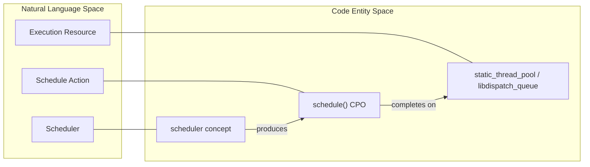
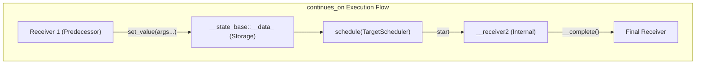

<!-- source: DeepWiki mcp.deepwiki.com · repo NVIDIA/stdexec · page 4.7 Scheduler Operations · fetched 2026-10-26 -->

# Scheduler Operations

Relevant source files

The following files were used as context for generating this wiki page:

- [include/exec/completion_signatures.hpp](include/exec/completion_signatures.hpp)
- [include/exec/libdispatch_queue.hpp](include/exec/libdispatch_queue.hpp)
- [include/exec/system_context.hpp](include/exec/system_context.hpp)
- [include/stdexec/__detail/__completion_signatures.hpp](include/stdexec/__detail/__completion_signatures.hpp)
- [include/stdexec/__detail/__continues_on.hpp](include/stdexec/__detail/__continues_on.hpp)
- [include/stdexec/__detail/__on.hpp](include/stdexec/__detail/__on.hpp)
- [include/stdexec/__detail/__senders.hpp](include/stdexec/__detail/__senders.hpp)
- [include/stdexec/__detail/__starts_on.hpp](include/stdexec/__detail/__starts_on.hpp)
- [include/stdexec/__detail/__transform_completion_signatures.hpp](include/stdexec/__detail/__transform_completion_signatures.hpp)
- [test/exec/sequence/test_any_sequence_of.cpp](test/exec/sequence/test_any_sequence_of.cpp)
- [test/stdexec/algos/adaptors/test_continues_on.cpp](test/stdexec/algos/adaptors/test_continues_on.cpp)
- [test/stdexec/algos/adaptors/test_on.cpp](test/stdexec/algos/adaptors/test_on.cpp)
- [test/stdexec/algos/adaptors/test_starts_on.cpp](test/stdexec/algos/adaptors/test_starts_on.cpp)
- [test/stdexec/concepts/test_concept_scheduler.cpp](test/stdexec/concepts/test_concept_scheduler.cpp)
- [test/stdexec/cpos/test_cpo_connect.cpp](test/stdexec/cpos/test_cpo_connect.cpp)
- [test/stdexec/cpos/test_cpo_schedule.cpp](test/stdexec/cpos/test_cpo_schedule.cpp)
- [test/stdexec/queries/test_get_forward_progress_guarantee.cpp](test/stdexec/queries/test_get_forward_progress_guarantee.cpp)

## Purpose and Scope

This page documents the standard sender algorithms that work with schedulers to control where work executes. These operations enable transitioning execution between different execution contexts (e.g., thread pools, GPU streams, event loops).

The primary operations covered are:
- `schedule` - creates a sender that completes on a scheduler's execution context.
- `starts_on` - ensures a sender chain begins execution on a specific scheduler.
- `continues_on` - transitions execution to a different scheduler after a sender completes.
- `on` - executes a sender on a specific scheduler and then transitions back to the previous scheduler.

Sources: [include/stdexec/__detail/__execution_fwd.hpp:1-50](), [include/stdexec/__detail/__schedulers.hpp:1-100]()

---

## Scheduler and Schedule Operation

### The Scheduler Concept

A scheduler is an object that can create senders representing work to be executed on an associated execution context. The `scheduler` concept requires a `schedule` operation and equality comparison.

**Diagram: Mapping scheduler concepts to code entities**

Sources: [include/stdexec/__detail/__schedulers.hpp:75-82](), [include/stdexec/__detail/__execution_fwd.hpp:202-210](), [test/stdexec/concepts/test_concept_scheduler.cpp:40-85]()

### The `schedule` Customization Point

The `schedule` operation is a customization point object (CPO). It returns a sender that, when started, transitions the execution to the scheduler's context.

| Component | Entity Name | Location |
|-----------|------|----------|
| CPO Type | `schedule_t` | [include/stdexec/__detail/__execution_fwd.hpp:202]() |
| Concept | `scheduler` | [include/stdexec/__detail/__schedulers.hpp:75-82]() |
| Implementation | Member `schedule()` | [test/stdexec/concepts/test_concept_scheduler.cpp:65-68]() |

The sender returned by `schedule` has a completion signature of `set_value_t()` [include/exec/libdispatch_queue.hpp:123-124]().

Sources: [include/stdexec/__detail/__schedulers.hpp:30-85](), [include/exec/libdispatch_queue.hpp:157-160]()

---

## Context Transition Operations

### `starts_on` - Initial Scheduler Assignment

The `starts_on` algorithm takes a scheduler and a sender, and returns a sender that runs the input sender on the specified scheduler. Unlike most adaptors, it does not have a pipe form [include/stdexec/__detail/__starts_on.hpp:120-124]().

| Component | Current Name | Location |
|-----------|--------------|----------|
| Implementation | `__starts_on` | [include/stdexec/__detail/__starts_on.hpp:36-105]() |
| Attribute Query | `__starts_on::__attrs` | [include/stdexec/__detail/__starts_on.hpp:38-104]() |
| Completion Query | `get_completion_scheduler` | [include/stdexec/__detail/__starts_on.hpp:71-80]() |

`starts_on` is semantically equivalent to `schedule(sch) | let_value([sndr]{ return sndr; })` [include/stdexec/__detail/__starts_on.hpp:135-141]().

Sources: [include/stdexec/__detail/__starts_on.hpp:108-186]()

### `continues_on` - Mid-Chain Scheduler Transition

The `continues_on` operation transitions execution to a different scheduler *after* a predecessor sender completes.

**Diagram: Internal data flow of continues_on showing result buffering**

The `continues_on` implementation uses a `__state_base` to hold the output receiver and a `__storage_t` to buffer the results of the predecessor sender while the transition to the target scheduler occurs [include/stdexec/__detail/__continues_on.hpp:65-72]().

Sources: [include/stdexec/__detail/__continues_on.hpp:41-124](), [test/stdexec/algos/adaptors/test_continues_on.cpp:120-134]()

---

## The `on` Adaptor

The `on` adaptor provides scoped execution. It starts a sender on a new scheduler and ensures that the final completion happens on the "original" scheduler found in the environment.

| Feature | Description | Code Pointer |
|---------|-------------|--------------|
| Root Default | Defaults to `inline_scheduler` if no scheduler in env | [include/stdexec/__detail/__on.hpp:52-53]() |
| Transformation | Combines `starts_on` and `continues_on` | [include/stdexec/__detail/__on.hpp:73-75]() |
| Attribute Wrapper | `__on::__attrs` | [include/stdexec/__detail/__on.hpp:117-151]() |

If the current environment does not have a scheduler and it is not a root environment, `on` will fail to compile with `_CANNOT_RESTORE_EXECUTION_CONTEXT_AFTER_ON_` [include/stdexec/__detail/__on.hpp:43-58]().

Sources: [include/stdexec/__detail/__on.hpp:41-95](), [test/stdexec/algos/adaptors/test_on.cpp:42-63]()

---

## Completion Signatures and Transformation

Scheduler operations frequently involve transforming completion signatures, such as adding `set_error_t(std::exception_ptr)` if a scheduling operation might fail.

| Meta-function | Purpose | Location |
|---------------|---------|----------|
| `__transform_completion_signatures_t` | Core signature transformation engine | [include/stdexec/__detail/__transform_completion_signatures.hpp:161-167]() |
| `__decay_value_sig` | Normalizes value types for context transfer | [include/stdexec/__detail/__continues_on.hpp:43-44]() |
| `__completions_t` | Computes signatures for `continues_on` | [include/stdexec/__detail/__continues_on.hpp:61-63]() |

Sources: [include/stdexec/__detail/__transform_completion_signatures.hpp:95-167](), [include/stdexec/__detail/__continues_on.hpp:43-63]()

---

