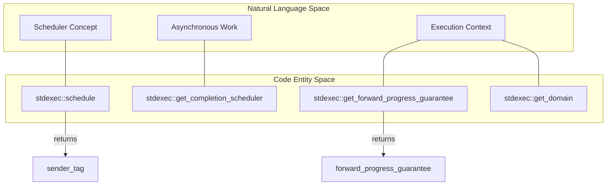
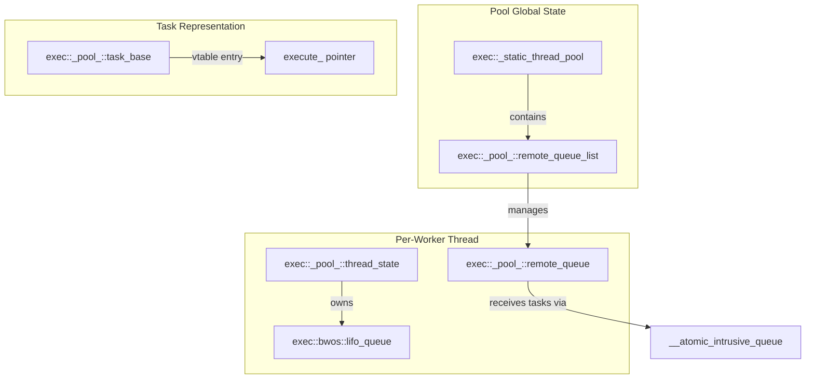

<!-- source: DeepWiki mcp.deepwiki.com · repo NVIDIA/stdexec · page 5 CPU Execution Contexts · fetched 2026-10-26 -->

# CPU Execution Contexts

<details>
<summary>Relevant source files</summary>

The following files were used as context for generating this wiki page:

- [.clang-tidy](.clang-tidy)
- [include/exec/libdispatch_queue.hpp](include/exec/libdispatch_queue.hpp)
- [include/exec/static_thread_pool.hpp](include/exec/static_thread_pool.hpp)
- [include/exec/system_context.hpp](include/exec/system_context.hpp)
- [include/stdexec/__detail/__on.hpp](include/stdexec/__detail/__on.hpp)
- [include/stdexec/__detail/__starts_on.hpp](include/stdexec/__detail/__starts_on.hpp)
- [test/exec/test_static_thread_pool.cpp](test/exec/test_static_thread_pool.cpp)
- [test/stdexec/algos/adaptors/test_bulk.cpp](test/stdexec/algos/adaptors/test_bulk.cpp)

</details>


## Purpose and Scope

CPU execution contexts provide schedulers that execute asynchronous work on CPU threads. A scheduler in the P2300 model is an execution resource that can create senders representing work to be executed in a particular execution context. This page provides an overview of all CPU-based schedulers available in the `stdexec` repository and explains how they integrate with the sender/receiver model.

For detailed documentation of specific schedulers:
- **Static thread pool implementation**: see [Static Thread Pool](#5.1) for `exec::static_thread_pool`, work-stealing, and NUMA awareness.
- **Platform-specific schedulers**: see [System Context and Platform Schedulers](#5.2) for `system_context`, GCD, and Windows thread pool support.
- **Simple schedulers**: see [Inline and Run Loop Schedulers](#5.3) for `inline_scheduler` and `run_loop`.
- **External library integration**: see [Third-Party Scheduler Integrations](#5.4) for TBB, Taskflow, and ASIO.

For GPU execution contexts, see [GPU Execution with nvexec](#6).

Sources: [include/exec/static_thread_pool.hpp:1-17](), [include/exec/system_context.hpp:1-15]()

## The Scheduler Concept

A scheduler satisfies the `scheduler` concept and provides a `schedule()` customization point that returns a sender. When that sender is connected to a receiver and started, the receiver's completion signals will be called on an execution agent associated with the scheduler.

### Bridge from Concept to Code: Scheduler Interface
The following diagram maps the abstract P2300 scheduler concepts to the specific code entities used in `stdexec`.



**Key Scheduler Queries and CPOs:**

| Component | Code Entity | Description |
|-----------|------|-------------|
| **Scheduling** | `stdexec::schedule` | CPO that returns a sender completing on the scheduler's context. [include/stdexec/__detail/__schedulers.hpp:115-125]() |
| **Domain** | `stdexec::get_domain` | Returns the domain (e.g., `default_domain`) for algorithm customization. [include/stdexec/__detail/__domain.hpp:25-35]() |
| **Progress** | `get_forward_progress_guarantee` | Returns `concurrent`, `parallel`, or `weakly_parallel`. [include/exec/libdispatch_queue.hpp:179-183]() |
| **Introspection** | `get_completion_scheduler` | Query to find which scheduler a sender will complete on. [include/stdexec/__detail/__starts_on.hpp:71-81]() |

Sources: [include/stdexec/__detail/__schedulers.hpp:115-125](), [include/exec/libdispatch_queue.hpp:179-183](), [include/stdexec/__detail/__starts_on.hpp:71-81]()

## Available CPU Schedulers

The `stdexec` ecosystem provides multiple CPU schedulers for different use cases, ranging from high-performance work-stealing pools to platform-specific integrations.

**Scheduler Comparison:**

| Scheduler | Type Name | Use Case | Implementation Details |
|-----------|-----------|----------|------------------------|
| **Static Pool** | `exec::static_thread_pool` | General-purpose CPU work | BWOS LIFO queues, NUMA-aware. [include/exec/static_thread_pool.hpp:197-210]() |
| **Parallel** | `stdexec::parallel_scheduler` | System-wide parallel backend | Bridges to `parallel_scheduler_backend`. [include/stdexec/__detail/__parallel_scheduler.hpp:78-85]() |
| **Task** | `stdexec::task_scheduler` | Type-erased scheduling | Wraps backends like `__any_task_scheduler_backend`. |
| **Run Loop** | `stdexec::run_loop` | Event loops, `sync_wait` | Intrusive task queue for manual polling. |
| **Inline** | `stdexec::inline_scheduler` | Testing, recursion | Executes work immediately on the current thread. |
| **Libdispatch** | `exec::libdispatch_scheduler` | macOS/iOS integration | Wraps Apple's `dispatch_queue_t`. [include/exec/libdispatch_queue.hpp:88-186]() |

Sources: [include/exec/static_thread_pool.hpp:197-210](), [include/stdexec/__detail/__parallel_scheduler.hpp:78-85](), [include/exec/libdispatch_queue.hpp:88-186]()

## Domain-Based Customization

Schedulers advertise a domain that enables platform-specific optimizations for standard algorithms. For example, `static_thread_pool::scheduler` uses its own domain to customize `bulk` operations, ensuring work is distributed efficiently across the pool's threads.


**Domain Transformation Examples:**
- **Static Thread Pool**: Overrides `bulk` to use `_bulk_sender` which utilizes `even_share` for task distribution. [include/exec/static_thread_pool.hpp:256-301]()
- **Libdispatch**: Transforms generic `bulk` into `__libdispatch::bulk_sender` to use `dispatch_apply_f`. [include/exec/libdispatch_queue.hpp:92-118]()

Sources: [include/exec/static_thread_pool.hpp:256-301](), [include/exec/libdispatch_queue.hpp:92-118]()

## Thread Pool Architecture

The `exec::static_thread_pool` is a high-performance CPU scheduler implementing a work-stealing architecture with NUMA awareness.

### Bridge from Code to System: Static Thread Pool Entities
This diagram maps the internal classes and structs to their roles in the multi-threaded execution system.



**Work Distribution Algorithm:**
1. **Local Priority**: Threads prioritize their local `bwos::lifo_queue` for cache locality.
2. **Remote Tasks**: Threads check their `remote_queue` for tasks submitted by non-pool threads via `pop_all_reversed`. [include/exec/static_thread_pool.hpp:163-174]()
3. **Stealing**: Idle threads attempt to steal from other workers, using `xorshift` for victim selection and NUMA hints to stay local to a socket when possible.

Sources: [include/exec/static_thread_pool.hpp:113-117](), [include/exec/static_thread_pool.hpp:137-144](), [include/exec/static_thread_pool.hpp:163-174]()

## System and Parallel Schedulers

The `parallel_scheduler` provides a bridge to system-level execution resources. It uses a type-erased backend to allow different platform implementations.

- **System Context**: Provides the default global instance of the parallel scheduler via `get_parallel_scheduler()`. [include/exec/system_context.hpp:31-41]()
- **Parallel Scheduler Backend**: Defines the interface for `schedule`, `schedule_bulk_chunked`, and `schedule_bulk_unchunked`.
- **Receiver Proxy**: A type-erased interface that allows the backend to signal completion back to the `stdexec` frontend.

Sources: [include/exec/system_context.hpp:31-41](), [include/stdexec/__detail/__parallel_scheduler.hpp:78-85]()

## Bulk Operation Optimization

CPU execution contexts optimize `bulk` operations by dividing the iteration space into "even shares" across available threads.

- **even_share**: Splits `n` items into `size` chunks, distributing the remainder `n % size` across the first few ranks to ensure balanced load. [include/exec/static_thread_pool.hpp:89-105]()
- **Static Pool Bulk**: Uses `_bulk_sender` to spawn tasks that process these shares in parallel. [test/test_static_thread_pool.cpp:88-108]()

Sources: [include/exec/static_thread_pool.hpp:89-105](), [test/test_static_thread_pool.cpp:88-108]()

## Basic Usage Patterns

**Scheduling on a Thread Pool:**
```cpp
exec::static_thread_pool pool{8};
auto sched = pool.get_scheduler();

auto snd = stdexec::schedule(sched) 
         | stdexec::then([] { return 42; });
```

**Parallel Bulk Processing:**
```cpp
// Executes 100 iterations in parallel across the pool
auto bulk_snd = stdexec::bulk(stdexec::schedule(sched), 100, [](size_t i) {
    // Parallel work here
});
```

Sources: [test/stdexec/algos/adaptors/test_bulk.cpp:140-144](), [test/test_static_thread_pool.cpp:165-184]()

---

