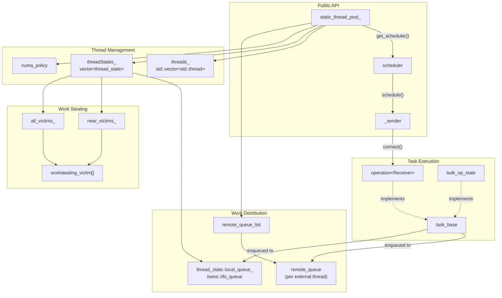
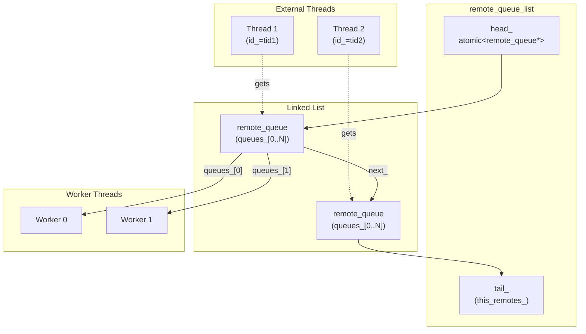

<!-- source: DeepWiki mcp.deepwiki.com · repo NVIDIA/stdexec · page 5.1 Static Thread Pool · fetched 2026-10-26 -->

# Static Thread Pool

<details>
<summary>Relevant source files</summary>

The following files were used as context for generating this wiki page:

- [.clang-tidy](.clang-tidy)
- [include/exec/detail/atomic_intrusive_queue.hpp](include/exec/detail/atomic_intrusive_queue.hpp)
- [include/exec/detail/bwos_lifo_queue.hpp](include/exec/detail/bwos_lifo_queue.hpp)
- [include/exec/detail/numa.hpp](include/exec/detail/numa.hpp)
- [include/exec/detail/xorshift.hpp](include/exec/detail/xorshift.hpp)
- [include/exec/static_thread_pool.hpp](include/exec/static_thread_pool.hpp)
- [include/stdexec/__detail/__any_allocator.hpp](include/stdexec/__detail/__any_allocator.hpp)
- [include/stdexec/__detail/__memory.hpp](include/stdexec/__detail/__memory.hpp)
- [test/exec/test_bwos_lifo_queue.cpp](test/exec/test_bwos_lifo_queue.cpp)
- [test/exec/test_static_thread_pool.cpp](test/exec/test_static_thread_pool.cpp)
- [test/rrd/CMakeLists.txt](test/rrd/CMakeLists.txt)
- [test/rrd/bwos_lifo_queue.cpp](test/rrd/bwos_lifo_queue.cpp)
- [test/stdexec/algos/adaptors/test_bulk.cpp](test/stdexec/algos/adaptors/test_bulk.cpp)

</details>


This page documents the `exec::static_thread_pool` implementation, a work-stealing, NUMA-aware CPU execution context that provides parallel execution of sender operations. This is the primary CPU-based scheduler for high-performance parallel workloads in stdexec.

## Purpose and Scope

The `static_thread_pool_` class provides a fixed-size thread pool with the following characteristics:

- **Work-stealing scheduler**: Idle threads steal work from busy threads to balance load using a Bounded Work-Stealing (BWOS) algorithm [include/exec/static_thread_pool.hpp:1016-1060]().
- **NUMA awareness**: Threads can be bound to specific NUMA nodes for memory locality and prioritize stealing from "near" victims [include/exec/detail/numa.hpp:159-180]().
- **Bulk optimization**: Specialized support for `bulk` algorithms that distribute work across the pool without unnecessary allocations [include/exec/static_thread_pool.hpp:1155-1380]().
- **Remote task submission**: Lock-free, per-external-thread queues for safe work submission from outside the pool [include/exec/static_thread_pool.hpp:121-137]().

Sources: [include/exec/static_thread_pool.hpp:45-165]()

## Architecture Overview



**Architecture: Static Thread Pool Component Structure**

The pool consists of worker threads, each with a local `bwos::lifo_queue` [include/exec/detail/bwos_lifo_queue.hpp:89-90](). External threads use per-thread `remote_queue` instances [include/exec/static_thread_pool.hpp:121-137]() to safely submit work. Each worker maintains lists of work-stealing victims organized by NUMA proximity.

Sources: [include/exec/static_thread_pool.hpp:167-691](), [include/exec/detail/bwos_lifo_queue.hpp:89-168]()

## Core Components

### Thread Pool Initialization

The `static_thread_pool_` constructor performs the following steps:

1.  **Initialize Thread States**: Allocates `thread_state` objects for each worker [include/exec/static_thread_pool.hpp:697-700]().
2.  **NUMA Sorting**: Builds `threadIndexByNumaNode_` sorted by NUMA node affinity [include/exec/static_thread_pool.hpp:705-715]().
3.  **Victim List Creation**: Populates `near_victims_` and `all_victims_` for hierarchical stealing [include/exec/static_thread_pool.hpp:717-725]().
4.  **Worker Spawning**: Spawns worker threads executing the `run()` method [include/exec/static_thread_pool.hpp:733-737]().

Each worker thread binds itself to its assigned NUMA node via `numa_.bind_to_node()` [include/exec/static_thread_pool.hpp:753]() before entering the execution loop.

Sources: [include/exec/static_thread_pool.hpp:697-737](), [include/exec/static_thread_pool.hpp:750-762]()

### BWOS LIFO Queue

The pool uses a **Block-based Work Stealing (BWoS)** queue [include/exec/detail/bwos_lifo_queue.hpp:32-33]().

- **Owner Operations**: `push_back` and `pop_back` provide LIFO semantics for cache locality [include/exec/detail/bwos_lifo_queue.hpp:96-100]().
- **Thief Operations**: `steal_front` provides FIFO semantics to steal larger chunks of work [include/exec/detail/bwos_lifo_queue.hpp:98]().
- **Structure**: Circular array of blocks, where each block has internal `head_` and `tail_` counters [include/exec/detail/bwos_lifo_queue.hpp:151-165]().
- **ABA Prevention**: Uses a 64-bit counter encoding where the upper 32 bits track "rounds" to prevent ABA problems during block reuse [include/exec/detail/bwos_lifo_queue.hpp:35-45]().

Sources: [include/exec/detail/bwos_lifo_queue.hpp:31-65](), [include/exec/detail/bwos_lifo_queue.hpp:89-168]()

### Remote Queue System



**Diagram: Remote Queue Structure**

External threads use a thread-local `remote_queue` [include/exec/static_thread_pool.hpp:179-181](). Each `remote_queue` contains an array of `__atomic_intrusive_queue` instances, one for every worker thread in the pool [include/exec/static_thread_pool.hpp:133](). This minimizes contention when multiple external threads submit work to the same pool.

Sources: [include/exec/static_thread_pool.hpp:121-197]()

## Work Stealing Mechanism

Worker threads follow a hierarchical stealing strategy in `thread_state::pop()`:

1.  **Local Queue**: Attempt to pop from the thread's own `local_queue_` [include/exec/static_thread_pool.hpp:1020-1024]().
2.  **Remote Queues**: Drain tasks submitted by external threads via `remotes_.pop_all_reversed()` [include/exec/static_thread_pool.hpp:1026-1031]().
3.  **Near Stealing**: Attempt to steal from threads on the same NUMA node [include/exec/static_thread_pool.hpp:1033-1040]().
4.  **Global Stealing**: Attempt to steal from any thread in the pool [include/exec/static_thread_pool.hpp:1042-1049]().
5.  **Sleep**: If no work is found, the thread increments the `numActive_` sleep counter and waits on a condition variable [include/exec/static_thread_pool.hpp:1051-1058]().

Sources: [include/exec/static_thread_pool.hpp:1016-1060](), [include/exec/static_thread_pool.hpp:622-651]()

## Bulk Operation Support

The `static_thread_pool_::domain` customizes `bulk` and `bulk_chunked` algorithms to execute in parallel across the pool.

### Bulk Sender Transformation

When a `bulk` sender is connected in an environment where `static_thread_pool` is the scheduler, the domain transforms the sender into a `bulk_sender_t` [include/exec/static_thread_pool.hpp:312-320](). This transformation enables parallel iteration distribution.

### Work Distribution: even_share

The pool uses `even_share` to partition a range of `n` items across `size` threads [include/exec/static_thread_pool.hpp:89-105]().

```cpp
// Example: even_share(11, rank, 3)
// rank 0: [0, 4)  (4 items)
// rank 1: [4, 8)  (4 items)
// rank 2: [8, 11) (3 items)
```

Sources: [include/exec/static_thread_pool.hpp:89-105](), [include/exec/static_thread_pool.hpp:296-340]()

### Bulk Operation State

The `bulk_shared_state` [include/exec/static_thread_pool.hpp:1295-1380]() manages the lifecycle of a parallel bulk operation:
- **Task Array**: Allocates an array of `bulk_task` objects, one per worker thread [include/exec/static_thread_pool.hpp:1310]().
- **Synchronization**: Uses an atomic `active_tasks_` counter to track completion [include/exec/static_thread_pool.hpp:1301]().
- **Error Handling**: If any iteration throws, the first exception is captured in `exception_` and the operation transitions to an error state [include/exec/static_thread_pool.hpp:1303-1304]().

Sources: [include/exec/static_thread_pool.hpp:1155-1380]()

## NUMA Awareness

The pool integrates with the NUMA subsystem via the `numa_policy` interface [include/exec/detail/numa.hpp:68-71]().

| Entity | Role |
| :--- | :--- |
| `numa_policy` | Abstract interface for NUMA topology and binding [include/exec/detail/numa.hpp:33-64]() |
| `default_numa_policy` | Linux implementation using `libnuma` [include/exec/detail/numa.hpp:145-181]() |
| `no_numa_policy` | Fallback for systems without NUMA support [include/exec/detail/numa.hpp:73-97]() |
| `nodemask` | Bitmask of allowed NUMA nodes for a scheduler [include/exec/detail/numa.hpp:237-250]() |

The `static_thread_pool` allows creating constrained schedulers via `get_constrained_scheduler(nodemask)` [include/exec/static_thread_pool.hpp:472-474](). These schedulers only submit work to worker threads assigned to the allowed NUMA nodes [include/exec/static_thread_pool.hpp:812-831]().

Sources: [include/exec/detail/numa.hpp:17-190](), [include/exec/static_thread_pool.hpp:812-831]()

## Implementation Details

### Task Base and Operation States

All executable work derives from `task_base` [include/exec/static_thread_pool.hpp:115-119]():
- `next`: Pointer for intrusive queueing.
- `execute_`: Function pointer to the execution logic.

The `operation` state [include/exec/static_thread_pool.hpp:1073-1154]() for a `schedule()` sender implements `task_base` by setting `execute_` to a static function that calls `set_value(receiver)` [include/exec/static_thread_pool.hpp:1124-1130]().

### Active Thread Tracking

The pool tracks active vs. stealing threads using a single atomic `numActive_` [include/exec/static_thread_pool.hpp:656]().
- **Upper 16 bits**: Number of threads executing tasks.
- **Lower 16 bits**: Number of threads currently in the stealing loop.

This dual-counter allows the pool to efficiently decide when to wake up sleeping threads [include/exec/static_thread_pool.hpp:972-1013]().

Sources: [include/exec/static_thread_pool.hpp:115-119](), [include/exec/static_thread_pool.hpp:1073-1154](), [include/exec/static_thread_pool.hpp:972-1013]()

---

