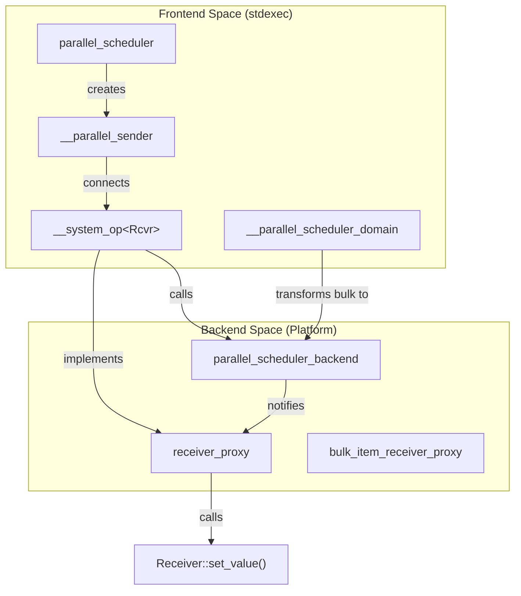
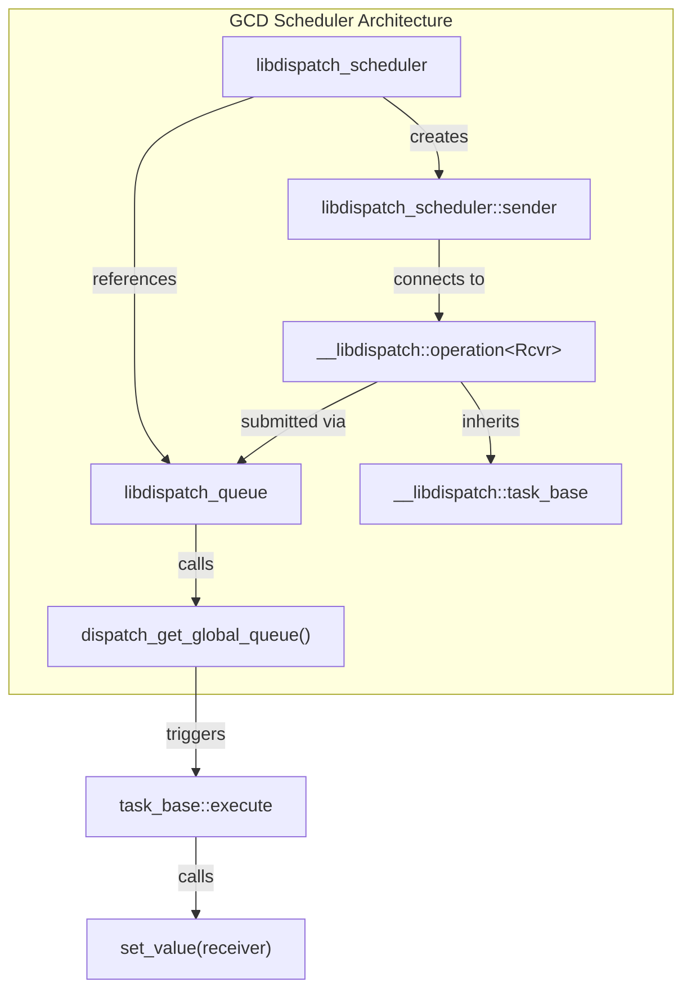

<!-- source: DeepWiki mcp.deepwiki.com · repo NVIDIA/stdexec · page 5.2 System Context and Platform Schedulers · fetched 2026-10-26 -->

# System Context and Platform Schedulers

Relevant source files

The following files were used as context for generating this wiki page:

- [include/exec/libdispatch_queue.hpp](include/exec/libdispatch_queue.hpp)
- [include/exec/system_context.hpp](include/exec/system_context.hpp)
- [include/stdexec/__detail/__finally.hpp](include/stdexec/__detail/__finally.hpp)
- [include/stdexec/__detail/__on.hpp](include/stdexec/__detail/__on.hpp)
- [include/stdexec/__detail/__parallel_scheduler.hpp](include/stdexec/__detail/__parallel_scheduler.hpp)
- [include/stdexec/__detail/__parallel_scheduler_backend.hpp](include/stdexec/__detail/__parallel_scheduler_backend.hpp)
- [include/stdexec/__detail/__starts_on.hpp](include/stdexec/__detail/__starts_on.hpp)
- [include/stdexec/__detail/__task_scheduler.hpp](include/stdexec/__detail/__task_scheduler.hpp)
- [include/stdexec/__detail/__typeinfo.hpp](include/stdexec/__detail/__typeinfo.hpp)
- [test/stdexec/schedulers/test_parallel_scheduler.cpp](test/stdexec/schedulers/test_parallel_scheduler.cpp)
- [test/stdexec/schedulers/test_task_scheduler.cpp](test/stdexec/schedulers/test_task_scheduler.cpp)

## Purpose and Scope

The `system_context` provides a unified platform-optimized parallel execution framework through `stdexec::get_parallel_scheduler()`. This scheduler automatically selects the best available platform-specific backend at compile-time: `libdispatch_queue` (macOS GCD), `windows_thread_pool` (Windows), or `static_thread_pool` (fallback). 

This page documents:
- **system_context**: The entry point for platform-optimized parallel execution.
- **parallel_scheduler**: The frontend scheduler type returned by `get_parallel_scheduler()`.
- **task_scheduler**: A type-erased scheduler that wraps any backend providing parallel execution capabilities.
- **Platform Backends**: Detailed implementation of `libdispatch_queue` and the replacement API.
- **Replaceability API**: Mechanisms for providing custom backend implementations via `parallel_scheduler_replacement`.

**Sources:** [include/exec/system_context.hpp:31-43](), [include/stdexec/__detail/__parallel_scheduler.hpp:81-88](), [include/stdexec/__detail/__task_scheduler.hpp:63-65](), [include/exec/libdispatch_queue.hpp:34-186]()

---

## The Parallel Scheduler Architecture

The `parallel_scheduler` is a frontend wrapper that delegates work to an implementation of `parallel_scheduler_backend`. It supports standard scheduling and optimized bulk operations through the `__parallel_scheduler_domain`.

### Implementation Details
- **Frontend Storage**: The operation states (`__system_op` and `__bulk_state`) use preallocated storage defined by macros like `STDEXEC_PARALLEL_SCHEDULER_SCHEDULE_OP_SIZE` (default 72 bytes) to avoid dynamic allocations during `connect` [include/stdexec/__detail/__parallel_scheduler.hpp:53-64]().
- **Domain Customization**: The `__parallel_scheduler_domain` overrides `transform_sender` to intercept `bulk_chunked` and `bulk_unchunked` algorithms, routing them to the backend's `schedule_bulk_chunked` or `schedule_bulk_unchunked` methods [include/stdexec/__detail/__parallel_scheduler.hpp:97-102]().

**Diagram: Parallel Scheduler Frontend-to-Backend Mapping**

**Sources:** [include/stdexec/__detail/__parallel_scheduler.hpp:81-102](), [include/stdexec/__detail/__parallel_scheduler.hpp:186-190](), [include/stdexec/__detail/__parallel_scheduler_backend.hpp:50-80](), [include/stdexec/__detail/__parallel_scheduler_backend.hpp:133-134]()

---

## Task Scheduler (Type-Erased)

The `task_scheduler` provides a type-erased interface for schedulers that support parallel execution. It is constructed from any scheduler that satisfies the necessary backend requirements but is specifically designed to wrap `parallel_scheduler_backend` implementations [include/stdexec/__detail/__task_scheduler.hpp:216-220]().

- **Construction**: It can be constructed from a backend implementation but explicitly prevents construction from a `parallel_scheduler` to maintain clear separation [include/stdexec/__detail/__task_scheduler.hpp:221-225](), [test/stdexec/schedulers/test_task_scheduler.cpp:117-121]().
- **Environment**: It provides an `__unstoppable_env` option which overrides `get_stop_token` to return a `never_stop_token`, ensuring critical tasks are not cancelled [include/stdexec/__detail/__task_scheduler.hpp:119-128]().

**Sources:** [include/stdexec/__detail/__task_scheduler.hpp:63-115](), [include/stdexec/__detail/__task_scheduler.hpp:216-230](), [test/stdexec/schedulers/test_task_scheduler.cpp:41-50]()

---

## Platform Schedulers

### libdispatch (GCD) Implementation
On Apple platforms, `exec::libdispatch_queue` provides a wrapper around Grand Central Dispatch. It uses the global concurrent queue for task execution.

| Entity | Role |
|--------|------|
| `libdispatch_queue` | Management struct containing the priority and `submit()` logic using `dispatch_async_f` [include/exec/libdispatch_queue.hpp:188-204](). |
| `libdispatch_scheduler` | The scheduler implementation that produces `libdispatch_scheduler::sender` [include/exec/libdispatch_queue.hpp:88-186](). |
| `__libdispatch::task_base` | The base class for all GCD tasks, providing a virtual-like `execute` function pointer [include/exec/libdispatch_queue.hpp:40-43](). |
| `__libdispatch::operation` | The operation state created by `connect()`, inheriting from `task_base` to be compatible with GCD callbacks [include/exec/libdispatch_queue.hpp:209-224](). |

**Diagram: libdispatch (GCD) Scheduler Data Flow**

**Sources:** [include/exec/libdispatch_queue.hpp:40-43](), [include/exec/libdispatch_queue.hpp:157-160](), [include/exec/libdispatch_queue.hpp:188-204](), [include/exec/libdispatch_queue.hpp:209-224]()

---

## System Context and Replaceability

The `system_context.hpp` header is now deprecated in favor of including `<stdexec/execution.hpp>` directly, but it still provides the legacy `experimental::execution` aliases [include/exec/system_context.hpp:23-41]().

### The Replacement API
The `stdexec::parallel_scheduler_replacement` namespace defines the modern interface for backend integration.

- **receiver_proxy**: An abstract interface used by the backend to complete operations in the frontend without knowing the frontend's concrete types [include/stdexec/__detail/__parallel_scheduler_backend.hpp:50-71]().
- **parallel_scheduler_backend**: The abstract base class for all parallel execution providers. It defines virtual methods for `schedule`, `schedule_bulk_chunked`, and `schedule_bulk_unchunked` [include/stdexec/__detail/__parallel_scheduler_backend.hpp:81-134]().
- **Interface Querying**: The backend supports a `__query_interface` method to allow for future ABI-stable extensions [include/stdexec/__detail/__parallel_scheduler_backend.hpp:89-103]().

**Sources:** [include/stdexec/__detail/__parallel_scheduler_backend.hpp:46-135](), [include/exec/system_context.hpp:31-41]()

---

## Algorithm Interaction

### Starts On and Continues On
These algorithms are the primary way users interact with platform schedulers.

- `starts_on(scheduler, sender)`: A sender adaptor that ensures the work described by `sender` starts on the execution resource associated with `scheduler` [include/stdexec/__detail/__starts_on.hpp:110-118]().
- `continues_on(sender, scheduler)`: Transitions the execution context *after* the completion of the predecessor `sender` [include/stdexec/__detail/__on.hpp:73-75]().

### Bulk Customization
Both `parallel_scheduler` and `libdispatch_scheduler` use domain-specific `transform_sender` overloads to optimize `bulk` operations.

- **libdispatch**: Maps `bulk` to `dispatch_apply` via `__libdispatch::transform_bulk` [include/exec/libdispatch_queue.hpp:66-81]().
- **parallel_scheduler**: Maps `bulk` to the backend's `schedule_bulk_*` methods, supporting both chunked and unchunked execution patterns [include/stdexec/__detail/__parallel_scheduler.hpp:97-102]().

**Sources:** [include/stdexec/__detail/__starts_on.hpp:107-137](), [include/stdexec/__detail/__on.hpp:63-76](), [include/exec/libdispatch_queue.hpp:92-118]()

---

## Summary of Schedulers

| Scheduler | Header | Domain | Guarantees |
|-----------|--------|--------|------------|
| `parallel_scheduler` | `stdexec/execution.hpp` | `__parallel_scheduler_domain` | Parallel [include/stdexec/__detail/__parallel_scheduler.hpp:81-102]() |
| `task_scheduler` | `stdexec/execution.hpp` | `task_scheduler_domain` | Parallel (Type-erased) [include/stdexec/__detail/__task_scheduler.hpp:216-220]() |
| `libdispatch_scheduler` | `exec/libdispatch_queue.hpp` | `libdispatch_scheduler::domain` | Parallel [include/exec/libdispatch_queue.hpp:179-183]() |
| `inline_scheduler` | `stdexec/execution.hpp` | `default_domain` | Inline [include/stdexec/__detail/__inline_scheduler.hpp:60-65]() |

**Sources:** [include/stdexec/__detail/__parallel_scheduler.hpp:81-102](), [include/stdexec/__detail/__task_scheduler.hpp:216-220](), [include/exec/libdispatch_queue.hpp:179-183](), [include/exec/system_context.hpp:31-43]()

---

