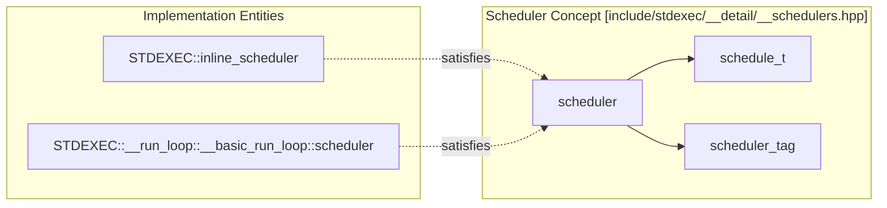
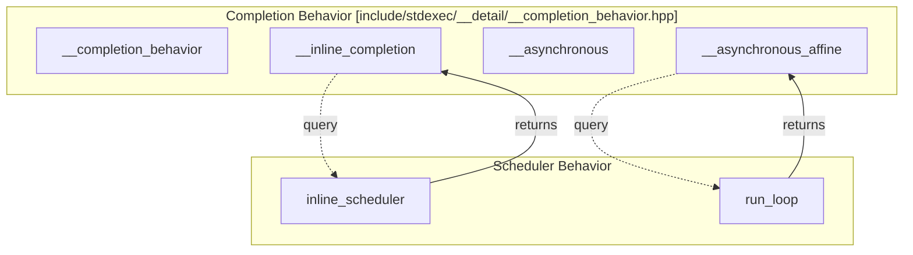
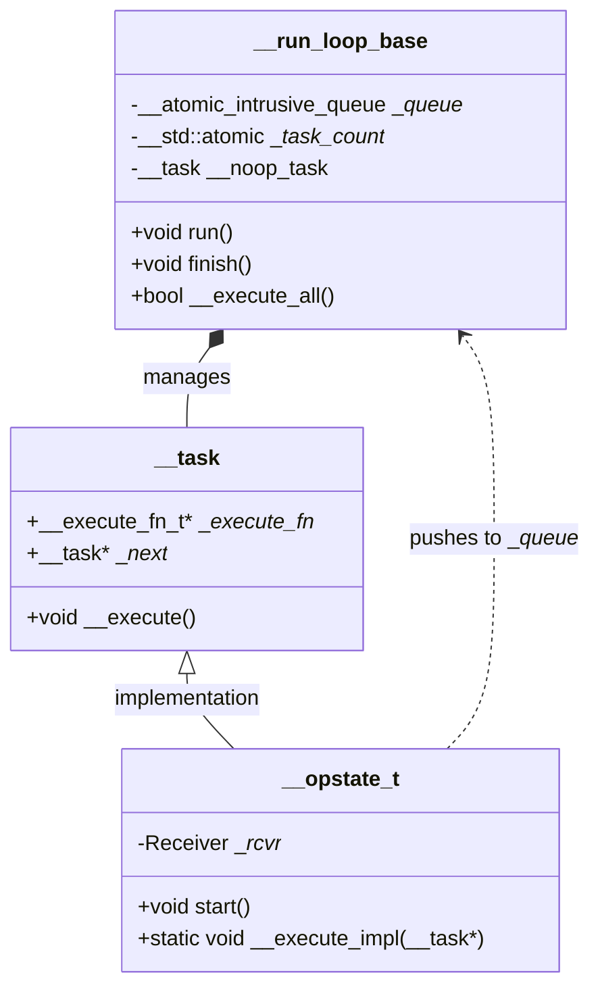

<!-- source: DeepWiki mcp.deepwiki.com · repo NVIDIA/stdexec · page 5.3 Inline and Run Loop Schedulers · fetched 2026-10-26 -->

# Inline and Run Loop Schedulers

Relevant source files

The following files were used as context for generating this wiki page:

- [cmake/RAPIDS.cmake](cmake/RAPIDS.cmake)
- [include/exec/inline_scheduler.hpp](include/exec/inline_scheduler.hpp)
- [include/stdexec/__detail/__affine.hpp](include/stdexec/__detail/__affine.hpp)
- [include/stdexec/__detail/__completion_behavior.hpp](include/stdexec/__detail/__completion_behavior.hpp)
- [include/stdexec/__detail/__deprecations.hpp](include/stdexec/__detail/__deprecations.hpp)
- [include/stdexec/__detail/__inline_scheduler.hpp](include/stdexec/__detail/__inline_scheduler.hpp)
- [include/stdexec/__detail/__queries.hpp](include/stdexec/__detail/__queries.hpp)
- [include/stdexec/__detail/__query.hpp](include/stdexec/__detail/__query.hpp)
- [include/stdexec/__detail/__run_loop.hpp](include/stdexec/__detail/__run_loop.hpp)

## Purpose and Scope

This page documents two fundamental CPU schedulers provided by `stdexec`: `inline_scheduler` and `run_loop`. These schedulers provide immediate and controlled execution respectively, serving as building blocks for testing, synchronous waiting, and scenarios where minimal scheduling overhead is desired.

For information about more sophisticated CPU schedulers with work-stealing and parallelism, see [Static Thread Pool](5.1) and [System Context and Platform Schedulers](5.2).

## Overview

Both `inline_scheduler` and `run_loop` provide single-threaded execution contexts:

- **`inline_scheduler`**: Executes work immediately on the calling thread without actual scheduling or thread switching. The sender completes synchronously wherever `start()` is called on the operation state. [include/stdexec/__detail/__inline_scheduler.hpp:38-53]()
- **`run_loop`**: Provides a manually-controlled event loop that queues work and executes it when `run()` is called. This enables synchronous waiting and precise control over execution timing. [include/stdexec/__detail/__run_loop.hpp:52-64]()

### Scheduler Characteristics Comparison

| Feature | `inline_scheduler` | `run_loop` |
|---------|-------------------|----------------------|
| **Execution location** | Wherever `start()` is called | On thread calling `run()` |
| **Execution timing** | Immediate (synchronous) | Deferred until `run()` |
| **Thread switching** | No | No |
| **Queuing** | No | Yes (`__atomic_intrusive_queue`) |
| **Blocking** | No | Yes (in `run()`) |
| **Primary use case** | Inline completion, testing | `sync_wait`, testing |

Sources: [include/stdexec/__detail/__inline_scheduler.hpp:38-86](), [include/stdexec/__detail/__run_loop.hpp:40-64](), [include/stdexec/__detail/__run_loop.hpp:189-192]()

## Scheduler Concepts and Queries

Both schedulers satisfy the `scheduler` concept defined in `stdexec`. The `schedule()` member function returns a sender that, when connected and started, will execute on the scheduler's execution context.

Sources: [include/stdexec/__detail/__inline_scheduler.hpp:75](), [include/stdexec/__detail/__run_loop.hpp:27]()

### Completion Behavior

A key distinction exists in how these schedulers report their completion behavior. The `inline_scheduler` explicitly queries as `__inline_completion`, indicating it never introduces asynchrony.

Sources: [include/stdexec/__detail/__inline_scheduler.hpp:31-34](), [include/stdexec/__detail/__completion_behavior.hpp:41-64]()

## inline_scheduler

The `inline_scheduler` executes work synchronously on the calling thread. It is the simplest possible scheduler, with no queuing and no thread management.

### Characteristics

1. **Inline Completion**: When `start()` is called on an operation state produced by `inline_scheduler::schedule()`, the operation completes immediately before `start()` returns by calling `set_value` on the receiver. [include/stdexec/__detail/__inline_scheduler.hpp:47-50]()
2. **Scheduler Forwarding**: The `inline_scheduler` reports that it completes inline via its attributes. [include/stdexec/__detail/__inline_scheduler.hpp:28-36]()
3. **Minimal Overhead**: No dynamic allocation, no synchronization, no context switching.

### Implementation Detail
The `inline_scheduler` is defined in `include/stdexec/__detail/__inline_scheduler.hpp`. A deprecated alias exists in `include/exec/inline_scheduler.hpp` for backward compatibility.

Sources: [include/stdexec/__detail/__inline_scheduler.hpp:38-86](), [include/exec/inline_scheduler.hpp:20-29]()

## run_loop

The `run_loop` class provides a single-threaded event loop with manual control over execution. It maintains an internal queue of pending work and executes it when `run()` is explicitly called.

### Core Components and Data Flow

Sources: [include/stdexec/__detail/__run_loop.hpp:40-193]()

### Key Functions

#### `run()`
Blocks the calling thread and executes all enqueued work items. It uses an `__atomic_intrusive_queue` to wait for items and process them via `__execute_all()`. It continues until the `__finishing_` flag is set and the queue is drained. [include/stdexec/__detail/__run_loop.hpp:52-64]()

#### `finish()`
Signals the run loop to stop processing work. It increments the task count to prevent premature exit and pushes a `__noop_task` to wake the thread calling `run()`. [include/stdexec/__detail/__run_loop.hpp:67-87]()

#### `__execute_all()`
The internal mechanism that pops all tasks from the queue and executes their `__execute()` function. It decrements the `__task_count_` after processing the batch. [include/stdexec/__detail/__run_loop.hpp:158-185]()

## Affine Algorithm

The `affine` adaptor (formerly `affine_on`) ensures a sender completes on the scheduler it started on. If a sender is not already affine (like `inline_scheduler` senders are), the algorithm wraps it to ensure completion happens on the environment's start scheduler.

- **`__is_affine`**: A concept checking if a sender's completion behavior is already `__inline_completion` or `__asynchronous_affine`. [include/stdexec/__detail/__affine.hpp:50-53]()
- **Transformation**: If a sender is not affine, it is transformed using `__finally` to schedule a transition back to the starting scheduler. [include/stdexec/__detail/__affine.hpp:124-126]()

Sources: [include/stdexec/__detail/__affine.hpp:27-130](), [include/stdexec/__detail/__deprecations.hpp:56-58]()

## Integration with sync_wait

The primary use of `run_loop` within `stdexec` is in the implementation of `sync_wait()`. It provides the execution context where the calling thread blocks until the sender completes.

The `run_loop` ensures that even if a sender transitions to other threads, the final completion signal is "pulled" back to the thread that called `sync_wait` by enqueuing a completion task into the loop.

Sources: [include/stdexec/__detail/__run_loop.hpp:111-154](), [include/stdexec/__detail/__run_loop.hpp:52-64]()

---

