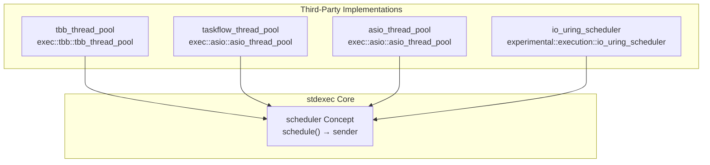
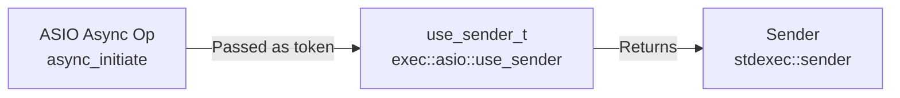
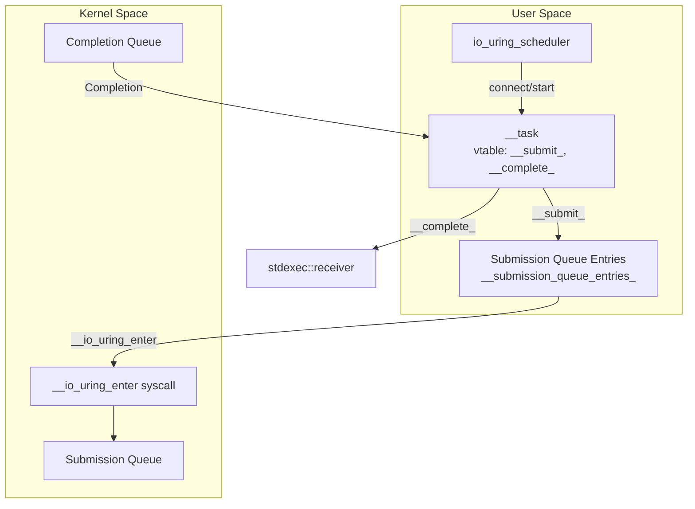

<!-- source: DeepWiki mcp.deepwiki.com · repo NVIDIA/stdexec · page 5.4 Third-Party Scheduler Integrations · fetched 2026-10-26 -->

# Third-Party Scheduler Integrations

Relevant source files

The following files were used as context for generating this wiki page:

- [cmake/Modules/ConfigureASIO.cmake](cmake/Modules/ConfigureASIO.cmake)
- [cmake/Modules/ConfigureTBB.cmake](cmake/Modules/ConfigureTBB.cmake)
- [cmake/Modules/ConfigureTaskflow.cmake](cmake/Modules/ConfigureTaskflow.cmake)
- [cmake/import_standalone_asio.cmake](cmake/import_standalone_asio.cmake)
- [examples/benchmark/asio_thread_pool.cpp](examples/benchmark/asio_thread_pool.cpp)
- [examples/benchmark/taskflow_thread_pool.cpp](examples/benchmark/taskflow_thread_pool.cpp)
- [include/asioexec/as_default_on.hpp](include/asioexec/as_default_on.hpp)
- [include/asioexec/completion_token.hpp](include/asioexec/completion_token.hpp)
- [include/asioexec/executor_with_default.hpp](include/asioexec/executor_with_default.hpp)
- [include/asioexec/use_sender.hpp](include/asioexec/use_sender.hpp)
- [include/exec/asio/asio_config.hpp.in](include/exec/asio/asio_config.hpp.in)
- [include/exec/linux/io_uring_context.hpp](include/exec/linux/io_uring_context.hpp)
- [include/exec/variant_sender.hpp](include/exec/variant_sender.hpp)
- [include/execpools/asio/asio_thread_pool.hpp](include/execpools/asio/asio_thread_pool.hpp)
- [include/execpools/taskflow/taskflow_thread_pool.hpp](include/execpools/taskflow/taskflow_thread_pool.hpp)
- [include/execpools/tbb/tbb_thread_pool.hpp](include/execpools/tbb/tbb_thread_pool.hpp)
- [include/execpools/thread_pool_base.hpp](include/execpools/thread_pool_base.hpp)
- [include/tbbexec/tbb_thread_pool.hpp](include/tbbexec/tbb_thread_pool.hpp)
- [test/exec/asio/CMakeLists.txt](test/exec/asio/CMakeLists.txt)
- [test/exec/asio/test_asio_thread_pool.cpp](test/exec/asio/test_asio_thread_pool.cpp)
- [test/exec/asio/test_completion_token.cpp](test/exec/asio/test_completion_token.cpp)
- [test/exec/asio/test_use_sender.cpp](test/exec/asio/test_use_sender.cpp)
- [test/exec/taskflow/test_taskflow_thread_pool.cpp](test/exec/taskflow/test_taskflow_thread_pool.cpp)
- [test/exec/test_io_uring_context.cpp](test/exec/test_io_uring_context.cpp)
- [test/exec/test_variant_sender.cpp](test/exec/test_variant_sender.cpp)
- [test/nvexec/monotonic_buffer.cpp](test/nvexec/monotonic_buffer.cpp)
- [test/nvexec/synchronized_pool.cpp](test/nvexec/synchronized_pool.cpp)

This page documents stdexec's integration with third-party threading libraries and platform-specific execution contexts. These integrations provide alternative scheduler implementations that conform to the P2300 sender/receiver model while leveraging specialized backends like Intel TBB, Taskflow, ASIO, and Linux `io_uring`.

---

## Overview

Stdexec provides optional integrations with several third-party threading libraries and platform-specific APIs. All integrations implement the `scheduler` concept, making them interchangeable with stdexec's built-in execution contexts.

| Integration | CMake Option | Library Target | Header Path |
|------------|--------------|----------------|-------------|
| **Intel TBB** | `STDEXEC_ENABLE_TBB` | `STDEXEC::tbbexec` | `exec/tbb/tbb_thread_pool.hpp` |
| **Taskflow** | `STDEXEC_ENABLE_TASKFLOW` | `STDEXEC::taskflow_pool` | `exec/taskflow/taskflow_thread_pool.hpp` |
| **ASIO** | `STDEXEC_ENABLE_ASIO` | `STDEXEC::asioexec` | `exec/asio/asio_thread_pool.hpp` |
| **io_uring** | `STDEXEC_ENABLE_IO_URING` | Part of `stdexec` | `exec/linux/io_uring_context.hpp` |

**Sources:** [cmake/Modules/ConfigureASIO.cmake:1-108](), [include/exec/linux/io_uring_context.hpp:17-55]()

---

## Integration Architecture

Third-party schedulers integrate through the `scheduler` concept. The domain system allows these schedulers to customize sender algorithms.

### Code Entity Mapping

**Sources:** [include/tbbexec/tbb_thread_pool.hpp:29-33](), [include/execpools/asio/asio_thread_pool.hpp:31-38](), [include/exec/linux/io_uring_context.hpp:59-150]()

---

## Intel TBB Integration

The TBB integration wraps Intel's tasking library. The `exec::tbb::tbb_thread_pool` exposes TBB's task arena as a stdexec scheduler.

### Configuration and Deprecation
The library supports TBB detection via CMake modules. Note that the `tbbexec` namespace and its associated headers are deprecated in favor of `exec::tbb` [include/tbbexec/tbb_thread_pool.hpp:21-33]().

**Sources:** [include/tbbexec/tbb_thread_pool.hpp:17-34]()

---

## ASIO Integration

Stdexec supports both **Boost.Asio** and **Standalone ASIO**. This is controlled via the `STDEXEC_ASIO_IMPLEMENTATION` CMake variable, which can be set to `boost` or `standalone` [cmake/Modules/ConfigureASIO.cmake:1-15]().

### ASIO Completion Token
The integration provides `exec::asio::use_sender_t`, which allows ASIO asynchronous operations to return senders instead of using callbacks [include/exec/asio/use_sender.hpp:31-43]().

### Type Mapping and Cancellations
The ASIO integration maps ASIO error codes to stdexec completion signals. For instance, `std::errc::operation_canceled` or `boost::system::errc::operation_canceled` results in a `set_stopped` signal [test/exec/asio/test_use_sender.cpp:110-149](). Successful operations result in a `set_value` signal [test/exec/asio/test_use_sender.cpp:151-172]().

**Sources:** [include/asioexec/use_sender.hpp:33-43](), [include/asioexec/completion_token.hpp:33-44](), [cmake/Modules/ConfigureASIO.cmake:17-108](), [test/exec/asio/test_use_sender.cpp:41-108]()

---

## Linux io_uring Integration

The `io_uring_context` provides a high-performance asynchronous I/O and timer scheduler for Linux. It maps the kernel's submission queue (SQ) and completion queue (CQ) into the process memory using `mmap` [include/exec/linux/io_uring_context.hpp:101-132]().

### io_uring Data Flow

### Key Components
- **`__context_base`**: Handles memory mapping of the ring buffers and initialization of the `io_uring` file descriptor via `__io_uring_setup` [include/exec/linux/io_uring_context.hpp:71-77](), [include/exec/linux/io_uring_context.hpp:110-150]().
- **`__task`**: Base class for I/O operations with a `__task_vtable` for checking readiness, submission, and completion [include/exec/linux/io_uring_context.hpp:155-181]().
- **`io_uring_scheduler`**: Satisfies the `timed_scheduler` concept, supporting `schedule_after` and `schedule_at` [test/exec/test_io_uring_context.cpp:84-115]().

**Sources:** [include/exec/linux/io_uring_context.hpp:59-195](), [test/exec/test_io_uring_context.cpp:76-134]()

---

## Variant Senders

When working with multiple third-party schedulers, `exec::variant_sender` allows for runtime selection between different sender types while maintaining a single static type for the sender chain.

### Implementation
- **`variant_sender<Senders...>`**: Wraps a `STDEXEC::__variant` of different senders [include/exec/variant_sender.hpp:60-74]().
- **`connect`**: Dispatches to the active sender's `connect` via `STDEXEC::__visit` [include/exec/variant_sender.hpp:130-141]().
- **Completion Signatures**: Automatically computes the union of all completion signatures from the wrapped senders using `__concat_completion_signatures_t` [include/exec/variant_sender.hpp:63-65]().

**Sources:** [include/exec/variant_sender.hpp:22-149](), [test/exec/test_variant_sender.cpp:40-76]()

---

