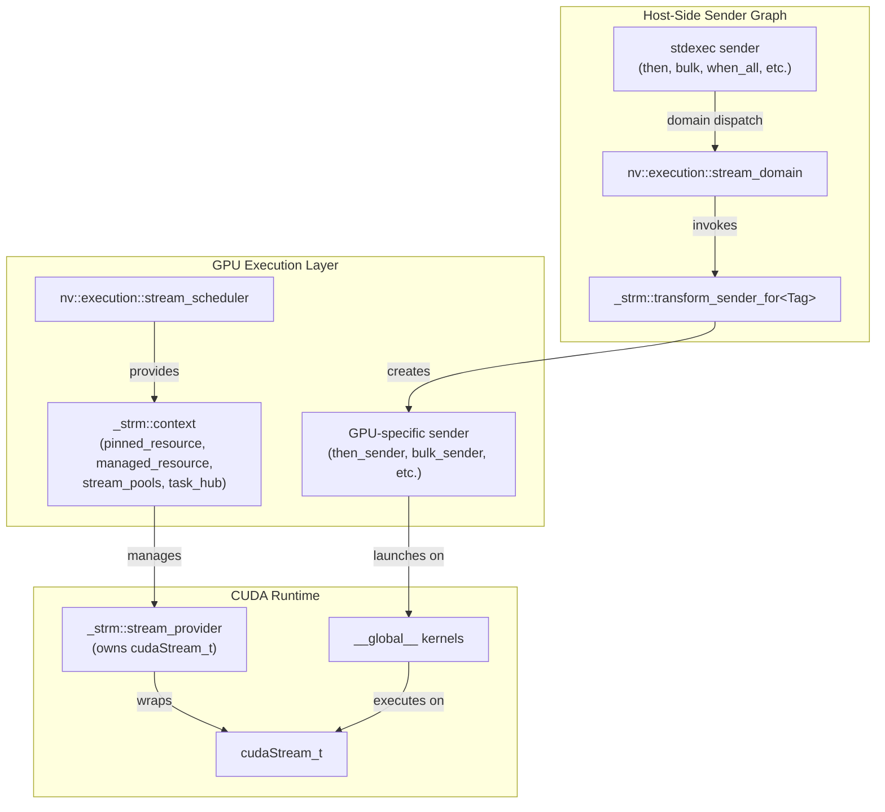
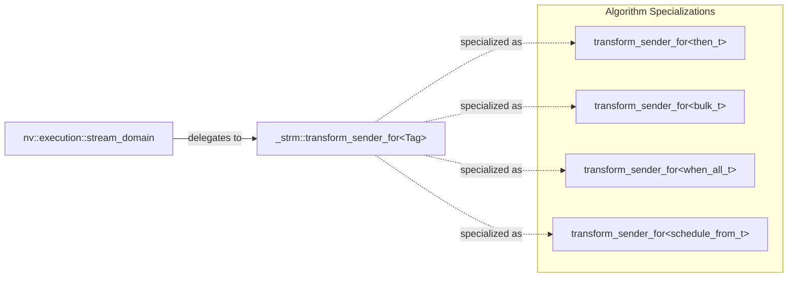
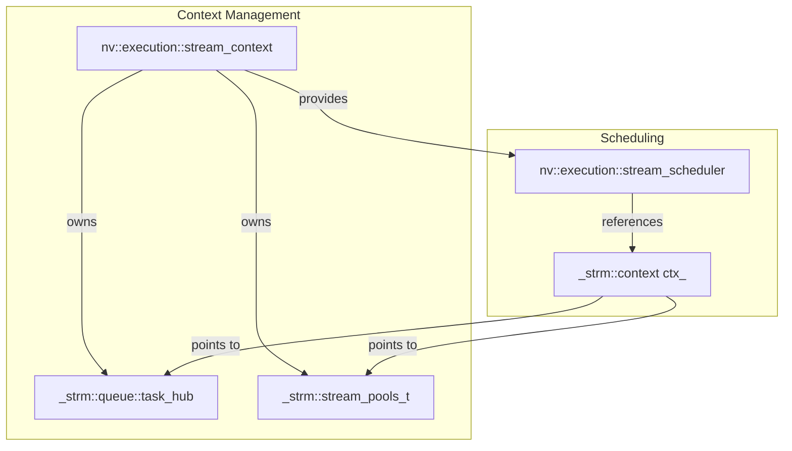

<!-- source: DeepWiki mcp.deepwiki.com · repo NVIDIA/stdexec · page 6 GPU Execution with nvexec · fetched 2026-10-26 -->

# GPU Execution with nvexec

Relevant source files

The following files were used as context for generating this wiki page:

- [examples/nvexec/maxwell/snr.cuh](examples/nvexec/maxwell/snr.cuh)
- [include/nvexec/multi_gpu_context.cuh](include/nvexec/multi_gpu_context.cuh)
- [include/nvexec/stream/common.cuh](include/nvexec/stream/common.cuh)
- [include/nvexec/stream/ensure_started.cuh](include/nvexec/stream/ensure_started.cuh)
- [include/nvexec/stream/split.cuh](include/nvexec/stream/split.cuh)
- [include/nvexec/stream/when_all.cuh](include/nvexec/stream/when_all.cuh)
- [include/nvexec/stream_context.cuh](include/nvexec/stream_context.cuh)

## Purpose and Scope

The `nvexec` library extends the stdexec sender/receiver model to enable GPU-accelerated execution using NVIDIA CUDA. It provides GPU-optimized implementations of standard sender algorithms (such as `then`, `bulk`, `when_all`, `let_value`) that execute kernels on CUDA streams rather than on CPU threads.

This page introduces the fundamental architecture and components of nvexec. For detailed information on specific topics:
- Stream contexts and schedulers: see [Stream Context and Schedulers](#6.1)
- Algorithm transformations: see [Stream Domain and Sender Adaptors](#6.2)
- Multi-GPU support: see [Multi-GPU Execution](#6.3)
- Synchronization primitives: see [Stream Synchronization Patterns](#6.4)
- Memory and resource management: see [Memory Management and Stream Providers](#6.5)
- Device-side task queuing: see [Task Hub and Device-Side Queuing](#6.6)

## Architecture Overview

The nvexec library implements a domain-based customization system that intercepts standard sender algorithms and replaces them with GPU-optimized implementations. The key architectural components are:

Title: nvexec Architecture Overview

**Architecture: Domain-Based Algorithm Transformation**

Sources: [include/nvexec/stream/common.cuh:145-164](), [include/nvexec/stream_context.cuh:70-155]()

The transformation process follows this flow:

1. **Host sender graph creation**: User composes senders using standard algorithms (`then`, `bulk`, `when_all`).
2. **Domain identification**: When connecting to a receiver, the sender's completion scheduler is queried, which returns `stream_domain` [include/nvexec/stream/common.cuh:145-164]().
3. **Algorithm transformation**: `stream_domain::transform_sender` intercepts each algorithm and delegates to `transform_sender_for<Tag>` specializations [include/nvexec/stream/common.cuh:147-155]().
4. **GPU sender creation**: Transform functions create GPU-specific sender types (e.g., `then_sender`, `bulk_sender`, `when_all_sender`) that launch CUDA kernels [include/nvexec/stream/when_all.cuh:122-135]().

## Core Components

### stream_domain

The `stream_domain` type enables GPU-specific algorithm customization by providing `transform_sender` and `apply_sender` hooks:

Title: stream_domain Customization Hierarchy

**Diagram: stream_domain Customization Hierarchy**

Sources: [include/nvexec/stream/common.cuh:145-164](), [include/nvexec/stream/schedule_from.cuh:173-190]()

The `stream_domain` struct is defined at [include/nvexec/stream/common.cuh:145-164]() and provides two customization points:
- `transform_sender` - transforms standard algorithms for GPU execution [include/nvexec/stream/common.cuh:149-155]().
- `apply_sender` - applies algorithm-specific operations [include/nvexec/stream/common.cuh:157-163]().

### context

The `_strm::context` struct aggregates all resources needed for GPU execution:

| Member | Type | Purpose |
|--------|------|---------|
| `pinned_resource_` | `std::pmr::memory_resource*` | Host pinned memory allocator [include/nvexec/stream_context.cuh:192]() |
| `managed_resource_` | `std::pmr::memory_resource*` | CUDA managed memory allocator [include/nvexec/stream_context.cuh:193]() |
| `stream_pools_` | `stream_pools_t*` | Pool of reusable CUDA streams [include/nvexec/stream_context.cuh:194]() |
| `hub_` | `queue::task_hub*` | Device-side task queue manager [include/nvexec/stream_context.cuh:197]() |
| `priority_` | `stream_priority` | Stream priority (high/normal/low) [include/nvexec/stream/common.cuh:43-48]() |

Sources: [include/nvexec/stream_context.cuh:168-198](), [include/nvexec/stream/common.cuh:43-48]()

### stream_scheduler and stream_context

The `stream_context` owns the lifecycle of the GPU resources and provides a scheduler for work submission.

Title: Context and Scheduler Relationship

**Diagram: Context and Scheduler Relationship**

Sources: [include/nvexec/stream_context.cuh:168-198]()

The `stream_context` is defined at [include/nvexec/stream_context.cuh:168-198](). It initializes the device and the `task_hub` [include/nvexec/stream_context.cuh:170-173](). The `get_scheduler()` method returns a `stream_scheduler` containing a lightweight `_strm::context` reference [include/nvexec/stream_context.cuh:175-182]().

## Multi-GPU Execution

For systems with multiple GPUs, `multi_gpu_stream_context` provides an environment for distributed execution:

- **Peer Access**: The context automatically enables peer-to-peer memory access between all detected GPUs during initialization [include/nvexec/multi_gpu_context.cuh:176-193]().
- **Multi-GPU Scheduler**: Returns a `multi_gpu_stream_scheduler` which can schedule work across the entire device pool [include/nvexec/multi_gpu_context.cuh:197-206]().
- **Work Distribution**: The `multi_gpu_stream_scheduler` produces senders that can be connected to receivers to trigger multi-device operations [include/nvexec/multi_gpu_context.cuh:45-48]().

Sources: [include/nvexec/multi_gpu_context.cuh:167-224]()

## Synchronization and Resource Management

The nvexec execution model handles the bridge between asynchronous GPU execution and host-side completion:

1. **Kernel Launch**: GPU-specific operation states launch kernels on a `cudaStream_t` [include/nvexec/stream/when_all.cuh:63-67]().
2. **Synchronization**: Algorithms like `when_all` and `split` use `cudaEvent_t` to coordinate across multiple streams [include/nvexec/stream/split.cuh:85-86](), [include/nvexec/stream/when_all.cuh:29]().
3. **Memory Management**: Uses managed memory (`cudaMallocManaged`) for shared state between host and device [include/nvexec/stream/split.cuh:133-148]().

This mechanism is central to algorithms like `split`, where a single producer stream must notify multiple consumer operation states [include/nvexec/stream/split.cuh:150-209]().

Sources: [include/nvexec/stream/split.cuh:1-122](), [include/nvexec/stream/when_all.cuh:1-120]()

## Next Steps

This overview covered the fundamental architecture of nvexec. For specific topics:

- To create and use stream contexts and schedulers, see [Stream Context and Schedulers](#6.1)
- To understand how algorithms are transformed for GPU, see [Stream Domain and Sender Adaptors](#6.2)
- To enable multi-GPU execution and peer access, see [Multi-GPU Execution](#6.3)
- To coordinate work across streams with events, see [Stream Synchronization Patterns](#6.4)
- To manage memory and CUDA resources, see [Memory Management and Stream Providers](#6.5)
- To understand the poller/producer task architecture, see [Task Hub and Device-Side Queuing](#6.6)

Sources: [include/nvexec/stream/common.cuh:1-137](), [include/nvexec/stream_context.cuh:1-201]()

---

