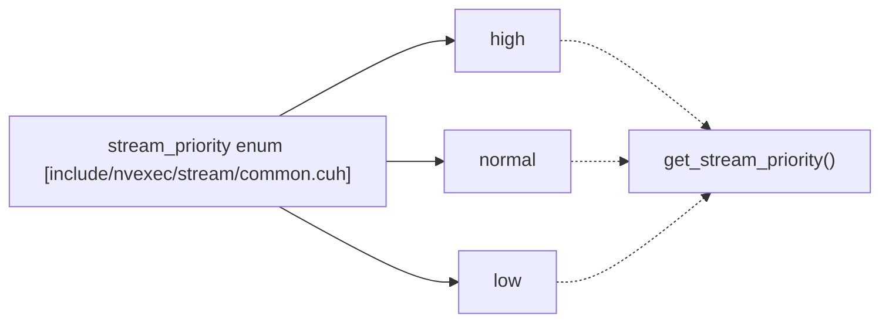
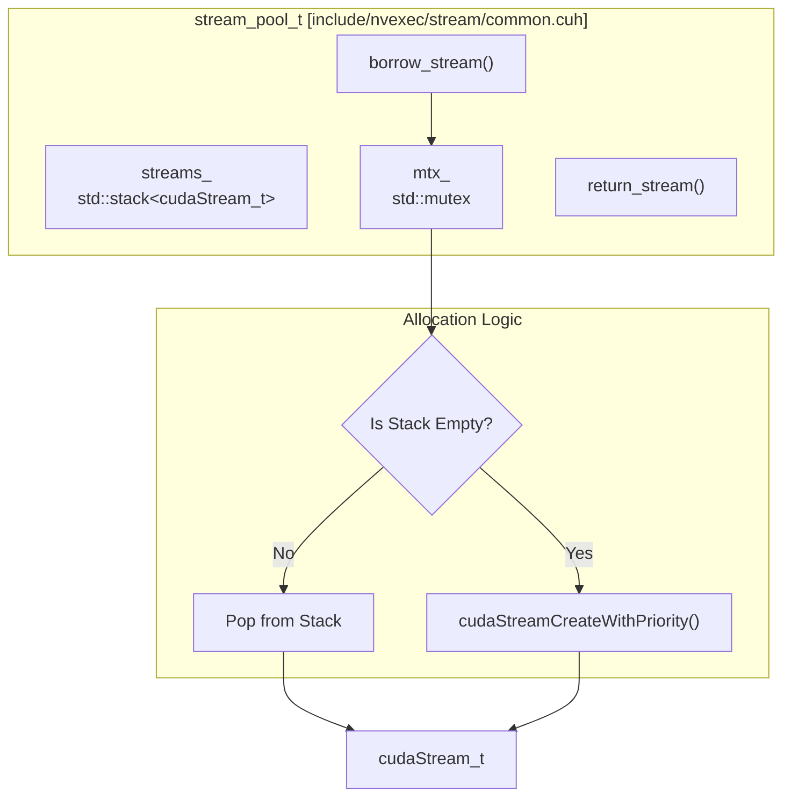
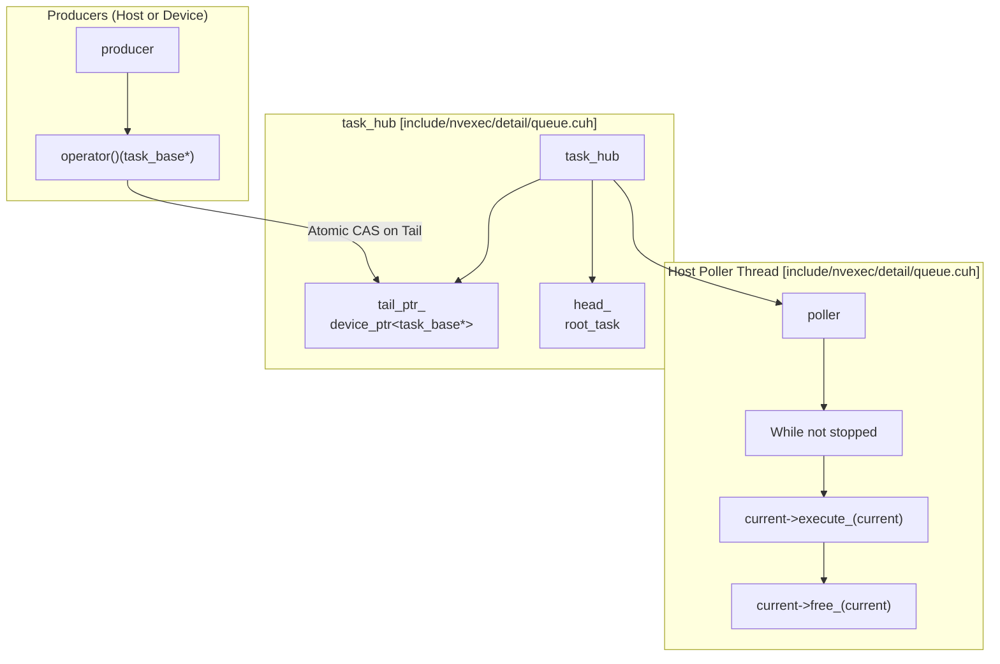
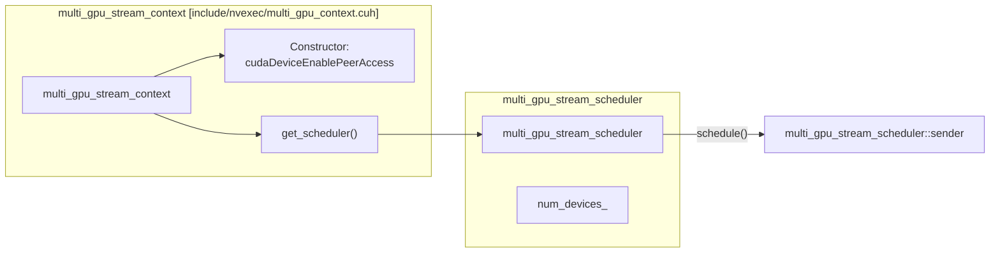
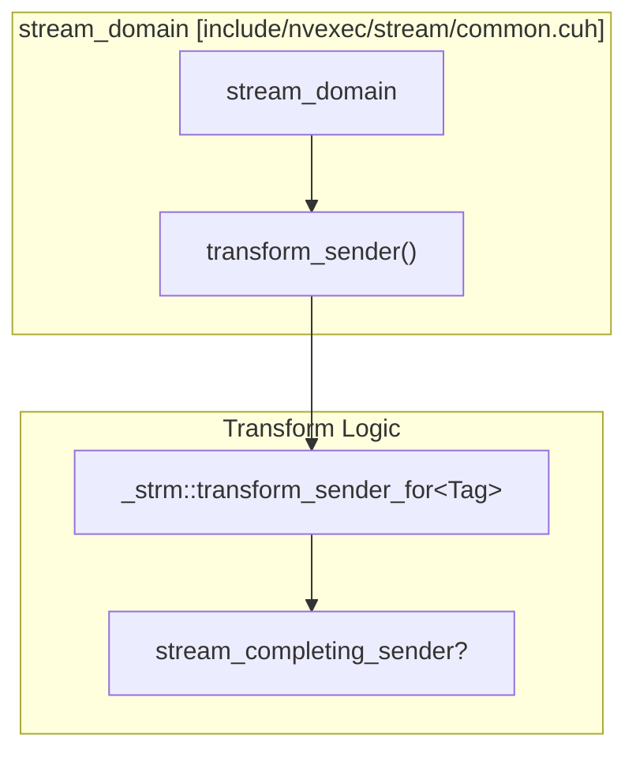

<!-- source: DeepWiki mcp.deepwiki.com · repo NVIDIA/stdexec · page 6.1 Stream Context and Schedulers · fetched 2026-10-26 -->

# Stream Context and Schedulers

<details>
<summary>Relevant source files</summary>

The following files were used as context for generating this wiki page:

- [examples/nvexec/maxwell/snr.cuh](examples/nvexec/maxwell/snr.cuh)
- [include/nvexec/detail/cuda_atomic.cuh](include/nvexec/detail/cuda_atomic.cuh)
- [include/nvexec/detail/cuda_fwd.cuh](include/nvexec/detail/cuda_fwd.cuh)
- [include/nvexec/multi_gpu_context.cuh](include/nvexec/multi_gpu_context.cuh)
- [include/nvexec/stream/common.cuh](include/nvexec/stream/common.cuh)
- [include/nvexec/stream/ensure_started.cuh](include/nvexec/stream/ensure_started.cuh)
- [include/nvexec/stream/split.cuh](include/nvexec/stream/split.cuh)
- [include/nvexec/stream/when_all.cuh](include/nvexec/stream/when_all.cuh)
- [include/nvexec/stream_context.cuh](include/nvexec/stream_context.cuh)

</details>


This page documents the CUDA stream execution contexts and schedulers provided by `nvexec`. These types enable GPU execution by managing CUDA streams, memory resources, and asynchronous task queues.

**Scope**: This page covers `stream_context`, `stream_scheduler`, `multi_gpu_stream_context`, and their supporting infrastructure. For GPU-specific sender adaptors that run on these schedulers, see [Stream Domain and Sender Adaptors](6.2). For multi-GPU execution patterns, see [Multi-GPU Execution](6.3).

## Overview

The `nvexec` stream system provides two primary context types:
- **`stream_context`**: Single-GPU execution context with automatic stream pooling. [include/nvexec/stream_context.cuh:168-198]()
- **`multi_gpu_stream_context`**: Multi-GPU execution context with peer access configuration. [include/nvexec/multi_gpu_context.cuh:167-224]()

Both contexts produce schedulers that integrate with the `stdexec` sender/receiver model, allowing GPU kernels to execute as senders within a standard-compliant pipeline.

Sources: [include/nvexec/stream_context.cuh:168-198](), [include/nvexec/multi_gpu_context.cuh:167-224]()

## Stream Context Architecture

The `stream_context` is the primary entry point for single-device GPU execution. It manages the lifetime of internal resource providers and provides a factory for schedulers.

```mermaid
graph TB
    User["User Code"]
    
    subgraph "stream_context [include/nvexec/stream_context.cuh]"
        Context["stream_context"]
        Pinned["pinned_resource_<br/>resource_storage&lt;pinned_resource&gt;"]
        Managed["managed_resource_<br/>resource_storage&lt;managed_resource&gt;"]
        Pools["stream_pools_t<br/>Priority pools"]
        Hub["task_hub<br/>CPU-GPU task queue"]
    end
    
    subgraph "stream_scheduler [include/nvexec/stream_context.cuh]"
        Sched["stream_scheduler"]
        CtxState["_strm::context<br/>shared state"]
        SendFn["schedule()<br/>returns sender"]
    end
    
    subgraph "Execution Logic [include/nvexec/stream/common.cuh]"
        Sender["sender"]
        OpState["opstate&lt;Receiver&gt;"]
        Base["opstate_base&lt;Receiver&gt;"]
    end
    
    User -->|"get_scheduler()"| Context
    Context --> Pinned
    Context --> Managed
    Context --> Pools
    Context --> Hub
    
    Context -->|"returns"| Sched
    Sched --> CtxState
    CtxState -.references.-> Pinned
    CtxState -.references.-> Managed
    CtxState -.references.-> Pools
    CtxState -.references.-> Hub
    
    Sched -->|"schedule()"| SendFn
    SendFn --> Sender
    Sender -->|"connect(receiver)"| OpState
    OpState --|> Base
```

**Stream Context Component Relationships**

The `stream_context` owns the heavy resources (`pinned_resource_`, `managed_resource_`, `stream_pools_`, and `hub_`). When `get_scheduler()` is called, it bundles pointers to these resources into a `_strm::context` structure passed to the `stream_scheduler`. [include/nvexec/stream_context.cuh:175-182]()

Sources: [include/nvexec/stream_context.cuh:168-198](), [include/nvexec/stream_context.cuh:175-182]()

## _strm::context Structure

The `_strm::context` type (often referred to as `context` within the `_strm` namespace) is the central state structure shared across all stream operations:

| Field | Type | Purpose |
|-------|------|---------|
| `pinned_resource_` | `std::pmr::memory_resource*` | Allocator for host-pinned memory. [include/nvexec/stream/common.cuh:218]() |
| `managed_resource_` | `std::pmr::memory_resource*` | Allocator for CUDA managed memory. [include/nvexec/stream/common.cuh:219]() |
| `stream_pools_` | `stream_pools_t*` | Pool of reusable CUDA streams. [include/nvexec/stream/common.cuh:220]() |
| `hub_` | `queue::task_hub*` | Task queue for CPU-GPU coordination. [include/nvexec/stream/common.cuh:221]() |
| `priority_` | `stream_priority` | Stream priority: high, normal, or low. [include/nvexec/stream/common.cuh:222]() |

Sources: [include/nvexec/stream/common.cuh:215-223]()

### Stream Priority Levels

The system supports three priority levels which map to underlying CUDA stream priorities via `cudaDeviceGetStreamPriorityRange`. [include/nvexec/stream/common.cuh:177-199]()



Sources: [include/nvexec/stream/common.cuh:43-48](), [include/nvexec/stream/common.cuh:177-199]()

## Stream Pool Management

To avoid the overhead of frequent `cudaStreamCreate` and `cudaStreamDestroy` calls, `nvexec` implements a `stream_pool_t` that maintains a stack of reusable streams. [include/nvexec/stream/common.cuh:201-213]()



**Stream Pool Lifecycle**

The `stream_pools_t` object contains three `stream_pool_t` instances (one for each priority). [include/nvexec/stream/common.cuh:226-241]()

Sources: [include/nvexec/stream/common.cuh:201-213](), [include/nvexec/stream/common.cuh:226-241]()

## Task Queue System (task_hub)

The `task_hub` is a critical component for host-device synchronization. It allows device code to enqueue tasks (callbacks) that are executed by a dedicated host thread. [include/nvexec/stream_context.cuh:197]()



**Task Queue Architecture**

- **`task_base`**: The base structure for all tasks, containing function pointers for execution and cleanup.
- **`producer`**: A lightweight handle that can be passed into CUDA kernels to enqueue tasks via atomic operations.
- **`poller`**: Spawns a `std::thread` that busy-waits on the task queue and executes tasks as they arrive.

Sources: [include/nvexec/stream_context.cuh:197](), [include/nvexec/detail/queue.cuh:32-157]()

## operation_state_base

Most `nvexec` operation states inherit from `_strm::opstate_base<Receiver>`. This base class manages the relationship between the operation and the CUDA stream it executes on.

| Function | Purpose |
|----------|---------|
| `get_stream()` | Returns the `cudaStream_t` associated with this operation. [include/nvexec/stream/common.cuh:576]() |
| `make_env()` | Constructs the execution environment for child operations, including the stream provider. [include/nvexec/stream/common.cuh:586]() |
| `propagate_completion_signal()` | Handles the transition from GPU execution back to the receiver, potentially launching a continuation kernel if the receiver is not a "stream receiver". [include/nvexec/stream/common.cuh:606-626]() |

Sources: [include/nvexec/stream/common.cuh:534-633]()

## Multi-GPU Support

The `multi_gpu_stream_context` enables work distribution across multiple devices. Upon construction, it automatically detects available GPUs and enables peer-to-peer access between them. [include/nvexec/multi_gpu_context.cuh:167-194]()



**Multi-GPU Peer Setup**

The constructor iterates through all device pairs and calls `cudaDeviceEnablePeerAccess` if `cudaDeviceCanAccessPeer` returns true. [include/nvexec/multi_gpu_context.cuh:176-192]()

Sources: [include/nvexec/multi_gpu_context.cuh:167-224]()

## Stream Domain Customization

The `stream_domain` is the mechanism through which standard `stdexec` algorithms (like `then`, `bulk`, `let_value`) are specialized for CUDA streams. [include/nvexec/stream/common.cuh:145-164]()



When an algorithm is used within a `stream_domain` (e.g., following a `schedule(stream_sched)`), the domain's `transform_sender` is invoked. It checks if the sender is completing on a `gpu_stream_scheduler`. If so, it replaces the standard implementation with a stream-optimized version via `__structured_apply`. [include/nvexec/stream/common.cuh:147-155]()

Sources: [include/nvexec/stream/common.cuh:145-164]()

## Summary of Schedulers

| Scheduler | Context | Purpose |
|-----------|---------|---------|
| `stream_scheduler` | `stream_context` | Single-GPU execution via stream pooling. [include/nvexec/stream_context.cuh:70]() |
| `multi_gpu_stream_scheduler` | `multi_gpu_stream_context` | Multi-GPU execution with device-aware scheduling. [include/nvexec/multi_gpu_stream_scheduler:32]() |

Sources: [include/nvexec/stream_context.cuh:70-155](), [include/nvexec/multi_gpu_context.cuh:32-154]()

---

