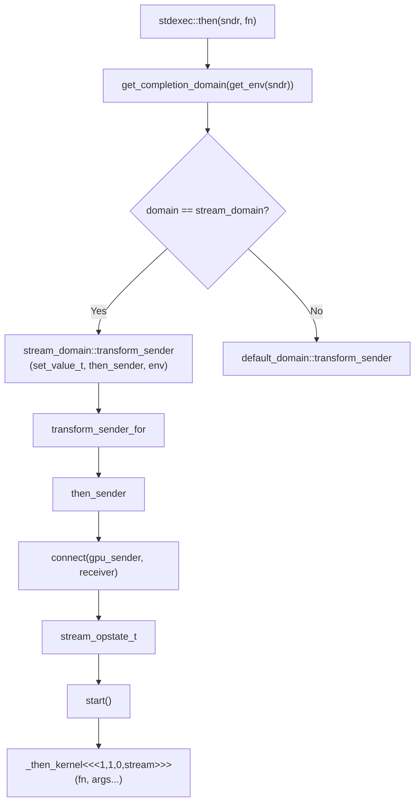
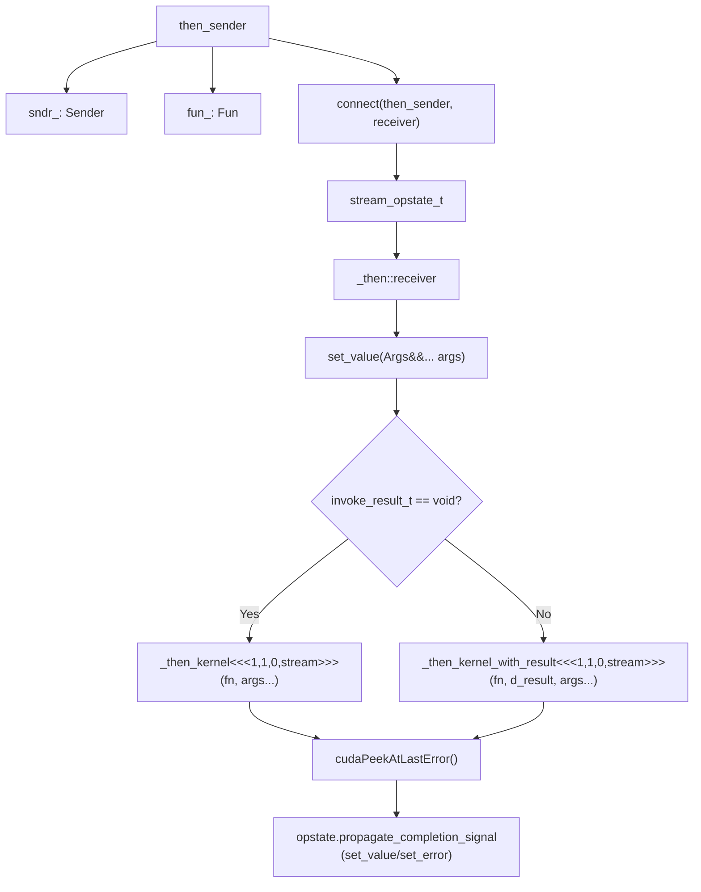
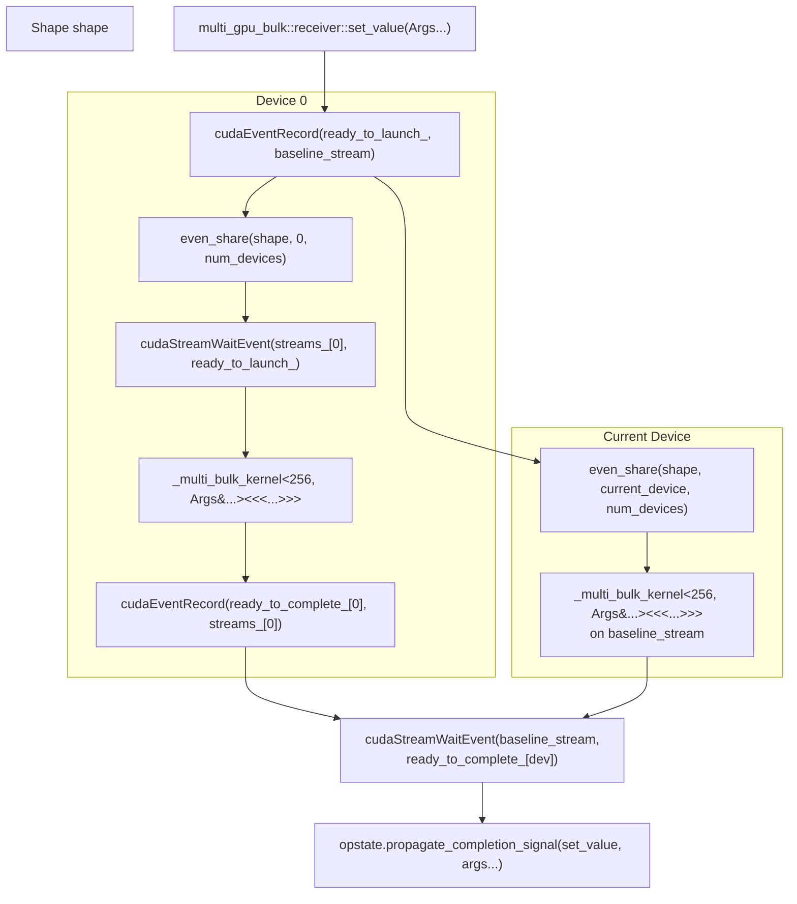
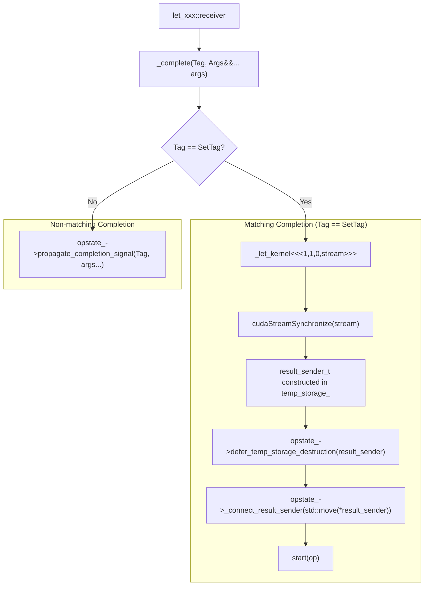
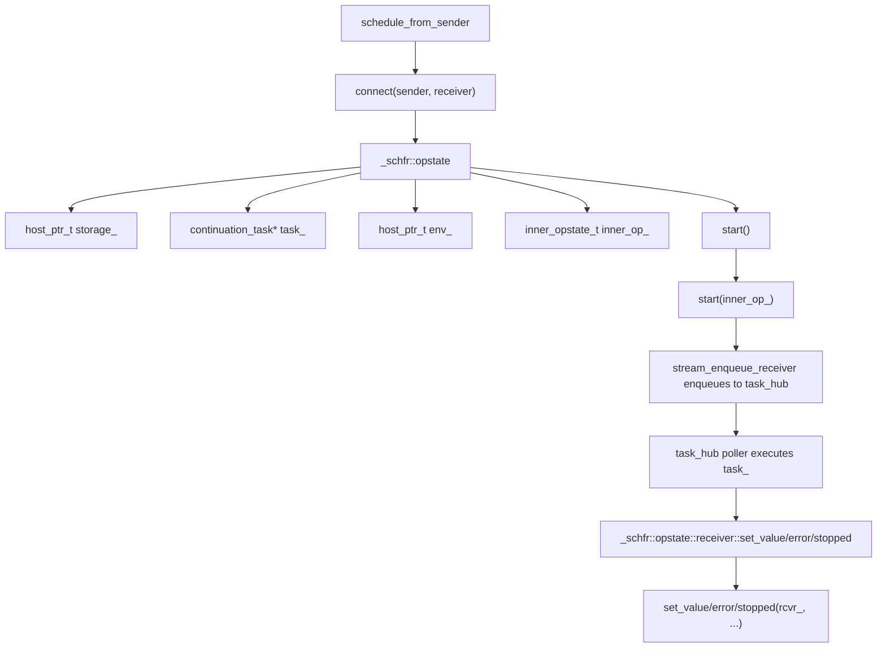

<!-- source: DeepWiki mcp.deepwiki.com · repo NVIDIA/stdexec · page 6.2 Stream Domain and Sender Adaptors · fetched 2026-10-26 -->

# Stream Domain and Sender Adaptors

<details>
<summary>Relevant source files</summary>

The following files were used as context for generating this wiki page:

- [examples/nvexec/maxwell/snr.cuh](examples/nvexec/maxwell/snr.cuh)
- [include/nvexec/stream/algorithm_base.cuh](include/nvexec/stream/algorithm_base.cuh)
- [include/nvexec/stream/bulk.cuh](include/nvexec/stream/bulk.cuh)
- [include/nvexec/stream/common.cuh](include/nvexec/stream/common.cuh)
- [include/nvexec/stream/ensure_started.cuh](include/nvexec/stream/ensure_started.cuh)
- [include/nvexec/stream/let_xxx.cuh](include/nvexec/stream/let_xxx.cuh)
- [include/nvexec/stream/reduce.cuh](include/nvexec/stream/reduce.cuh)
- [include/nvexec/stream/schedule_from.cuh](include/nvexec/stream/schedule_from.cuh)
- [include/nvexec/stream/split.cuh](include/nvexec/stream/split.cuh)
- [include/nvexec/stream/then.cuh](include/nvexec/stream/then.cuh)
- [include/nvexec/stream/upon_error.cuh](include/nvexec/stream/upon_error.cuh)
- [include/nvexec/stream/upon_stopped.cuh](include/nvexec/stream/upon_stopped.cuh)
- [include/nvexec/stream/when_all.cuh](include/nvexec/stream/when_all.cuh)

</details>


This page documents the `stream_domain` class and how `nvexec` transforms standard `stdexec` sender algorithms into GPU-optimized implementations. The `stream_domain` inherits from `stdexec::default_domain` and provides `transform_sender` and `apply_sender` customizations that dispatch to GPU-specific sender implementations when a sender's completion scheduler is a stream scheduler.

Related pages: Stream Context and Schedulers (6.1), Multi-GPU Execution (6.3), Domains and Customization (3.4).

## The stream_domain Class

The `stream_domain` struct is defined in [include/nvexec/stream/common.cuh:145-164]() and serves as the customization point for GPU execution. It provides two key customizations:

**stream_domain Structure**

```cpp
struct stream_domain
{
  template <::exec::sender_for Sender, class Tag = STDEXEC::tag_of_t<Sender>, class Env>
    requires _strm::has_stream_transform<Sender, Env>
  static auto transform_sender(STDEXEC::set_value_t, Sender&& sndr, Env const & env);

  template <class Tag, STDEXEC::sender Sender, class... Args>
    requires STDEXEC::__callable<_strm::apply_sender_for<Tag>, Sender, Args...>
  static auto apply_sender(Tag, Sender&& sndr, Args&&... args);
};
```

The domain is advertised by GPU schedulers through their `get_completion_domain` query, causing the `stdexec` framework to apply GPU transformations when constructing sender chains.

Sources: [include/nvexec/stream/common.cuh:145-164]()

## Transformation Mechanism

The `nvexec::_strm` namespace provides template specializations of `transform_sender_for<Tag>` and `apply_sender_for<Tag>` for standard algorithm tags. When a sender algorithm is used with a GPU scheduler in its environment, the `stream_domain::transform_sender` method invokes these specializations to substitute GPU implementations.

**Domain Transformation Process**



The transformation is triggered when:
1. A sender's completion scheduler advertises `stream_domain` via `get_completion_domain` [include/nvexec/stream/common.cuh:96-103]().
2. The algorithm tag has a corresponding `transform_sender_for<Tag>` specialization in `nvexec::_strm` [include/nvexec/stream/common.cuh:88-89]().
3. The input sender satisfies `stream_completing_sender<Sender, Env>` [include/nvexec/stream/common.cuh:105-110]().

Sources: [include/nvexec/stream/common.cuh:145-164](), [include/nvexec/stream/common.cuh:105-110](), [include/nvexec/stream/then.cuh:207-220]()

## Core GPU Adaptors

The following sections document the primary GPU sender adaptors provided through `stream_domain` transformations. Each adaptor replaces a standard `stdexec` algorithm with a GPU-specific implementation that launches CUDA kernels.

### then_sender

The `then_sender<Sender, Fun>` struct implements `stdexec::then_t` on GPU by launching single-threaded CUDA kernels to execute transformation functions. It is created by `transform_sender_for<STDEXEC::then_t>` when the input sender is a `stream_completing_sender`.

**Kernel Selection**

| Return Type | Kernel Template | Memory Allocation |
|-------------|-----------------|-------------------|
| `void` | `_then_kernel<As...>` | None |
| Non-`void` | `_then_kernel_with_result<As..., ResultT>` | `sizeof(ResultT)` in `temp_storage_` |

**then_sender Data Flow**



The `_then::receiver<MemoryAllocationSize, Receiver, Fun>::set_value()` implementation [include/nvexec/stream/then.cuh:72-110]():
1. Checks function return type at compile-time using `std::is_same_v<void, result_t>` [include/nvexec/stream/then.cuh:75]().
2. Launches `_then_kernel` (void return) or `_then_kernel_with_result` (non-void return) with `<<<1, 1, 0, stream>>>` [include/nvexec/stream/then.cuh:80, 96]().
3. Checks `cudaPeekAtLastError()` for launch errors [include/nvexec/stream/then.cuh:82, 100]().
4. Calls `opstate_.propagate_completion_signal()` with result or error [include/nvexec/stream/then.cuh:85, 103]().

Sources: [include/nvexec/stream/then.cuh:38-54](), [include/nvexec/stream/then.cuh:56-131](), [include/nvexec/stream/then.cuh:134-205](), [include/nvexec/stream/then.cuh:207-220]()

### bulk_sender and multi_gpu_bulk_sender

The `bulk_sender<Sender, Shape, Fun>` implements `stdexec::bulk_t` with parallel thread execution on GPU.

**Grid Configuration**

```cpp
constexpr int block_threads = 256;
int const grid_blocks = (static_cast<int>(shape_) + block_threads - 1) / block_threads;
_bulk_kernel<block_threads, Args&...><<<grid_blocks, block_threads, 0, stream>>>(shape_, std::move(f_), args...);
```

The kernel uses thread indexing: `tid = static_cast<int>(threadIdx.x + blockIdx.x * blockDim.x)` [include/nvexec/stream/bulk.cuh:45](), with bounds checking `if (tid < static_cast<int>(shape))` [include/nvexec/stream/bulk.cuh:47]().

**Single-GPU vs Multi-GPU**

| Sender Type | Scheduler Type | Work Distribution | Synchronization |
|-------------|----------------|-------------------|-----------------|
| `bulk_sender<Sender, Shape, Fun>` | `stream_scheduler` | Single device | Single stream |
| `multi_gpu_bulk::opstate` | `multi_gpu_stream_scheduler` | `even_share(shape_, dev, num_devices_)` | `cudaEvent_t` across devices |

**Multi-GPU Work Distribution**



Sources: [include/nvexec/stream/bulk.cuh:40-51](), [include/nvexec/stream/bulk.cuh:53-111](), [include/nvexec/stream/bulk.cuh:114-160](), [include/nvexec/stream/bulk.cuh:164-210]()

### let_sender Family

The `let_sender` implementation launches a single-threaded kernel to invoke the function and placement-construct the result sender in memory.

**let_xxx Kernel**

```cpp
template <class... Args, class Fun, class ResultSenderT>
STDEXEC_ATTRIBUTE(launch_bounds(1))
__global__ void _let_kernel(Fun fn, ResultSenderT* result, Args... args)
{
  static_assert(trivially_copyable<Fun, Args...>);
  new (result) ResultSenderT(::cuda::std::move(fn)(static_cast<Args&&>(args)...));
}
```

The kernel placement-constructs a sender object at `result` [include/nvexec/stream/let_xxx.cuh:44](). After synchronizing the stream, the operation state connects this sender and starts the nested operation [include/nvexec/stream/let_xxx.cuh:149-150]().

Sources: [include/nvexec/stream/let_xxx.cuh:39-45]()

**let_xxx Operation State**



Sources: [include/nvexec/stream/let_xxx.cuh:122-187]()

### schedule_from_sender

The `schedule_from_sender<Sender>` implements `stdexec::schedule_from_t` by capturing completion values from a source sender and propagating them on a GPU stream.

**schedule_from Operation Flow**



The `_schfr::opstate` allocates `variant_t` storage and a `continuation_task` in pinned memory [include/nvexec/stream/schedule_from.cuh:77-84]().

Sources: [include/nvexec/stream/schedule_from.cuh:34-119](), [include/nvexec/stream/schedule_from.cuh:122-171](), [include/nvexec/stream/schedule_from.cuh:173-190]()

### upon_error_sender and upon_stopped_sender

These adaptors implement recovery functions on GPU.

**upon_error Receiver Implementation**

The `_upon_error::receiver::set_error()` method [include/nvexec/stream/upon_error.cuh:79-116]():

```cpp
template <class Error>
  requires std::invocable<Fun, Error>
void set_error(Error&& error) noexcept {
  using result_t = std::invoke_result_t<Fun, Error>;
  constexpr bool does_not_return_a_value = std::is_same_v<void, result_t>;
  cudaStream_t stream = opstate_.get_stream();
  
  if constexpr (does_not_return_a_value) {
    _upon_error_kernel<Error&&><<<1, 1, 0, stream>>>(std::move(f_), static_cast<Error&&>(error));
    // propagate set_value() or set_error(cudaError_t)
  } else {
    auto* d_result = static_cast<decayed_result_t*>(opstate_.temp_storage_);
    _upon_error_kernel_with_result<Error&&><<<1, 1, 0, stream>>>(std::move(f_), d_result, static_cast<Error&&>(error));
    // propagate set_value(std::move(*d_result)) or set_error(cudaError_t)
  }
}
```

Sources: [include/nvexec/stream/upon_error.cuh:39-53](), [include/nvexec/stream/upon_error.cuh:55-131](), [include/nvexec/stream/upon_stopped.cuh:37-51](), [include/nvexec/stream/upon_stopped.cuh:53-127]()

### reduce_sender

The `reduce_sender` uses CUB (`cub::DeviceReduce::Reduce`) to perform parallel reductions on GPU.

**Reduction Implementation**

```cpp
// range is produced asynchronously, wait for it
cudaStreamSynchronize(stream);

// call CUB to get temp storage size
cub::DeviceReduce::Reduce(d_temp_storage, temp_storage_size, first, d_out, num_items, self.fun_, self.init_, stream);

// allocate temp storage
cudaMallocAsync(&d_temp_storage, temp_storage_size, stream);

// perform reduction
cub::DeviceReduce::Reduce(d_temp_storage, temp_storage_size, first, d_out, num_items, self.fun_, self.init_, stream);
```

Sources: [include/nvexec/stream/reduce.cuh:40-123](), [include/nvexec/stream/reduce.cuh:125-135]()

## Implementation Patterns

### Stream Receiver Base

GPU adaptor receivers derive from `stream_receiver_base` [include/nvexec/stream/common.cuh:251]() and declare a `static constexpr std::size_t memory_allocation_size()` member function [include/nvexec/stream/then.cuh:60]().

**Common Receiver Pattern**

```cpp
template <std::size_t MemoryAllocationSize, class Receiver, class Fun>
struct receiver : public stream_receiver_base {
  static constexpr std::size_t memory_allocation_size() noexcept {
    return MemoryAllocationSize;
  }
  
  void set_value(Args&&... args) noexcept {
    cudaStream_t stream = opstate_.get_stream();
    // launch kernel
    opstate_.propagate_completion_signal(STDEXEC::set_value, ...);
  }
};
```

Sources: [include/nvexec/stream/then.cuh:56-131](), [include/nvexec/stream/bulk.cuh:53-111](), [include/nvexec/stream/common.cuh:251]()

### Kernel Launch Patterns

GPU kernels use standard CUDA attributes:

**Kernel Attributes**

| Kernel Type | Launch Bounds | Grid Configuration | Use Case |
|-------------|---------------|-------------------|----------|
| Scalar operations | `launch_bounds(1)` | `<<<1, 1, 0, stream>>>` | `then`, `let_*`, `upon_*` |
| Parallel operations | `launch_bounds(BlockThreads)` | `<<<grid_blocks, block_threads, 0, stream>>>` | `bulk` |

Sources: [include/nvexec/stream/then.cuh:41, 49](), [include/nvexec/stream/bulk.cuh:41, 82](), [include/nvexec/stream/let_xxx.cuh:40]()

### when_all_sender

The `when_all_sender` coordinates multiple input senders on GPU. It uses `cudaEvent_t` to synchronize between different streams if the child senders execute on different streams [include/nvexec/stream/when_all.cuh:29]().

Sources: [include/nvexec/stream/when_all.cuh:122-162]()

---

