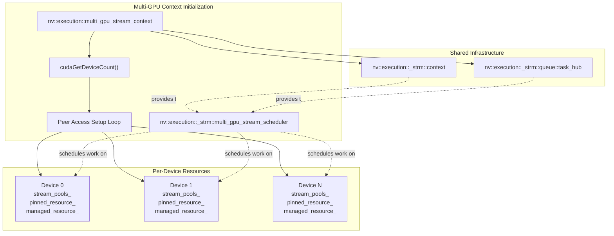
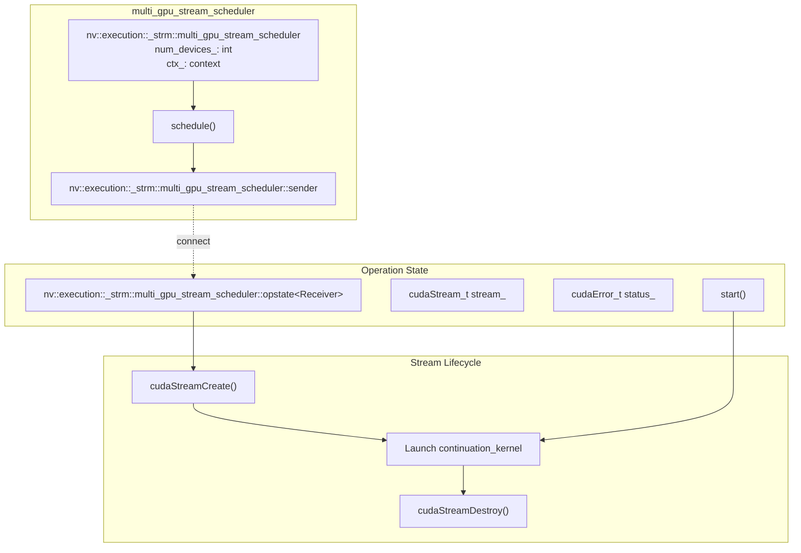
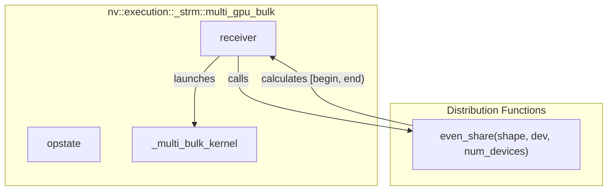

<!-- source: DeepWiki mcp.deepwiki.com · repo NVIDIA/stdexec · page 6.3 Multi-GPU Execution · fetched 2026-10-26 -->

# Multi-GPU Execution

<details>
<summary>Relevant source files</summary>

The following files were used as context for generating this wiki page:

- [include/nvexec/multi_gpu_context.cuh](include/nvexec/multi_gpu_context.cuh)
- [include/nvexec/stream/bulk.cuh](include/nvexec/stream/bulk.cuh)
- [include/nvexec/stream/let_xxx.cuh](include/nvexec/stream/let_xxx.cuh)
- [include/nvexec/stream/reduce.cuh](include/nvexec/stream/reduce.cuh)
- [include/nvexec/stream/schedule_from.cuh](include/nvexec/stream/schedule_from.cuh)
- [include/nvexec/stream/then.cuh](include/nvexec/stream/then.cuh)
- [include/nvexec/stream/upon_error.cuh](include/nvexec/stream/upon_error.cuh)
- [include/nvexec/stream/upon_stopped.cuh](include/nvexec/stream/upon_stopped.cuh)
- [include/nvexec/stream_context.cuh](include/nvexec/stream_context.cuh)

</details>


## Purpose and Scope

This document describes nvexec's multi-GPU execution capabilities, which enable sender graphs to execute work across multiple CUDA devices. The `multi_gpu_stream_context` automatically configures peer access between GPUs and provides a scheduler that coordinates execution across devices. It leverages specialized work distribution logic, such as `even_share`, to partition parallel tasks.

For single-GPU execution, see [Stream Context and Schedulers](6.1). For details on synchronization mechanisms used in multi-GPU scenarios, see [Stream Synchronization Patterns](6.4).

## Multi-GPU Stream Context Architecture

The `multi_gpu_stream_context` class manages resources and configuration for multi-GPU execution. It extends the logic of the single-GPU `stream_context` by enumerating available devices and establishing peer access relationships.

**Architecture Diagram**


Sources: [include/nvexec/multi_gpu_context.cuh:167-224]()

### Context Construction and Initialization

The `multi_gpu_stream_context` constructor performs the following initialization sequence:

| Step | Operation | CUDA API / Code Entity |
|------|-----------|----------|
| 1 | Retrieve current device | `cudaGetDevice(&dev_id_)` [include/nvexec/multi_gpu_context.cuh:170-171]() |
| 2 | Enumerate all devices | `cudaGetDeviceCount(&num_devices_)` [include/nvexec/multi_gpu_context.cuh:174]() |
| 3 | Configure peer access | `cudaDeviceCanAccessPeer()`, `cudaDeviceEnablePeerAccess()` [include/nvexec/multi_gpu_context.cuh:179-191]() |
| 4 | Initialize task hub | `_strm::queue::task_hub` [include/nvexec/multi_gpu_context.cuh:172]() |
| 5 | Allocate memory resources | `resource_storage` for pinned/managed memory [include/nvexec/multi_gpu_context.cuh:218-219]() |

Sources: [include/nvexec/multi_gpu_context.cuh:169-194]()

### Peer Access Configuration

The context establishes peer-to-peer memory access between all capable device pairs. This enables direct device-to-device memory transfers and remote memory access without host involvement.

```cpp
for (int dev_id = 0; dev_id < num_devices_; dev_id++)
{
  cudaSetDevice(dev_id);
  for (int peer_id = 0; peer_id < num_devices_; peer_id++)
  {
    if (peer_id != dev_id)
    {
      int can_access{};
      cudaDeviceCanAccessPeer(&can_access, dev_id, peer_id);

      if (can_access)
      {
        cudaDeviceEnablePeerAccess(peer_id, 0);
      }
    }
  }
}
```
Sources: [include/nvexec/multi_gpu_context.cuh:176-192]()

## Multi-GPU Stream Scheduler

The `multi_gpu_stream_scheduler` coordinates execution across multiple devices. Unlike the standard `stream_scheduler`, it manages a `num_devices_` count and uses a specialized `sender` to distribute work.

**Scheduler Components**


Sources: [include/nvexec/multi_gpu_context.cuh:32-154]()

### Scheduler Creation

The scheduler is obtained from the context via `get_scheduler`. It stores the number of devices and the shared context containing memory resources and the task hub.

Sources: [include/nvexec/multi_gpu_context.cuh:197-206]()

### Stream Management

Each operation state created by connecting a sender from `multi_gpu_stream_scheduler::schedule()` creates its own dedicated stream.

| Lifecycle Phase | Operation | Location |
|----------------|-----------|----------|
| Construction | `cudaStreamCreate(&stream_)` | [include/nvexec/multi_gpu_context.cuh:59]() |
| Execution | `continuation_kernel` launch on `stream_` | [include/nvexec/multi_gpu_context.cuh:90-96]() |
| Destruction | `cudaStreamDestroy(stream_)` | [include/nvexec/multi_gpu_context.cuh:64]() |

Sources: [include/nvexec/multi_gpu_context.cuh:53-107]()

## Work Distribution with Bulk Operations

The `multi_gpu_stream_scheduler` integrates with the `bulk` algorithm to automatically partition work across multiple GPUs using the `even_share` logic.

### Even Share Partitioning

When a `bulk` operation is performed on a multi-GPU scheduler, nvexec utilizes an `even_share` partitioning strategy. This divides the total iteration `shape` into contiguous chunks for each device.

**Multi-GPU Bulk Logic Space**


Sources: [include/nvexec/stream/bulk.cuh:162-215]()

The partitioning logic in `nv::execution::_strm::multi_gpu_bulk::receiver::set_value` ensures that:
1. Each device `dev` receives a range `[begin, end)` calculated via `even_share` [include/nvexec/stream/bulk.cuh:206]().
2. Iterations are distributed as evenly as possible across `num_devices_`.
3. If the current device is not the target device, the operation uses the stream associated with that device `opstate_.streams_[dev]` to launch the `_multi_bulk_kernel` [include/nvexec/stream/bulk.cuh:205-212]().

## Resource Sharing and Memory Considerations

### Shared Resources

The `multi_gpu_stream_context` shares certain resources across all devices to facilitate coordination:

| Resource | Type | Purpose |
|----------|------|---------|
| `pinned_resource_` | `_strm::pinned_resource` | Host-pinned memory allocator [include/nvexec/multi_gpu_context.cuh:218]() |
| `managed_resource_` | `_strm::managed_resource` | Unified memory allocator [include/nvexec/multi_gpu_context.cuh:219]() |
| `stream_pools_` | `_strm::stream_pools_t` | Managed pools of CUDA streams [include/nvexec/multi_gpu_context.cuh:220]() |
| `hub_` | `_strm::queue::task_hub` | Host poller thread for device-side enqueuing [include/nvexec/multi_gpu_context.cuh:223]() |

### Memory Accessibility

With peer access enabled via `cudaDeviceEnablePeerAccess` [include/nvexec/multi_gpu_context.cuh:188](), the following accessibility rules apply:
- **Managed memory** is accessible from all devices.
- **Peer device memory** can be accessed directly by kernels on other GPUs if `cudaDeviceCanAccessPeer` returns true [include/nvexec/multi_gpu_context.cuh:183]().
- **Pinned memory** is accessible from all devices.

## Integration with Standard Algorithms

The multi-GPU infrastructure supports the standard suite of stream-optimized adaptors through the `stream_domain` customization:

- **`then`**: Executes a function on a GPU stream [include/nvexec/stream/then.cuh:38-131]().
- **`bulk`**: Parallel iteration across one or more GPUs using `_bulk_kernel` or `_multi_bulk_kernel` [include/nvexec/stream/bulk.cuh:38-51, 164-175]().
- **`reduce`**: Performs reductions using CUB on the GPU [include/nvexec/stream/reduce.cuh:38-123]().
- **`let_value`**: Creates new sender chains on the GPU, using `_let_kernel` to construct the secondary sender on the device [include/nvexec/stream/let_xxx.cuh:39-45, 122-187]().

## Differences from Single-GPU Context

| Aspect | `stream_context` | `multi_gpu_stream_context` |
|--------|------------------|---------------------------|
| Device Management | Single active device | Multiple devices with peer access [include/nvexec/multi_gpu_context.cuh:174-192]() |
| Stream Management | Borrows from `stream_pools_t` | Dedicated `cudaStream_t` per opstate [include/nvexec/multi_gpu_context.cuh:59]() |
| Work Distribution | Single device | `even_share` partitioning in `bulk` [include/nvexec/stream/bulk.cuh:206]() |
| Scheduler Type | `stream_scheduler` | `multi_gpu_stream_scheduler` [include/nvexec/multi_gpu_context.cuh:32]() |

Sources: [include/nvexec/stream_context.cuh:168-198](), [include/nvexec/multi_gpu_context.cuh:167-224]()

---

