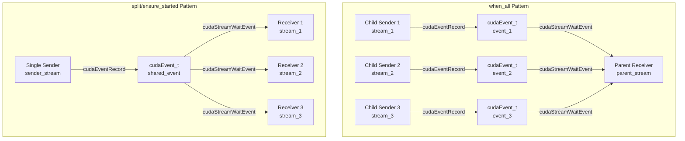
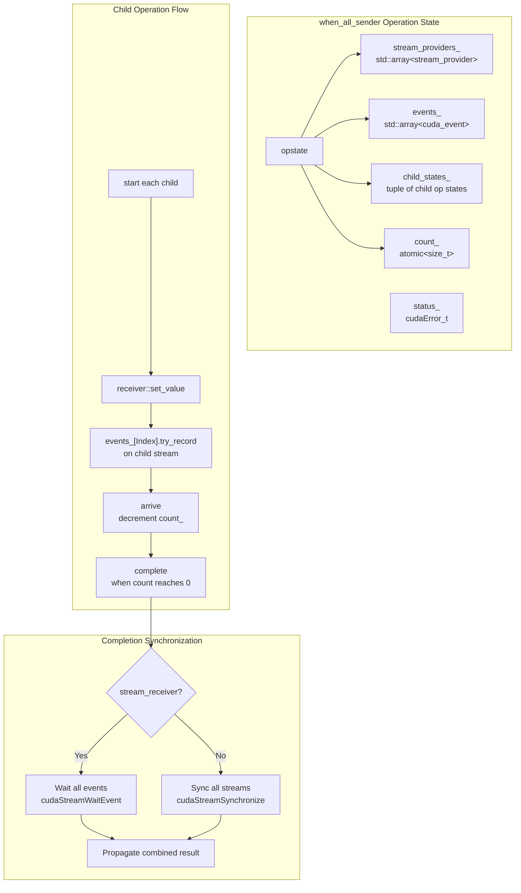
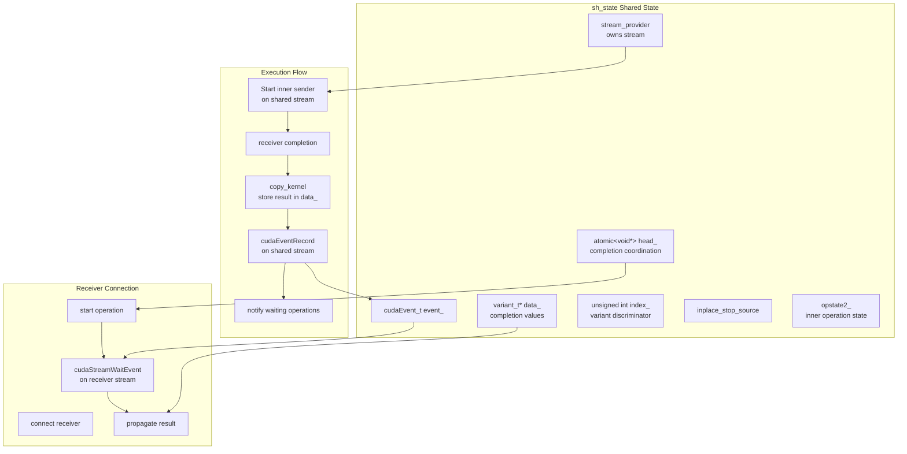

<!-- source: DeepWiki mcp.deepwiki.com · repo NVIDIA/stdexec · page 6.4 Stream Synchronization Patterns · fetched 2026-10-26 -->

# Stream Synchronization Patterns

<details>
<summary>Relevant source files</summary>

The following files were used as context for generating this wiki page:

- [.vscode/launch.json](.vscode/launch.json)
- [examples/nvexec/maxwell/snr.cuh](examples/nvexec/maxwell/snr.cuh)
- [include/nvexec/README.md](include/nvexec/README.md)
- [include/nvexec/stream/common.cuh](include/nvexec/stream/common.cuh)
- [include/nvexec/stream/ensure_started.cuh](include/nvexec/stream/ensure_started.cuh)
- [include/nvexec/stream/split.cuh](include/nvexec/stream/split.cuh)
- [include/nvexec/stream/when_all.cuh](include/nvexec/stream/when_all.cuh)
- [test/nvexec/bulk.cpp](test/nvexec/bulk.cpp)
- [test/nvexec/common.cuh](test/nvexec/common.cuh)
- [test/nvexec/ensure_started.cpp](test/nvexec/ensure_started.cpp)
- [test/nvexec/split.cpp](test/nvexec/split.cpp)
- [test/nvexec/then.cpp](test/nvexec/then.cpp)
- [test/nvexec/transfer.cpp](test/nvexec/transfer.cpp)
- [test/nvexec/transfer_when_all.cpp](test/nvexec/transfer_when_all.cpp)
- [test/nvexec/when_all.cpp](test/nvexec/when_all.cpp)

</details>


## Purpose and Scope

This document explains how `nvexec` implements stream synchronization for concurrent and shared sender operations using CUDA events. It covers the GPU-specific implementations of `when_all`, `split`, and `ensure_started` that coordinate work across multiple CUDA streams without unnecessary CPU blocking.

For basic stream execution concepts, see [Stream Context and Schedulers](6.1). For sender adaptors that transform stream work, see [Stream Domain and Sender Adaptors](6.2).

## Overview

In GPU execution, multiple operations may run on different CUDA streams. Synchronizing these streams efficiently is critical for performance. `nvexec` implements three key synchronization patterns:

| Pattern | Purpose | Synchronization Method |
|---------|---------|------------------------|
| `when_all` | Wait for multiple child senders to complete, each on its own stream | CUDA events recorded per child stream, waited on parent stream |
| `split` | Share a single sender's result with multiple receivers | Single CUDA event recorded on sender stream, waited by each receiver stream |
| `ensure_started` | Eagerly start a sender and share its result | Single CUDA event recorded on sender stream, waited by each receiver stream |

**Stream Synchronization Patterns**



Sources: [include/nvexec/stream/when_all.cuh:122-124](), [include/nvexec/stream/split.cuh:150-151](), [include/nvexec/stream/ensure_started.cuh:148-149]()

## CUDA Event-Based Synchronization

`nvexec` uses CUDA events (`cudaEvent_t`) to coordinate between streams without blocking the CPU. The fundamental pattern is:

1. **Record**: When work completes on a stream, record a CUDA event via `cudaEventRecord(event, stream)` [include/nvexec/stream/split.cuh:85-86]().
2. **Wait**: Make another stream wait for that event via `cudaStreamWaitEvent(stream, event, 0)` [include/nvexec/stream/split.cuh:260-262]().

This allows asynchronous stream ordering: the waiting stream will pause GPU-side until the event is recorded, but the CPU thread continues immediately.

**Receiver Type Dispatch**

Operations must handle two receiver types differently:

| Receiver Type | Identification | Synchronization Strategy |
|---------------|----------------|--------------------------|
| `stream_receiver` | Inherits from `stream_receiver_base` | Use CUDA events for async stream synchronization |
| Non-stream receiver | Does not inherit `stream_receiver_base` | Use `cudaStreamSynchronize` to block CPU until stream completes |

Sources: [include/nvexec/stream/common.cuh:251-254](), [include/nvexec/stream/when_all.cuh:109-119]()

## when_all Implementation

The `when_all_sender` template coordinates multiple child senders, each executing on its own stream, and combines their results.

**when_all Key Components**



Sources: [include/nvexec/stream/when_all.cuh:238-479]()

### Stream Provider Management

Each child sender gets its own `stream_provider` to ensure independent streams:

- **Array Creation**: [include/nvexec/stream/when_all.cuh:338-349]() - `get_stream_providers` creates an array of stream providers by querying each child sender's completion scheduler.
- **Individual Streams**: Each element in `stream_providers_` manages its own CUDA stream, borrowed from the scheduler's stream pool.

### Event Recording per Child

When a child completes with `set_value`:

1. **Copy Values**: [include/nvexec/stream/when_all.cuh:63-67](), [include/nvexec/stream/when_all.cuh:408-412]() - `copy_kernel` transfers completion values to managed memory.
2. **Record Event**: [include/nvexec/stream/when_all.cuh:416]() - `events_[Index].try_record(stream)` captures the completion moment on the child's stream.
3. **Arrive at Barrier**: [include/nvexec/stream/when_all.cuh:421]() - Decrement atomic counter.

### Completion and Synchronization

When all children arrive at the barrier:

**For stream receivers** [include/nvexec/stream/when_all.cuh:292-301]():
The parent stream waits for all child events asynchronously using `cudaStreamWaitEvent`.

**For non-stream receivers** [include/nvexec/stream/when_all.cuh:303-305]():
Each child stream is synchronized with `cudaStreamSynchronize` via the `_sync_op` helper [include/nvexec/stream/when_all.cuh:109-119]().

Sources: [include/nvexec/stream/when_all.cuh:272-336]()

## split and ensure_started Implementation

Both `split` and `ensure_started` share a similar pattern: execute a sender once and distribute its result to multiple receivers using a shared event.

**split/ensure_started Architecture**



Sources: [include/nvexec/stream/split.cuh:150-224](), [include/nvexec/stream/ensure_started.cuh:148-227]()

### Shared State Components

The `sh_state` template manages the shared resources:

- **Stream Provider**: [include/nvexec/stream/split.cuh:164](), [include/nvexec/stream/ensure_started.cuh:168]() - Single stream provider for the inner sender.
- **CUDA Event**: [include/nvexec/stream/split.cuh:170-171](), [include/nvexec/stream/ensure_started.cuh:175-176]() - Created and recorded when inner sender completes.
- **Result Storage**: [include/nvexec/stream/split.cuh:165](), [include/nvexec/stream/ensure_started.cuh:169]() - `variant_t* data_` holds completion values in managed memory via `malloc_managed`.
- **Atomic Head**: [include/nvexec/stream/split.cuh:219](), [include/nvexec/stream/ensure_started.cuh:159]() - Coordinates notification of waiting receivers.

### Event Recording Pattern

When the inner sender completes, `receiver::set_result` (or `_set_result`) records the event:

**For stream senders** [include/nvexec/stream/split.cuh:79-87]():
```cpp
if constexpr (stream_sender<Sender, env_t>) {
  cudaStream_t stream = sh_state_.opstate2_.get_stream();
  sh_state_.index_    = __mapply<__mfind_i<tuple_t>, variant_t>::value;
  copy_kernel<Tag, Args&&...>
    <<<1, 1, 0, stream>>>(sh_state_.data_, static_cast<Args&&>(args)...);
  sh_state_.stream_provider_.status_ = STDEXEC_LOG_CUDA_API(
    cudaEventRecord(sh_state_.event_, stream));
}
```

The same pattern exists in `ensure_started`: [include/nvexec/stream/ensure_started.cuh:79-87]().

### Event Waiting Pattern

Each receiver operation waits for the shared event on its own stream:

**split** [include/nvexec/stream/split.cuh:260-262]():
```cpp
status = STDEXEC_LOG_CUDA_API(
  cudaStreamWaitEvent(op->get_stream(), op->shared_state_.event_, 0));
```

**ensure_started** [include/nvexec/stream/ensure_started.cuh:274-275]():
```cpp
status = STDEXEC_LOG_CUDA_API(
  cudaStreamWaitEvent(op->get_stream(), op->shared_state_->event_, 0));
```

This allows multiple receivers to independently wait for the same completion event without synchronizing with each other on the CPU.

### split vs ensure_started Differences

| Aspect | `split` | `ensure_started` |
|--------|-------|----------------|
| **Start Timing** | Lazy - starts when first receiver starts [include/nvexec/stream/split.cuh:301-312]() | Eager - starts immediately in constructor [include/nvexec/stream/ensure_started.cuh:179-197]() |
| **Receiver Coordination** | Uses intrusive linked list via `opstate_base::next_` [include/nvexec/stream/split.cuh:128]() | Uses `__enable_intrusive_from_this` and reference counting [include/nvexec/stream/ensure_started.cuh:149]() |
| **Shared State Lifetime** | Lives until all receivers complete | Reference counted; lives until last receiver or destruction |

Sources: [include/nvexec/stream/split.cuh:227-315](), [include/nvexec/stream/ensure_started.cuh:229-325]()

## Memory Management for Completion Values

All three patterns store completion values in CUDA managed memory:

- **Allocation**: [include/nvexec/stream/split.cuh:133-148](), [include/nvexec/stream/ensure_started.cuh:130-146]() - `malloc_managed` allocates variant storage.
- **Copy Kernel**: [include/nvexec/stream/when_all.cuh:63-67](), [include/nvexec/stream/split.cuh:57-62]() - Transfers values on GPU via `copy_kernel`.
- **Deallocation**: [include/nvexec/stream/split.cuh:203](), [include/nvexec/stream/ensure_started.cuh:212]() - `cudaFree` in destructors.

The `variant_storage_t` type is computed from the sender's completion signatures to hold any possible result.

Sources: [include/nvexec/stream/split.cuh:153](), [include/nvexec/stream/ensure_started.cuh:151]()

## Stream Receiver Detection

Operations use compile-time dispatch to determine synchronization strategy:

**stream_receiver_base Marker** [include/nvexec/stream/common.cuh:251-254]():
```cpp
struct stream_receiver_base {
  using receiver_concept = STDEXEC::receiver_tag;
};
```

Operations check for this base class or related concepts at compile time to select between event-based and synchronous completion:

[include/nvexec/stream/when_all.cuh:292]():
```cpp
if constexpr (stream_receiver<Receiver>) {
  // Use events
} else {
  // Synchronize streams
}
```

Sources: [include/nvexec/stream/common.cuh:251-254](), [include/nvexec/stream/when_all.cuh:206-207]()

## Error Handling

All synchronization patterns propagate CUDA errors:

- **Event Creation Errors**: Checked during state construction [include/nvexec/stream/split.cuh:170-171](), [include/nvexec/stream/ensure_started.cuh:175-177]().
- **Event Record Errors**: Stored in `status_` or `stream_provider_.status_` [include/nvexec/stream/when_all.cuh:416](), [include/nvexec/stream/split.cuh:85-86]().
- **Event Wait Errors**: Checked before propagating completion [include/nvexec/stream/when_all.cuh:292-301](), [include/nvexec/stream/split.cuh:261-262]().
- **Error Propagation**: If any CUDA operation fails, the error is propagated via `set_error(cudaError_t)` [include/nvexec/stream/when_all.cuh:334](), [include/nvexec/stream/split.cuh:276]().

Sources: [include/nvexec/stream/when_all.cuh:283-335](), [include/nvexec/stream/split.cuh:258-277](), [include/nvexec/stream/ensure_started.cuh:270-290]()

## Transform Sender Integration

All three patterns integrate with the `stream_domain` via `transform_sender_for` specializations:

**when_all** [include/nvexec/stream/when_all.cuh:505-517]():
- Intercepts `STDEXEC::when_all_t` for `stream_completing_sender` arguments.
- Creates `when_all_sender` with GPU-specific synchronization.

**transfer_when_all** [include/nvexec/stream/when_all.cuh:520-532]():
- Intercepts `STDEXEC::transfer_when_all_t` with `gpu_stream_scheduler`.
- Passes scheduler's context to the operation.

**split** [include/nvexec/stream/split.cuh:363-375]():
- Intercepts `split_t` for `stream_completing_sender` argument.
- Extracts context from sender's completion scheduler.

**ensure_started** [include/nvexec/stream/ensure_started.cuh:388-400]():
- Intercepts `ensure_started_t` for `stream_completing_sender` argument.
- Extracts context from sender's completion scheduler.

Sources: [include/nvexec/stream/when_all.cuh:505-532](), [include/nvexec/stream/split.cuh:363-375](), [include/nvexec/stream/ensure_started.cuh:388-400]()

---

