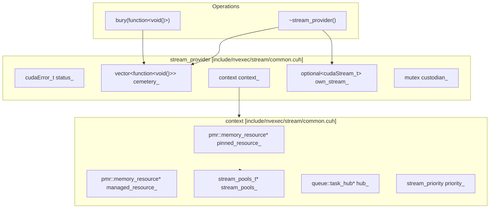
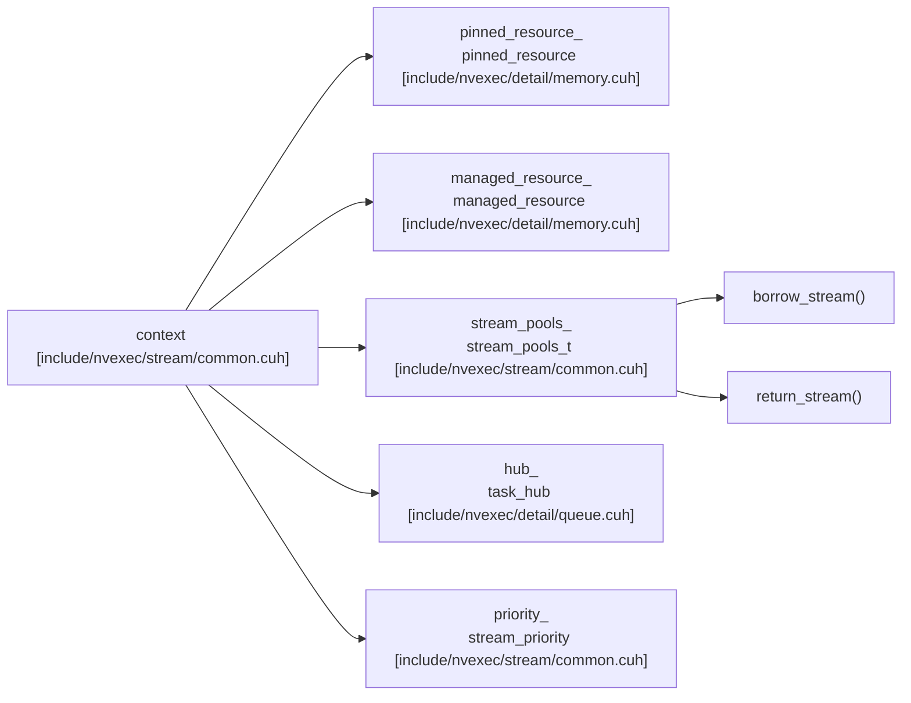
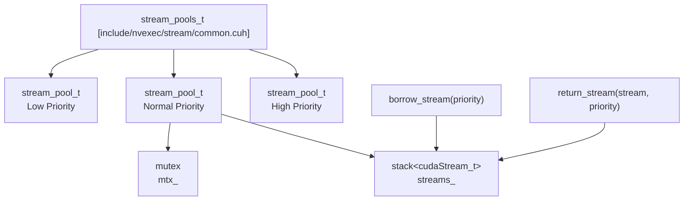
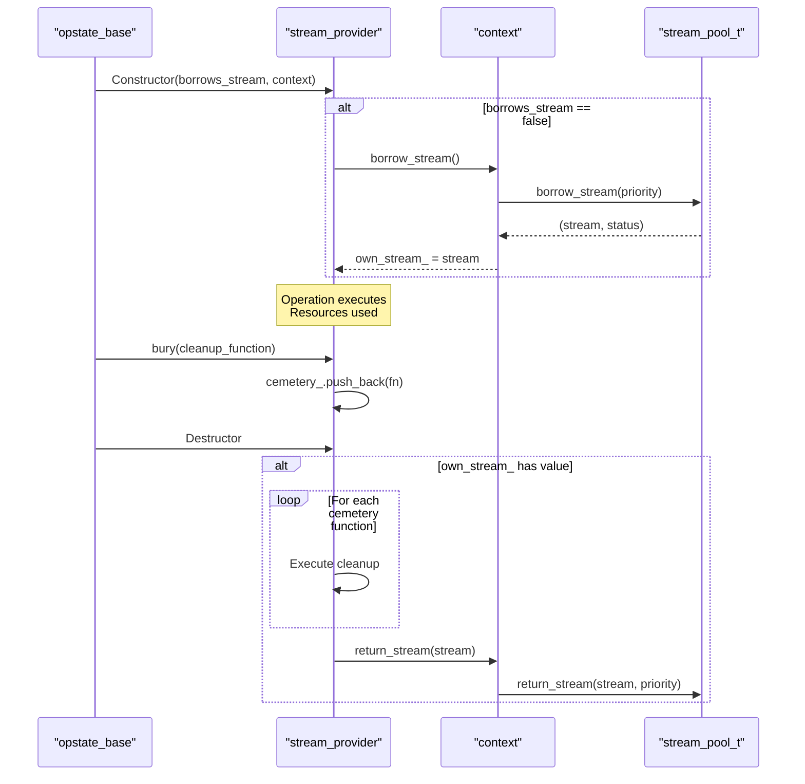
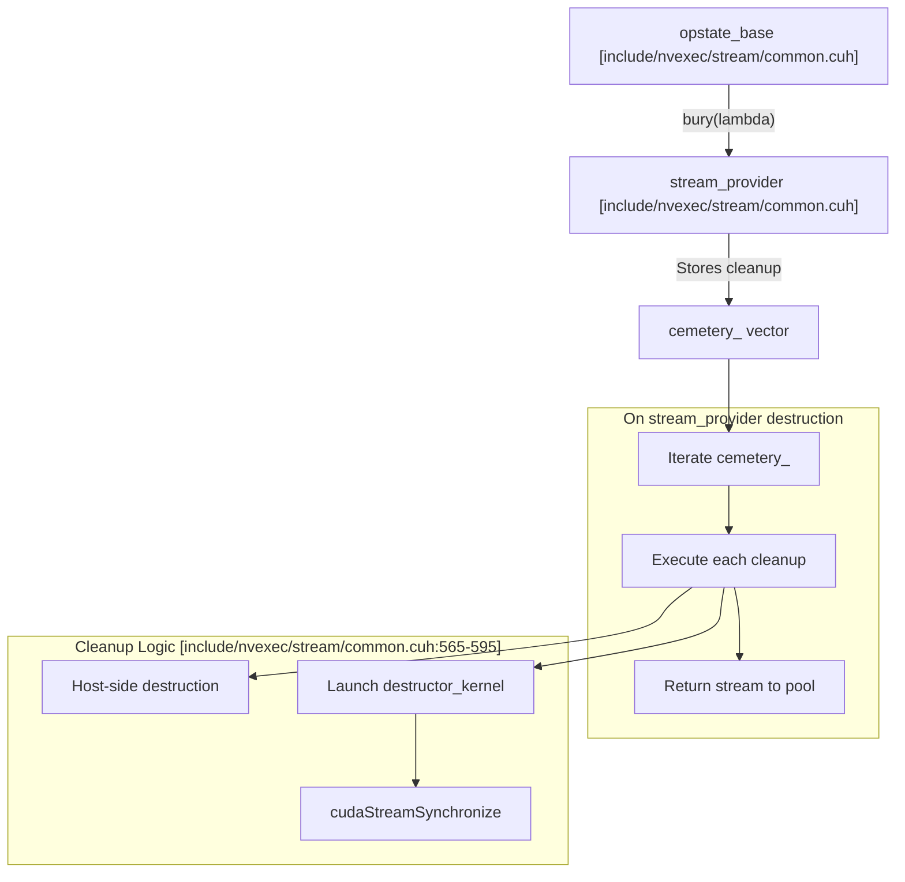
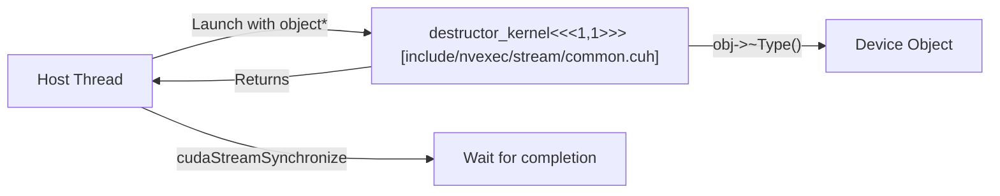
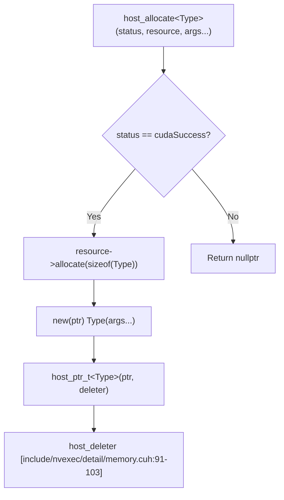
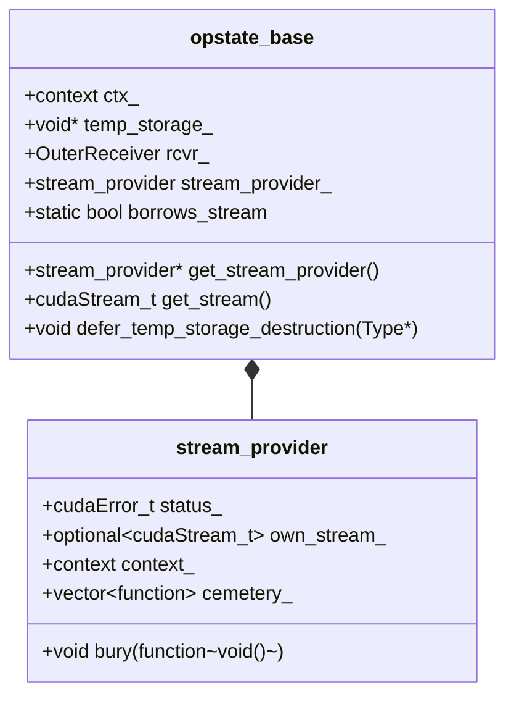

<!-- source: DeepWiki mcp.deepwiki.com · repo NVIDIA/stdexec · page 6.5 Memory Management and Stream Providers · fetched 2026-10-26 -->

# Memory Management and Stream Providers

Relevant source files

The following files were used as context for generating this wiki page:

- [examples/nvexec/maxwell/snr.cuh](examples/nvexec/maxwell/snr.cuh)
- [include/nvexec/detail/config.cuh](include/nvexec/detail/config.cuh)
- [include/nvexec/detail/memory.cuh](include/nvexec/detail/memory.cuh)
- [include/nvexec/detail/variant.cuh](include/nvexec/detail/variant.cuh)
- [include/nvexec/stream/common.cuh](include/nvexec/stream/common.cuh)
- [include/nvexec/stream/ensure_started.cuh](include/nvexec/stream/ensure_started.cuh)
- [include/nvexec/stream/split.cuh](include/nvexec/stream/split.cuh)
- [include/nvexec/stream/when_all.cuh](include/nvexec/stream/when_all.cuh)
- [test/nvexec/start_detached.cpp](test/nvexec/start_detached.cpp)
- [test/nvexec/tracer_resource.h](test/nvexec/tracer_resource.h)
- [test/nvexec/variant.cpp](test/nvexec/variant.cpp)

This page documents the memory management infrastructure and stream provider system in nvexec's GPU execution model. It covers how CUDA streams are managed, memory resources are allocated, and how the "cemetery" mechanism enables safe deferred destruction of GPU resources.

For information about stream contexts and schedulers that create stream providers, see [Stream Context and Schedulers](#6.1). For details on how stream providers are used in specific algorithms, see [Stream Domain and Sender Adaptors](#6.2) and [Stream Synchronization Patterns](#6.4).

## Overview

The nvexec memory management system addresses several key challenges in GPU asynchronous execution:

1.  **Stream Lifecycle Management**: CUDA streams must be borrowed from pools and returned after use.
2.  **Deferred Resource Cleanup**: GPU resources (e.g., temporary allocations) may need destruction after kernels complete.
3.  **Memory Resource Abstraction**: Different memory types (pinned, managed, device) require different allocation strategies.
4.  **Operation State Integration**: Stream providers must integrate seamlessly with sender operation states to manage their execution environment.

The core abstraction is the `stream_provider` class, which manages stream ownership and defers cleanup operations until the stream is returned to its pool.

Sources: [include/nvexec/stream/common.cuh:268-309](), [include/nvexec/detail/memory.cuh:36-250]()

## Core Architecture

### Stream Provider

The `stream_provider` class is the central component for managing CUDA stream ownership and deferred cleanup. It is defined within the `nv::execution::_strm` namespace.

Title: Stream Provider Internal Structure

**Key Components:**

| Field | Type | Purpose |
| :--- | :--- | :--- |
| `status_` | `cudaError_t` | Tracks cumulative error status of stream operations [include/nvexec/stream/common.cuh:269](). |
| `own_stream_` | `std::optional<cudaStream_t>` | The CUDA stream managed by this provider [include/nvexec/stream/common.cuh:270](). |
| `context_` | `context` | Access to memory resources and stream pools [include/nvexec/stream/common.cuh:271](). |
| `cemetery_` | `std::vector<std::function<void()>>` | Deferred cleanup operations (the "cemetery") [include/nvexec/stream/common.cuh:272](). |
| `custodian_` | `std::mutex` | Protects cemetery access for thread-safe burials [include/nvexec/stream/common.cuh:273](). |

**Ownership Model:**
- If `own_stream_` has a value, the provider owns the stream and will return it to the pool on destruction [include/nvexec/stream/common.cuh:302-308]().
- If `own_stream_` is empty, the provider is "borrowing" a stream from a parent operation state's provider [include/nvexec/stream/common.cuh:276-282]().

Sources: [include/nvexec/stream/common.cuh:268-309]()

### Context Structure

The `context` struct aggregates resources needed for GPU execution and is passed through the sender/receiver graph.

Title: Resource Context and Memory Providers

| Resource | Implementation | Purpose |
| :--- | :--- | :--- |
| `pinned_resource_` | `nv::execution::_strm::pinned_resource` | Allocates host-pinned memory via `cudaMallocHost` [include/nvexec/detail/memory.cuh:146-175](). |
| `managed_resource_` | `nv::execution::_strm::managed_resource` | Allocates CUDA unified memory via `cudaMallocManaged` [include/nvexec/detail/memory.cuh:207-234](). |
| `stream_pools_` | `nv::execution::_strm::stream_pools_t` | Provides thread-safe stream borrowing/returning functionality [include/nvexec/stream/common.cuh:225-261](). |
| `hub_` | `nv::execution::queue::task_hub` | Task hub for device-side work enqueueing (see [Task Hub and Device-Side Queuing](#6.6)). |
| `priority_` | `stream_priority` | Default stream priority for borrowed streams [include/nvexec/stream/common.cuh:43-48](). |

Sources: [include/nvexec/stream/common.cuh:201-261](), [include/nvexec/detail/memory.cuh:146-234]()

## Stream Pool Management

Stream pools enable efficient reuse of CUDA streams across operations to avoid the high cost of stream creation/destruction.

### Stream Pool Architecture

The `stream_pools_t` class contains three separate `stream_pool_t` instances, one for each priority level: `high`, `normal`, and `low`.

Title: Multi-Priority Stream Pools

**Stream Priority Mapping:**
Priority ranges are queried using `cudaDeviceGetStreamPriorityRange` [include/nvexec/stream/common.cuh:177-199]().

| Enum Value | CUDA Priority | Use Case |
| :--- | :--- | :--- |
| `stream_priority::high` | Greatest (lowest numeric value) | Time-critical kernels |
| `stream_priority::normal` | 0 | Default operations |
| `stream_priority::low` | Least (highest numeric value) | Background work |

**Borrowing Process:**
1.  Lock the pool's mutex `mtx_` [include/nvexec/stream/common.cuh:213]().
2.  If the `streams_` stack is empty, create a new stream with `cudaStreamCreateWithPriority` [include/nvexec/stream/common.cuh:221]().
3.  Otherwise, pop a stream from the stack [include/nvexec/stream/common.cuh:230]().
4.  Return the stream handle and error status.

Sources: [include/nvexec/stream/common.cuh:177-261]()

### Stream Provider Lifecycle

Title: Stream Provider Borrowing Sequence

Sources: [include/nvexec/stream/common.cuh:276-308]()

## Cemetery Mechanism

The cemetery mechanism enables safe deferred destruction of GPU resources that may still be in use by pending GPU operations when an operation state is destroyed.

### Deferred Destruction Pattern

When an operation state needs to destroy a resource (e.g., temporary device memory) but the stream may still have pending work, it "buries" a cleanup function in the `stream_provider`.

Title: The Cemetery Cleanup Mechanism

**Cleanup Decision Flow:**
The `defer_temp_storage_destruction` method determines whether to destroy resources on host or device [include/nvexec/stream/common.cuh:565-595]():
1.  Check if memory is prefetched to CPU using `cudaMemRangeGetAttribute` [include/nvexec/stream/common.cuh:576]().
2.  If CPU-accessible (`cudaCpuDeviceId`), the destructor is called directly on the host.
3.  Otherwise, it launches a `destructor_kernel` on the device [include/nvexec/stream/common.cuh:586]().
4.  The stream is synchronized before the underlying memory resource deallocates the memory.

Sources: [include/nvexec/stream/common.cuh:263-309](), [include/nvexec/stream/common.cuh:565-595]()

### Destructor Kernel

For device-resident objects with non-trivial destructors, nvexec uses a minimal kernel to invoke the destructor on the GPU.

Title: Device Destructor Kernel

The kernel is marked with `STDEXEC_ATTRIBUTE(launch_bounds(1))` to minimize resource usage [include/nvexec/stream/common.cuh:263-266]().

Sources: [include/nvexec/stream/common.cuh:263-266]()

## Memory Allocation Utilities

### Managed and Pinned Resources

nvexec provides PMR-compatible memory resources for different CUDA memory types:

| Resource Class | Allocation Function | File:Line |
| :--- | :--- | :--- |
| `pinned_resource` | `cudaMallocHost` | [include/nvexec/detail/memory.cuh:146-175]() |
| `gpu_resource` | `cudaMalloc` | [include/nvexec/detail/memory.cuh:177-205]() |
| `managed_resource` | `cudaMallocManaged` | [include/nvexec/detail/memory.cuh:207-234]() |

### Allocation Helpers

The `host_allocate` template is used to allocate host-side memory (often pinned) and construct an object, returning a `host_ptr_t` (a `unique_ptr` with a custom deleter) [include/nvexec/detail/memory.cuh:108-137]().

Title: Host/Pinned Allocation Flow

Similarly, `device_allocate` is used for trivial types to allocate device memory and copy data from host to device [include/nvexec/detail/memory.cuh:52-82](). In algorithms like `split` and `ensure_started`, `malloc_managed` is used to allocate `variant_storage_t` in managed memory [include/nvexec/stream/split.cuh:132-148]().

Sources: [include/nvexec/detail/memory.cuh:39-144](), [include/nvexec/stream/split.cuh:132-148]()

## Operation State Integration

Stream providers are integrated into the `opstate_base` class, which serves as a foundation for most nvexec stream-based algorithms.

### opstate_base

The `opstate_base` handles stream acquisition and environment propagation.

Title: Operation State and Stream Provider Association

**Stream Borrowing Logic:**
The `borrows_stream` constant is calculated at compile-time by checking if the receiver's environment already provides a stream via the `get_stream_provider_t` query [include/nvexec/stream/common.cuh:545-550]().

Sources: [include/nvexec/stream/common.cuh:533-627]()

### Environment Queries

The stream provider is made available to child senders through environment queries.

| Query | Function | Purpose |
| :--- | :--- | :--- |
| `get_stream_provider_t` | `get_stream_provider(env)` | Retrieves the pointer to the `stream_provider` [include/nvexec/stream/common.cuh:373-379](). |
| `get_stream_t` | `get_stream(env)` | Extracts the raw `cudaStream_t` from the provider [include/nvexec/stream/common.cuh:393-404](). |

Sources: [include/nvexec/stream/common.cuh:373-404]()

## Integration with Stream Algorithms

### Memory in split and ensure_started

The `split` and `ensure_started` adaptors use the `malloc_managed` utility to allocate shared state (`sh_state`) that holds a `variant_storage_t`. This allows results to be stored in memory accessible by both the producing stream and subsequent consuming streams [include/nvexec/stream/split.cuh:151-209](), [include/nvexec/stream/ensure_started.cuh:149-199]().

### Synchronous Coordination

In concurrent adaptors like `when_all`, stream synchronization is handled via `cudaStreamSynchronize` when an operation is forced to sync, or via `cudaEventRecord` to coordinate across multiple streams [include/nvexec/stream/when_all.cuh:109-119]().

Sources: [include/nvexec/stream/split.cuh:132-209](), [include/nvexec/stream/ensure_started.cuh:130-199](), [include/nvexec/stream/when_all.cuh:109-119]()

---

