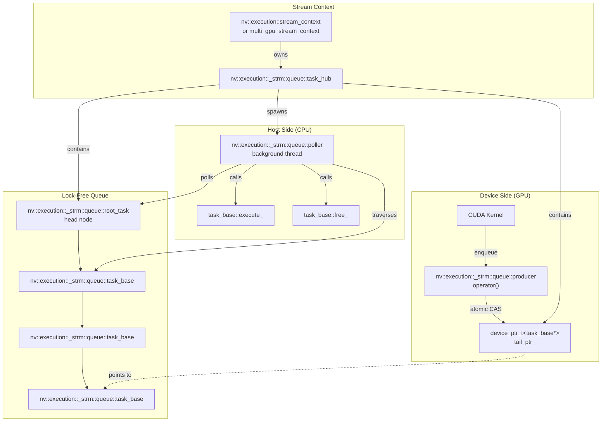
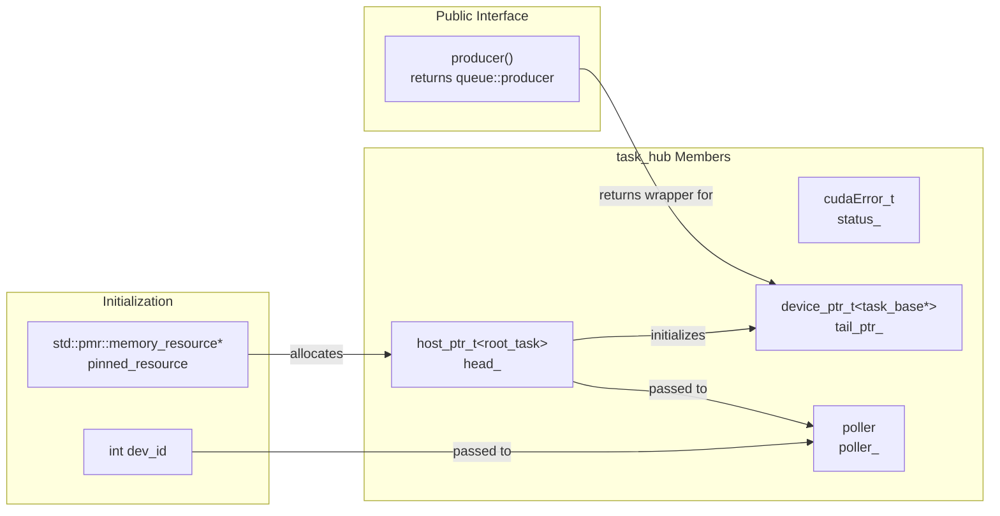
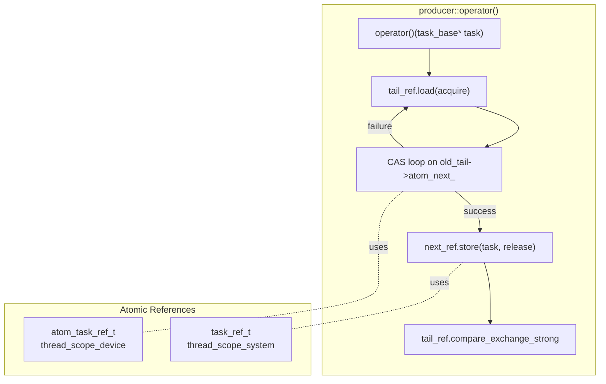
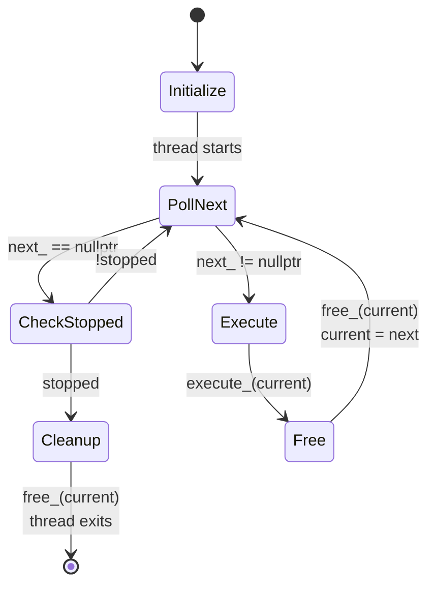
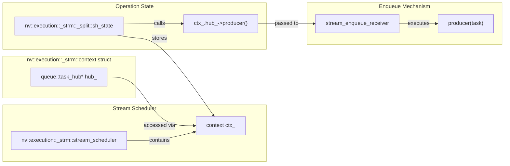

<!-- source: DeepWiki mcp.deepwiki.com · repo NVIDIA/stdexec · page 6.6 Task Hub and Device-Side Queuing · fetched 2026-10-26 -->

# Task Hub and Device-Side Queuing

Relevant source files

The following files were used as context for generating this wiki page:

- [examples/nvexec/maxwell/snr.cuh](examples/nvexec/maxwell/snr.cuh)
- [include/nvexec/detail/queue.cuh](include/nvexec/detail/queue.cuh)
- [include/nvexec/nvtx.cuh](include/nvexec/nvtx.cuh)
- [include/nvexec/stream/common.cuh](include/nvexec/stream/common.cuh)
- [include/nvexec/stream/ensure_started.cuh](include/nvexec/stream/ensure_started.cuh)
- [include/nvexec/stream/launch.cuh](include/nvexec/stream/launch.cuh)
- [include/nvexec/stream/split.cuh](include/nvexec/stream/split.cuh)
- [include/nvexec/stream/when_all.cuh](include/nvexec/stream/when_all.cuh)

## Purpose and Scope

This document describes the `task_hub` system in nvexec, which provides a mechanism for CUDA device code to enqueue work that will be executed on the host. The task hub implements a lock-free queue that bridges device-side execution with host-side operations, enabling efficient coordination between GPU kernels and CPU-side scheduling logic.

For information about stream contexts that contain task hubs, see [Stream Context and Schedulers](6.1). For details about GPU-specific algorithm implementations, see [Stream Domain and Sender Adaptors](6.2).

## Architecture Overview

The task hub uses a two-layer architecture:

1.  **Device-side Producer**: Atomic enqueue operations callable from CUDA kernels.
2.  **Host-side Poller**: Background thread that continuously polls and executes enqueued tasks.

This design allows device code to trigger host-side operations without blocking GPU execution or requiring explicit synchronization.

### System Architecture Diagram

**Sources**: [include/nvexec/detail/queue.cuh:30-157](), [include/nvexec/stream/common.cuh:201-250]()

## Core Components

### task_base Structure

The `task_base` structure is the fundamental unit of work in the task hub queue. Each task contains function pointers for execution and cleanup, along with queue linkage.

| Field | Type | Purpose |
| :--- | :--- | :--- |
| `next_` | `task_base*` | Host-visible pointer to next task in queue |
| `atom_next_` | `task_base**` | Device-visible atomic pointer for insertion |
| `execute_` | `fn_t*` | Function to execute the task |
| `free_` | `fn_t*` | Function to free task resources |

The dual pointer design (`next_` and `atom_next_`) enables atomic insertion from device code while maintaining efficient traversal on the host.

**Sources**: [include/nvexec/detail/queue.cuh:32-40]()

### task_hub Class

The `task_hub` class is the central component that manages the queue lifecycle. It is initialized within the `stream_context`.

The constructor initializes the queue with a `root_task` and launches the `poller` thread:
*   Allocates `root_task` in pinned memory using the provided memory resource [include/nvexec/detail/queue.cuh:147]().
*   Allocates device-visible tail pointer initialized to point to the root [include/nvexec/detail/queue.cuh:148]().
*   Spawns `poller` thread on the specified device [include/nvexec/detail/queue.cuh:149]().

**Sources**: [include/nvexec/detail/queue.cuh:139-156]()

### producer Component

The `producer` is a lightweight callable object that encapsulates the enqueue operation. It can be safely copied to device code and called from CUDA kernels.

The enqueue algorithm uses compare-and-swap (CAS) operations to atomically insert tasks at the tail of the queue:
1.  Load current tail pointer with acquire semantics [include/nvexec/detail/queue.cuh:53]().
2.  Attempt to CAS the tail's `atom_next_` pointer from null to the new task [include/nvexec/detail/queue.cuh:60-63]().
3.  On success, store the new task in `next_` with release semantics [include/nvexec/detail/queue.cuh:66]().
4.  Update the tail pointer to point to the new task [include/nvexec/detail/queue.cuh:73]().

**Sources**: [include/nvexec/detail/queue.cuh:45-75]()

### poller Thread

The `poller` spawns a background thread that continuously polls the queue for new tasks and executes them on the host.

The poller thread implementation:
*   Sets the CUDA device context to the specified device ID [include/nvexec/detail/queue.cuh:107]().
*   Continuously checks the current task's `next_` pointer using relaxed loads [include/nvexec/detail/queue.cuh:115]().
*   When `stopped_` flag is set and no more tasks are available, cleans up and exits [include/nvexec/detail/queue.cuh:117-121]().
*   Executes each task's `execute_` function, then calls `free_`, then advances [include/nvexec/detail/queue.cuh:124-127]().

**Sources**: [include/nvexec/detail/queue.cuh:95-137]()

### root_task

The `root_task` serves as the sentinel head node of the queue. It is never executed or removed, providing a stable insertion point.

Key characteristics:
*   `execute_` is a no-op function [include/nvexec/detail/queue.cuh:81-82]().
*   `free_` deallocates the device-visible `atom_next_` pointer [include/nvexec/detail/queue.cuh:83-86]().
*   `atom_next_` is allocated with `cudaMalloc` and initialized to null [include/nvexec/detail/queue.cuh:90-91]().
*   Acts as the initial value for the tail pointer [include/nvexec/detail/queue.cuh:148]().

**Sources**: [include/nvexec/detail/queue.cuh:77-93]()

## Lock-Free Queue Design

The task hub implements a lock-free single-producer, single-consumer (SPSC) queue with relaxed ordering guarantees suitable for GPU-to-host communication.

### Memory Ordering Strategy

| Operation | Memory Order | Scope | Purpose |
| :--- | :--- | :--- | :--- |
| `tail_ref.load()` | `memory_order_acquire` | `thread_scope_system` | Load tail pointer from device [include/nvexec/detail/queue.cuh:42,53]() |
| `atom_next_ref.compare_exchange_weak()` | `memory_order_relaxed` | `thread_scope_device` | Try to link new task [include/nvexec/detail/queue.cuh:43,60-63]() |
| `next_ref.store()` | `memory_order_release` | `thread_scope_system` | Publish task to host [include/nvexec/detail/queue.cuh:66]() |
| `tail_ref.compare_exchange_strong()` | Default | `thread_scope_system` | Update tail [include/nvexec/detail/queue.cuh:73]() |
| `next_ref.load()` | `memory_order_acquire` | `thread_scope_system` | Read next task on host [include/nvexec/detail/queue.cuh:124]() |

**Sources**: [include/nvexec/detail/queue.cuh:42-75](), [include/nvexec/detail/queue.cuh:113-124]()

## Usage in Stream Operations

### Enqueuing from Device Code

The `task_hub` is critical for algorithms that must transition from device-side completion back to host-side logic, such as `split` and `ensure_started`. These algorithms utilize `stream_enqueue_receiver` to interact with the hub.

In `split`, if the source is not a stream-sender, it connects the sender to an `enqueue_receiver_t` which takes the `task_hub::producer()` [include/nvexec/stream/split.cuh:187-188](). A similar pattern is found in `ensure_started` [include/nvexec/stream/ensure_started.cuh:194-195]().

### Producer Access Pattern

Stream operation states store the `context` which contains a pointer to the `task_hub`. They call `hub_->producer()` to obtain a `producer` instance.

**Sources**: [include/nvexec/stream/split.cuh:187-188](), [include/nvexec/stream/ensure_started.cuh:194-195](), [include/nvexec/detail/queue.cuh:152-155]()

## Memory Management

### Allocation Strategy

The task hub uses specific memory types for different components:

| Component | Memory Type | Allocation Method | Reason |
| :--- | :--- | :--- | :--- |
| `root_task` | Pinned Host | `host_allocate<root_task>()` | Fast host access, stable address [include/nvexec/detail/queue.cuh:147]() |
| `atom_next_` in root | Device | `cudaMalloc()` | Device-visible atomic pointer [include/nvexec/detail/queue.cuh:90]() |
| `tail_ptr_` | Device | `device_allocate<task_base*>()` | Device-side queue tail tracking [include/nvexec/detail/queue.cuh:148]() |

**Sources**: [include/nvexec/detail/queue.cuh:90-148]()

### Cleanup and Destruction

Destruction sequence:
1.  `poller` destructor sets the `stopped_` flag and joins the polling thread [include/nvexec/detail/queue.cuh:134-135]().
2.  Polling thread completes current task and calls its `free_` function before exiting [include/nvexec/detail/queue.cuh:119,125]().
3.  `task_hub` members (smart pointers) automatically free their respective memory.

**Sources**: [include/nvexec/detail/queue.cuh:119-137]()

---

