<!-- source: DeepWiki mcp.deepwiki.com · repo NVIDIA/stdexec · page 7.1 Async Scope and Structured Concurrency · fetched 2026-10-26 -->

# Async Scope and Structured Concurrency

<details>
<summary>Relevant source files</summary>

The following files were used as context for generating this wiki page:

- [docs/eelis_link_filter.pl](docs/eelis_link_filter.pl)
- [examples/scope.cpp](examples/scope.cpp)
- [include/exec/async_scope.hpp](include/exec/async_scope.hpp)
- [include/exec/env.hpp](include/exec/env.hpp)
- [include/exec/finally.hpp](include/exec/finally.hpp)
- [include/exec/materialize.hpp](include/exec/materialize.hpp)
- [include/exec/when_any.hpp](include/exec/when_any.hpp)
- [include/stdexec/__detail/__associate.hpp](include/stdexec/__detail/__associate.hpp)
- [include/stdexec/__detail/__counting_scopes.hpp](include/stdexec/__detail/__counting_scopes.hpp)
- [include/stdexec/__detail/__spawn.hpp](include/stdexec/__detail/__spawn.hpp)
- [include/stdexec/__detail/__spawn_common.hpp](include/stdexec/__detail/__spawn_common.hpp)
- [include/stdexec/__detail/__spawn_future.hpp](include/stdexec/__detail/__spawn_future.hpp)
- [include/stdexec/__detail/__stop_when.hpp](include/stdexec/__detail/__stop_when.hpp)
- [test/exec/async_scope/test_spawn.cpp](test/exec/async_scope/test_spawn.cpp)
- [test/exec/async_scope/test_spawn_future.cpp](test/exec/async_scope/test_spawn_future.cpp)
- [test/stdexec/algos/adaptors/test_let_error.cpp](test/stdexec/algos/adaptors/test_let_error.cpp)
- [test/stdexec/algos/adaptors/test_stop_when.cpp](test/stdexec/algos/adaptors/test_stop_when.cpp)
- [test/test_common/scope_helpers.hpp](test/test_common/scope_helpers.hpp)

</details>


## Purpose and Scope

This document describes `exec::async_scope`, a facility for structured concurrency that manages the lifetimes of asynchronous operations. The `async_scope` provides mechanisms to track spawned tasks, ensure proper cleanup, and coordinate cancellation across multiple concurrent operations.

For coroutine-based structured concurrency patterns, see [Coroutine Integration](#7.2). For sequence processing patterns, see [Sequence Senders](#7.3). For general environment manipulation that can affect task contexts, see [Environment Utilities](#7.5).

Sources: [include/exec/async_scope.hpp:33-788]()

## Overview

The `async_scope` class implements a container for managing the lifetimes of asynchronous operations. It provides four primary operations:

| Operation | Purpose | Returns Value | Use Case |
|-----------|---------|---------------|----------|
| `nest()` | Track a sender's lifetime within the scope | Sender | Structured task with parent-child relationship |
| `spawn()` | Launch fire-and-forget work | `void` | Background tasks with no result |
| `spawn_future()` | Launch work and get awaitable result | Sender (future) | Async work with deferred consumption |
| `when_empty()` | Wait for all nested operations to complete | Sender | Scope cleanup and synchronization barrier |

All operations propagate the scope's `inplace_stop_token`, enabling coordinated cancellation of all nested work when `request_stop()` is called on the scope.

Sources: [include/exec/async_scope.hpp:721-779]()

## Core Architecture

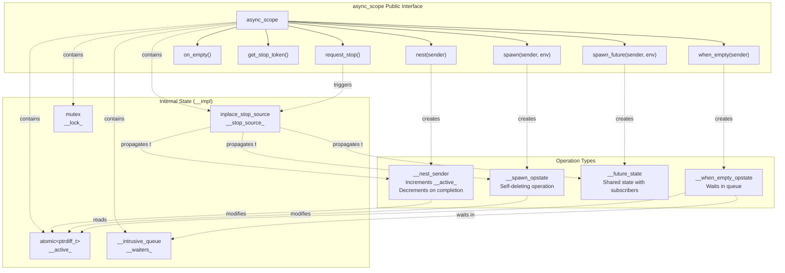

Sources: [include/exec/async_scope.hpp:33-69](), [include/exec/async_scope.hpp:721-779]()

## The async_scope Class

### Class Definition and Lifecycle

The `async_scope` class is defined as an immovable object that contains an internal implementation pointer.

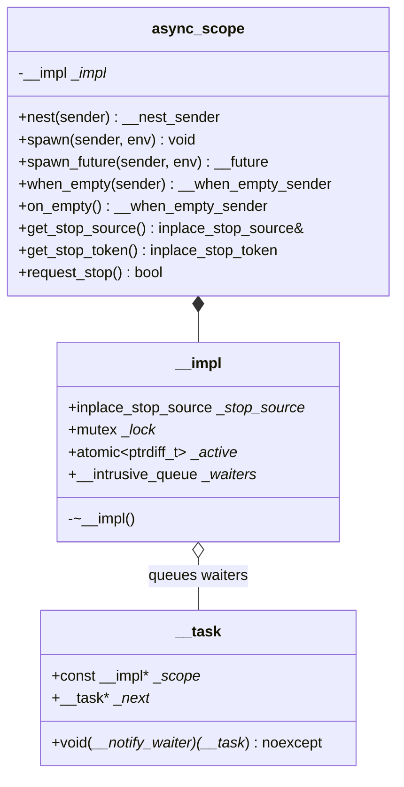

The destructor of `__impl` asserts that `__active_` is zero and `__waiters_` is empty, enforcing that all work must complete before scope destruction.

Sources: [include/exec/async_scope.hpp:46-69](), [include/exec/async_scope.hpp:721-779]()

## nest() Operation

The `nest()` operation wraps a sender to track its lifetime within the scope. It returns a `__nest_sender` that increments the active count when started and decrements it upon completion.

### nest() Execution Flow

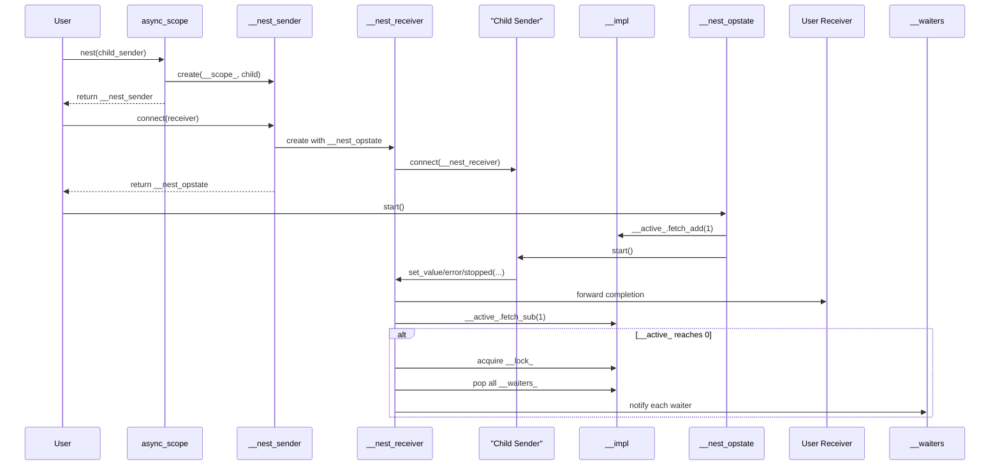

### Environment Transformation

The `__nest_receiver` modifies the environment to inject the scope's stop token:

| Original Environment | Transformed Environment |
|---------------------|-------------------------|
| User's receiver environment | `make_env(user_env, prop{get_stop_token, scope.__stop_source_.get_token()})` |

This allows nested senders to respond to scope-wide cancellation requests.

Sources: [include/exec/async_scope.hpp:145-236](), [include/exec/async_scope.hpp:737-741]()

### nest() Completion Semantics

The `__nest_receiver` intercepts all three completion channels:

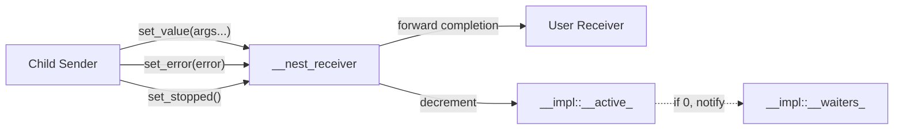

The critical section at [include/exec/async_scope.hpp:160-175]() ensures atomic decrement and waiter notification.

Sources: [include/exec/async_scope.hpp:154-204]()

## spawn() Operation

The `spawn()` operation launches fire-and-forget work. Unlike `nest()`, it does not return a sender for tracking—the operation manages its own lifetime through a self-deleting operation state.

### spawn() Architecture

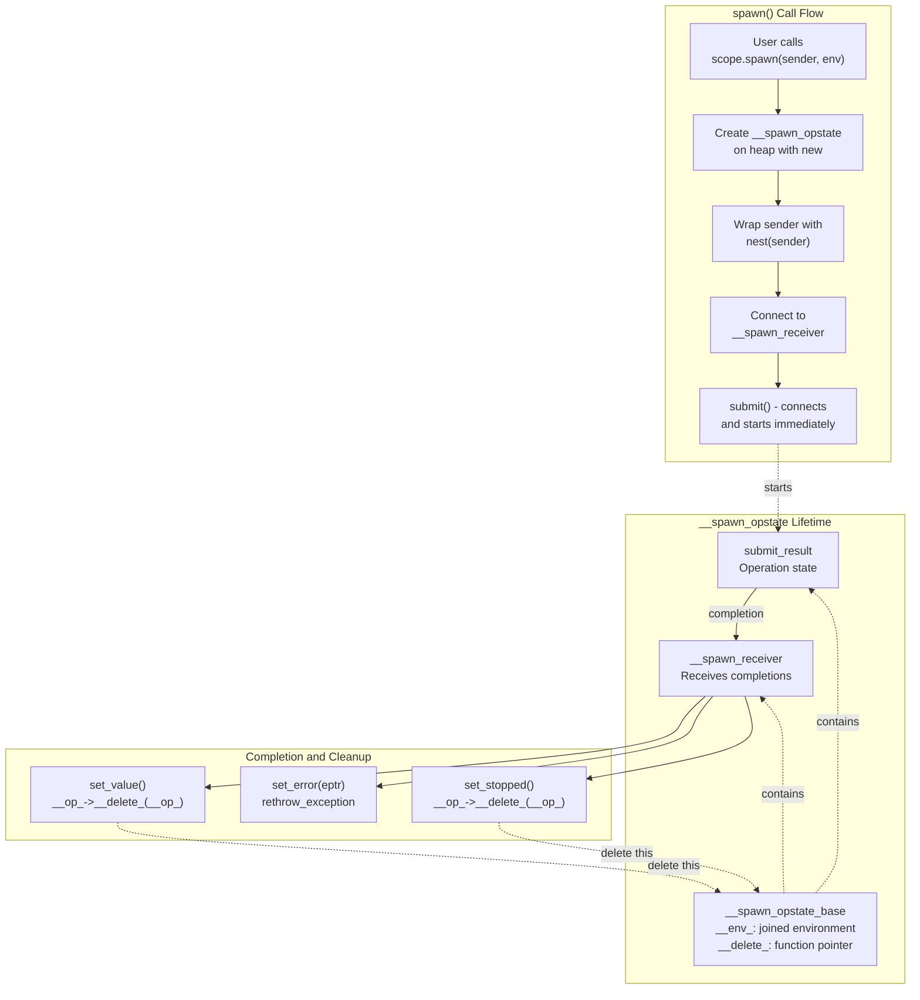

Sources: [include/exec/async_scope.hpp:640-717](), [include/exec/async_scope.hpp:743-752]()

### spawn() Environment

The `spawn()` operation creates a specialized environment by joining the user-provided environment with a `__spawn_env`:

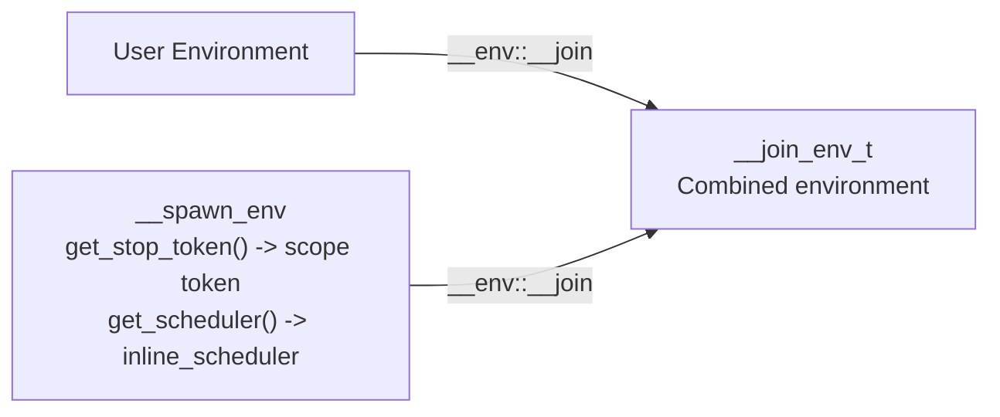

The `inline_scheduler` ensures that continuations run immediately rather than being deferred.

Sources: [include/exec/async_scope.hpp:640-652](), [include/exec/async_scope.hpp:696-699]()

### spawn() Error Handling

The `__spawn_receiver::set_error` at [include/exec/async_scope.hpp:672-675]() is marked `[[noreturn]]` and calls `std::rethrow_exception`. This means spawned senders **must not fail**—any error terminates the program. The comment indicates this is not to spec and is a known limitation.

Sources: [include/exec/async_scope.hpp:667-679]()

## spawn_future() Operation

The `spawn_future()` operation launches work and returns a `__future` sender that can be awaited to retrieve the result. Multiple receivers can connect to the same future, and the work begins immediately upon construction.

### spawn_future() State Machine

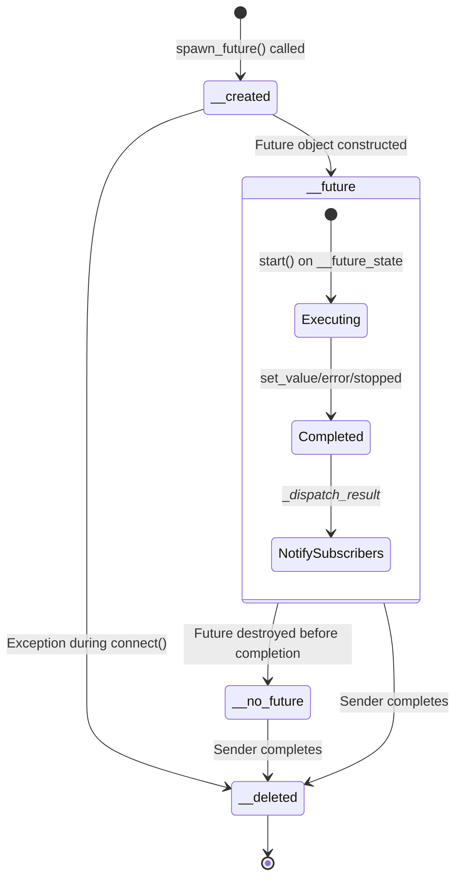

The state transitions are enforced by `__future_state_base::__step_from_to_()` at [include/exec/async_scope.hpp:460-467](), which asserts on invalid state transitions.

Sources: [include/exec/async_scope.hpp:240-246](), [include/exec/async_scope.hpp:449-458]()

### spawn_future() Data Flow

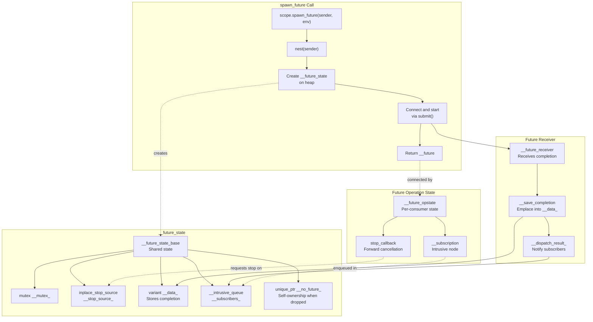

Sources: [include/exec/async_scope.hpp:546-577](), [include/exec/async_scope.hpp:754-761]()

### spawn_future() Completion Storage

Completions are stored in a variant that holds tuples of completion tag and decayed arguments:

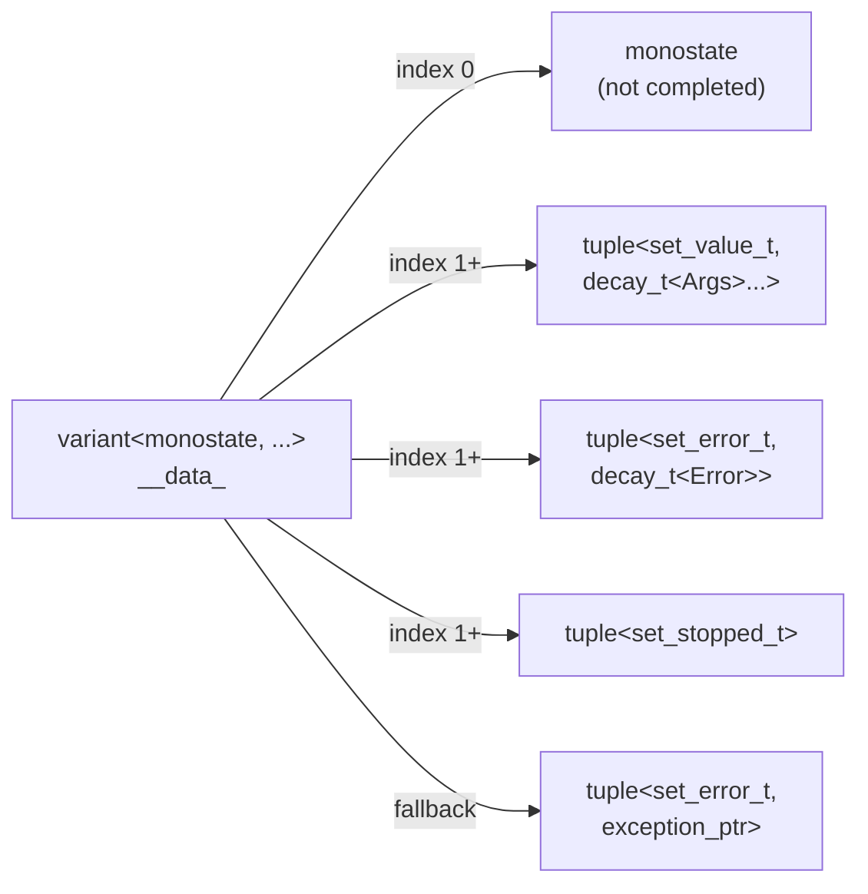

The `__completion_as_tuple_t` metafunction at [include/exec/async_scope.hpp:382-388]() transforms completion signatures into tuple types.

Sources: [include/exec/async_scope.hpp:396-409](), [include/exec/async_scope.hpp:502-513]()

### spawn_future() Subscriber Notification

When the spawned sender completes, the `__future_receiver` notifies all subscribers:

| State | Action |
|-------|--------|
| `__data_.index() == 0` (incomplete) | Store result, transition state |
| `__no_future_ != nullptr` | Delete state immediately (no consumers) |
| Otherwise | Pop all `__subscribers_` and call `__subscription::__complete()` on each |

This happens in `__dispatch_result_` at [include/exec/async_scope.hpp:483-500]().

Sources: [include/exec/async_scope.hpp:480-544]()

## when_empty() Operation

The `when_empty()` operation returns a sender that completes when the scope's active operation count reaches zero. It queues a waiter in `__impl::__waiters_` if operations are still active.

### when_empty() Synchronization

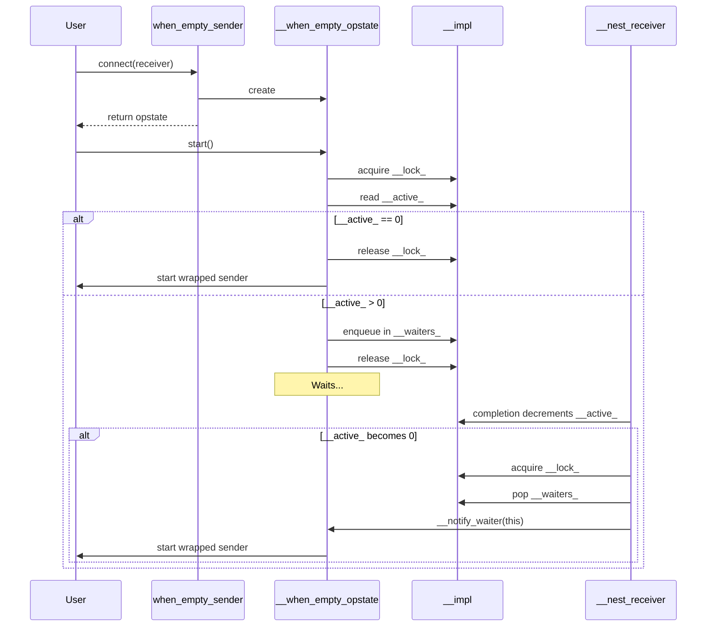

The critical ordering is enforced by acquiring the lock **before** checking `__active_` at [include/exec/async_scope.hpp:88-91](). This prevents a race where:
1. Check `__active_` (non-zero)
2. Last operation completes and decrements to zero
3. Enqueue waiter (never notified)

Sources: [include/exec/async_scope.hpp:73-108](), [include/exec/async_scope.hpp:726-730]()

### when_empty() vs on_empty()

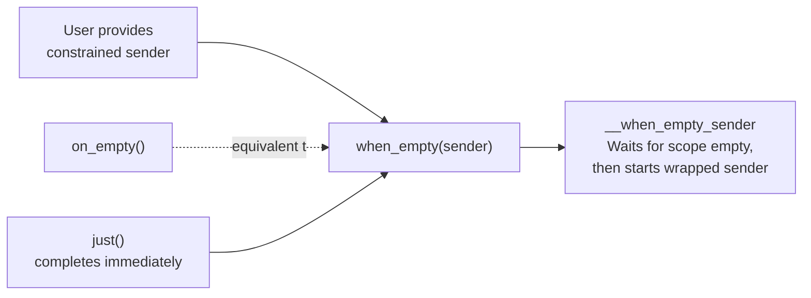

The `on_empty()` method at [include/exec/async_scope.hpp:732-735]() is a convenience that calls `when_empty(just())`.

Sources: [include/exec/async_scope.hpp:726-735]()

## Stop Token Propagation

The `async_scope` uses an `inplace_stop_source` to coordinate cancellation across all nested operations.

### Stop Token Flow

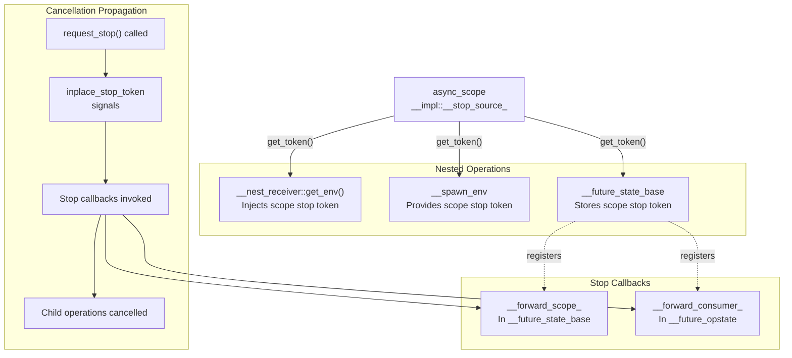

Sources: [include/exec/async_scope.hpp:206-209](), [include/exec/async_scope.hpp:439-447](), [include/exec/async_scope.hpp:251-257]()

### Stop Token in Futures

For `spawn_future()`, there are two levels of stop token forwarding:

1. **Scope to Future State**: When the scope requests stop, the `__forward_scope_` callback at [include/exec/async_scope.hpp:440-443]() requests stop on the future's `__stop_source_`.

2. **Consumer to Future State**: When a consumer (receiver connected to the future) requests stop, the `__forward_consumer_` callback at [include/exec/async_scope.hpp:330-333]() also requests stop on the future's `__stop_source_`.

This dual forwarding ensures the spawned work can be cancelled from either direction.

Sources: [include/exec/async_scope.hpp:251-257](), [include/exec/async_scope.hpp:330-333](), [include/exec/async_scope.hpp:440-447]()

## Implementation Details

### Reference Counting

The `__impl::__active_` counter tracks active nested operations:

| Event | Action | Atomic Operation |
|-------|--------|-----------------|
| `nest()` started | Increment | `fetch_add(1, relaxed)` at line 209 |
| `nest()` completed | Decrement | `fetch_sub(1, acq_rel)` at line 162 |
| `when_empty()` check | Read | `load(acquire)` at line 91 |

The acquire-release semantics ensure that when `__active_` transitions to zero, all writes to shared state by completing operations are visible to the thread notifying waiters.

Sources: [include/exec/async_scope.hpp:67](), [include/exec/async_scope.hpp:91](), [include/exec/async_scope.hpp:162](), [include/exec/async_scope.hpp:209]()

### Intrusive Queue for Waiters

The `__waiters_` queue uses intrusive linking through the `__task::__next_` pointer:

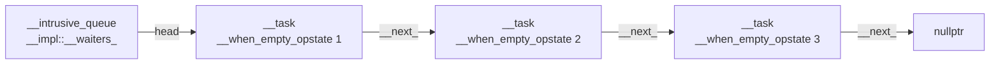

Each `__task` stores a `__notify_waiter` function pointer that knows how to resume the specific waiter type. This allows `__nest_receiver::__complete()` to notify waiters without knowing their concrete types.

Sources: [include/exec/async_scope.hpp:46-51](), [include/exec/async_scope.hpp:68](), [include/exec/async_scope.hpp:93-95](), [include/exec/async_scope.hpp:163-174]()

### Completion Signature Transformations

All scope operations modify completion signatures through environment injection:

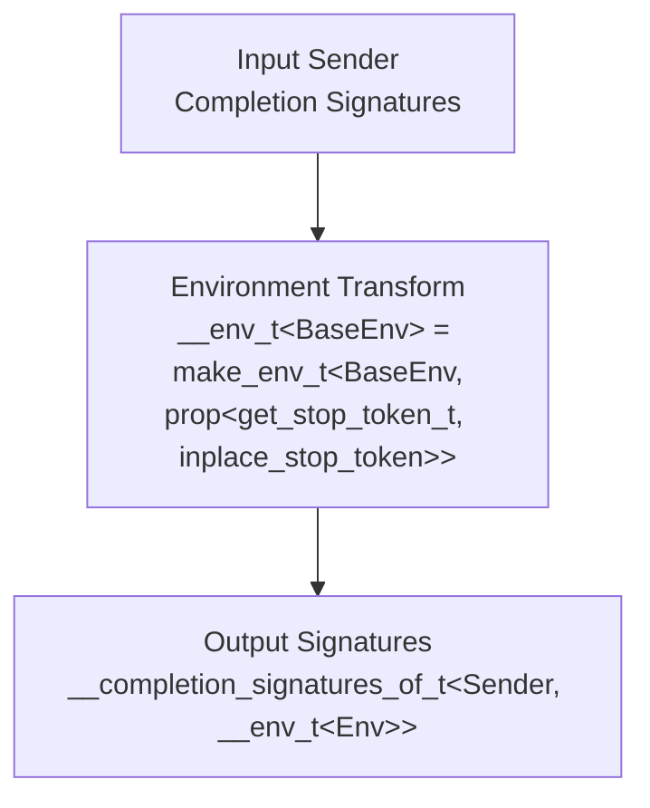

The `__env_t` type at [include/exec/async_scope.hpp:53-54]() wraps the base environment with an additional stop token property, which is then used to recompute completion signatures.

For `spawn_future()`, additional transformations decay value types and add `set_error(exception_ptr)`:

```cpp
__future_completions_t = transform_completion_signatures_of<
  Sender,
  __env_t<Env>,
  completion_signatures<set_stopped_t(), set_error_t(exception_ptr)>,
  __decay_values_t,   // decay all value arguments
  __decay_error_t     // decay error arguments
>;
```

Sources: [include/exec/async_scope.hpp:53-54](), [include/exec/async_scope.hpp:132-136](), [include/exec/async_scope.hpp:228-232](), [include/exec/async_scope.hpp:396-403]()

---

