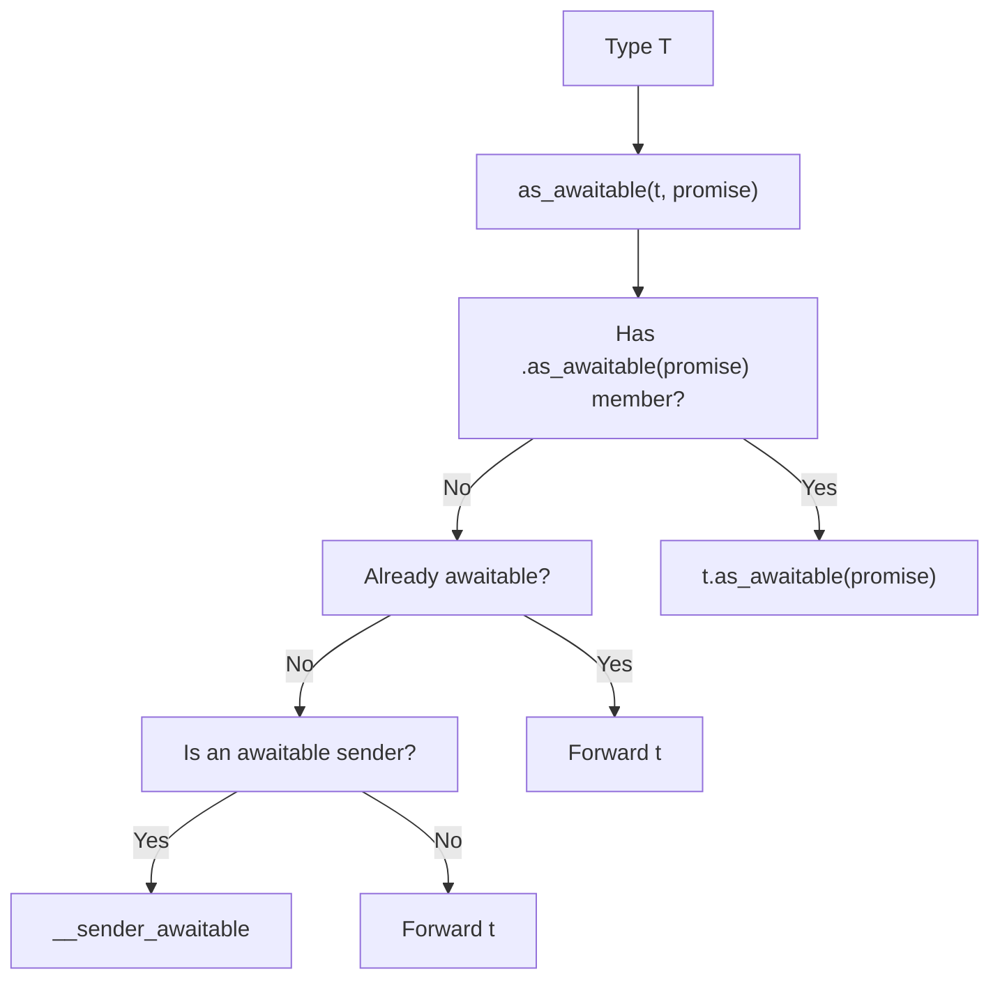
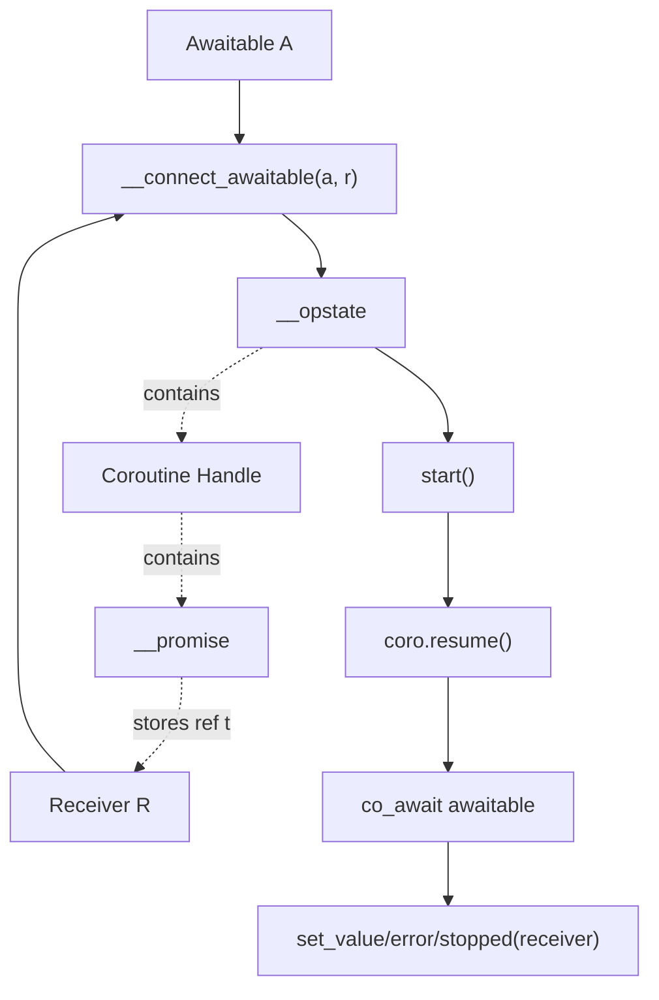
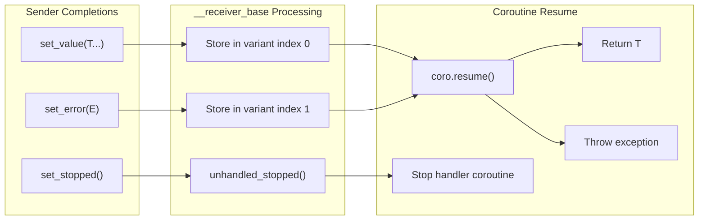
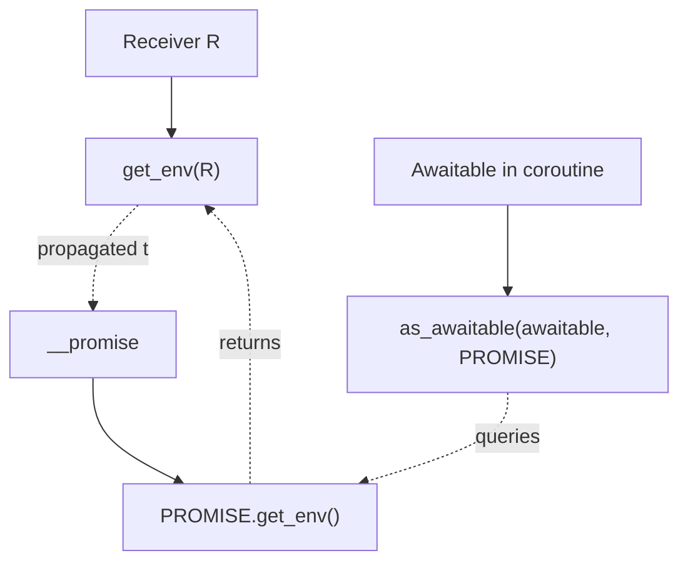

<!-- source: DeepWiki mcp.deepwiki.com · repo NVIDIA/stdexec · page 7.2 Coroutine Integration · fetched 2026-10-26 -->

# Coroutine Integration

<details>
<summary>Relevant source files</summary>

The following files were used as context for generating this wiki page:

- [include/exec/at_coroutine_exit.hpp](include/exec/at_coroutine_exit.hpp)
- [include/exec/on_coro_disposition.hpp](include/exec/on_coro_disposition.hpp)
- [include/exec/task.hpp](include/exec/task.hpp)
- [include/stdexec/__detail/__as_awaitable.hpp](include/stdexec/__detail/__as_awaitable.hpp)
- [include/stdexec/__detail/__awaitable.hpp](include/stdexec/__detail/__awaitable.hpp)
- [include/stdexec/__detail/__connect_awaitable.hpp](include/stdexec/__detail/__connect_awaitable.hpp)
- [include/stdexec/__detail/__task.hpp](include/stdexec/__detail/__task.hpp)
- [include/stdexec/__detail/__with_awaitable_senders.hpp](include/stdexec/__detail/__with_awaitable_senders.hpp)
- [include/stdexec/coroutine.hpp](include/stdexec/coroutine.hpp)
- [test/exec/test_at_coroutine_exit.cpp](test/exec/test_at_coroutine_exit.cpp)
- [test/exec/test_task.cpp](test/exec/test_task.cpp)
- [test/stdexec/types/test_task.cpp](test/stdexec/types/test_task.cpp)

</details>


## Purpose and Scope

This page documents the low-level coroutine integration mechanisms in `stdexec`, specifically `as_awaitable` and `__connect_awaitable`, which enable bidirectional interoperability between C++20 coroutines and the P2300 sender/receiver model. These mechanisms allow senders to be `co_await`ed within coroutines and awaitables to be used as senders.

For information about the underlying sender/receiver model, see [Core Execution Model](3). For high-level coroutine utilities like `exec::task`, see [Async Scope and Structured Concurrency](7.1). For sequence-based coroutine patterns, see [Sequence Senders](7.3).

## Overview

stdexec provides two primary mechanisms for coroutine integration:

1.  **`as_awaitable`**: A customization point that converts types (especially senders) into awaitables that can be `co_await`ed [include/stdexec/__detail/__as_awaitable.hpp:47-49]().
2.  **`__connect_awaitable`**: A mechanism that allows awaitables to be connected as senders [include/stdexec/__detail/__connect_awaitable.hpp:39-41]().

These mechanisms work together to provide seamless integration between the sender/receiver model and C++20 coroutines, enabling developers to use both declarative sender chains and imperative coroutine-style code.

**Sources:** [include/stdexec/__detail/__as_awaitable.hpp:47-49](), [include/stdexec/__detail/__connect_awaitable.hpp:39-41]()

## The `as_awaitable` Customization Point

Diagram: as_awaitable Transformation Flow



The `as_awaitable_t` customization point is defined in [include/stdexec/__detail/__as_awaitable.hpp:230-244]() and provides a uniform interface for converting types into awaitables. It checks for customization in the following priority order:

| Priority | Customization | Description |
| :--- | :--- | :--- |
| 1 | `.as_awaitable(promise)` member | Type provides its own conversion to awaitable [include/stdexec/__detail/__connect_awaitable.hpp:43-47]() |
| 2 | Already awaitable | Type satisfies `__awaitable<T, __unspecified>` concept [include/stdexec/__detail/__awaitable.hpp:77-83]() |
| 3 | Awaitable sender | Type is a sender that can be awaited (wrapped in `__sender_awaiter`) [include/stdexec/__detail/__as_awaitable.hpp:104-149]() |
| 4 | Pass-through | Type returned as-is |

### The `__sender_awaiter` Wrapper

When `as_awaitable` receives a sender, it uses a sender-awaiter mechanism [include/stdexec/__detail/__as_awaitable.hpp:104-149](). This wrapper:

1.  Determines if the sender completes inline via `__completes_inline` [include/stdexec/__detail/__as_awaitable.hpp:99-102]().
2.  Implements the awaitable interface (`await_ready`, `await_suspend`, `await_resume`) [include/stdexec/__detail/__as_awaitable.hpp:110-145]().
3.  Stores the result in a `__expected_t<_Value>` variant which holds either the value or an `std::exception_ptr` [include/stdexec/__detail/__as_awaitable.hpp:91-91]().
4.  Resumes the coroutine when the sender completes via the `__continuation_` handle [include/stdexec/__detail/__as_awaitable.hpp:147-147]().

**Sources:** [include/stdexec/__detail/__as_awaitable.hpp:47-149](), [include/stdexec/__detail/__as_awaitable.hpp:230-244](), [include/stdexec/__detail/__awaitable.hpp:77-83]()

## The `__connect_awaitable` Mechanism

Diagram: Connect Awaitable Operation State



The `__connect_awaitable` mechanism enables awaitables to be used as senders by implementing the `connect` customization. It creates a coroutine state that:

1.  Takes the awaitable and receiver as parameters.
2.  `co_await`s the awaitable to get its result within `__co_impl` [include/stdexec/__detail/__connect_awaitable.hpp:201-220]().
3.  Forwards the result to the receiver via `set_value`, `set_error`, or `set_stopped` [include/stdexec/__detail/__connect_awaitable.hpp:207-217]().

### The `__promise` Type

The `__promise<Awaiter, Receiver>` type [include/stdexec/__detail/__connect_awaitable.hpp:78-117]() serves as the promise type for the internal coroutine. Key features:

| Member Function | Purpose |
| :--- | :--- |
| `unhandled_stopped()` | Called when awaitable completes with stopped, returns noop coroutine [include/stdexec/__detail/__connect_awaitable.hpp:81-87]() |
| `get_env()` | Forwards environment queries to the receiver [include/stdexec/__detail/__connect_awaitable.hpp:89-94]() |
| `await_transform()` | Uses `__with_await_transform` to handle `as_awaitable` customization [include/stdexec/__detail/__connect_awaitable.hpp:52-73]() |

### Operation State Lifecycle

The `__opstate<Awaiter, Receiver>` manages the coroutine lifecycle [include/stdexec/__detail/__connect_awaitable.hpp:239-254]():

1.  **Construction**: Creates the coroutine frame and stores the receiver.
2.  **`start()`**: Resumes the coroutine to begin awaiting the awaitable.
3.  **Destruction**: Cleans up the coroutine handle and associated resources via `__manual_lifetime`.

**Sources:** [include/stdexec/__detail/__connect_awaitable.hpp:78-117](), [include/stdexec/__detail/__connect_awaitable.hpp:201-220](), [include/stdexec/__detail/__connect_awaitable.hpp:239-254]()

## Completion Signal Mapping

Diagram: Sender Completion to Coroutine Behavior



The `__receiver_base<Value>` type [include/stdexec/__detail/__as_awaitable.hpp:177-208]() handles sender completions and maps them to coroutine behavior:

| Sender Completion | Storage/Action | Coroutine Behavior |
| :--- | :--- | :--- |
| `set_value(Us...)` | Stored in `__result_` index 0 [include/stdexec/__detail/__as_awaitable.hpp:182-186]() | `await_resume()` returns the value [include/stdexec/__detail/__as_awaitable.hpp:124-129]() |
| `set_error(Error)` | Stored in `__result_` index 1 as `exception_ptr` [include/stdexec/__detail/__as_awaitable.hpp:193-200]() | `await_resume()` calls `std::rethrow_exception` [include/stdexec/__detail/__as_awaitable.hpp:120-123]() |
| `set_stopped()` | Denoted by valueless variant [include/stdexec/__detail/__as_awaitable.hpp:202-207]() | Returns `unhandled_stopped()` continuation [include/stdexec/__detail/__as_awaitable.hpp:132-145]() |

### The `await_resume` Implementation

The `__sender_awaiter_base::await_resume()` [include/stdexec/__detail/__as_awaitable.hpp:115-130]() handles the stored result:

1.  **Stopped check**: Asserts that the variant is not valueless (stopped should have skipped normal resumption) [include/stdexec/__detail/__as_awaitable.hpp:119-119]().
2.  **Error check**: If index is 1, rethrows the stored `exception_ptr` [include/stdexec/__detail/__as_awaitable.hpp:120-123]().
3.  **Value return**: If index is 0, returns the stored value (potentially `void` via `__void` wrapper) [include/stdexec/__detail/__as_awaitable.hpp:124-129]().

**Sources:** [include/stdexec/__detail/__as_awaitable.hpp:115-130](), [include/stdexec/__detail/__as_awaitable.hpp:177-208]()

## Environment Propagation

Diagram: Environment Query Flow Through Promise



The `__promise<Awaiter, Receiver>::get_env()` member function [include/stdexec/__detail/__connect_awaitable.hpp:89-94]() forwards environment queries from awaitables to the connected receiver. This enables:

1.  **Scheduler queries**: Awaitables can query `get_scheduler()` or `get_start_scheduler()` from the receiver's environment.
2.  **Stop token access**: Awaitables can access the stop token via `get_stop_token()`.
3.  **Custom queries**: Any query supported by the receiver's environment is accessible through the promise.

**Sources:** [include/stdexec/__detail/__connect_awaitable.hpp:89-94](), [include/stdexec/__detail/__as_awaitable.hpp:65-71]()

## The `__awaitable` Concept

The `__awaitable` concept [include/stdexec/__detail/__awaitable.hpp:77-83]() determines whether a type can be awaited within a coroutine. A type `T` is awaitable with promise type `P` if:

1.  `T` provides `operator co_await()` (member or free function) [include/stdexec/__detail/__awaitable.hpp:57-72](), OR
2.  `T` itself satisfies the `__awaiter` concept with `await_ready`, `await_suspend`, and `await_resume` [include/stdexec/__detail/__awaitable.hpp:33-38]().

### Value Type Extraction

The `__value_t` alias [include/stdexec/__detail/__as_awaitable.hpp:63-65]() computes what value a sender will produce when awaited:

```cpp
template <class _Sender, class _Promise>
using __value_t = __decay_t<
  __value_types_of_t<_Sender, env_of_t<_Promise&>, __q<__single_value_t>, __msingle_or<void>>>;
```

This handles mapping sender completion signatures to a single return type:
-   **Multiple values**: Wrapped in a tuple via `__as_single` [include/stdexec/__detail/__as_awaitable.hpp:51-61]().
-   **Single value**: Returned as-is.
-   **No values**: Returns `void`.

**Sources:** [include/stdexec/__detail/__as_awaitable.hpp:51-65](), [include/stdexec/__detail/__awaitable.hpp:33-83]()

## The `__co_impl` Coroutine Implementation

The `__connect_awaitable_t::__co_impl` coroutine [include/stdexec/__detail/__connect_awaitable.hpp:201-220]() drives awaitable-to-sender conversion:

1.  **Await the input**: `co_await` the awaitable to get its result [include/stdexec/__detail/__connect_awaitable.hpp:205-205]().
2.  **Handle void vs value**: If the result is void, it calls `set_value(receiver)`. If it is a value, it calls `set_value(receiver, result)` [include/stdexec/__detail/__connect_awaitable.hpp:207-213]().
3.  **Exception handling**: Catch any exceptions and call `set_error(receiver, std::current_exception())` [include/stdexec/__detail/__connect_awaitable.hpp:215-217]().
4.  **Completion via `__co_call`**: Uses a special awaiter that calls the completion function and then terminates the coroutine to ensure the frame is destroyed [include/stdexec/__detail/__connect_awaitable.hpp:172-195]().

**Sources:** [include/stdexec/__detail/__connect_awaitable.hpp:172-220]()

## Integration with `exec::task`

`exec::task<T>` [include/exec/task.hpp]() is a high-level coroutine type that utilizes these integration points.

### Scheduler Affinity and Stickiness

`exec::task` supports scheduler affinity [include/exec/task.hpp:116-120](). By default, it uses `__scheduler_affinity::__sticky`, meaning:

1.  It captures the scheduler on which it was started via `get_start_scheduler` [include/exec/task.hpp:158-165]().
2.  It provides that captured scheduler to child coroutines or queries via `get_start_scheduler_t` [include/exec/task.hpp:174-178]().

This behavior is tested in [test/exec/test_task.cpp:53-84](), demonstrating that the task remains on its "sticky" scheduler even after awaiting work on a different context.

### Coroutine Exit Actions

The `at_coroutine_exit` utility [include/exec/at_coroutine_exit.hpp]() allows registering cleanup actions that run when a coroutine exits. This is implemented by:

1.  Wrapping the cleanup sender in a `__task` [include/exec/at_coroutine_exit.hpp:132-186]().
2.  Splicing the cleanup task into the coroutine's continuation chain via `await_suspend` [include/exec/at_coroutine_exit.hpp:163-177]().
3.  Ensuring the cleanup task destroys itself in its final suspend point via `__coroutine_destroy_and_continue` [include/exec/at_coroutine_exit.hpp:195-201]().

**Sources:** [include/exec/task.hpp:116-178](), [include/exec/at_coroutine_exit.hpp:132-201](), [test/exec/test_task.cpp:53-84]()

## Summary of Key Entities

| Entity | File | Role |
| :--- | :--- | :--- |
| `as_awaitable` | [include/stdexec/__detail/__as_awaitable.hpp]() | CPO to convert senders/types to awaitables. |
| `__connect_awaitable` | [include/stdexec/__detail/__connect_awaitable.hpp]() | Implementation of `connect` for awaitable types. |
| `__sender_awaiter` | [include/stdexec/__detail/__as_awaitable.hpp]() | Wrapper that makes a sender satisfy the awaitable concept. |
| `__coroutine_handle` | [include/stdexec/coroutine.hpp]() | Enhanced handle supporting `unhandled_stopped()`. |
| `exec::task` | [include/exec/task.hpp]() | P2300-compatible coroutine task type. |

**Sources:** [include/stdexec/__detail/__as_awaitable.hpp:47-49](), [include/stdexec/__detail/__connect_awaitable.hpp:39-41](), [include/stdexec/coroutine.hpp:82-173](), [include/exec/task.hpp:41-84]()

---

