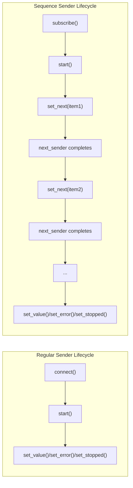
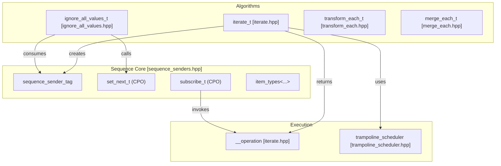
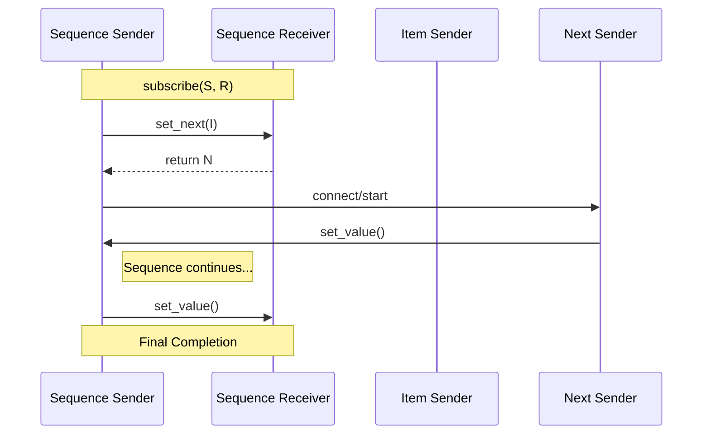

<!-- source: DeepWiki mcp.deepwiki.com · repo NVIDIA/stdexec · page 7.3 Sequence Senders · fetched 2026-10-26 -->

# Sequence Senders

<details>
<summary>Relevant source files</summary>

The following files were used as context for generating this wiki page:

- [include/exec/any_sender_of.hpp](include/exec/any_sender_of.hpp)
- [include/exec/fork_join.hpp](include/exec/fork_join.hpp)
- [include/exec/just_from.hpp](include/exec/just_from.hpp)
- [include/exec/sequence.hpp](include/exec/sequence.hpp)
- [include/exec/sequence/any_sequence_of.hpp](include/exec/sequence/any_sequence_of.hpp)
- [include/exec/sequence/empty_sequence.hpp](include/exec/sequence/empty_sequence.hpp)
- [include/exec/sequence/ignore_all_values.hpp](include/exec/sequence/ignore_all_values.hpp)
- [include/exec/sequence/iterate.hpp](include/exec/sequence/iterate.hpp)
- [include/exec/sequence/merge.hpp](include/exec/sequence/merge.hpp)
- [include/exec/sequence/merge_each.hpp](include/exec/sequence/merge_each.hpp)
- [include/exec/sequence/transform_each.hpp](include/exec/sequence/transform_each.hpp)
- [include/exec/sequence_senders.hpp](include/exec/sequence_senders.hpp)
- [include/exec/trampoline_scheduler.hpp](include/exec/trampoline_scheduler.hpp)
- [test/exec/sequence/test_empty_sequence.cpp](test/exec/sequence/test_empty_sequence.cpp)
- [test/exec/sequence/test_iterate.cpp](test/exec/sequence/test_iterate.cpp)
- [test/exec/sequence/test_merge.cpp](test/exec/sequence/test_merge.cpp)
- [test/exec/sequence/test_transform_each.cpp](test/exec/sequence/test_transform_each.cpp)
- [test/exec/test_any_sender.cpp](test/exec/test_any_sender.cpp)
- [test/exec/test_sequence_senders.cpp](test/exec/test_sequence_senders.cpp)

</details>


## Purpose and Scope

This document describes the **sequence sender** model, an extension to the P2300 sender/receiver model implemented in `stdexec`. Sequence senders enable streaming multiple items through an asynchronous pipeline, allowing a sender to emit zero or more items before final completion. This is fundamental for processing asynchronous streams, ranges, and concurrent batches of work.

## Overview

While a regular sender completes exactly once with a value, error, or stopped signal, a sequence sender can emit multiple **items** before final completion. Each item is itself a regular sender.

### Key Differences from Regular Senders

| Aspect | Regular Sender | Sequence Sender |
|--------|---------------|-----------------|
| **Initiation** | `connect(sender, receiver)` | `subscribe(sequence, receiver)` |
| **Item Emission** | N/A (single completion) | `set_next(receiver, item)` returns `next_sender` |
| **Item Metadata** | `completion_signatures<...>` | `item_types<Senders...>` |
| **Final Completion** | `set_value/error/stopped` | `set_value/error/stopped` |
| **Tag Type** | `sender_tag` | `sequence_sender_tag` |



**Diagram: Lifecycle Comparison Between Regular and Sequence Senders**

Sources: [include/exec/sequence_senders.hpp:110-111](), [include/exec/sequence_senders.hpp:119-125](), [include/exec/sequence_senders.hpp:712-730]()

## Core Concepts and Types

### sequence_sender_tag

The `sequence_sender_tag` type serves as the sender concept tag for sequence senders. It derives from `stdexec::sender_tag` to indicate that sequence senders are also valid senders in the P2300 model.

```cpp
struct sequence_sender_tag : STDEXEC::sender_tag {};
```

Sources: [include/exec/sequence_senders.hpp:110-111]()

### item_types

The `item_types` template describes what types of items (senders) a sequence can emit. It is the sequence-equivalent of `completion_signatures`.

```cpp
template <class... _Senders>
struct item_types;
```

A sequence sender advertises its item types through:
- A nested `item_types` type alias. [include/exec/sequence_senders.hpp:54-54]()
- A static `get_item_types` member function. [include/exec/sequence_senders.hpp:266-267]()
- A `tag_invoke` customization of `get_item_types_t`. [include/exec/sequence_senders.hpp:331-333]()

Sources: [include/exec/sequence_senders.hpp:202-208](), [include/exec/sequence_senders.hpp:263-343]()

### next_sender Concept

The result of `set_next` must be a `next_sender`. This sender signals whether the sequence should continue or stop.

```cpp
template <class _Sender, class _Env = STDEXEC::env<>>
concept next_sender =
    STDEXEC::sender_in<_Sender, _Env>
    && STDEXEC::__mapply<
      STDEXEC::__mbind_front_q<STDEXEC::__mset_contains_t,
                               STDEXEC::__mset<STDEXEC::set_value_t(), STDEXEC::set_stopped_t()>>,
      STDEXEC::completion_signatures_of_t<_Sender, _Env>>::value;
```

A `next_sender` can **only** complete with `set_value()` (continue) or `set_stopped()` (break/stop sequence). It cannot emit an error directly.

Sources: [include/exec/sequence_senders.hpp:119-125]()

## The set_next CPO

The `set_next` customization point is how a sequence emits items to a receiver.

```cpp
template <class _Receiver, class _Item>
auto set_next(_Receiver& __rcvr, _Item&& __item) 
  -> next_sender_of_t<_Receiver, _Item>;
```

**Requirements:**
- Takes a receiver by **lvalue reference** to allow repeated calls. [include/exec/sequence_senders.hpp:145-145]()
- Returns a `next_sender` that the sequence must start and await before emitting the next item or final completion. [include/exec/sequence_senders.hpp:148-151]()

Sources: [include/exec/sequence_senders.hpp:142-151]()

## The subscribe CPO

The `subscribe` customization point initiates a sequence sender, analogous to `connect` for regular senders.

```cpp
struct subscribe_t {
  template <sender _Sequence, receiver _Receiver>
  auto operator()(_Sequence&& __sndr, _Receiver __rcvr) const
    -> /* operation_state */;
};
```

**Customization Resolution:**
1. If the sender is a regular sender (not a sequence sender), `subscribe` creates a wrapper that calls `set_next` exactly once with the sender itself. [include/exec/sequence_senders.hpp:670-692]()
2. If it is a sequence sender, it looks for a `subscribe` member or `tag_invoke` customization. [include/exec/sequence_senders.hpp:712-730]()

Sources: [include/exec/sequence_senders.hpp:664-824]()

## Sequence Algorithms

### iterate

The `iterate` factory creates a sequence sender from a C++20 range. It emits each element of the range as a `just(element)` sender.

```cpp
auto seq = exec::iterate(std::views::iota(0, 10));
```

**Implementation Details:**
- It uses a `trampoline_scheduler` to prevent stack overflow during long synchronous iterations. [include/exec/sequence/iterate.hpp:51-53]()
- It connects to the `next_sender` returned by the receiver and only proceeds to the next range element when that sender completes with `set_value()`. [include/exec/sequence/iterate.hpp:140-160]()

Sources: [include/exec/sequence/iterate.hpp:186-193](), [include/exec/sequence/iterate.hpp:140-160]()

### ignore_all_values

This adaptor transforms a sequence sender into a regular sender that completes with `set_value()` after all items in the sequence have been processed.

```cpp
auto snd = exec::iterate(range) | exec::ignore_all_values();
```

**Behavior:**
- It provides an `__item_receiver` that intercepts item completions. [include/exec/sequence/ignore_all_values.hpp:104-108]()
- It ignores values sent by items but tracks errors or stopped signals. [include/exec/sequence/ignore_all_values.hpp:110-114]()
- If an item errors, it stores the error in a variant and requests a stop for the rest of the sequence. [include/exec/sequence/ignore_all_values.hpp:122-127]()

Sources: [include/exec/sequence/ignore_all_values.hpp:41-97](), [include/exec/sequence/ignore_all_values.hpp:104-144]()

### transform_each

Applies a sender adaptor to every item emitted by a sequence.

```cpp
auto transformed = exec::iterate(range) 
                 | exec::transform_each(ex::then([](int x){ return x + 1; }));
```

**Data Flow:**
1. The `transform_each` receiver's `set_next(item)` is called. [include/exec/sequence/transform_each.hpp:67-72]()
2. It applies the stored adaptor to the `item`. [include/exec/sequence/transform_each.hpp:74-74]()
3. It passes the resulting transformed sender to the downstream receiver's `set_next`. [include/exec/sequence/transform_each.hpp:73-73]()

Sources: [include/exec/sequence/transform_each.hpp:51-119](), [include/exec/sequence/transform_each.hpp:137-146]()

### merge_each

Flatten a sequence of sequences by running the nested sequences concurrently.

```cpp
auto merged = outer_sequence | exec::merge_each();
```

**Implementation:**
- It uses an `inplace_stop_source` to coordinate cancellation across all concurrent nested sequences. [include/exec/sequence/merge_each.hpp:96-97]()
- It tracks the number of active nested sequences using atomic reference counting or virtual base coordination. [include/exec/sequence/merge_each.hpp:175-181]()
- If any nested sequence or item fails, the error is stored, and all other operations are cancelled via the stop source. [include/exec/sequence/merge_each.hpp:197-208]()

Sources: [include/exec/sequence/merge_each.hpp:42-210]()

## Code Entity Mapping



**Diagram: Association of Sequence Entities**

Sources: [include/exec/sequence_senders.hpp:110-111](), [include/exec/sequence/iterate.hpp:186-187](), [include/exec/sequence/ignore_all_values.hpp:41-45](), [include/exec/sequence/merge_each.hpp:45-45]()



**Diagram: Sequence Emission Protocol**

Sources: [include/exec/sequence_senders.hpp:142-151](), [include/exec/sequence_senders.hpp:712-730]()

---

