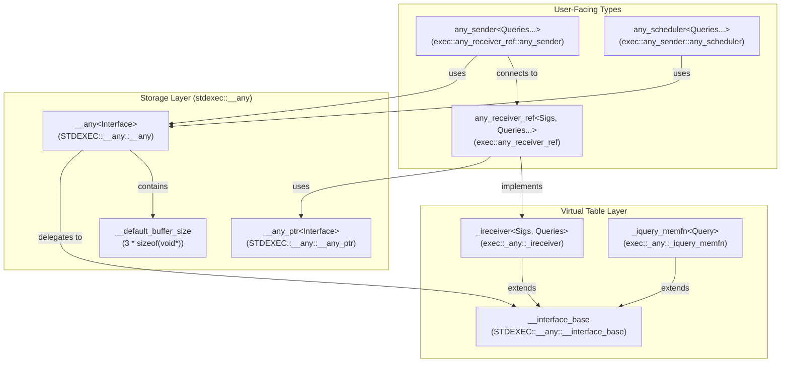
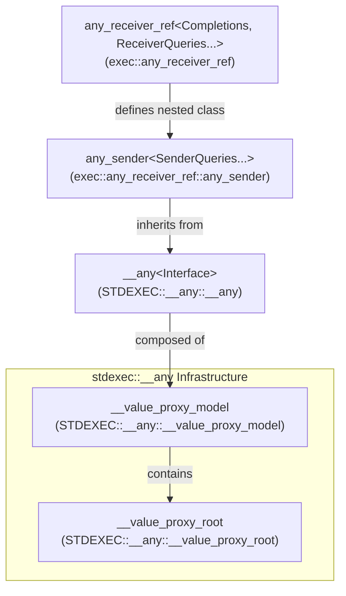
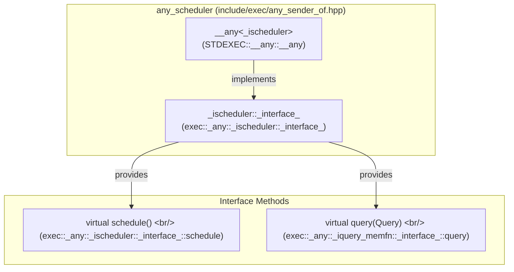
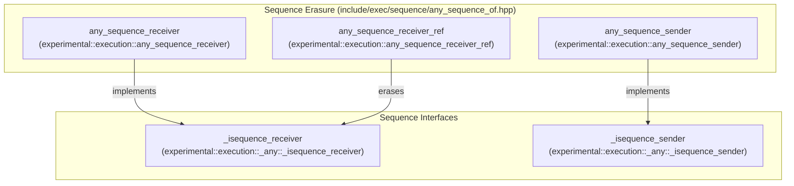

<!-- source: DeepWiki mcp.deepwiki.com · repo NVIDIA/stdexec · page 7.4 Type Erasure with any_sender · fetched 2026-10-26 -->

# Type Erasure with any_sender

<details>
<summary>Relevant source files</summary>

The following files were used as context for generating this wiki page:

- [include/exec/any_sender_of.hpp](include/exec/any_sender_of.hpp)
- [include/exec/function.hpp](include/exec/function.hpp)
- [include/exec/sequence/any_sequence_of.hpp](include/exec/sequence/any_sequence_of.hpp)
- [include/stdexec/__detail/__any.hpp](include/stdexec/__detail/__any.hpp)
- [include/stdexec/__detail/__static_vector.hpp](include/stdexec/__detail/__static_vector.hpp)
- [include/stdexec/__detail/__utility.hpp](include/stdexec/__detail/__utility.hpp)
- [include/stdexec/stop_token.hpp](include/stdexec/stop_token.hpp)
- [test/exec/CMakeLists.txt](test/exec/CMakeLists.txt)
- [test/exec/test_any_sender.cpp](test/exec/test_any_sender.cpp)
- [test/exec/test_function.cpp](test/exec/test_function.cpp)
- [test/stdexec/detail/test_any.cpp](test/stdexec/detail/test_any.cpp)

</details>


This document describes the type erasure facilities provided by `exec::any_sender_of`, `exec::any_receiver_ref`, and `exec::any_scheduler`. These components enable runtime polymorphism for senders, receivers, and schedulers without virtual inheritance, allowing heterogeneous collections of execution objects and runtime selection of execution strategies.

For structured concurrency with task lifetime management, see [Async Scope and Structured Concurrency](#7.1). For sequence sender type erasure, see the related `any_sequence_of` implementation in [include/exec/sequence/any_sequence_of.hpp:1-336]().

## Overview and Motivation

Type erasure in stdexec provides runtime polymorphism while maintaining the sender/receiver protocol's type safety and composition guarantees. The primary use case is enabling runtime selection of schedulers and senders where the concrete type cannot be determined at compile time.

Key characteristics:
- **Move-only semantics** for senders (prevents accidental copies of expensive sender graphs) [include/exec/any_sender_of.hpp:1191-1232]()
- **Reference semantics** for receivers (lightweight wrapper around existing receiver) [include/exec/any_sender_of.hpp:1152-1190]()
- **Copyable semantics** for schedulers (allows scheduler storage and comparison) [include/exec/any_sender_of.hpp:1050-1140]()
- **Small Buffer Optimization (SBO)** to avoid heap allocation for small objects [include/stdexec/__detail/__any.hpp:97-143]()
- **Customizable queries** via template parameters [include/exec/any_sender_of.hpp:31-41]()

Sources: [include/exec/any_sender_of.hpp:1-1368](), [include/stdexec/__detail/__any.hpp:1-163]()

## Core Components Architecture

The architecture relies on the `stdexec::__any` infrastructure, which implements ad hoc polymorphism with value semantics.

### Type Erasure Entity Mapping


Sources: [include/stdexec/__detail/__any.hpp:42-143](), [include/exec/any_sender_of.hpp:26-1147]()

## any_receiver_ref: Type-Erased Receiver Reference

`any_receiver_ref` provides a lightweight, non-owning reference to a receiver that satisfies specific completion signatures and queries. It is implemented using `__any_ptr`.

### Type Declaration

```cpp
// include/exec/any_sender_of.hpp:1152-1190
template <class _Completions, auto... _ReceiverQueries>
class any_receiver_ref;
```

### Template Parameters

| Parameter | Description | Example |
|-----------|-------------|---------|
| `_Completions` | `completion_signatures<...>` specifying allowed completions | `completion_signatures<set_value_t(int), set_error_t(std::exception_ptr)>` |
| `_ReceiverQueries...` | Query signatures the receiver must support | `get_stop_token.signature<inplace_stop_token() noexcept>` |

Sources: [include/exec/any_sender_of.hpp:1152-1190]()

### Internal Structure and Dispatch

The receiver vtable implementation handles completion signatures through `_ireceiver` and queries through `_iquery_memfn`.

**Virtual Function Structure** [include/exec/any_sender_of.hpp:142-178]():
- `_iquery_memfn` injects `query` member functions into the interface.
- If `Indirect` is true, queries are forwarded to `get_env(value)`.

**VTable Pattern** [include/stdexec/__detail/__any.hpp:72-110]():
- `__interface_base` defines the layout of the virtual table.
- `__value(*this)` provides access to the concrete erased object within the vtable methods.

Sources: [include/exec/any_sender_of.hpp:142-260](), [include/stdexec/__detail/__any.hpp:72-110]()

## any_sender: Type-Erased Sender

`any_sender` is a nested class template within `any_receiver_ref` that provides move-only type erasure for senders.

### Type Declaration and Relationship


Sources: [include/exec/any_sender_of.hpp:1191-1232](), [include/stdexec/__detail/__any.hpp:127-142]()

### Sender Virtual Table and Operation State

The sender vtable includes a `connect` method that produces a type-erased operation state.

**Operation State Erasure** [include/exec/any_sender_of.hpp:831-848]():
- `_any_opstate_base` provides the type-erased operation state interface.
- It stores the concrete operation state in an immovable buffer of `6 * sizeof(void*)`.
- The `start()` call is dispatched through a virtual function pointer.

Sources: [include/exec/any_sender_of.hpp:831-848](), [include/exec/any_sender_of.hpp:967-1048]()

## any_scheduler: Type-Erased Scheduler

`any_scheduler` provides copyable type erasure for schedulers, typically used for runtime selection of thread pools or execution contexts.

### Internal Architecture


Sources: [include/exec/any_sender_of.hpp:1050-1140]()

### Equality and Comparison

Schedulers support value-based equality comparison using the `__iequality_comparable` interface provided by the `__any` library.

**Comparison Implementation** [include/stdexec/__detail/__any.hpp:173-174]():
- The storage layer implements `operator==` by checking if the vtables match and then calling the virtual equality check.

Sources: [include/stdexec/__detail/__any.hpp:170-174](), [test/exec/test_any_sender.cpp:525-563]()

## Storage and Small Buffer Optimization (SBO)

The `stdexec::__any` infrastructure provides the storage backbone for all type-erased types.

### Terminology and Root Types
[include/stdexec/__detail/__any.hpp:48-64]()
- **root**: The nucleus of a "model" (e.g., `__value_root`, `__reference_root`).
- **model**: A polymorphic wrapper around a root implementing an interface.
- **proxy**: Stores a model in a small buffer or on the heap.

### Small Buffer Configuration
[include/stdexec/__detail/__any.hpp:144-146]()
- **Default Buffer Size**: `__default_buffer_size` is defined as `3 * sizeof(void*)`.
- **In-situ Storage**: If the concrete type fits within the buffer and is nothrow move-constructible, it is stored in-situ.
- **Heap Allocation**: If the type is too large or not nothrow movable, the storage allocates on the heap using the provided allocator.

Sources: [include/stdexec/__detail/__any.hpp:42-146](), [test/stdexec/detail/test_any.cpp:112-154]()

## Sequence Type Erasure

`any_sequence_of` extends the type erasure model to sequence senders, introducing the `set_next` requirement.


Sources: [include/exec/sequence/any_sequence_of.hpp:27-130]()

## Performance and Constraints

### Memory and Allocation
- **any_receiver_ref**: Zero allocation (pointer-based erasure). [include/exec/any_sender_of.hpp:1152-1190]()
- **any_sender**: Allocation only if the concrete sender exceeds `3 * sizeof(void*)`. [include/stdexec/__detail/__any.hpp:144]()
- **any_scheduler**: Allocation only if the scheduler exceeds the buffer size (typically `4 * sizeof(void*)` for schedulers). [include/exec/any_sender_of.hpp:1064-1066]()

### Constraints
- Senders must be **MoveConstructible**. [include/exec/any_sender_of.hpp:967-1008]()
- Schedulers must be **CopyConstructible** and **EqualityComparable**. [include/exec/any_sender_of.hpp:1050-1140]()

Sources: [include/stdexec/__detail/__any.hpp:144-168](), [include/exec/any_sender_of.hpp:1050-1140]()

## exec::function: Deferred Allocation Erasure

`exec::function<ReturnType(Args...)>` is a specialized type-erased sender that represents an async function. Unlike `any_sender`, it defers the allocation of the operation state until `connect`, allowing it to use a `frame_allocator` from the receiver's environment.

**Key Features**:
- **Deferred Allocation**: Connect picks the allocator from the environment using `__choose_frame_allocator`. [include/exec/function.hpp:68-72]()
- **Environment Injection**: Wraps receivers to provide a default `std::pmr::polymorphic_allocator` if none is found. [include/exec/function.hpp:93-102]()

Sources: [include/exec/function.hpp:41-122](), [test/exec/test_function.cpp:97-230]()

---

