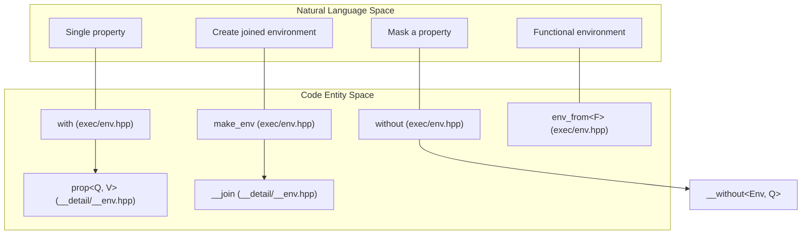
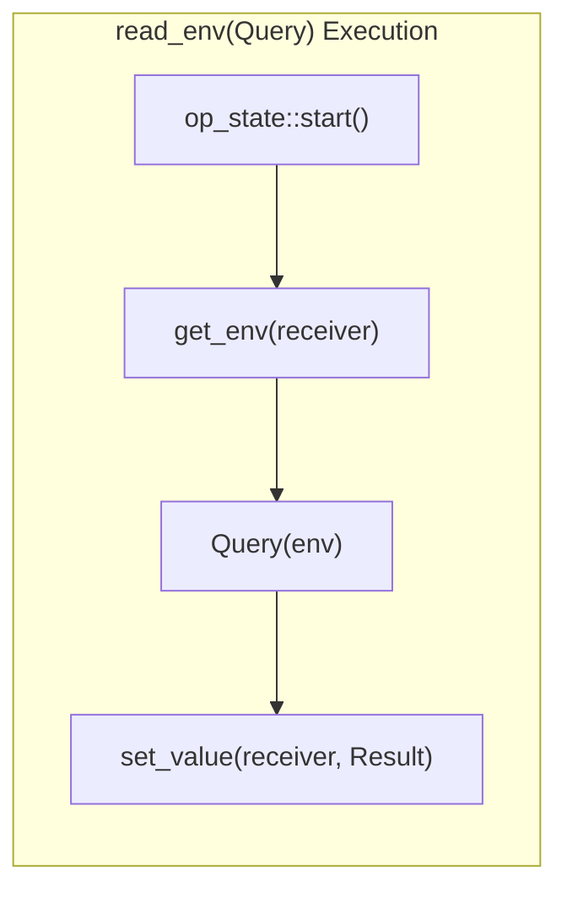
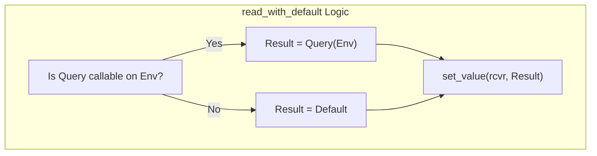

<!-- source: DeepWiki mcp.deepwiki.com · repo NVIDIA/stdexec · page 7.5 Environment Utilities · fetched 2026-10-26 -->

# Environment Utilities

Relevant source files

The following files were used as context for generating this wiki page:

- [include/exec/async_scope.hpp](include/exec/async_scope.hpp)
- [include/exec/env.hpp](include/exec/env.hpp)
- [include/exec/finally.hpp](include/exec/finally.hpp)
- [include/exec/materialize.hpp](include/exec/materialize.hpp)
- [include/exec/when_any.hpp](include/exec/when_any.hpp)
- [include/stdexec/__detail/__env.hpp](include/stdexec/__detail/__env.hpp)
- [include/stdexec/__detail/__just.hpp](include/stdexec/__detail/__just.hpp)
- [include/stdexec/__detail/__read_env.hpp](include/stdexec/__detail/__read_env.hpp)
- [include/stdexec/__detail/__schedulers.hpp](include/stdexec/__detail/__schedulers.hpp)
- [include/stdexec/__detail/__sync_wait.hpp](include/stdexec/__detail/__sync_wait.hpp)
- [include/stdexec/__detail/__write_env.hpp](include/stdexec/__detail/__write_env.hpp)
- [test/exec/test_env.cpp](test/exec/test_env.cpp)

## Purpose and Scope

Environment utilities provide mechanisms for manipulating and querying execution environments. In the P2300 model, an environment is a collection of key-value pairs (queries and their results) that propagate through sender/receiver chains to control behavior, such as scheduling, cancellation tokens, and allocators [include/stdexec/__detail/__env.hpp:38-41]().

This document covers the `experimental::execution` and `stdexec` utilities for environment manipulation: `make_env`, `with`, `without`, `read_env`, `write_env`, and `read_with_default`.

---

## Environment Manipulation API

The utilities in `exec/env.hpp` allow for the construction and modification of environment objects. These are often used when connecting senders to receivers or when customizing the environment for a specific branch of a sender graph.

### Core Functions and Classes

| Entity | Role |
| :--- | :--- |
| `make_env` | Joins a base environment with a new set of properties [include/exec/env.hpp:73-88](). |
| `with` | Creates a single-property environment (a `prop`) [include/exec/env.hpp:30-37](). |
| `without` | Wraps an environment to hide a specific query [include/exec/env.hpp:39-69](). |
| `prop<Query, Value>` | A singleton environment mapping a `Query` to a `Value` [include/stdexec/__detail/__env.hpp:177-200](). |
| `env_from<Fun>` | An environment that satisfies queries by calling a provided function object [include/exec/env.hpp:98-114](). |

**Sources:** [include/exec/env.hpp:23-114](), [include/stdexec/__detail/__env.hpp:101-200]()

### `make_env` and Environment Joining

`make_env` is the primary utility for combining environments. It utilizes `__join` logic to create a layered environment where queries are resolved by searching from the newest to the oldest added layer.

- **Implementation:** `make_env` delegates to `STDEXEC::__env::__join` [include/exec/env.hpp:73-88]().
- **Data Flow:** When a query is performed on a joined environment, it first checks the primary (left) environment. If the query is not supported there, it forwards the query to the base (right) environment [include/stdexec/__detail/__env.hpp:104-122]().

### `without`

The `without` utility masks a specific query from an environment. It creates a wrapper that handles all queries except the one specified [include/exec/env.hpp:42-49](). This is useful for preventing a child sender from seeing a specific property (like a stop token) provided by the parent [include/exec/env.hpp:55-69]().

---

## Reading and Writing Environments in Sender Chains

While `make_env` creates environment objects, `read_env` and `write_env` are sender adaptors that interact with the environment at execution time.

### `read_env`

`read_env` is a sender factory that, when started, queries the receiver's environment and sends the result through the value channel [include/stdexec/__detail/__read_env.hpp:152-182]().

- **Operation State:** The `__opstate` for `read_env` executes the query inside its `start()` method [include/stdexec/__detail/__read_env.hpp:46-61](). If the query returns a reference, it is passed directly; otherwise, it is stored in an internal `__optional` [include/stdexec/__detail/__read_env.hpp:62-78]().
- **Signatures:** The completion signatures are computed at compile-time based on the result of the query against the environment type [include/stdexec/__detail/__read_env.hpp:105-130]().

**Sources:** [include/stdexec/__detail/__read_env.hpp:39-152]()

### `write_env`

`write_env` is a pipeable sender adaptor that adds properties to the environment seen by its child sender [include/stdexec/__detail/__write_env.hpp:76-91]().

- **Mechanism:** It uses the `__sexpr` model [include/stdexec/__detail/__write_env.hpp:147-149](). When the child sender is connected, the operation state's environment is computed by joining the written properties with the receiver's environment [include/stdexec/__detail/__write_env.hpp:42-46]().
- **Renaming Note:** `exec::write` was renamed to `stdexec::write_env` for consistency with P2300 naming [include/exec/env.hpp:210-213]().

---

## Utility: `read_with_default`

`read_with_default` provides a way to query the environment with a fallback value if the query is not supported by the environment.

- **Logic:** In `__opstate::start()`, it checks if the query is callable on the receiver's environment using `__callable<_Tag, env_of_t<_Receiver>>` [include/exec/env.hpp:139-140](). If so, it calls it; otherwise, it sends the provided default value [include/exec/env.hpp:141-147]().
- **Error Handling:** If the query throws, the error is caught and propagated via `set_error(std::exception_ptr)` [include/exec/env.hpp:149-152]().

**Sources:** [include/exec/env.hpp:119-208]()

---

## Integration with Schedulers and Stop Tokens

Many standard execution queries are implemented using `read_env` under the hood to provide a functional interface for obtaining values from the current execution context.

| Function | Implementation |
| :--- | :--- |
| `get_scheduler()` | `read_env(get_scheduler)` |
| `get_stop_token()` | `read_env(get_stop_token)` |
| `get_allocator()` | `read_env(get_allocator)` |
| `get_delegation_scheduler()` | `read_env(get_delegation_scheduler)` |

**Sources:** [include/stdexec/__detail/__read_env.hpp:170-173](), [include/stdexec/__detail/__sync_wait.hpp:51-56]()

---

## Environment Forwarding

The `__fwd` and `__fwd_env` utilities ensure that environments are correctly propagated through layers of the sender graph, filtering out non-forwarding queries.

- **Forwarding Query:** A query is forwarded if it models the `forwarding_query` concept, which is typically checked via `forwarding_query_t` [include/stdexec/__detail/__env.hpp:58-66]().
- **Root Environment:** `__as_root_env` marks an environment as the "root," preventing further upward propagation of certain queries by joining it with a `__root_env` [include/stdexec/__detail/__env.hpp:139-156]().

**Sources:** [include/stdexec/__detail/__env.hpp:53-93](), [include/stdexec/__detail/__env.hpp:129-168]()

---

