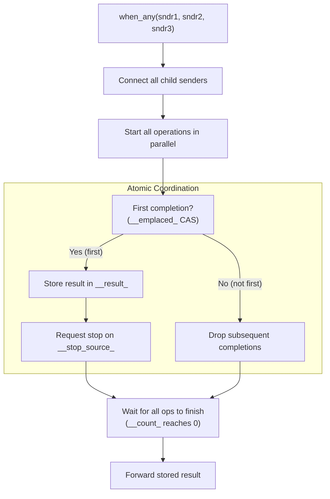
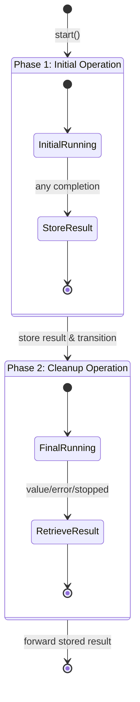
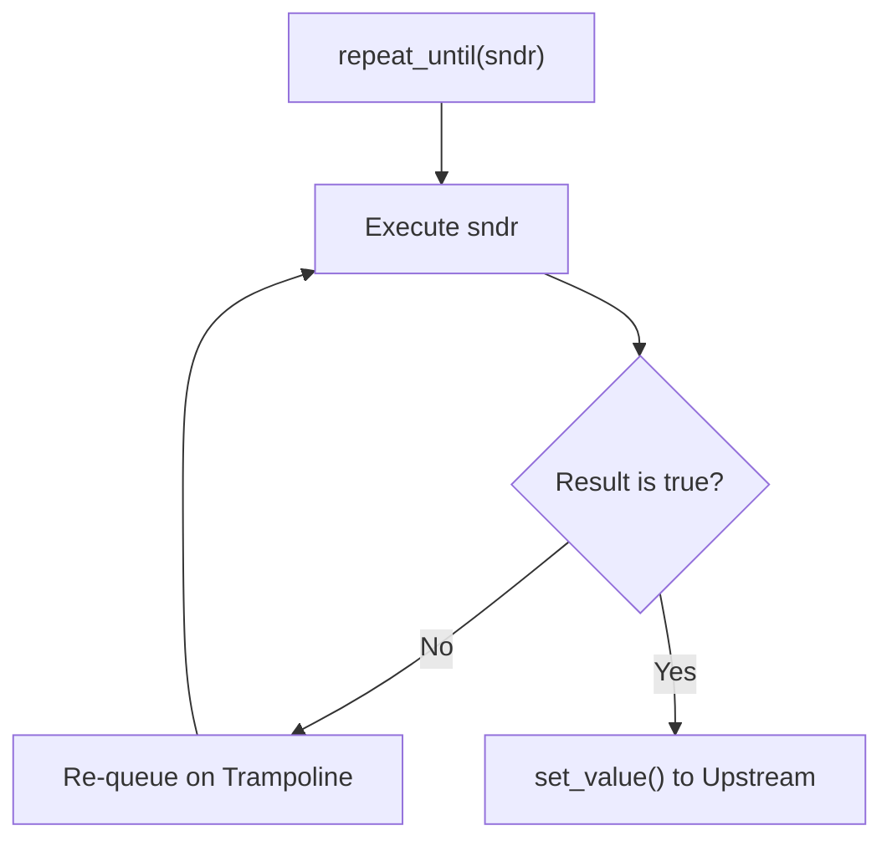

<!-- source: DeepWiki mcp.deepwiki.com · repo NVIDIA/stdexec · page 7.6 Additional Algorithms · fetched 2026-10-26 -->

# Additional Algorithms

Relevant source files

The following files were used as context for generating this wiki page:

- [include/exec/async_scope.hpp](include/exec/async_scope.hpp)
- [include/exec/create.hpp](include/exec/create.hpp)
- [include/exec/env.hpp](include/exec/env.hpp)
- [include/exec/finally.hpp](include/exec/finally.hpp)
- [include/exec/materialize.hpp](include/exec/materialize.hpp)
- [include/exec/repeat_effect_until.hpp](include/exec/repeat_effect_until.hpp)
- [include/exec/repeat_n.hpp](include/exec/repeat_n.hpp)
- [include/exec/repeat_until.hpp](include/exec/repeat_until.hpp)
- [include/exec/start_now.hpp](include/exec/start_now.hpp)
- [include/exec/timed_scheduler.hpp](include/exec/timed_scheduler.hpp)
- [include/exec/timed_thread_scheduler.hpp](include/exec/timed_thread_scheduler.hpp)
- [include/exec/unless_stop_requested.hpp](include/exec/unless_stop_requested.hpp)
- [include/exec/when_any.hpp](include/exec/when_any.hpp)
- [include/stdexec/__detail/__intrusive_mpsc_queue.hpp](include/stdexec/__detail/__intrusive_mpsc_queue.hpp)
- [include/stdexec/__detail/__spin_loop_pause.hpp](include/stdexec/__detail/__spin_loop_pause.hpp)
- [test/exec/test_create.cpp](test/exec/test_create.cpp)
- [test/exec/test_repeat_n.cpp](test/exec/test_repeat_n.cpp)
- [test/exec/test_repeat_n_fail.cpp](test/exec/test_repeat_n_fail.cpp)
- [test/exec/test_repeat_until.cpp](test/exec/test_repeat_until.cpp)
- [test/exec/test_unless_stop_requested.cpp](test/exec/test_unless_stop_requested.cpp)

## Purpose and Scope

This page documents additional utility algorithms in the `exec` namespace that provide specialized composition patterns beyond the standard algorithms. These utilities enable advanced coordination patterns such as racing multiple operations, guaranteeing cleanup execution, repeating effects, and converting completion signals.

The algorithms covered here include:
- **`when_any`** - Race multiple senders, complete with the first result.
- **`finally`** - Guarantee cleanup code execution regardless of the completion channel.
- **`on`** - Execute a sender on a specific scheduler.
- **`materialize`/`dematerialize`** - Convert between completion channels and values.
- **`repeat_n` / `repeat_until`** - Looping constructs for sender chains.
- **`create`** - Create a sender from a function that takes a receiver.

---

## when_any Algorithm

The `when_any` algorithm races multiple senders and completes with the result of the first sender to finish. All other operations are cancelled via an internal `inplace_stop_source`.

### Behavior

**Diagram: when_any Execution Flow**

The algorithm uses two atomic variables to coordinate:
- `__emplaced_`: Ensures only the first completion stores its result. [include/exec/when_any.hpp:110-110]()
- `__count_`: Tracks how many operations are still running. [include/exec/when_any.hpp:112-112]()

Sources: [include/exec/when_any.hpp:77-166]()

### Key Implementation Components

**Operation State Base** [include/exec/when_any.hpp:77-166]()

The `__opstate_base` structure manages shared state across all child operations:

| Component | Type | Purpose |
|-----------|------|---------|
| `__stop_source_` | `inplace_stop_source` | Cancels pending operations after first completion. [include/exec/when_any.hpp:106-106]() |
| `__emplaced_` | `atomic<bool>` | Atomic flag to determine which operation stores result. [include/exec/when_any.hpp:110-110]() |
| `__count_` | `atomic<size_t>` | Counts remaining operations. [include/exec/when_any.hpp:112-112]() |
| `__result_` | `_ResultVariant` | Stores the first completion's arguments. [include/exec/when_any.hpp:115-115]() |

**Child Receiver** [include/exec/when_any.hpp:169-203]()

Each child sender is connected to a `__receiver` that implements the competition logic. The `notify` method [include/exec/when_any.hpp:117-148]() performs a `compare_exchange_strong` on `__emplaced_` to determine if this is the first completion. If successful, it requests stop on all other operations [include/exec/when_any.hpp:145-145]().

Sources: [include/exec/when_any.hpp:77-203]()

---

## finally Algorithm

The `finally` algorithm guarantees that a cleanup sender executes after the initial sender completes, regardless of which completion channel (value, error, or stopped) the initial sender uses.

### Two-Phase Execution Model

**Diagram: finally Two-Phase State Machine**

The algorithm is defined as `STDEXEC::__finally_t` [include/exec/finally.hpp:24-25](). It guarantees that the completion signal from the first sender is preserved while the second sender (the "cleanup" or "final" action) is executed.

Sources: [include/exec/finally.hpp:22-29]()

---

## materialize and dematerialize

These algorithms convert between completion channels and values, allowing completion signals to be manipulated as first-class data.

### materialize Algorithm

The `materialize` algorithm converts all completion channels into `set_value` calls where the first argument is the completion tag (e.g., `set_value_t`, `set_error_t`).

**Receiver Implementation** [include/exec/materialize.hpp:27-66]()

The `__materialize::__receiver` intercepts all completion channels and forwards them as values:
- `set_value(Args...)` becomes `set_value(set_value_t(), Args...)`. [include/exec/materialize.hpp:38-42]()
- `set_error(Error)` becomes `set_value(set_error_t(), Error)`. [include/exec/materialize.hpp:46-51]()
- `set_stopped()` becomes `set_value(set_stopped_t())`. [include/exec/materialize.hpp:53-56]()

Sources: [include/exec/materialize.hpp:23-66]()

### dematerialize Algorithm

The inverse operation, `dematerialize`, extracts the completion tag from the first argument and dispatches it back to the appropriate channel.

**Receiver Implementation** [include/exec/materialize.hpp:138-174]()

The `__dematerialize::__receiver` takes the materialized value and "unpacks" it:
- If the first argument is `set_value_t`, it calls `set_value` on the upstream receiver with the remaining arguments. [include/exec/materialize.hpp:150-153]()
- If the first argument is `set_error_t`, it calls `set_error`.
- If the first argument is `set_stopped_t`, it calls `set_stopped`.

Sources: [include/exec/materialize.hpp:134-174]()

---

## Looping Algorithms

### repeat_n
Repeats a sender a fixed number of times. It uses a `trampoline_scheduler` to avoid stack overflow during deep recursions of the loop [include/exec/repeat_n.hpp:151-152]().

**Operation State** [include/exec/repeat_n.hpp:119-187]()
The `__opstate` manages a `__child_op_` which is an operation state of the child sender wrapped in a `sequence` with a `trampoline_scheduler` [include/exec/repeat_n.hpp:123-153](). This ensures that each iteration starts on the trampoline to prevent stack exhaustion.

### repeat_until
Repeats a sender until a predicate is met. The child sender must complete with a value convertible to `bool`. If it completes with `true`, the loop terminates [include/exec/repeat_until.hpp:91-96]().

**Diagram: repeat_until Control Flow**

Sources: [include/exec/repeat_n.hpp:39-187](), [include/exec/repeat_until.hpp:43-206]()

---

## Create Algorithm

The `create` algorithm allows constructing a sender from a function that takes a context (containing the receiver and additional arguments). This is useful for wrapping callback-based APIs into the sender/receiver model.

### Key Implementation Components

**Context** [include/exec/create.hpp:37-41]()
The `__context` struct provides access to the downstream `receiver` and any `args` passed during construction.

**Operation State** [include/exec/create.hpp:44-62]()
When `start()` is called, it invokes the user-provided function `__fun_` with the context. The user function is expected to eventually call a completion signal on `__ctx_.receiver`.

Sources: [include/exec/create.hpp:23-113]()

---

## Summary of Utility Algorithms

| Algorithm | Header | Purpose |
|-----------|--------|---------|
| `when_any` | `exec/when_any.hpp` | Race multiple senders; first one wins. |
| `finally` | `exec/finally.hpp` | Execute a cleanup action after another sender completes. |
| `materialize` | `exec/materialize.hpp` | Convert completion signals (value/error/stopped) into values. |
| `dematerialize` | `exec/materialize.hpp` | Convert materialized values back into completion signals. |
| `repeat_n` | `exec/repeat_n.hpp` | Loop a sender $N$ times using a trampoline to avoid stack overflow. |
| `repeat_until` | `exec/repeat_until.hpp` | Loop a sender until it returns `true`. |
| `create` | `exec/create.hpp` | Factory to create a sender from a function that receives a context. |
| `now` | `exec/timed_scheduler.hpp` | Query the current time from a timed scheduler. [include/exec/timed_scheduler.hpp:43-66]() |

Sources: [include/exec/when_any.hpp:1-20](), [include/exec/finally.hpp:1-29](), [include/exec/materialize.hpp:1-21](), [include/exec/repeat_n.hpp:1-32](), [include/exec/create.hpp:1-20](), [include/exec/timed_scheduler.hpp:43-66]()

---

